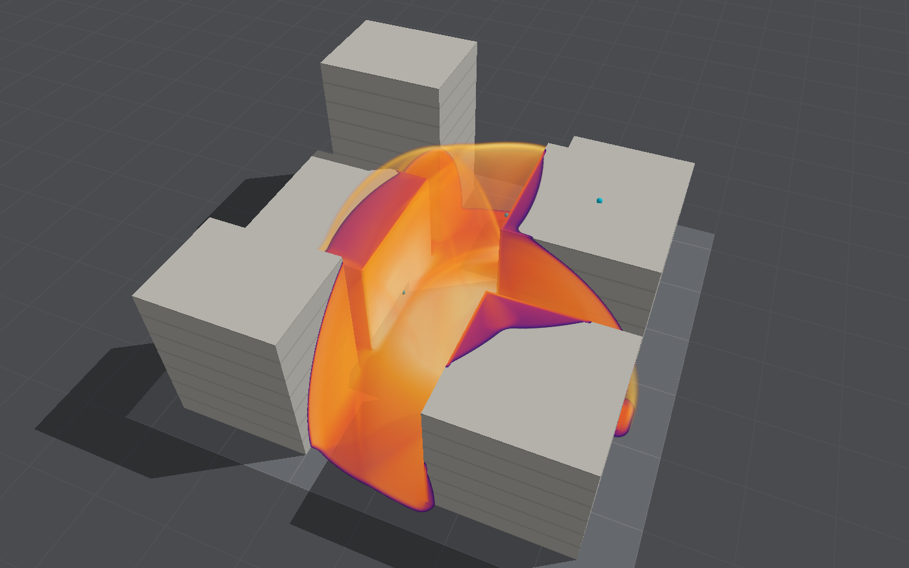
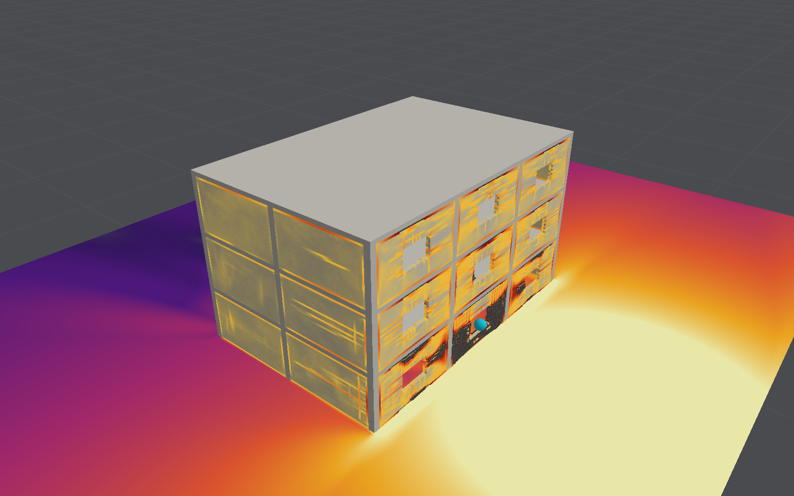
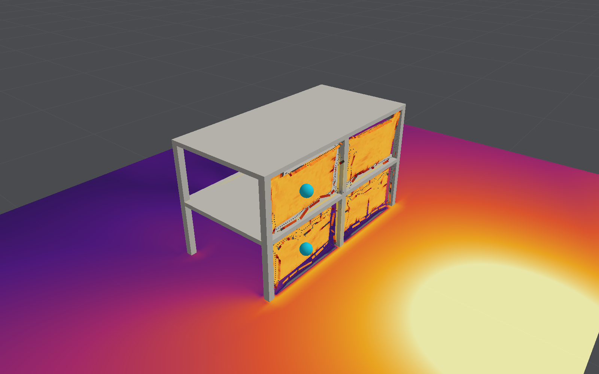
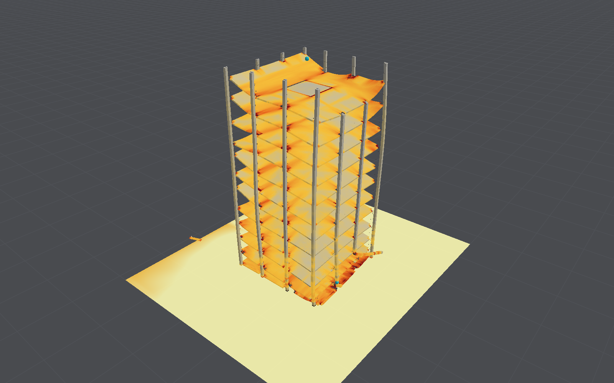

# BombCAD

An interactive blast simulator for Macs, written to answer one question: how close to real
time can a physically based simulation of blast on structures run on a current Mac? It has
since grown towards the [long-term vision](docs/long-term-vision.md) of exploring "all
explosions great and small", from a charge in a room to large surface bursts across terrain.

At its core are two solvers, both on the GPU:

- an **air-blast solver** that carries the blast wave round obstacles and records peak
  overpressure and impulse on every surface;
- a **structural solver** for reinforced concrete, masonry, concrete block, steel and glass that
  cracks, crushes, yields its reinforcement and breaks under those pressures, meshed with solid
  elements, faster shells and beams, or both in one body. Broken pieces collide, fall and come
  to rest, and the air flows through the gaps they leave.

Around them sit freestanding objects, terrain, effects beside the blast (fragments, the
fireball's heat, its cloud, ground shock) and a second kind of source, a gas deflagration. Every
result carries its [evidential standing](docs/standing.md): compared with measurement, verified against
theory, an approximation, or illustrative.

It is a study of the numerics, the physics and the performance, not a design tool. Nothing in
it should be used to judge the safety of a real structure.









## Download

A signed, notarized build for Apple silicon Macs running macOS 15 or later is on the
[Releases](https://github.com/emmettl/bombcad/releases) page. Expand the ZIP and move
`BombCAD.app` to Applications; the `.sha256` file beside it checks the download.

## Building and running

From source: macOS 15 or later, Swift 6.4 and a Metal GPU.

```bash
swift run -c release BombCAD
```

```bash
make app
```

The second builds `dist/BombCAD.app`. In the view, drag to orbit, shift-drag to pan and pinch to
zoom; space runs and pauses, ⌘R resets. The sidebar's **Run** tab picks a layout, the grid, the
charge or gas cloud and the display; **Edit layout** builds and imports scenes (OBJ, STL, IFC).
Runs can be saved, compared, swept across parameters on several Macs, and exported for
rendering. Everything the app does is described in [Using the app](docs/using-the-app.md),
including `BombCAD run` and the `blastbench` command-line tool.

## What it models

| Area | What is there | Document |
|------|---------------|----------|
| Air | Blast waves round obstacles; refinement near the shock in one or two levels; afterburning, hot and dissociating air; gravity and sub-grid mixing as options | [Air-blast model](docs/air-blast-model.md) |
| Terrain | A heightfield ground the blast, receivers, objects and footings see, imported from a DEM | [Terrain](docs/terrain.md) |
| Structures | Solid, shell and beam elements; concrete cracking, crushing, bond and dowel action; masonry as units and joints; steel; glass | [Structural model](docs/structural-model.md), [concrete](docs/concrete-model.md), [shells](docs/shell-model.md) |
| Supports | Fixed bases, breakable connections at any angle, footings on layered soil with embedment | [Structural model](docs/structural-model.md#footings) |
| Freestanding objects | Boxes and cars that slide, lift, tip and collide, each in the air; car parks and furnished rooms | [Freestanding objects](docs/freestanding-objects.md) |
| Fragments | A cased charge's fragments flown through the blast | [Fragments](docs/fragments.md) |
| Thermal | The fireball's radiation on surfaces, ray-marched on the GPU, and the surfaces' heating; paused as illustrative | [Thermal radiation](docs/thermal-radiation.md), [surface heating](docs/surface-heating.md) |
| Cloud | The fireball's rise, condensation, rain and spread in a measured or standard atmosphere | [Fireball rise](docs/fireball-rise.md) |
| Ground shock | The design manuals' estimate, or a layered soil column under each point | [Ground shock](docs/ground-shock.md) |
| Gas deflagrations | A methane or propane cloud lit in a room, with vent panels | [Gas deflagrations](docs/deflagration.md) |
| Scale | Exposure-only building envelopes and neighbourhoods of them | [Building envelopes](docs/building-envelopes.md), [street interactions](docs/street-interaction.md) |
| Other Macs | Sweeps and the effects beside the blast placed on other Macs by cost | [Distributed computing](docs/distributed-computing.md) |

## Headline results

Measured on an Apple M4 Max (32-core GPU, 36 GB).

| Case                                                        | Speed                        |
|-------------------------------------------------------------|------------------------------|
| Air blast, street scene, 8.4 million cells of 0.25 m        | 17× slower than real time    |
| Concrete building, 225,000 elements, coupled to the air     | 70× slower                   |
| The same building as 3,700 shell elements                   | 7× slower (2× on 0.5 m air)  |
| Three-storey building as shells and beams                   | 31× slower (17× on 0.5 m air) |
| The building with its front wall solid, the rest shells     | 24× slower                   |
| Three-storey frame with masonry cladding, 160,000 elements  | 60× slower                   |
| Two-storey frame collapsing over 3 s                        | 11× slower                   |
| Eight-storey frame collapsing over 4 s, 31,000 shells and beams, 0.5 m air | 21× slower    |
| Twelve-storey tower collapsing over 4 s, 95,000 shells and beams, 0.5 m air | 56× slower   |

Against the outside world, in brief; the [validation summary](docs/validation.md#summary) gives
the numbers, and each section the test and the model. The defaults were chosen with these tests
in view (two have since been run blind), most tests are single specimens, and where the model errs it mostly predicts too little
damage; an [independent review](docs/validation-review.md) weighs the claims:

| Area | Standing |
|------|----------|
| Air solver and structural numerics | Verified against exact solutions and theory |
| Blast loads on walls | Either way: on today's defaults (afterburning and hot air) the impulse on walls 6–13% high against Kingery–Bulmash (a fit, its scatter not given) on 0.25 m cells beyond 1.5 m/kg^(1/3), the incident impulse within 6% (fitted); without them within 6% and 13–22% low. Peaks read low, the unsafe side, refinement helping. Good |
| Gas in a closed room | Either way within 8% of UFC 3-340-02's design curve on today's defaults, afterburning and hot air; without them half for light charges, the unsafe side. Good |
| Bending of slabs and beams | Either way by load, on the meshes that agreed: a slab test at 104–115% on solid elements (its repeat scattered ±2%), rising towards 119% as the mesh is refined, but 79–88% (too stiff, the unsafe side) under its lower shot, and as sensitive to the strain-rate law chosen; a beam bent to failure at 100–101% on 12 and 24 elements, but 17% strong on 6 and breaking early on 36 and 48. Moderate, on those meshes |
| Shear | Unsafe side: one beam failing in shear 4–11% too strong on 24 to 48 elements, 32% on 12, not converged; beams struck to shear failure fail by the wrong mechanism, those with stirrups holding where the tests crushed their strut. Low |
| Impact | Either way on one mesh: drop-weight beams 12–23% high under light drops, −5% to −1% under heavy ones on 16 elements; finer meshes settle 16–75% and 12–20% high; struck about twice as hard; the strain-rate laws that decide it were chosen on these tests. Moderate on 16 elements only |
| Held out (blind) | Hrynyk's slabs struck repeatedly by a weight, predicted before the measurements were unsealed: first impacts 15–29% too flexible, as calibrated; once damaged, too stiff, and none of the three punching failures predicted (the unsafe side). Mendonça's slabs under an open-air charge: the two nearest collapsed where the model left them standing, and the blast bent the rest four to ten times as far as the model's (worse than calibrated, the unsafe side). [Blind tests](docs/blind-tests.md) |
| Close-in and contact charges | Unsafe side for damage: a third to a half as far down, too little spall, holes only as an option. The load within 8% from 0.3 m/kg^(1/3) on fine air, on the ideal gas and on today's (peaks within 7%, impulses 3–5% high); in contact about twice the products' impulse. Good for the load, low for damage |
| Steel in both faces | Unsafe side under small charges: 40–70% as far, too stiff; −20% to +7% under larger ones (two shots); one layer and two barely told apart. Moderate for larger charges, low for small |
| Internal explosion | Unsafe side: the chamber's roof left a quarter as far up as measured, too stiff, and not converged. Low |
| Foundations | Either way for a footing's rocking moment; settlement 1.7–2.3 times too much; energy a sixth to a half. Moderate, low for energy |
| Debris | Unsafe side: held back rather than thrown, slabs never holed. Low: one comparison; collapse has none |
| Fireball radiation and gas deflagrations | Radiation too bright, vented peaks too low (the unsafe side). Illustrative |

The [roadmap](docs/roadmap.md) lists the limitations in order of importance and the work on them;
[data wanted](docs/data-wanted.md) lists the measurements that would test them.

## Documentation

| Document                                    | Contents                                                        |
|---------------------------------------------|-----------------------------------------------------------------|
| [Using the app](docs/using-the-app.md)      | Building, the app's tabs and editors, saved runs, sweeps, exports and the command line |
| [Air-blast model](docs/air-blast-model.md)  | Equations, numerical scheme, charge model, refinement, gravity, mixing, boundaries |
| [Structural model](docs/structural-model.md) | Elements, time stepping, contact, connections, footings, coupling to the air |
| [Concrete model](docs/concrete-model.md)    | Cracking, crushing, shear, reinforcement, bond, strain-rate effects, removal |
| [Shell model](docs/shell-model.md)          | Shells for walls and slabs, beams for columns                   |
| [Structural editing](docs/structural-editing.md) | Building structures, materials, openings and restraints in the app |
| [IFC import over a corpus](docs/ifc-import-corpus.md) | What 385 open IFC files did on import, what was fixed and what is left |
| [Freestanding objects](docs/freestanding-objects.md) | Rigid boxes and cars coupled to the air, contact and populated scenes |
| [Terrain](docs/terrain.md)                  | A heightfield ground the blast sees, DEM import, and slopes checked against shock reflection theory |
| [Large scenes](docs/large-scenes.md) | Bursts of hundreds of tonnes to kilotonnes over kilometres: accuracy, cost and grids against Kingery–Bulmash, terrain at scale |
| [Validation](docs/validation.md)            | Every comparison with measurements and theory, with a summary   |
| [Validation review](docs/validation-review.md) | An independent review of the record's claims, ranked by severity |
| [Blind tests](docs/blind-tests.md) | The protocol and register of tests predicted on frozen defaults before their measurements are unsealed |
| [Standing of results](docs/standing.md)     | Each result's evidential standing, derived from the scene and carried with runs and exports |
| [Performance](docs/performance.md)          | Benchmarks and where the time goes                              |
| [Street interactions](docs/street-interaction.md) | Matched neighbourhood comparisons, spatial exposure maps and resolution sensitivity |
| [Building envelopes](docs/building-envelopes.md) | Stationary exposure-only buildings, surface loading, matched detailed references and scaling through 64 buildings |
| [Multiple-object scenes](docs/multiple-object-scene.md) | Scene requirements and the boundary with ContinuumKit; [scaling](docs/multi-object-scaling.md) |
| [Fragments](docs/fragments.md) | A cased charge's fragments flown one way through the blast and drawn over it, here or on another Mac |
| [Thermal radiation](docs/thermal-radiation.md) | The fireball's radiant heat on the ground and the scene's faces, from the air model's hot gas, here or on another Mac |
| [Surfaces heated by the fireball](docs/surface-heating.md) | Each receiver's absorbed radiation conducted into its material for its peak surface temperature, with illustrative ignition thresholds |
| [The fireball's rise and cloud](docs/fireball-rise.md) | The hot gas left after the blast, followed as a rising, entraining cloud that spreads once it stops, carried by the wind |
| [Gas deflagrations](docs/deflagration.md) | An illustrative second source: a methane or propane cloud lit in a room, and vent panels that release at a pressure |
| [Ground shock](docs/ground-shock.md) | An illustrative estimate of the ground's shaking away from the charge, or a layered soil column, fed the overpressure on the ground |
| [Distributed computing](docs/distributed-computing.md) | Sweeps on several Macs, and the effects beside the blast placed on other Macs by cost |
| [Run comparison](docs/run-comparison.md)    | Saved runs, comparing them, and headless runs                   |
| [USD export](docs/usd-export.md) | Writing a run over time as USD and OpenVDB volumes, for rendering in Blender and elsewhere |
| [Ray tracing](docs/ray-tracing.md) | Notes for other projects: adopting Metal ray tracing for precomputed simulations |
| [Save files](docs/save-files.md)            | Versioned project packages, assets and persisted settings       |
| [Long-term vision](docs/long-term-vision.md) | All explosions great and small: the product direction           |
| [Roadmap](docs/roadmap.md)                  | Known limitations in order of importance, and planned work      |
| [Data wanted](docs/data-wanted.md)          | Measurements that would test the model, ranked, and what has been fetched |
| [ContinuumKit adoption](docs/continuumkit-adoption.md) | Shared numerical components adopted from ContinuumKit       |
| [Native interface review](docs/native-interface-review.md) | Checks of the app's panels in native windows          |
| [Releasing](docs/releasing.md)              | Signed, notarized builds                                        |
| [Continuous integration](docs/continuous-integration.md) | The Mac mini runner, nightly validation and benchmarks |
| [RoomCAD](https://github.com/emmettl/RoomCAD) | Independent room acoustics app, now in its own repository     |

Each model document lists its sources, its limitations and the work that would address them.

## Code layout

| Target        | Contents                                                             |
|---------------|----------------------------------------------------------------------|
| `SceneModel` / `SceneView` | Shared geometry and camera in [SimulationKit](Packages/SimulationKit/README.md) |
| `BlastCore`   | Air and structural solvers, materials, scenarios, effects, benchmark data |
| `BlastRender` | Scene renderer, orbit camera, offscreen snapshots                    |
| `BombCAD`     | SwiftUI app with the layout editor                                   |
| `blastbench`  | Command-line throughput, validation and snapshot tool                |

## Licence

MIT; see [LICENSE](LICENSE).
