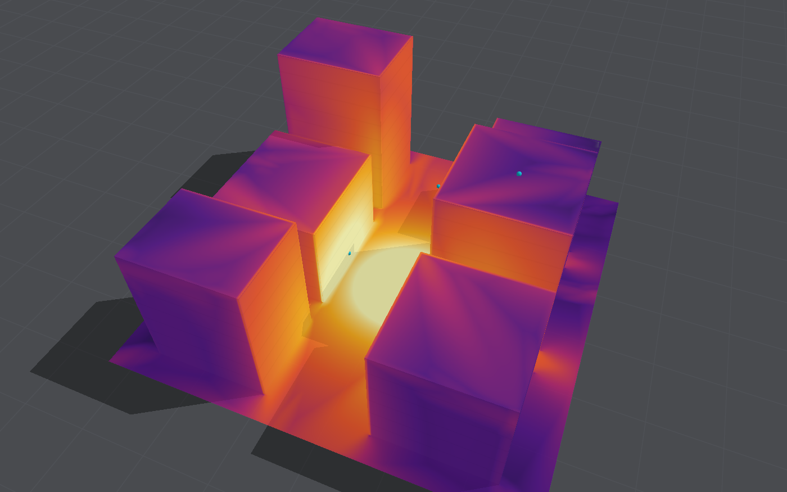

# Air-blast model

The air solver propagates the blast wave through the air around rigid obstacles and the
deformable structure. It lives in `Sources/BlastCore/BlastSolver.swift` and
`Sources/BlastCore/Shaders/Solver.metal`.

## What it solves

The three-dimensional compressible Euler equations for an ideal gas with a constant ratio of
specific heats γ = 1.4, on a uniform Cartesian grid of cubic cells. There is no viscosity, heat
conduction or chemistry, no gravity unless [gravity](#gravity) is on, and no radiation unless
[radiative cooling](#radiative-cooling) is. The conserved variables per cell are density, three momentum
components and total energy, stored as five single-precision numbers.

## Numerical scheme

| Aspect             | Choice                                                                         |
|--------------------|--------------------------------------------------------------------------------|
| Discretisation     | Finite volume, cell-centred                                                    |
| Order              | Second order in smooth flow, first order at shocks                             |
| Reconstruction     | MUSCL–Hancock: limited slopes of the primitive variables, half-step predictor  |
| Limiter            | Generalised minmod with θ = 1.5 (θ = 1 is minmod, θ = 2 is monotonised central) |
| Riemann solver     | HLLC, with Einfeldt's wave-speed estimates from Roe averages; HLL is selectable |
| Multi-dimensions   | Dimensional splitting; the sweep order alternates x-y-z and z-y-x each step    |
| Time step          | Courant number 0.45 per sweep, ramped up over the first six steps              |
| Positivity         | Reconstruction falls back to first order where it would give negative density or pressure; density and pressure floors |

Each directional sweep is one Metal compute kernel that reads a five-cell stencil and writes
the cell's new state, so a time step is three kernel dispatches. Neighbouring cells compute the
flux through their shared face from identical inputs, which makes the scheme conservative
without storing fluxes.

**Time-step control on the GPU.** The final sweep of each step records the fastest wave speed
with an atomic maximum. A one-thread kernel at the start of the next step turns that into the
time step, advances the clock and samples the gauges. Because nothing is read back to the CPU
between steps, a batch of up to 256 steps runs without the CPU. `advance` hands a batch to the GPU
in command buffers of about 75 ms of its time each, sized from the rate it has measured, as the
app sizes its batches: one buffer holding the GPU for seconds starved the window server, which
the system then killed with every app. The batch's clock, time limit and sampling stay on the
GPU from one buffer to the next, so its steps are the same to the bit however it is cut
(`blastbench digest`, and one-step buffers in the tests); the structure and shell solvers cut
their runs of 2,000 substeps the same way.

**Recorded fields.** The final sweep also accumulates, per cell, the peak overpressure and the
positive-phase impulse (the time integral of overpressure while it is positive). These are what
the app paints on the ground and on rigid blocks.

## Obstacles and boundaries

- Rigid blocks and the structure are voxelised into a solid mask. A block cell is solid when
  its centre is inside the block; a plate too thin to hold a cell's centre across it (a 0.2 m wall
  on 0.5 m cells) but a cell or more in its other directions takes across it the one layer of
  cells its middle lies in, on the coarse grid and each refined level, rather than vanishing as it
  did before 17 October 2026 (a rod thinner than a cell still can); a structure cell is solid when at least a third of it is
  filled by intact elements (see [Structural model](structural-model.md#coupling-to-the-air)). Counted
  at the elements' centres, a structure's outline can flicker where those centres lie on cell
  faces; counted by their overlap with the cells, the default since 16 October 2026, it does not
  (the same section).
- At a solid cell or a reflecting domain face, the stencil is filled with mirrored ghost states
  (normal velocity reversed). The Riemann problem at the wall then has zero mass flux, so walls
  are exactly conservative and can be one cell thick.
- The ground can have a shape, a heightfield [terrain](terrain.md): a cell below its surface is
  solid, on the coarse grid and every refinement level, as for a block. The floor beneath it stays
  a reflecting face.
- The ground (z = 0) is a reflecting face. The other five faces of the domain are open; see
  [Open faces](#open-faces).

### Open faces

Since 15 October 2026 the open faces stand still air beyond them (`OpenFaces.farField`, in
`SolverConfiguration.recommended`, which the app, `BombCAD run`, the benches and the validation's
harnesses start from). Across a face the waves are taken as acoustic: the one leaving, p + ρc u,
comes from the cell inside, the one entering from still air, and the ghost's density follows the
isentrope of the side the flow comes from. A wave passing out is let through, and gas at ambient
pressure, however hot, stays at rest; air drawn in supersonically is still air itself, and the
ghost's pressure is held within a factor of two of the two sides', where the linearisation would
otherwise give a negative pressure (as it did beside contact charges, air rushing back into their
rarefaction, which hot air turned into NaNs). Under gravity, whose ambient changes with height,
the faces copy.

The earlier faces copied the last interior cell outward (zero-gradient, `OpenFaces.copy`, still
the bare `SolverConfiguration()`). That lets a shock out but holds whatever pressure the air near
the face settles to: a domain hardly bigger than a fireball trapped its burning products (Wang's
slab, its 10 kg charge 0.4 m from a face, read 3.8 times the impulse of a domain four times as
wide; far-field faces read within 4% of it, and doubling and quadrupling the box moved them under
3%), and a domain losing air through them drained below ambient (about 1 kPa below in an 8 m box
after a 1 kg burst; far-field faces leave it within tens of pascals). On the validation's
Kingery–Bulmash gauges the two agree to the per cent in every peak, impulse and arrival; on the
street they give the same peaks and impulses within 4%.

### Open faces near a structure

A far-field face takes each wave as meeting it head on. A blast running along a side or the top
meets still air beyond the face. Its reflection coefficient there is (cos θ − 1)/(cos θ + 1), so
a grazing wave (θ near 90°) loses about half its pressure at the face and sends a rarefaction
back in. Peaks and positive impulses barely notice. A structure's late response does.

On Tyndall's CLT building, test 1 (14.5 kg at 22.9 m, `blastbench tyndall --tests 1 --pad
back,side,top --history`; 17 October 2026), with 0.25 m cells refined by 2:

- The front wall's first inbound peak was 16 mm in every domain, and its positive-phase load
  the same.
- In the harness's domain (the charge 1.1 m from the face behind it, the building 5.7 m from the
  sides), the rarefaction from the side faces deepened the front's negative phase to −11.8 kPa at
  66 ms (−4 kPa in a large domain). That drove the wall's second swing to 29 mm.

| Faces moved out (behind the charge, sides, top) | Nearest face, m/kg^(1/3) | First storey, inbound / rebound | Front pressure, RMS from the largest |
|---|---|---|---|
| none (the harness) | 0.46 (behind the charge) | 29 / −30 mm | 3.2 kPa |
| behind the charge, 5.9 m | 1.7 (top) | 25 / −29 mm | |
| sides, 2 m | 0.46 | 21 / −25 mm | |
| 5.9, 2, 0 m | 1.7 (top) | 18 / −24 mm | 2.5 kPa |
| 12, 8, 6 m | 4.1 (top) | 18 / −24 mm | 0.9 kPa |
| 24, 16, 12 m | 6.6 (top) | 18 / −24 mm | (reference) |
| none, copying faces | 0.46 | 18 / −17 mm | 3.4 kPa |
| 12, 8, 6 m, copying faces | 4.1 | 18 / −24 mm | 0.8 kPa |

The pressure history converges once every face is about 4 m/kg^(1/3) from both the charge and the
building (the building is 7.9 m high to its parapet). The face behind the building was 3.4 m
(1.4 m/kg^(1/3)) from it in every run and did not move the front's response, so a face beyond a
structure as seen from the charge counts from the charge alone. The app's Domain section and the advisor say when a scene with a structure has an open
face nearer than that (`Scenario.tightOpenFaces`, `Scenario.structureFaceClearance`). The domain
can be grown only from its origin, so faces below the origin are moved by moving the scene.

The record's comparisons built in tighter boxes were each checked with one case at the rule
(18 October 2026; [validation](validation.md#open-faces-at-the-clearance-rule)). Peaks and
close-in slabs did not move. A 4 × 5 m slab in a box barely wider than itself lost a quarter of
its swing, its underside's push draining out through the sides, and a chamber's roof was left
11% lower.

A better boundary was tried in place of the clearance. The faces took each wave as a plane one
from the largest charge, at its angle, letting a grazing wave carry on past the face. It is not
used:

- On Tyndall it gave 20 mm in the harness's domain and 22 mm with the faces 2.9 m/kg^(1/3) out.
- Under a 167 m top over the 500 t burst, it overshot as copying faces do: peaks 63–74% and
  impulses 150–180% of Kingery–Bulmash's out to 40 m/kg^(1/3). Head-on far-field faces drained
  the wave to 2% there.

A plane wave at its angle cannot carry the spherical spreading beyond a face, so no local face
condition stands in for the room. It is kept on the branch `claude/oblique-far-field`.

**The samples.** Most were sized for the positive phase and a run of minutes, and open with the
warning. The warehouse, the transport hub and the deformable wall were widened to meet the
clearance (18 October 2026), at about 1.4–1.6 times the air, and the terraced row was laid out to
meet it. For the rest, meeting it would take far more air (the cost of a run goes with it at a
given cell). So they keep their domains, and their late response, after the positive phase, carries
the warning:

| Sample | Nearest open face, m/kg^(1/3) | Air to meet 4 m/kg^(1/3) |
|---|---|---|
| Deformable building | 1.7 (behind the charge) | 2.7× |
| Two-storey frame (2 t) | 0.7 (top) | 32× |
| Frame with masonry infill | 2.4 (top) | 1.6× |
| Three-storey building | 1.3 (behind the charge) | 2.0× |
| Eight-storey frame (4 t) | 0.5 (top) | 19× |
| Twelve-storey tower (4 t) | 0.6 (top) | 14× |
| Steel and glass office (1 t) | 0.6 (top) | 3.8× |
| Column, close-in | 0.5 (top) | 32× |
| Wall in front of a building | 1.7 (sides, behind) | 3.1× |
| Glass façade | 1.1 (behind the charge) | 1.4×, but its frame would have to move |
| Car park | 0.7 (top) | 4.8× |
| Three buildings across a street | 2.2 (top) | 1.8× |
| Underpass | 0.9 (ends) | 5.0× |
| Block-built house | 2.1 (behind the charge) | 1.7× |
| Internal explosion (the test's chamber) | 0.3 | 6.5× |
| Large-panel flats, street charge (500 kg) | 0.5 | 16× |

The glass façade's panes break in the positive phase, which the faces do not move. The
chamber's charge is inside its walls, so the faces see only what leaks out. In the frames and
towers it is their collapse, long after the positive phase, that the faces may move.

The warning leaves the choice to the user. Beneath it, **Widen to the rule** grows the domain from
its origin until its far faces (east, north and the top) are 4 m/kg^(1/3) from the charge and the
structures (`Scenario.grownToTheRule`, the `high` half of `Scenario.openFaceRoom`). Nothing in the
scene moves. The advisor's estimate of a run on the grown domain is shown beside it, as times the
air and the run's time before and after. Faces at the origin (west and south) can be cleared only
by moving the scene's contents away from it, which the action does not do: it names those still
near. The warning also says when the faces matter least: what the positive phase decides, such as
glass breaking, and a charge inside its walls.

## The charge

The charge is a "bursting balloon": a sphere of hot, dense gas at rest.

- Its energy is the TNT-equivalent mass times 4.184 MJ/kg (the conventional energy of TNT;
  Cooper gives TNT's heat of detonation as 4.56 MJ/kg with the water liquid, about 4.07 with it
  as vapour, and 4.69 MJ/kg as the energy that fits a large set of air-blast tests), and
  its mass is added to the air's density in the sphere.
- The sphere's radius is the physical charge radius (for a density of 1600 kg/m³) or two cells
  (two fine cells where the air is [refined](#refining-near-the-shock)), whichever is larger.
- Cells are weighted by the fraction of their volume inside the sphere, and the totals are
  normalised over fluid cells only. A charge on the ground or against a wall therefore releases
  all of its energy into the air; a charge on rigid ground behaves like a free-air charge of
  twice the mass.
- A scenario can fire several charges at once (`additionalCharges`); each is laid down the
  same way.

### Afterburning

TNT is short of oxygen: its detonation products are mostly carbon monoxide, hydrogen and
carbon, which burn when they mix with air, releasing about twice the energy of the detonation
again. With `SolverConfiguration.afterburning` on (as it is, with hot air, for every run since
15 October 2026: `SolverConfiguration.recommended`; the app's "Afterburning and hot air" and
`blastbench --no-afterburn` turn both off):

- The air carries two more densities, of unburnt products ("fuel") and of oxygen (23.2% of
  air by mass). They move with the gas, each leaving a cell at that cell's mass fraction
  (first-order upwind), so they stay positive and are conserved.
- Where fuel and oxygen share a cell, the fuel burns, at TNT's ratio of 0.74 kg of oxygen per
  kg (C7H5N3O6 + 5.25 O2 → 7 CO2 + 2.5 H2O + 1.5 N2), releasing 10 MJ/kg (TNT's heat of
  combustion, about 15 MJ/kg, less its heat of detonation; Cooper's afterburn heat, the same
  difference, is 566 kcal/mol, 10.4 MJ/kg, and his oxygen demand the same 5.25 mol), over a time
  τ = 10 ms × W^(1/3) (W in kg). Mixing is the grid's own: products meet air as numerical
  diffusion spreads them.
- With τ = 0 everything at the charge's edge burns in the first steps and joins the leading
  shock, as if the charge were three times heavier: arrival times come 10–25% early and the
  incident impulse 8–22% high. τ was chosen to match the incident impulse of Kingery–Bulmash
  (see [Validation](validation.md#afterburning)); 46 ms for 100 kg is of the order of the
  fireball's life.

It is off by default: it costs about 1.8 times as much (more work per step, and a shorter step
in the hotter gas). With the ideal gas it overstates pressures in rooms by about 30%; with hot
air (next) it does not.

### A finely resolved start

Since 18 October 2026 each charge starts from a one-dimensional solution instead of the
balloon (`SolverConfiguration.mappedCharge`, on in `recommended` and, with afterburning and hot
air, in the app's runs; a project saved before then keeps the balloon). The blast is solved with
spherical symmetry (the same MUSCL–Hancock and HLLC scheme, with the face areas 4πr² and the
pressure's geometric source), on a radial grid of a twentieth of the charge's radius, from a
sphere of the charge's own size (TNT's density). It reaches as far as it can before meeting
anything: 0.8 of the distance to the nearest block, structure, pane, ground that is not flat or
open face, half the way to the nearest other charge, at most 64 cells and 6 m/kg^(1/3). A charge
on the ground spreads as one of twice the mass, mirrored; on more reflecting faces (a model's
mirror planes, a corner of them), as one of 2, 4 or 8 times the mass. The state is then laid onto the grid (each cell averaged over 64 samples, the
radial momentum turned into vectors) and the clock set to the time that took. With several
charges, all are solved to one time, the earliest at which any shock reaches its radius (the
others then still within theirs), and each is laid in the cells nearer it than any other charge,
which its radius keeps it to; alike charges share one solution. Gauges, cells and
the injury plane (`configureExposurePlane`) the shock has already passed take their histories,
peaks, impulses and arrivals from the one-dimensional solution. Where it cannot reach three
cells the balloon starts that charge instead, laid as the others are mapped, at their clock
(the balloon stands for its charge some time after it fired anyway); with dissociating air,
gravity, sub-grid mixing, radiative cooling or the afterburning limit, every charge. The model
has no delays between charges: all fire together.

**Its gas.** The one-dimensional solution has the air's own gas, the ideal gas or hot air (the
same vibrational energy, in double precision), and with afterburning carries the products and the
air's oxygen and burns them at the grid's rate. A fine grid mixes the fireball far less than the
coarse cells mix the balloon's, so it diffuses the products and oxygen with an eddy diffusivity
κ W^(1/3), κ = 16 m²/s/kg^(1/3): fitted once, on 10 kg on 0.5 m cells, and checked on 1 and 100
kg and 0.25 m cells. With it, hot air and afterburning the one-dimensional burst gains just what
its products burn (to 1%; `MappedChargeTests`).

**Against Kingery–Bulmash** (`blastbench validate --mass`, incident; see
[Validation](validation.md#the-mapped-start-18-october)), from 1 m/kg^(1/3):

| | Balloon | Mapped |
|---|---|---|
| 10 and 100 kg, 0.25–0.5 m cells | 32–84% | 83–117% |
| 1 kg, 0.25 and 0.5 m cells | 11–47% | 63–99% |
| 10 kg, 0.5 m refined once / twice | 29–69% / 48–83% | 72–109% at both |

- **Impulse:** within 5–15% at every grid beyond 1 m/kg^(1/3). It holds beyond the mapped radius,
  so nothing is counted twice. Refined, the patches placed at the restart take their coarse
  cells' impulse again once the passage is laid down (`AirRefinement.reseedImpulseBase`); without
  that the impulse beyond 6 m was lost (5–38%).
- **Close in:** at 0.5–0.75 m/kg^(1/3) the incident impulse reads 125–175%, where
  Kingery–Bulmash rests on few tests.
- **Reflected peaks:** on a wall, with the start held back by it, within a few points of the
  balloon's, and as low: the grid still smears the reflection.
- **Past the mapped radius:** the grid smears the shock again over a few metres: 100 kg on
  0.25 m cells, mapped 12.8 m out (0.8 of the way to the domain's top), reads 83–86% at 18–23 m.

**The injury reach** at standing height (10 kg on 0.25 m cells, `InjuryFieldTests`) comes to
0.80 and 0.65 of the free field's for the lungs' threshold and 50% lethality, against the
balloon's 0.69 and 0.50; the eardrums' are unchanged at 0.84–0.86. Standing height is still short
of a surface burst's ground-level curves close in, where the wave off the ground arrives apart.

**Its cost** is the one-dimensional solution's own, on the CPU before the run: about 4 s out to 4
m/kg^(1/3) and 8 s to 6 on an M4 Max, whatever the charge (`blastbench mapped-cost`), which the
run advisor adds (`RunCost.mappedStartSeconds`). It is solved once for each charge, gas and
reach and kept (the last four), so a scene run again starts at once. The fireball before the grid's clock, for the thermal
radiation, comes from the same solution kept at the frames' times ([before the grid's
clock](thermal-radiation.md#before-the-grids-clock)). The solver is its own
module (`RadialBlast`), built optimised even for tests, which would otherwise take many minutes
over it. In the app the solution stops at half the run's duration if its shock has not reached
the radius by then, so that a short run still steps the grid (`BlastSolver.mappedStartLatest`).
Without the cap in scaled distance, a small charge on coarse cells would be solved hundreds of
charge radii out, for many minutes.

**The products' own equation of state** (tried 18 October 2026, kept as an option, off). With
`mappedChargeProducts` the one-dimensional solution carries the detonation products as a tracer
with TNT's Jones–Wilkins–Lee law (A 371.2 GPa, B 3.231 GPa, R1 4.15, R2 0.95, ω 0.30 at 1.63
g/cm³, from the LLNL Explosives Handbook; the handbook's other TNT set, as ANSYS Autodyn carries
it, as a check). Where products and air mix each presses as it would alone at its partial
density, both at the mixture's energy per kilogram; the scheme bounds the waves as Davis does.
It raises the incident peak close in (52 to 67% of Kingery–Bulmash at 0.2 m/kg^(1/3), 64 to 81%
at 0.3, 88 to 100% at 0.5) and changes nothing past 0.75 (within 4%), nor the impulse; the
products have spread to some 10 kg/m³ by the time they are mapped, where JWL's terms for dense
products are gone, but there the air's gas reads their pressure 13–25% higher (ω 0.30 against
the hot air's 0.33–0.40). On the grid it moves the reflected loads too little to adopt: the
impulse within 2% from 0.3 m/kg^(1/3), the peak within 2 points from 0.5, and at 0.3 from 105%
to 131% of the curves on 5 mm cells, away from them and within close in's scatter
([validation](validation.md#the-products-own-equation-of-state-18-october)). It makes the
one-dimensional solution 2.3 to 2.8 times as long. Where it would matter is in contact, where the
charge is never mapped (see future work).

**The comparisons of structures** (slabs, walls, rooms, envelopes and the rest) were run on the
balloon start. Their harnesses are pinned to it (`SolverConfiguration.balloonStart`) until each
is run again ([the list](validation.md#still-on-the-balloon-start)).

**Sharing.** Neither ContinuumKit nor Edgerton has a one-dimensional solver. `SphericalBlast`
can be extracted into ContinuumKit, by its process, if another project needs a resolved start.

### Hot air

The gas left by a charge, and burnt products all the more, is at 2000 to 3000 K, where the
molecules of air store energy in vibration as well as in motion and rotation, so a joule of
heat raises the pressure less than in cold air. `SolverConfiguration.airModel =
.thermallyPerfect` includes this:

- Internal energy per kilogram is e(T) = 5/2 R T + e_vib(T), with N2 and O2 (0.79 and 0.21 by
  moles) as harmonic oscillators of characteristic temperatures 3390 K and 2270 K:
  e_vib = R Σ x θ / (exp(θ/T) − 1). Pressure is ρ R T, R = 287.05 J/(kg K).
- The temperature is found from e by one Newton step from a rational function of the
  temperature without vibration, which lies within 10⁻⁴ of it from 1 K to 60,000 K; the step
  brings it within 2 × 10⁻¹⁰. The speed of sound uses the ratio of specific heats, which falls
  from 1.4 to about 1.29 near 3000 K, from the heat capacity at the first guess (within
  2 × 10⁻⁶). Until October 2026 it took two steps from the temperature without vibration and
  evaluated the heat capacity again at the root: three evaluations of the exponentials where
  one does (docs/performance.md, "What the recommended air costs"). The Riemann solver's averaged sound speed is the Roe average of the two
  sides' speeds.
- Below about 500 K it is the ideal gas within 0.1%, so tests in units where the gas is cold
  (the shock tube, the point blast) are unchanged. Dissociation, above about 2500 K, is left
  out of it; `.dissociating` (below) adds it.

It costs about a quarter more. Together with afterburning (the app's "Afterburning and hot air"
switch) it brings the closed-room gas pressure within 8% of UFC 3-340-02's at every charge
density tested, with nothing fitted to it, and keeps the incident impulse in the open within
6% of Kingery–Bulmash (see [Validation](validation.md#afterburning)).

### An extinction limit for afterburning

`SolverConfiguration.afterburnLimit` (`--burn-limit [--ignition 800] [--limit-flame 1500]` in
`blastbench`; off by default) lets the products burn only where the mixture can keep a flame
going. The burning rate above the limit stays as it was: mixing-limited, as in Kuhl, Ferguson and
Oppenheim's account of TNT's afterburning. Two conditions:
- **ignition:** the cell must be at least 800 K, where Dryer and Glassman's global rate for the
  oxidation of carbon monoxide, the products' main fuel, becomes faster than the gas mixes;
- **flammability:** burning all the fuel its oxygen allows must take the cell to 1,500 K, about
  the flame temperature of mixtures at their flammability limits (Zabetakis). This is a lean
  limit and a rich one at once, and it widens as the mixture warms, as real limits do.

It is compiled in only when on, and changes nothing in a [deflagration](deflagration.md), which
never shares a run with afterburning. `AfterburnLimitTests` checks it:
- cold products in air do not burn, nor warm ones too dilute to reach the limit flame
  temperature;
- hot or rich ones do;
- what burns is what the gas gains.

**It moves the blast it was meant to leave alone, and does not cool the fireball.** With
afterburning and hot air, on 0.25 m cells:
- *Closed rooms* (UFC 3-340-02) are as before, 98–107% of the design curve: their gas is hot and
  dense enough to burn anyway.
- *In the open* the incident impulse beyond 1 m/kg^⅓ falls by 8–9%, from 94–100% of
  Kingery–Bulmash to 86–91%, the reflected impulse by up to 8.5% and the peaks by about 2%. Part
  of the burning that feeds the blast is in mixtures the limit calls too cool or too dilute.
- *A shorter burning time* restores the open impulse but not the rooms: 6 ms × W^⅓ gives 92–99%
  in the open and 104–114% in rooms, and 4 ms gives 98–109% and 107–117%.

So no refit holds both, and the fitted 10 ms stays. The fireball's luminous gas is no cooler
with it, because the fireball's hot core burns anyway (see
[Dial Pack](thermal-radiation.md#against-dial-pack)).

### Dissociating air

`SolverConfiguration.airModel = .dissociating` (`--air dissociating` in `blastbench`) is
thermally perfect air whose N2 and O2 also split into atoms once hot, in equilibrium, as
Lighthill's ideal dissociating gas:

- For each species, the fraction α of its molecules dissociated satisfies
  α² / (1 − α) = (ρd / ρs) exp(−θd / T), ρs being
  the species' own density: θd = 113,000 K and ρd = 130 g/cm³ for N2,
  59,500 K and 150 g/cm³ for O2 (Vincenti and Kruger, written from memory). At atmospheric
  pressure O2 is then 41% split at 3500 K and 79% at 4000 K, and N2 51% at 7000 K.
- Atoms carry 3/2 R T each, the molecules split take up the bond's energy, R θd per
  kilogram of molecules, and the pressure is ρ T Σ y R (1 + α) over the species' mass
  fractions y (0.767 and 0.233).
- The temperature is found from the energy, or from the pressure, by Newton's method from the
  temperature of air that does not dissociate, which lies above it. The speed of sound uses
  the frozen ratio of specific heats, at the composition as it stands.

It changes little that has been checked. Every incident and reflected peak, impulse and
arrival time of the Kingery–Bulmash comparison, from 0.75 m/kg^(1/3) out, with afterburning,
moves by under 1%; closed rooms' gas pressure, 98–108% of UFC 3-340-02 with thermally perfect
air, becomes 92–107%, the densest rooms coming down by about 6% (their gas is the hottest).
It costs 3.6 times as long as thermally perfect air. It is therefore an option, not part of
the app's "Afterburning and hot air" switch. Where it would matter, within a charge diameter
or two, the products, still treated as air, and the cells, which resolve no detail of the
fireball, matter more.

### Radiative cooling

`SolverConfiguration.radiativeCooling` (`--radiate` in `blastbench`; off by default) takes from
the luminous gas the heat it radiates. Every fourth step, each cell at least 1,500 K hot absorbs
and emits as the [thermal radiation's volume](thermal-radiation.md#the-gas-losing-what-it-radiates)
takes it to, grey gas and the unburnt products' soot; the radiance is carried through the box
round those cells along the lattice's 26 directions, and each cell loses what it emits less what
it absorbs, κ(4πB − G), exactly what the beams carry away (the discrete transfer method of
Lockwood and Shah). It is a source in the energy equation, taken after the step's sweeps, so it
touches no flux; refined cells lose what their coarse cell loses a volume, which keeps the levels
conservative across their edges. The energy radiated is kept as `BlastSolver.radiatedEnergy`.

With afterburning and hot air it moves every Kingery–Bulmash incident and reflected impulse by
0.2% or less and every peak by 0.4% or less, and lowers a closed room's gas pressure after 80 ms by
2% to 4%, the heat the walls take; the street's fireball then radiates 12.8% of the charge's
energy by 170 ms rather than 21%. It costs about 5% more a step, and saves about as much in
steps, the cooler gas allowing longer ones.

### Gravity

`SolverConfiguration.gravity` (`--gravity [--lapse 6.5]` in `blastbench`; off by default) pulls
the air down at 9.81 m/s². The air then starts at rest in a hydrostatic atmosphere, its pressure
and density falling with height as the temperature does, at the standard atmosphere's 6.5 K/km
(as the [cloud's rise](fireball-rise.md) assumes) or, with a lapse rate of 0, isothermally. For a
blast it changes nothing; it lets hot gas rise.

**Well balanced.** Gravity's pull on air at rest is balanced by a pressure gradient that a scheme
of this kind reproduces only to its truncation error, so a plain source term would set the
resting atmosphere moving at millimetres a second. As atmospheric codes do (Botta, Klein and
others; Käppeli and Mishra; and the perturbation form of Giraldo and Restelli), the vertical sweep
works on each cell's deviation from the background:
- the slopes and the Hancock predictor are the deviations', with the background's own gradient,
  and gravity's pull on the deviation, in the predictor;
- each face carries the background at the face plus the reconstructed deviation, and where
  that would leave no density or pressure, the first-order deviation, as without gravity. A cell
  at the pressure floor, as a cut cell beside the terrain can be left, holds less than the
  background falls across half of it (1.5 Pa for a 0.25 m cell), so it gives its faces its own
  state instead. Before, such a face had no pressure and its sound speed was a NaN: air over
  cut terrain with gravity broke, most often refined, and its digest changed from run to run;
- the background's pressure at the face is left out of the momentum flux, and gravity's pull on
  the background out of the source, which is −g(ρ − ρ_b);
- the energy gains −g times the mean of the cell's two faces' mass fluxes, so the gas's energy
  and its potential energy are conserved together, and refluxing corrects that term where the
  refined levels' fluxes replace the coarse one.

Air at rest in the background has no deviation, so its fluxes and its sources are zero exactly.
Getting that to the bit took three things:
- the background is worked out once for each level into a table, since the same expressions
  compiled into two kernels can differ in their last bit;
- a face whose two sides are identical takes the physical flux, which HLLC gives only to
  rounding;
- refined cells and their ghosts are filled with the coarse cells' deviations plus their own
  background.

Fine air under solid coarse cells, as over [terrain](terrain.md), takes the background at its
height. Gravity is compiled into the kernels only when on, so with it off they are unchanged:
`blastbench digest` gives the same hashes as before, with and without refinement.

**Checked** (`GravityTests`):
- Air at rest stays at rest to the bit for 200 steps: isothermal or cooling with height, ideal
  or thermally perfect, refined in two levels everywhere, and in a closed box over a hill.
- Its pressure 63.5 m up is the barometric formula's to 10⁻⁵.
- A layer of cells at the pressure floor, in thermally perfect air at rest, stays finite.
- In a closed box a hot bubble's rise conserves the gas's energy and potential energy together
  to 10⁻⁶.
- A sphere of air twice as hot as its surroundings first accelerates at 90% of potential flow's
  g Δρ / (ρ + ρₐ/2), a sphere 8 cells in radius.

Followed for 20 s (`blastbench bubble`, a 4 m bubble at 576 K on 0.5 m cells), the bubble rises
as the cloud's integral model of a turbulent thermal says: its warm gas's centre is 13.2 m up at
2 s against 13.0, and 54.5 m at 20 s against 49.7, rising at 1.55 m/s against 1.41. Against
Kingery–Bulmash (0.5 m cells refined) every incident and reflected peak and impulse moves by
0.1% or less: on a blast's time scale gravity is nothing.

**Around it:**
- *Still air is skipped* as without gravity: still air is air at rest in the background at its
  height, which a sweep leaves to the bit, so the answer is the same as sweeping everything
  (`GravityTests` checks the street with afterburning). Skipped air counts towards the time step
  at the ground's sound speed, the column's fastest, which sets the step only while nothing
  moves.
- *Overpressure* (peaks, impulses, gauges and the air's sleep test) is measured against the
  ambient pressure at its own height, so air at rest records none anywhere. Exposure planes and
  envelopes still take the ground's.
- *In the app*, **Gravity in the air** in the Run tab's charge settings turns it on; it is saved
  with the project only when on, so projects and runs saved before it are unchanged.
- *The cloud's hand-over* relaxes each plane's gas to the ambient pressure at its height and
  judges its warmth against the air there, so gas the air model has lifted is handed over as it
  stands, and the hand-over can come later, after the air model itself has carried the
  fireball's first rise.
- *Not done*: the HLL solver balances only to rounding, and the experimental moving boxes have
  not been tried with it.

It costs about a fifth more a step (the street with afterburning to 170 ms: 11.2–11.4 s against
9.5 s).

### Sub-grid mixing

`SolverConfiguration.mixing` (`--mixing [--smagorinsky 0.17]` in `blastbench`; off by default)
lets the turbulence the grid cannot resolve carry momentum, heat and the products and oxygen.
Before each step every cell gets an eddy viscosity after Smagorinsky, ν = (C Δ)² |S|:
- |S| is the resolved rate of strain, and C = 0.17 is Lilly's value for the inertial range;
- Ducros's sensor, (∇·u)² / ((∇·u)² + |∇×u|²), switches it off where the flow is compression
  without rotation, so a shock keeps the scheme's own dissipation.

In each sweep, conservative face fluxes add −ρν ∂v/∂x of momentum, its work, and −ρ(ν/Pr) ∂h/∂x
of heat and ∂Y/∂x of each species, with Pr = Sc = 0.7. The face's ν is held under a quarter of
Δx²/Δt, so the explicit diffusion stays stable. Refined cells take their coarse cell's ν scaled
as an inertial range's, (Δ_fine/Δ_coarse)^(4/3). Like gravity, it is compiled in only when on.

**Checked** (`MixingTests`):
- In a closed box a swirling hot bubble keeps its mass and energy to 10⁻⁶.
- A planar shock passes with its pressures changed by under 10⁻⁴.
- A shear layer spreads faster with it than without.
- Against Kingery–Bulmash (0.5 m cells refined), peaks move by 0.3% or less and impulses by
  0.3% or less, with afterburning and hot air 0.45% and 0.2%.

It costs about 28% more a step (the street to 170 ms: 13.6–13.8 s against 10.5–10.9 s).

**It changes little that the grid resolves.**
- *A temporal mixing layer* (`blastbench mixinglayer`: ΔU 50 m/s, momentum thickness θ₀ two
  0.5 m cells, a box periodic in x and y) grows at 0.030 ΔU with it or without it, while θ goes
  from 2.5 to 10 m. Rogers and Moser's self-similar layer grows at 0.014 ΔU; layers measured
  in experiments, at 0.016 to 0.018. Over the first transition the model slows the growth a
  little (0.015 against 0.021 ΔU in a shorter box), as Smagorinsky models are known to.
- *The 4 m hot bubble* above rises to 55.2 m at 20 s against 54.4 m without it, both within 11%
  of the integral model of a thermal that entrains at Morton, Taylor and Turner's α = 0.25.

So on these cells the large eddies the grid resolves, and the scheme's own dissipation, do the
mixing.

**The σ-model, an option** (`SubgridMixing.model = .sigma`, coefficient 1.35). Nicoud et al.'s
(2011) operator σ₃(σ₁ − σ₂)(σ₂ − σ₃)/σ₁², from the singular values of the velocity gradient,
replaces |S|. It is zero wherever the resolved flow is one- or two-dimensional, axisymmetric, a
pure shear or a rigid rotation. So the laminar flow round a growing flame, an irrotational
spherical expansion that Smagorinsky's |S| takes for turbulence, gets none (`MixingTests`; on the
grid's differences a point source's flow keeps a share of Smagorinsky's that falls as (Δ/r)², a
quarter at five cells and a twelfth at ten). A [deflagration](deflagration.md#the-burning-velocity)
with flame turbulence turns it on and takes its sub-grid velocity from it, so the flame and the
air share one sub-grid model. Charges keep Smagorinsky's, bit for bit.

## Skipping still air

Air the blast has not yet reached is in exactly the uniform state it was filled with, and a
sweep leaves such a cell unchanged when every cell its update reads is in that state too. So
the grid is cut into tiles of 8 × 8 × 8 cells, and only the awake tiles are swept:

- A cell's update reads two cells either side along the sweep, so in one step (three sweeps)
  a change spreads at most two cells along each axis.
- After each step, a cell that differs from the uniform state by any amount wakes every tile
  within two cells of it. A tile is therefore awake before any change can reach its cells.
- At a restart, the tiles near every cell not in the uniform state are woken, and so are the
  tiles around a structure, where the moving mask and the debris trade with the air.
- Tiles never go back to sleep, and both state buffers start alike, so a skipped tile holds
  exactly the uniform state.
- Skipped air still counts towards the time step, with exactly the wave speed a sweep would
  have recorded for it.

The answer is therefore identical to the last bit; tests compare a street scene and a wall
broken by the blast with and without skipping, cell by cell. The list of awake tiles is built
on the GPU before each step and the sweeps are dispatched indirectly, so stepping still needs
no round trip to the CPU. Only the peak overpressure and impulse of air the blast never
reached can differ, by the rounding error that still air reads as overpressure (under 0.1 Pa).
`SolverConfiguration.skipStillAir` switches it off.

## Refining near the shock

A captured shock is smeared over two or three cells, so peak pressures read low unless the cells
are small, and a grid fine everywhere costs eight times as much for each halving.
`SolverConfiguration.refinement` (2 or 4; off by default) refines the air only where the shock
is, in one level or, with `refinementLevels` 2, in two (below). In the app it is the "Sharpen
shocks" switch (ratio 2) and, under it, "Twice over again" (two levels); `blastbench` takes
`--refine 2` and `--refine-levels 2`. The code is `Sources/BlastCore/Refinement.swift` and
`Shaders/Refine.metal`.

- **Where.** The grid is cut into blocks of 4 × 4 × 4 cells. A block is refined where the
  pressures of two neighbouring cells in it differ by more than `refinementThreshold` (10%) of
  the lower, and so is any block within a cell of such a pair (`refinementMargin`; two cells
  until October 2026, which moved the validation's peaks by under 1.3% and cost a fifth more
  blocks): a shock moves under half a cell a step, and the blocks are placed afresh every step,
  so it cannot outrun them. Each
  refined block is a patch of (4r)³ fine cells, taken from a pool that grows from 64 MB as the
  patches in use need, up to `refinementMemory` (1 GB by default in code; in the app, what this Mac
  leaves beside the coarse grid). A patch takes about 63 kB at ratio 2 and 364 kB at ratio 4.
  Where the shock would need more, the rest of it stays coarse. A grown pool steps exactly as one
  made whole (see [large scenes](large-scenes.md#the-refined-pools-memory)).
- **Each coarse step:** the coarse cells around each patch are saved; the coarse grid is swept
  as usual, and every coarse cell beside a patch records the flux it used through their shared
  face; each patch takes r steps of its own of a coarse step / r, alternating the order of its
  sweeps, with two layers of ghost cells filled before each sweep from the neighbouring patch or,
  in unrefined air, from the coarse cells (limited linear in space, linear in time between the
  step's start and end); each coarse cell beside a patch then has the difference between the
  fine fluxes through their face and its own put right (refluxing), so mass, momentum and
  energy are conserved across the level's edge; each coarse cell under a patch becomes the mean
  of its fine cells; and the patches are placed afresh, new ones filled from the coarse cells.
- **The outline.** Fine cells have their own solid mask, at their own resolution: a fine cell
  is solid where its centre lies in a rigid block (or, where the mask was set by hand rather than
  from blocks, where its coarse cell is solid), or where a deformable structure fills a third of
  it, the structure's elements sampled at points no further apart than a fine cell and its shells
  and beams at half one. A fine cell that opens takes the mean of the fluid fine cells beside it.
  A coarse cell under a patch becomes the mean of its fluid fine cells. Refluxing does not ask
  what the coarse cell inside is: a coarse cell beside a patch records the flux it used, through
  fluid or wall, and the fine level gives the flux of every fine face, the wall's where the fine
  cell is solid. A ghost cell takes its kind, fluid or wall, from the fine outline of the patch
  that holds it, and only where no patch does from the coarse mask, so that the two sides of a
  fine face always agree. Where the two outlines differ, a new patch shares the gas of a coarse
  cell among those of its fine cells that are fluid, and fills fine cells that are fluid under a
  solid coarse cell with still air; such a patch is never released, since its gas could not be
  given back to the coarse cells. So a closed room with a block offset by a quarter of a cell
  gains still air once, 0.4% of its mass and energy, as patches go down along the block's faces,
  and conserves them to 10⁻⁴ from then on (where the outlines agree they are conserved to
  rounding).
- **Afterburning.** The fine cells carry their own fuel and oxygen as the coarse cells do:
  carried by the fine mass fluxes at the mass fraction of the cell they leave (a ghost from
  unrefined air at its coarse cell's fractions), burnt after each substep's final sweep,
  refluxed across the level's edge with the gas, averaged back into the coarse cells, and filled
  into new patches at the coarse cell's fractions, so that the fine cells' mean is the coarse
  cell's. In a closed room, mass, energy less the heat the fuel left will release, and oxygen less
  what that fuel will take are each conserved to 10⁻⁴. The fuel and oxygen take 8 bytes a fine
  cell, and a patch's share of the pool grows by about a fifth; without afterburning they take
  nothing.
- **The charge.** With refinement the charge is laid on the fine cells, its sphere two fine
  cells across at least, and the patches around it are placed before the first step. Laid on
  the coarse cells, it was a blocky cube of gas that the fine cells then resolved, and near the
  charge the peaks ran up to 30% above those of the uniform grid twice as fine.
- **What it records.** A coarse cell's peak overpressure is the largest its fine cells reach, and its impulse is what it had
  when the patch was placed plus the largest any of its fine cells has gathered since: in open
  air its fine cells agree, and against a wall, where impulse falls off steeply, it reads the
  wall's value as a coarse cell beside a wall does. A gauge reads the fine cell holding its
  point.
- **Around a deformable structure.** Each face of the structure is loaded by the first fluid
  fine cell beyond it, where the air is refined, not by the mean of a coarse cell: against a
  wall the pressure changes too steeply for that mean to stand for it. A fine cell in a moving
  solid's coarse cell mirrors the gas about the solid's speed, as a coarse cell does. After the
  structure's substeps, what it changed in the coarse cells under the patches is carried into
  their fine cells: the momentum and energy debris trades with the air are
  added evenly to each fluid fine cell (a cell nothing touched is left exactly as it was); the
  structure's own outline in the fine cells follows it as above, each solid fine cell moving with
  the mean velocity of the structure in it.
- **A second level.** With `refinementLevels` 2 the blocks of 4 × 4 × 4 fine cells that the
  shock crosses are refined again, by the same ratio, so that at the shock the cells are r² times
  finer than the coarse ones. The second level sees the first as the first sees the coarse grid,
  its parent: each of its steps is r substeps taken within one substep of the first level, after
  that substep's sweeps; its ghost cells come from a patch of its own or from the first level's
  cells, between their state at the start and the end of that substep; the first level's cells
  beside its patches record the fluxes they used, which its own then replace; and the first
  level's cells under its patches become the mean of its fluid cells, before the first level's
  own are averaged into the coarse cells. A block of the first level's cells is refined where two
  neighbouring cells of the first level differ by `refinementFinerThreshold` (by default the same
  10%), and only where the first level's patches hold every cell within two of it: so the second
  level never meets the coarse grid, and the first level is kept wherever the second wants or
  keeps a block, so that neither is released from under the other. It has its own outline (rigid
  blocks, and the structure counted at its own resolution, its points no further apart than one
  of its cells), loads a deformable structure from its cells beside the faces, carries the debris'
  trade from the first level's cells, and carries afterburning's fuel and oxygen, all as the
  first level does. Its patch list, cells, outline and structure counts lie in the first level's
  buffers after the first level's own, which lets the structure's kernels, whose buffer slots are
  all taken, reach both. A third of `refinementMemory` goes to the first level and two thirds to
  the second, whose blocks are an eighth the volume; at the shock it needs four to six times as
  many. A gauge reads the finest cell holding its point.
- **Each level's own steps.** By default every level takes r substeps in each step of the grid
  above it, so that each level's Courant number is the coarse grid's, set by the fastest wave
  anywhere. That wave is often in the hot middle of the fireball, which is smooth and so left
  coarse once the shock has gone, while the patches follow the slower shock: they are then
  stepped more often than they need. With `refinementOwnSteps` (`--refine-own-steps`) each level
  takes only as many of its r substeps as its own fastest wave needs, n = ⌈r Δt v / (C h)⌉ for a
  step Δt above, its cells h and C the Courant number; the first level counts the second's waves
  too, so that the second never needs more than r. The speeds are those the level's sweeps
  recorded in the step before, and a new patch's cells count from its first step. The counts
  are worked out on the GPU each step: the CPU encodes all r substeps, those not taken get
  dispatches of no threadgroups, and where a level takes an odd number of sweeps its state is
  copied back into its first buffer. The coarse step is unchanged, and refluxing, which adds up
  the fine fluxes over the substeps taken, keeps the gas conserved across every level's edge.
  It is off by default; the advisor turns it on for refined runs where it expects a level to
  take under 1.6 of 2 substeps (in the app, "Adaptive substeps" under "Sharpen shocks"). On the
  recommended air it makes refined runs 1.19 to 1.33 times faster on open ground and 1.07 on the
  street, and moves the peaks of `validate` up by 1 to 2.5%, towards Kingery–Bulmash, and
  impulses and arrivals under 1%; close in, where every substep is taken, nothing changes (see
  [Performance](performance.md#refinement)).
- **Held beside envelopes and structures (options, off by default).** Refinement follows the shock
  and leaves a building once the shock has passed. Two options hold it in a band about each
  object while the air there is loaded past so many pascals:
  - `refinementHoldsEnvelopes`, beside the envelope recorder's faces (see
    [building envelopes](building-envelopes.md#surface-exposure-and-loads));
  - `refinementHoldsStructures`, a cell beyond each structure's solids as built;
    `blastbench … --hold-structures 100`.

  For structures it does not pay. On Tyndall's CLT building, test 1, in a domain at the open
  faces' clearance, 0.5 m cells refined by 2 against uniform 0.25 m cells (18 October 2026):

  | Air | Front reflected peak | Front positive phase | First storey, in / rebound | Second storey, in / rebound | Run |
  |---|---|---|---|---|---|
  | uniform 0.25 m | 25.2 kPa | 137.2 Pa s | 17 / −22 mm | 27 / −26 mm | 13 s |
  | refined, threshold 0.1 | 19.7 kPa | 137.8 Pa s | 15 / −21 mm | 28 / −23 mm | 13 s |
  | the same, held at 100 Pa | 21.2 kPa | 135.7 Pa s | 15 / −21 mm | 27 / −22 mm | 20 s |
  | refined, threshold 0.02 | 25.2 kPa | 137.0 Pa s | 16 / −22 mm | 27 / −22 mm | 15 s |
  | the same, held at 100 Pa | 25.2 kPa | 137.0 Pa s | 16 / −22 mm | 27 / −23 mm | 17 s |

  The measured positive phase was 137 Pa s.
  - **What sets the peak at the building is the threshold.** The shock reaches it at about
    13 kPa, below threshold 0.1's reach of 20 kPa, so the shock crosses the building's cells
    unrefined. Held, the band refines the air only within a cell of the wall, too late to
    sharpen a shock that has already crossed 22 m of coarse cells. At 0.02 the refinement
    follows the shock to the building and gives the uniform grid's peak without a band.
  - **The structure's response barely moves:** within 1 mm, at 13–54% more time.
  - **Wu's slab S8 (1.6 kg at 0.5 m)** moved by 0.1 mm at 18% more time.

  The standing's bands, which take the cells the shock is on as it passes, and the advisor's
  choice of threshold already capture this, so neither option is in the defaults.
- **Exactness.** It is all done on the GPU, with no round trip to the CPU between steps, and
  every sum runs in a fixed order: runs repeat exactly, uniform air refined everywhere stays
  exactly uniform, and mass and energy in a closed box are conserved to rounding (within 10⁻⁴,
  as without refinement), with one level or two. When a pool is used up, the blocks asking for a
  patch get them in the order of the blocks, by a sum over them, so that a full pool refines the
  same blocks every run; until then the last patches went to whichever threads asked first,
  which conserved the gas but made a run that filled the pool differ from run to run. A centred
  burst stays mirror-symmetric to 10⁻⁶ until rounding tips the threshold for one block and not
  its mirror image; from then on the two sides are solved on different grids and differ by up
  to about 1%.

On Sod's shock tube, refinement by 2 takes the error two-thirds of the way to that of a grid
twice as fine. On the Kingery–Bulmash comparison a grid refined by 2 gives the peaks and
impulses of a uniform grid twice as fine, in half the time or less; refined in two levels by 2,
those of a grid four times as fine, in a quarter of its time or less, and 1.2 to 1.4 times faster
than refined by 4 in one level, which gives the same. Close in, 40 mm cells refined in two levels
give the reflected impulse of 10 mm cells within 1% (see
[Validation](validation.md#with-refinement), [close in](validation.md#close-in) and
[Performance](performance.md#refinement)). One level stays the default, and "Sharpen shocks" one
level by 2: on the same coarse cells a second level costs five to seven times as much again
(8.1 s against 1.6 s for the open-ground event on 0.5 m cells).

**How it got here.** The first version refined whole tiles of still air (8 × 8 × 8 cells) and
every tile around a flagged one, and was slower than the uniform grid it imitated: a sphere cuts
through many cubes, and with cubes that size the refined shell was 5 to 6 m thick around a shock
a metre wide. Blocks of 4 cells, widened only towards the shock, halved it; moving the ghost
cells' coarse interpolation out of the fine sweep into a kernel of its own made each fine
update about 1.6 times the cost of a coarse one instead of three. Refinement pays roughly in
proportion to the blast's radius over three times the refined shell's thickness, so it pays
more the further the blast has spread. And the reflected impulse on a wall first read 10% low:
the coarse cell's mean over its fine cells, which against a wall dilutes the wall's value with
that of the cells behind it; the solution itself was right. Around the chamber's walls
(see [Validation](validation.md#an-internal-explosion-in-a-reinforced-concrete-chamber)) the
refined air first lost 15% of its energy and the roof rose half as far: ghost cells took their
kind from the coarse mask even inside a neighbouring patch, so where the fine outline differed
the two sides of a face disagreed on whether it was a wall.

The threshold decides how far out the refinement follows a shock: at the default 0.1 to about
20 kPa, at 0.005 beyond 40 m/kg^(1/3), after which the peak falls to the coarse cells' share (see
[Large scenes](large-scenes.md#against-kingerybulmash-to-40-mkg13)).

## Reflected peaks at a wall

A reflected peak read beside a wall comes out low wherever the cells there are coarse against the
charge, the unsafe side for glass, envelope components and injury. Traced 18 October 2026.

**Where it is lost.** `blastbench wallpeak` bursts 100 kg on rigid ground before a rigid wall,
then again without the wall. At 2 m/kg^(1/3) on 0.25 m cells, against Kingery–Bulmash's
reflected peak of 1,058 kPa:
- The incident shock the grid brings to the wall is 10% low, smeared over cells. Its normal
  reflection (Rankine–Hugoniot) would be 87% of the reflected peak.
- The gauge, reading the mean pressure of the cell against the wall, takes 69%: the reflected
  shock smeared over that cell too.
- Read as the pressure at the wall instead (the cell's gas against its mirror, two shocks), the
  same cell gives 93%.

So most of the loss is in reading the cell, not in the incident wave.

**By cells per charge length.** The cell read's fraction of Kingery–Bulmash's reflected peak
depends on the scaled distance Z and on N = W^(1/3)/Δx, the cells across the charge's scaled
length. At Z = 1, 100 kg on 0.25 m cells (N = 18.6) reads 40%, and 1 kg on 0.05 m cells (N = 20)
38%. Uniform cells; on the same runs the reflected impulse is 7–18% high from 1.5 m/kg^(1/3) out
on 0.25 m cells for 100 kg (within 6% on the ideal gas and the balloon start; see
[validation](validation.md#the-mapped-start-18-october)):

| Z (m/kg^(1/3)) | N = 9.3 | N = 18.6 | N = 20 | N = 37 | N = 50 |
|---|---|---|---|---|---|
| 0.3 | | | 17% | | 36% |
| 0.5 | | | 21% | | 54% |
| 0.75 | 15% | 32% | 29% | 57% | 61% |
| 1 | 22% | 40% | 38% | 62% | 69% |
| 1.5 | 34% | 55% | | 76% | |
| 2 | 45% | 64% | | 83% | |
| 3 | 60% | 77% | | 92% | |
| 4 | 68% | 83% | | 102% | |
| 5–6 | 72–74% | 87–88% | | 101–102% | |

N = 9.3, 18.6 and 37 are 100 kg on 0.5, 0.25 and 0.125 m cells (`blastbench validate`); N = 20
and 50 are 1 kg 0.3–1 m above rigid ground on 0.05 and 0.02 m cells (`blastbench closeair`).
Refinement at the wall counts as its finest cells.

**Read at the wall (an option, `gaugesReadWallPressure`, `--wall-read`).** A gauge within a cell
of a solid cell or a reflective face of the domain reads the pressure at that wall, from whatever
cell it reads, at any level.
- Peaks: 69–93% of Kingery–Bulmash on 0.25 m cells for 100 kg (from 32–88%), 46–80% on 0.5 m
  (from 15–74%); close in, 48–61% on 0.05 m (from 17–38%) and 82–96% on 0.02 m (from 36–69%).
- Impulse overshoots close in: 113–131% on 0.05 m and 119–143% on 0.02 m, from 61–103%. While the
  pressure at a wall rises, the cell beside it keeps a mean speed towards it, and the two-shock
  read counts that speed as gas brought to rest. It does not shrink as the cells do. The surplus
  comes at the peak, not in the tail: on 0.02 m cells it is all there within 0.05–0.1 ms of the
  arrival (+520 of +500 Pa s at Z 0.5, +83 of +91 at Z 1; `closeair --history`), so the read's spike
  is too broad, not the wall cell's pressure held too long. A peak taken from the read at the wall
  and an impulse from the cell beside it would come within 82–96% and 84–103% close in, but only
  the gauges would have it: glass, envelope components and injury read their own surfaces.
- Tyndall's test 1 (0.25 m air refined twice): the front's reflected peak goes from 25.1 to
  26.8 kPa against the measured 34.8, and its impulse from 140 to 150 kPa ms against 137. Its gap
  is the incident wave: the free field reads 9.8 kPa against the measured 16.6, and the front
  already exceeds the normal reflection of the model's own incident (20.4 kPa).
- It costs nothing measurable: six neighbours per gauge per step, on the thread that logs the
  gauges.

So it is for peaks alone (a peak's injury, a peak field), not for loads whose history matters
(envelope components, glass, structures), and stays off. For those, the table says how far the
peaks fall short and refinement at the wall is the remedy.

## Freezing the air

When a deformable structure is present, the air is frozen (its sweeps are skipped) once either
no cell is more than 2 kPa from ambient pressure, or five acoustic crossing times of the domain
have passed, as checked every 64 steps (so that when it happens depends only on the step count,
not on how the steps were batched). The structure then advances alone at its own time step. The second condition
exists because a collapsing structure keeps disturbing the air near it through the moving solid
mask, so the pressure test alone may never be met. The threshold is not lower because the
winds left behind by a blast die away slowly: a second after a 50 kg charge, some cells were
still 0.8 kPa from ambient.

The solid outline still follows the structure while the air sleeps. A body moving on is loaded by
the frozen air beside where it now is, and a cell it leaves is filled from its neighbours, as
when the air is awake. Until 2026-10-15 the outline froze with the air. A face that had moved
back through it then read solid cells, so no air, on one side and frozen air on the other: in
blind test 2 Mendonça's slabs, thrown up off their trestles, were driven down at about 11 g as
they came back (see [validation](validation.md#blind-test-2-mendonças-slabs-under-an-open-air-charge)).
Where nothing crosses a cell's centre the outline and the air are left exactly as they were,
and with several bodies the frozen air takes no new coupling pages.

## Verification and validation

See [Validation](validation.md). In brief: the scheme reproduces Sod's shock tube, a reflected
normal shock and the Sedov–Taylor blast, and conserves mass and energy exactly in a closed box.
Against the Kingery–Bulmash curves for a surface burst, from 0.75 to 6 m/kg^(1/3), the impulse
on a rigid wall is within 6% on 0.25 m cells beyond 1.5 m/kg^(1/3) and within 6% everywhere on
0.125 m cells; the incident impulse is 13% to 22% low on every grid; and peak pressures are
under-resolved (76% to 82% of the incident peak on 0.25 m cells, improving with resolution).
In a closed room the gas pressure left after the shocks is 48% to 114% of the design curve of
UFC 3-340-02, lowest for light charges.

## Limitations

1. **The source model is crude.** An ideal-gas balloon with γ = 1.4 ignores the detonation
   wave and the real equation of state of the detonation products. It is poor within a few
   charge diameters, or a few cells, of the charge. With afterburning and hot air, the defaults
   since 15 October 2026, the incident impulse is within 4% beyond 1 m/kg^(1/3) and rooms within
   8%, but the burning time is fitted, mixing is numerical, the products are treated as air, and
   dissociation is an option that changes little. Without them (an ideal gas, no afterburning,
   still selectable for speed) the incident impulse is 13% to 22% low at all ranges tested, and a
   closed room's gas pressure is half the design value for light charges.
2. **Shocks are smeared over two or three cells**, so peak overpressure is under-predicted near
   the charge, where the wave is thin compared with a cell. Impulse is much less affected.
   Refinement (above) gives the peaks of a grid twice or four times as fine, in one level, or four
   times as fine in two; there are no more than two levels. Reflected peaks read beside a wall fall
   further short; [Reflected peaks at a wall](#reflected-peaks-at-a-wall) gives how far, by cells
   per charge length.
3. **Open boundaries reflect a little.** The far-field faces (see [Open faces](#open-faces))
   treat each face's waves as acoustic and head-on, so neither strong nor oblique waves leave
   exactly; the copying faces before them (zero-gradient, or "transmissive") were not exactly
   non-reflecting either, and the figures that follow are theirs. Measured: for 50 kg at the surface,
   a gauge 13 m away and 5 m inside a truncated boundary differs from the same gauge in a long
   domain by at most 1.2 kPa against a 61.5 kPa peak (2%), all of it in the negative phase,
   and its positive impulse by 1.3%. Keep gauges and structures a few metres inside open faces.
   The negative phase needs more room: in `blastbench validate`'s 64 m domain the underpressure
   impulse at gauges 4–14 m inside its faces read 8–21% of UFC's value too high against a domain
   twice the size (three times gives the same as twice), and a domain too small for a light
   structure drained below ambient and pushed it over (see
   [Validation](validation.md#the-negative-phase-against-ufc-3-340-02)). A structure's late
   response wants its open faces about 4 m/kg^(1/3) from it and from the charge (see
   [Open faces near a structure](#open-faces-near-a-structure)).

   A characteristic far-field condition (the incoming Riemann invariant taken from still air)
   was tried and was much worse: in a split scheme it treats each face as if waves met it head
   on, and a blast running along a side or top boundary, with full overpressure and almost no
   flow through it, was turned into a strong spurious outflow that doubled the impulse at the
   gauge; it also set hot gas at ambient pressure flowing out at a kilometre a second, the two
   sides' ratios of specific heats differing. The acoustic form adopted on 15 October moves the
   street's impulses by under 4% and the Kingery–Bulmash gauges' by under 1%.
4. **One gas.** Detonation products are treated as air: by default as an ideal gas of γ = 1.4,
   or as thermally perfect air, so the fireball's composition, and its temperature, are not
   realistic. The mapped start can carry them as detonation products (JWL, an option), which
   moves open-air loads too little to adopt; in contact, never mapped, they stay air. It loses the heat it radiates (by default since 19 October 2026,
   [radiative cooling](thermal-radiation.md#the-gas-losing-what-it-radiates)) only above the
   luminous temperature, as a grey gas with soot, into black, cold surroundings.
5. **Moving solids are a staircase of whole cells.** A moving wall pushes the gas through its
   ghost states, and its surface jumps a cell at a time. The gas is conserved within 0.3% as it
   does; see the structural model's coupling notes.
6. **Single precision.** Pressure differences well below a pascal are lost in rounding against
   ambient pressure, which is harmless for blast but rules out acoustics.

## Future work

- **The products' own equation of state on the grid, for charges in contact.** In the mapped
  start it was tried and changes the loads from 0.3 m/kg^(1/3) out too little to adopt
  ([above](#a-finely-resolved-start)); in contact, where the charge is too near anything to be
  mapped, a ball of air at the charge's density delivers about twice the products' impulse
  ([Hupfauf](validation.md#slabs-under-contact-charges)), and the products would need a second
  gas on the grid. Deferred (18 October 2026) as larger than one validated regime warrants. The
  plan, if contact charges become a priority:
  - a products tracer per cell, as the grid's fuel species is only the unburnt products and
    vanishes as they burn, so the species' layout changes;
  - the products' JWL, beside the air's laws, at every call of the gas law (some 44, in the
    solver, refinement, extraction, deflagration, gravity and structure shaders), in single
    precision up to some 10 GPa;
  - the tracer carried through refinement's transfers and the cut cells;
  - wave bounds that do not assume an ideal gas's Roe average (Davis's, as in the
    one-dimensional start).

  It touches the refinement and cut-cell kernels, so it would be planned with their owners. (Dissociation of the air is done, as an option; it changes the checked loads
  by under 1%.)
- **Delays between charges**: every charge fires at once. A delayed one would need its own
  start on the clock, its one-dimensional solution laid when the grid reaches its time.
- **Better open boundaries**, if they are ever needed: a perfectly matched or sponge layer
  works at any angle, unlike the one-dimensional characteristic condition that was tried.
- **More of the refinement**: patches placed and released over a fine outline without the gas
  they move between grids being gained or lost. Smaller blocks were weighed and would gain
  little (see [Performance](performance.md#refinement)): the cost is set by the area of the shock.
  A third level, or a second whose blocks follow only the strong shock near the charge
  (`refinementFinerThreshold`), are untried.
- **Cut cells**, so that moving solid surfaces need not follow cell faces (see the structural
  model's future work).
- **Burning in flame sheets rather than the bulk**: on metre cells the grid mixes a fireball's
  products and air through its whole volume, so it burns throughout near the flame temperature,
  where a real one burns in thin sheets round a fuel-rich core. Sub-grid mixing and an extinction
  limit, tried for this, change it little (see [Dial Pack](thermal-radiation.md#against-dial-pack));
  a mixture-fraction flame model might. Paused for now, with the fireball's radiation.

## Sources

- P. W. Cooper, *Explosives Engineering*, Wiley-VCH, 1996. TNT's heats of detonation
  (Table 9.4, p. 132; 1,090 cal/g with the water liquid, p. 161) and combustion (Table 9.3,
  p. 130), its afterburn heat and oxygen demand (§9.6, pp. 132–133), the energy that fits
  air-blast tests (1,120 cal/g, pp. 384 and 406), the yield a surface burst gains from real
  ground (160–180%, p. 407), and the residual pressure of a charge burnt in a closed vessel
  (pp. 153–158). Read from a scan.

- F. C. Lockwood and N. G. Shah, "A new radiation solution method for incorporation in general
  combustion prediction procedures", *18th Symposium (International) on Combustion*, 1981,
  1405–1414. The discrete transfer method behind the radiative cooling; M. F. Modest,
  *Radiative Heat Transfer*, Academic Press, for the radiation's term in the energy equation.
- A. L. Kuhl, R. E. Ferguson and A. K. Oppenheim, "Gasdynamics of combustion of TNT products
  in air", *Archivum Combustionis* 19 (1999) 67–89: afterburning limited by mixing. F. L. Dryer
  and I. Glassman, "High-temperature oxidation of CO and CH4", *Symposium (International) on
  Combustion* 14 (1973) 987–1003: the global rate behind the ignition temperature. M. G.
  Zabetakis, *Flammability characteristics of combustible gases and vapors*, US Bureau of Mines
  Bulletin 627, 1965: flammability limits and the flame temperatures at them.
- J. Smagorinsky, "General circulation experiments with the primitive equations", *Monthly Weather
  Review* 91 (1963) 99–164; D. K. Lilly, "The representation of small-scale turbulence in
  numerical simulation experiments", IBM Scientific Computing Symposium on Environmental
  Sciences, 1967; F. Ducros and others, "Large-eddy simulation of the shock/turbulence
  interaction", *Journal of Computational Physics* 152 (1999) 517–549. The eddy viscosity, its
  coefficient, and the sensor that keeps it out of shocks.
- M. M. Rogers and R. D. Moser, "Direct simulation of a self-similar turbulent mixing layer",
  *Physics of Fluids* 6 (1994) 903–923; B. R. Morton, G. I. Taylor and J. S. Turner, "Turbulent
  gravitational convection from maintained and instantaneous sources", *Proceedings of the Royal
  Society A* 234 (1956) 1–23. The mixing layer's growth and a thermal's entrainment.
- N. Botta, R. Klein, S. Langenberg and S. Lützenkirchen, "Well balanced finite volume methods
  for nearly hydrostatic flows", *Journal of Computational Physics* 196 (2004) 539–565; R. Käppeli
  and S. Mishra, "Well-balanced schemes for the Euler equations with gravitation", *Journal of
  Computational Physics* 259 (2014) 199–219; F. X. Giraldo and M. Restelli, "A study of spectral
  element and discontinuous Galerkin methods for the Navier–Stokes equations in nonhydrostatic
  mesoscale atmospheric modeling", *Journal of Computational Physics* 227 (2008) 3849–3877. Gravity
  balanced against a hydrostatic background, and the deviations from it.
- E. F. Toro, *Riemann Solvers and Numerical Methods for Fluid Dynamics*, 3rd ed., Springer,
  2009. The MUSCL–Hancock scheme, slope limiting and the HLL and HLLC solvers.
- E. F. Toro, M. Spruce and W. Speares, "Restoration of the contact surface in the HLL-Riemann
  solver", *Shock Waves* 4, 1994. HLLC.
- B. Einfeldt, "On Godunov-type methods for gas dynamics", *SIAM Journal on Numerical
  Analysis* 25(2), 1988. Wave-speed estimates.
- G. A. Sod, "A survey of several finite difference methods for systems of nonlinear hyperbolic
  conservation laws", *Journal of Computational Physics* 27, 1978. The shock-tube test.
- L. I. Sedov, *Similarity and Dimensional Methods in Mechanics*, Academic Press, 1959. The
  point-blast solution.
- H. L. Brode, "Numerical solutions of spherical blast waves", *Journal of Applied Physics*
  26(6), 1955. Blast from a sphere of hot gas, the idea behind the balloon source.
- G. F. Kinney and K. J. Graham, *Explosive Shocks in Air*, 2nd ed., Springer, 1985. The
  free-air overpressure and impulse formulae (equations 6-2 and 6-12) used for validation,
  both checked against the book.
- C. N. Kingery and G. Bulmash, *Airblast Parameters from TNT Spherical Air Burst and
  Hemispherical Surface Burst*, ARBRL-TR-02555, US Army Ballistic Research Laboratory, 1984;
  and M. M. Swisdak, *Simplified Kingery Airblast Calculations*, Naval Surface Warfare Center,
  1994. The reference for design practice; Swisdak's polynomials for a hemispherical surface
  burst are in `KingeryBulmash.swift`.
- United Nations Office for Disarmament Affairs, *International Ammunition Technical
  Guidelines*, IATG 01.80, "Formulae for ammunition management", 3rd ed., 2021, Table 5.
  Three worked Kingery–Bulmash examples, an independent check on the polynomials.
- US Department of Defense, UFC 3-340-02, *Structures to Resist the Effects of Accidental
  Explosions*, 2008. Peak gas pressure in a closed room (Figure 2-152), digitised in
  `UFC340.swift`.
- The vibrational energy of a harmonic oscillator and the characteristic vibrational
  temperatures of N2 (3390 K) and O2 (2270 K), as in any text on statistical thermodynamics,
  for example J. D. Anderson, *Hypersonic and High-Temperature Gas Dynamics*, 2nd ed., AIAA,
  2006, chapters 11 and 16. The temperatures were written from memory.
