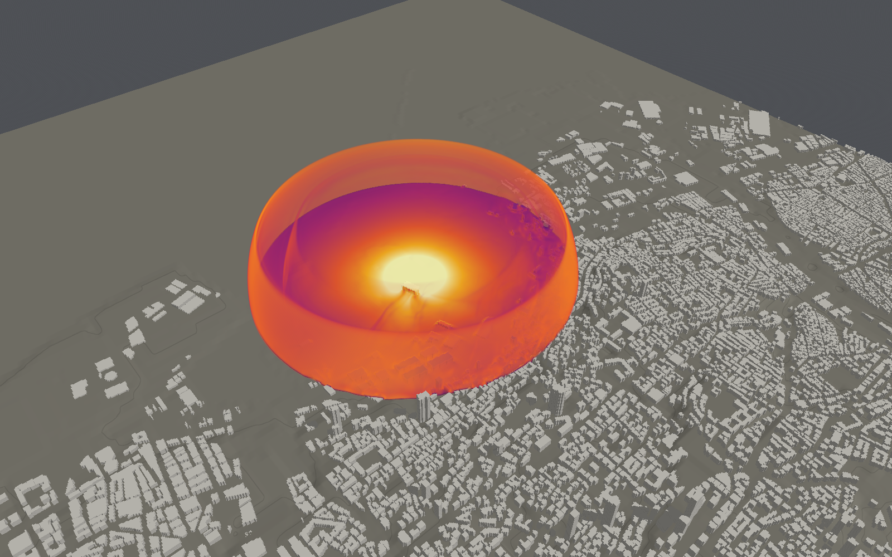

# Beirut, 4 August 2020: a district reconstruction

At about 18:08 local time on 4 August 2020, ammonium nitrate stored in Warehouse 12 of the Port
of Beirut exploded after a fire. More than 200 people were killed, thousands were injured and
some 300,000 lost their homes. This page reconstructs the blast over the port's district as a
technical comparison: BombCAD's first at the scale of a city, with the surveys made after it. It
reports what the model and the sources say; it does not judge the event.



## What holds and what does not

At 0.5 kt on 4 m cells, against the surveys below:

- **Holds: the shock's arrival.** Over the city's own geometry the model finds Rigby's yield
  again from his 30 observers; from 400 m out 25 of 27 arrive within 10% of the observed time.
- **Holds: the glass's far edge, and its grid.** Beyond 1.5 km the share of façades blown out is
  GEER's W3 (0.07 and 0.02 against 0.09 and 0.02), and the glass has converged by 4 m.
- **Holds: the silos' shadow close in, and a second set of arrivals.** Behind a block like the
  silos the model's peaks are Denny et al.'s measured third at 160 m and three fifths at 240 m, and at
  Stennett et al.'s six observers the shock arrives within 6% of their times.
- **Does not: the peaks.** They are 0.65–0.83 of Kingery–Bulmash (0.68–0.79 at 0.5 kt) and still rising on finer cells
  (0.78–0.83 at 3 m); refinement, on a staircase ground, gives 0.79–0.86 on the line and arrivals
  within 3%, and refined once under a ceiling over the roofs it gives the 4 m cells' glass at 0.44 of
  their run time. The JRC's simulation matches Kingery–Bulmash to 750 m with a charge
  tuned to it; this one is not tuned.
- **Does not: the glass close in, or its total.** The model's façades break together: inside
  1.5 km every side has some pane broken (GEER 0.35–0.84) and inside 1.25 km nearly all are blown
  out (GEER 0.17–0.77). It breaks 3.8 times the army's count of broken glass, on a glazed share
  that is assumed.
- **Does not: the structure.** It has not converged with the grid, and it damages less than GEER
  found: at 0.5–0.75 km 8 of 293 stone buildings fall where 7 of GEER's 13 partly collapsed, and
  concrete is barely touched beyond 750 m. Every building is one of two typical walls, not Beirut's frames with block infill.

## The scene

`scenebench district-scene` builds it from open data (the files are not in the repository; their
SOURCE.md files say where each came from and under what licence):

| | Source | In the scene |
|---|---|---|
| Buildings | OpenStreetMap, 17 October 2026 (ODbL): 14,502 buildings within about 2.5 km; 330 tagged with a height or levels | Each a block envelope on 4 m cells, standing on the lowest ground under it: 14,169 placed, 342 left out (too small or outside) |
| Heights | OSM tags where given; otherwise GHSL's average net building height (GHS-BUILT-H R2023A, 2018, 90 m cells, CC BY 4.0) | 89 by height, 187 by levels, 13,893 from GHSL |
| Ground | Copernicus GLO-30, a surface model (roofs and trees in it), 1″ | Opened over 100 m (a morphological opening: the lowest point within 100 m, then the highest of those), the sea flat at 6 m above the terrain's zero; the charge on it 1.4 m above the sea |
| Charge | Rigby et al. 2020: 0.50 kt TNT (best), 1.12 kt (upper); fireball and crater estimates 0.2–0.6 kt | 0.2, 0.5 and 1.1 kt TNT, hemispherical on saturated ground (0.9 of it to the air), at Warehouse 12's centre (33.901425 N, 35.519042 E) |
| Air | | The recommended air (afterburning, hot air, far-field open faces), 4 m cells, terrain on cut cells, 5 × 5 × 0.32 km: 125 million cells |

Today's map is not August 2020's: damaged buildings have since been repaired or rebuilt, and the
port's silos and warehouses are mapped as they now stand. The buildings' construction is not in
the map; each is judged twice, as 0.2 m reinforced concrete (the default) and as 0.5 m
unreinforced masonry, for the old sandstone houses.

### The recipe

```bash
scenebench district-scene --osm beirut-port-buildings.osm --dem Copernicus_DSM_COG_10_N33_00_E035_00_DEM.tif --ground-radius 100 --sea 1 --heights GHS_BUILT_H_ANBH_E2018_GLOBE_R2023A_4326_3ss_V1_0_R6_C22.tif --centre 35.519042,33.901425 --radius 2500 --dx 4 --height 320 --mass 500000 --out beirut.json
```

In the app, **File ▸ New District…** lays out the same from the same files, with the faces at
the open-face rule ([Using the app](using-the-app.md#a-district-from-a-map)). `beirut.json` opens in
the app and runs headless:

```bash
BombCAD run beirut.json --resolution 4 --ground saturated --duration 8 --envelope-window 0.5 --envelope-damage damage.json
```

`scenebench district-compare` (the same inputs, `--observers` Rigby's CSV) runs the event and
sets it against the surveys below; `scenebench district` times it at several sizes. Both start
from the [mapped one-dimensional solution](air-blast-model.md#a-finely-resolved-start) since 20
October 2026 (`--balloon-start` for the balloon they were first run on): at 0.5 kt the broken
glass moved 0.15% and every band 0.01 or less ([the record](validation.md#off-the-balloon-on-20-october)).

## Cost

The whole box, 125 million cells (1,250 × 1,250 × 80) and 738,387 components, runs its 8 s
of event in about 5,000 steps: 25–28 minutes each on the CI mini (a base M4 with 24 GB, shared),
the air taking about 8 GB and the components' histories 4 GB (0.5 s from each one's arrival in
0.7 ms bins). Placing the buildings and building the solver take seconds. At 2 km and a lower
top (40 million cells) the event takes 172 s, and 184 s with every component's history: the
histories cost 7%. The view draws the 40,000 blocks in about 20 ms a frame, through a grid of
columns rather than testing every block.

Things found and fixed on the way, and one that set the domain:

- **A cut cell of 8% air** beside the charge, under a silo whose base lay below the opened
  ground, went negative and the run skipped silently to its end; it is now solid at load, and a
  batch with a NaN in the air is reported unstable.
- **Masonry rocking against the masonry above it** (SBEDS's wall held by its axial load), and
  **a façade strip spanning its storey** rather than as tall as the cells cut it: without them
  the old stone houses fell far too readily, and the coarser the grid the more.
- **The domain's top.** At 160 m, faces that copy the air out channel the wave (1.7 times
  Kingery–Bulmash's peak at 2.4 km) and far-field faces drain it (0.2–0.3 times beyond 1.5 km);
  at 320 m the peaks are those of a 640 m top to 2.4 km, so the runs use 320 m. That held on
  the line of gauges over the sea. Over the hills south of the port it does not: there the 320 m
  top drains the façade loads from about 1.25 km at every yield (a 640 m top reads their peaks
  1.2–1.6 times higher at 1.5–2.25 km, up to 2.4 times to the south), and a 640 m top is needed (25 October 2026, [the hybrid far
  field](hybrid-far-field.md#the-full-runs-top-drains-its-far-loads-25-october-2026)).

## What it is compared with

All on the final setting (above), at 0.2, 0.5 and 1.1 kt.

### Arrival times (Rigby et al. 2020)

The shock's arrival at 30 of Rigby's observers 250 m to 2.35 km away (audio and video; the
fireball's own points left out), at a gauge 2 m above the ground where each stood:

| Yield | Simulated against observed, median (range) | Within 0.05 s of the observed window |
|---|---|---|
| 0.2 kt | 1.06 (0.87–1.16) | 9 of 30 |
| 0.5 kt | **0.98** (0.71–1.10) | **19 of 30** |
| 1.1 kt | 0.90 (0.57–1.03) | 5 of 30 |

The model over the city's own geometry finds Rigby's yield again from his observations: 0.5 kt.
The three nearest observers (250–300 m) saw the shock later than the model and Kingery–Bulmash
both (0.71–0.83 of the observed time at 0.5 kt), as Dewey's lower TNT equivalence close in
would have it; from 400 m out the model is within 0.83–1.10 of the observed times, 25 of the 27 within
10%.
Inferred rather than chosen, with the place left free, the same observers give 0.54 kt (90%:
0.39–0.85) by Kingery–Bulmash and 0.50 kt with these runs' ratios, and put the charge within 32 m
of Warehouse 12's centre ([charge inference](charge-inference.md#beirut)).

Stennett et al. (2020) timed the shock in six other videos, 0.5–2 km out (a frame, 33 ms, either
way), and found 637 t (407–960 t) by Kingery–Bulmash. At their observers the 0.5 kt run arrives at
0.94, 1.00, 1.02, 1.03, 1.05 and 1.06 of their times from 489 m to 2.07 km: late by a few percent far
out, as a larger yield would be, or as the day's 30 °C air, whose sound is about 2% faster than the
model's 15 °C, would make it. Their far observer is 1,996 m away by their table and about 2,080 m
by their coordinates (the run takes the coordinates).

### Peak overpressure

On a line north over the basin and the sea, against Kingery–Bulmash at the same TNT mass:
at 0.5 kt 0.68 of it at 100 m, 0.74 at 200 m, 0.79 at 500 m, 0.76 at 1 km and 0.76 at 2.4 km;
at 0.2 kt 0.65–0.74 along the line, at 1.1 kt 0.70–0.83 (0.81 at 1 km): the larger the charge,
the more cells its shock spans. About 5 points of that is the ground taking a tenth of the charge; the rest is 4 m cells,
which spread the shock (8 m cells refined twice to 2 m at the shock give 84–94% on the
landscape benchmark). The JRC's simulation at 1.1 kt gave 125, 46, 23 and 10.5 kPa at 300, 500,
750 and 1,000 m against this run's 1.1 kt line's 94, 37, 20 and 13 kPa ([below](#the-jrcs-simulation-valsamos-et-al-2021);
the 124, 46, 24 and 15 kPa quoted here before, second-hand, were its Kingery–Bulmash values).

### Glass against the street survey (GEER, 2021)

GEER's surveyors classed 9,183 street façades from photographs two months later (some already
repaired): W0 no visible damage to W3 blown out. Map buildings carry no windows, so each storey of
each façade is taken to hold one annealed pane, 1.2 × 1.5 m; a building side's glass is broken
where any storey's is. Sides broken at the pane's median strength / at E1300's design strength
(8 in 1,000 break), with GEER's share of façades W1 or worse:

| Distance | 0.2 kt, 6 mm | 0.5 kt, 6 mm | 0.5 kt, 4 mm | 0.5 kt, 8 mm | 1.1 kt, 6 mm | GEER |
|---|---|---|---|---|---|---|
| 0.5–0.75 km | 1.00 / 1.00 | 1.00 / 1.00 | 1.00 / 1.00 | 1.00 / 1.00 | 1.00 / 1.00 | 0.84 |
| 0.75–1 km | 0.97 / 1.00 | 1.00 / 1.00 | 1.00 / 1.00 | 0.97 / 1.00 | 1.00 / 1.00 | 0.62 |
| 1–1.25 km | 0.52 / 1.00 | 1.00 / 1.00 | 1.00 / 1.00 | 0.58 / 1.00 | 1.00 / 1.00 | 0.39 |
| 1.25–1.5 km | 0.07 / 1.00 | 0.92 / 1.00 | 1.00 / 1.00 | 0.10 / 1.00 | 1.00 / 1.00 | 0.35 |
| 1.5–1.75 km | 0.00 / 0.79 | 0.36 / 0.98 | 0.98 / 1.00 | 0.00 / 0.94 | 0.91 / 1.00 | 0.38 |
| 1.75–2 km | 0.00 / 0.42 | 0.11 / 0.80 | 0.79 / 1.00 | 0.00 / 0.68 | 0.61 / 0.96 | 0.28 |
| 2–2.5 km | 0.00 / 0.09 | 0.01 / 0.55 | 0.53 / 0.91 | 0.00 / 0.28 | 0.20 / 0.82 | 0.26 |
| 2.5–3 km | 0.00 / 0.00 | 0.00 / 0.07 | 0.06 / 0.65 | 0.00 / 0.01 | 0.00 / 0.45 | 0.11 |

- **Close in, the model breaks more than GEER saw.** Inside 1.25 km every side breaks at
  0.5 kt, where GEER found 0.39–0.84 damaged. GEER's photographs are of street façades two months
  on, some repaired, and its edge of damage is "~0.7–0.9 km in the central part", 1.2 km in the
  east and 1.5 km in the west: its fraction does not reach 1 even at 0.5 km.
- **The edge depends on the glass more than on the yield.** At 0.5 kt half the sides break at
  about 1.6 km with 6 mm panes, 2.1 km with 4 mm and 1.1 km with 8 mm; between the median and
  the design strength it moves by about 0.6 km. Rigby et al.'s check with Viper at 465 t found old
  annealed façades broken at about 1.86 km and newer, toughened ones whole: inside the 0.5 kt
  band.
- **Beyond 2 km** GEER still finds a quarter of façades damaged and broken glass was reported
  to 3 km; the model at 0.5 kt breaks them only at the design strength or with thin panes. Many
  panes to a façade, of all ages and sizes, make some break where a typical one does not: one
  pane a storey cannot show that tail.

### Glass as a mix of panes

One typical pane can only break or not. The app now gives each map building a mix of panes by
its height (older low-rise to 10 m: small 4 mm panes; apartments to 30 m: 4 and 6 mm; taller or
commercial: large 6–10 mm panes), each breaking with E1300's probability, so a façade breaks by
degrees (building-envelopes.md). The mixes are assumptions; no survey of Beirut's glazing by
building was found. By the map's mixes, on the same 4 m runs:

| Distance | Panes broken, 0.2 / 0.5 / 1.1 kt | Sides with some pane broken, 0.2 / 0.5 / 1.1 kt | GEER W1 or worse |
|---|---|---|---|
| 0.5–0.75 km | 1.00 / 1.00 / 1.00 | 1.00 / 1.00 / 1.00 | 0.84 |
| 0.75–1 km | 0.95 / 1.00 / 1.00 | 1.00 / 1.00 / 1.00 | 0.62 |
| 1–1.25 km | 0.70 / 0.98 / 1.00 | 1.00 / 1.00 / 1.00 | 0.39 |
| 1.25–1.5 km | 0.40 / 0.89 / 0.99 | 0.99 / 1.00 / 1.00 | 0.35 |
| 1.5–1.75 km | 0.12 / 0.57 / 0.89 | 0.87 / 0.99 / 1.00 | 0.38 |
| 1.75–2 km | 0.05 / 0.31 / 0.63 | 0.59 / 0.89 / 0.98 | 0.28 |
| 2–2.5 km | 0.02 / 0.11 / 0.33 | 0.24 / 0.63 / 0.89 | 0.26 |
| 2.5–3 km | 0.00 / 0.01 / 0.05 | 0.03 / 0.21 / 0.57 | 0.11 |

GEER's W1 is "some windows broken, frames intact", so a side with some pane broken is the
model's W1 or worse: the middle column is the like-for-like one, not the panes broken. GEER's W3
is "nearly complete blow-out of windows, doors and frames"; against it, a side counted as blown
out when nine in ten of its panes are expected broken (the model has no frames to blow out):

| Distance | Sides blown out, 0.2 / 0.5 / 1.1 kt | GEER W3 |
|---|---|---|
| 0.5–0.75 km | 0.99 / 1.00 / 1.00 | 0.77 |
| 0.75–1 km | 0.82 / 1.00 / 1.00 | 0.28 |
| 1–1.25 km | 0.13 / 0.96 / 1.00 | 0.17 |
| 1.25–1.5 km | 0.01 / 0.59 / 0.99 | 0.18 |
| 1.5–1.75 km | 0.00 / 0.07 / 0.74 | 0.09 |
| 1.75–2 km | 0.00 / 0.02 / 0.40 | 0.02 |
| 2–2.5 km | 0.00 / 0.00 / 0.06 | 0.15 |
| 2.5–3 km | 0.00 / 0.00 / 0.00 | 0.04 |

- **The model's façades break together; GEER's do not.** At 0.5 kt every side inside 1.5 km has
  some pane broken and nearly every side inside 1.25 km is blown out, where GEER found 117 of its
  750 façades at 0.5–0.75 km with no visible damage and W3 falling to 0.17–0.28 by 1 km. Beyond
  1.5 km the 0.5 kt blow-outs (0.07, 0.02) are GEER's (0.09, 0.02); the 2–2.5 km band's 0.15 W3 has
  nothing in the model at any yield. Within a band the model's sides differ only by their mix and
  their shielding; a street's differ also by glass type (toughened, laminated, filmed), by open
  windows and shutters, and by repair in the two months before the photographs.
- **Traced (19 October 2026)**: GEER's W3 is frames blown out, which follows the side's load as a
  fragility (median 18.5 kPa on the 4 m runs), and its W1 or worse is damage visible two months on;
  stronger glass would need two to four times E1300's, by distance. See [why it over-breaks against
  GEER](glass-probability.md#why-it-over-breaks-against-geer-19-october-2026).
- **The tail is there.** Beyond 2 km some panes break, as some did; but a side holds dozens
  of panes, so the chance that one breaks stays near one far out, above GEER's share of façades
  damaged at every yield.
- **The panes broken follow the pane's size more than its thickness.** At 0.5 kt, all four mixes
  on the same loads: 1.25–1.5 km breaks 0.66 of the older low-rise mix's small panes, 0.88 of the
  apartments' and 0.98 of the large commercial panes; 2–2.5 km, 0.07, 0.11 and 0.24.

**The area of glass broken** is the glass assumed times the share of it that breaks, and the two
are separate. Inside 3 km (the surveys' reach: 13,596 map buildings, 12,996 of them taken as
apartments) the mixes assume 6.85 million m² of glass, 82% of it the apartments' 0.25 of façade;
0.20, 0.38 and 0.54 of it breaks at 0.2, 0.5 and 1.1 kt, 1.35, 2.6 and 3.7 million m².

| Inside 3 km, 0.5 kt | Buildings | Glass assumed | Broken | Share broken |
|---|---|---|---|---|
| Apartments (0.25 glazed) | 12,996 | 5.62 M m² | 2.03 M m² | 0.36 |
| Tall or commercial (0.4) | 434 | 1.18 M m² | 0.56 M m² | 0.48 |
| Older low-rise (0.15) | 99 | 0.03 M m² | 0.01 M m² | 0.51 |
| Industrial (0.05) | 67 | 0.03 M m² | 0.004 M m² | 0.17 |

The Lebanese army recorded about 550,000 m² of glass and 140,000 m² of glass façades broken in
the 85,000 damaged units it surveyed (60,818 of them homes; reported in the press): a count of
broken glass in surveyed units, not of glass replaced, and how it was measured is not reported.
UN-Habitat puts 77,000 damaged flats in 10,000 buildings within 3 km, so the survey's reach is
about the model's. The model breaks 3.8 times its 0.69 million m² at 0.5 kt. Broken area is in
proportion to the glazed share, which no source gives for Beirut (it is an assumption, 0.05–0.4
by type); to match the army with the model's breakage every mix would need a quarter of its glazed
share (the apartments' 0.07 of façade, the commercial 0.11), below any plausible window. Both terms are high: the breakage, as GEER's W3
shows inside 1.5 km, and most likely the glazed share as well; the army's count may be
incomplete. The total cannot separate them.

### What cell size the glass and the damage need

The 1 km box (2 km square, 320 m top, 0.5 kt) on three grids, uniform cells:

| | 8 m | 4 m | 3 m |
|---|---|---|---|
| Peaks on the line (of Kingery–Bulmash) | 0.54–0.69 | 0.68–0.78 | 0.78–0.83 |
| Panes broken (map's mixes), 0.5–0.75 / 0.75–1 / 1–1.25 / 1.25–1.5 km | 0.99 / 0.94 / 0.80 / 0.52 | 1.00 / 1.00 / 0.98 / 0.89 | 1.00 / 1.00 / 0.98 / 0.92 |
| Stone heavy / failed, 0.5–0.75 km (of about 290) | 206 / 2 | 249 / 7 | 269 / 10 |
| Stone heavy, 0.75–1 km (of about 660) | 41 | 132 | 176 |
| Concrete moderate, 0.5–0.75 km | 33 | 96 | 139 |

- **The glass has converged by 4 m**: 3 m moves the panes broken by at most 0.03. These runs
  opened each component's 0.5 s window when its air woke, a tile ahead of the shock: about 0.13 s
  before the load on 3 m cells, 0.17–0.2 s on 4 m, and 0.3–0.37 s on 8 m, which kept as little as
  0.05 s of some loads at 1–1.25 km; part of the 8 m column's lower breakage is that. Windows now
  open on 500 Pa at the component (building-envelopes.md). The peaks are
  still rising (by a tenth from 4 to 3 m), but the glass is past the edge of breaking where most
  of it stands.
- **The structure has not**: each grid finer cracks more stone and concrete, as the peaks rise;
  3 m is the least these need, and finer would crack more still.
- **A strip's height is its storey's.** Before this was fixed, façade strips stood as tall as the
  cells cut them (4 m on 4 m cells, 8 m on 8 m), and a masonry strip's resistance falls with the
  square of its height: the coarse grids' walls were the weak ones, and stone failed in 102
  buildings at 0.5–0.75 km on 4 m cells where the storey's span gives 7.
- **Refinement** (8 m refined twice to 2 m at the shock, at a jump of 0.005) gives 0.79–0.86 of
  Kingery–Bulmash on the line to 900 m, more than 3 m cells. Two fixes to the refined air (18
  October: gas squeezed beside buildings' fine outlines, and cut cells under them restricted
  short; [terrain](terrain.md)) and the windows opened at 500 Pa (above) bring its façades' loads
  to the 3 m cells'. A ringing of about ±0.5–0.9 kPa from the ground's cut cells at the finest
  level still ran ahead of the shock over the city south-east of the charge, at about 2 km/s:
  gauges there took it for the arrival 300 ms early, and it opened 7–18% of the
  façades' windows before the load. With the ground as a staircase of whole cells (`--staircase`)
  it is gone:

  | | 8 m refined twice, staircase | 8 m refined twice, cut cells | 3 m |
  |---|---|---|---|
  | Run on the mini | 1,429 s | 2,079 s (finest pool full) | 451 s |
  | Arrivals at Rigby's observers 250–1,075 m | 0.97–1.03 of Kingery–Bulmash | six 25–52% early | |
  | Façades' median peak, 0.5–0.75 / 0.75–1 / 1–1.25 / 1.25–1.5 km | 32, 18, 11.5, 8.8 kPa | 29, 17, 11, 8.4 kPa | 30, 18, 12, 8.9 kPa |
  | Panes broken, same bands | 1.00, 1.00, 0.99, 0.95 | 0.93, 0.88, 0.84, 0.81 | 1.00, 1.00, 0.98, 0.92 |
  | Stone heavy / failed, 0.5–0.75 km | 262 / 10 | 256 / 9 | 269 / 10 |
  | Concrete moderate, 0.5–0.75 / 0.75–1 km | 200 / 45 | 195 / 45 | 139 / 11 |

  Refined on the staircase, the glass and the stone are the 3 m cells', the concrete more damaged
  (its peaks are higher), at 3.2 times the cost. Three quarters of that is the finest level's own
  sweeps, ghosts and halo (flagging, placing and the recorder under 2%), and its blocks filled the
  column evenly from the ground to the 320 m top. A ceiling over the ground
  (`SolverConfiguration.refinementCeiling`: no air refined more than 72 m above it, 40 m for all but
  the tallest 2% of the buildings and 32 m for the shock's top) with the footprints on the finest
  cells makes refinement pay; on the same staircase:

  | | 8 m refined once to 4 m, capped | 4 m | 8 m refined twice to 2 m, capped |
  |---|---|---|---|
  | Run on the mini | 74 s | 170 s | 645 s (1,429 s uncapped) |
  | Arrivals, 250–1,075 m | within 2% of the 4 m cells' | | 0.97–1.03 of Kingery–Bulmash |
  | Façades' median peak, 0.5–0.75 / 0.75–1 / 1–1.25 / 1.25–1.5 km | 24.5, 15.4, 10.4, 8.4 kPa | 27.8, 16.6, 11.2, 8.6 kPa | 28.8, 16.8, 11.0, 8.7 kPa |
  | Panes broken, 0.75–1 / 1–1.25 / 1.25–1.5 km | 1.00, 0.99, 0.94 | 1.00, 0.99, 0.94 | 1.00, 1.00, 0.97 |
  | Stone heavy / failed, 0.5–0.75 km | 239 / 7 | 257 / 10 | 249 / 8 |

  Refined once and capped, the glass and the arrivals are the 4 m cells' at 0.44 of their run time,
  the façades' peaks 2–12% lower and the stone a little less cracked; File ▸ New District now
  offers that air. A tower above the ceiling takes its upper floors' load on the coarse cells.

### Structure against the building survey (GEER, 2021)

GEER inspected 181 buildings (from calls to a hotline, so biased towards concern) and classed
them D0 none to D5 full collapse. The model's levels are its own (concrete by ASCE/SEI 59-11's
rotations; masonry heavy when cracked, failed when it has deflected its thickness), so the
comparison is of where the damage falls, at 0.5 kt:

| Distance | Stone (0.5 m masonry): none / heavy / failed | GEER stone: D1–D2 / D3 / D4 | Concrete (0.2 m): none / moderate / heavy+ | GEER RC: D0–D1 / D2 / D3 |
|---|---|---|---|---|
| 0.5–0.75 km | 32 / 253 / 8 | 1 / 5 / 7 | 200 / 92 / 1 | 8 / 9 / 4 |
| 0.75–1 km | 518 / 142 / 0 | 14 / 9 / 4 | 659 / 1 / 0 | 17 / 11 / 1 |
| 1–1.25 km | 907 / 0 / 0 | 15 / 3 / 0 (1–1.5 km) | 907 / 0 / 0 | 19 / 10 / 2 (1–1.5 km) |

The model damages the buildings less than the survey found, and nearer the charge:

- **Stone cracks where GEER's sandstone houses partly collapsed.** At 0.5–0.75 km nearly every
  stone building cracks (heavy) but 8 of 293 fall, where 7 of GEER's 13 there were D4; at
  0.75–1 km a fifth crack and none fall, where GEER had 9 of 27 at D3 and 4 at D4; beyond 1 km
  nothing, where GEER found D1–D3. Each wall is judged as a 0.5 m panel carrying only the stone
  above it, with no arching, its floors' loads unknown.
- **Concrete is barely touched beyond 750 m**, where GEER's RC buildings were D1–D3 out to 2 km.
  The envelope judges 0.2 m concrete walls; a Beirut "concrete" building is an RC frame with
  hollow-block infill, whose façades are thin masonry, and GEER's classes include the infill and
  partitions.
- **The grid is part of it**: 3 m cells crack more than 4 m (above), so the structure here reads
  low, and an earlier version, whose walls stood as tall as the cells, matched GEER's collapses
  by an error.

### The JRC's simulation (Valsamos et al. 2021)

The European Commission's Joint Research Centre simulated the same event in EUROPLEXUS (Valsamos,
Larcher and Casadei 2021, *Safety Science* 137, 105190, CC BY 4.0), also from OpenStreetMap:

| | JRC (EUROPLEXUS) | BombCAD, this page |
|---|---|---|
| Air | Finite volumes, HLLC, second order, ideal gas | Finite volumes, HLLC, second order, ideal gas; afterburning and hot air |
| Domain | 2,350 × 1,650 m, 150 m high; absorbing faces | 5 × 5 km, 320 m high; far-field faces |
| Cells | 4.5 million of about 5 m | 125 million of 4 m |
| Buildings | About 2,500 rigid, from OSM (heights as tagged, or 3 m a level) | 14,169 rigid, from OSM and GHSL's heights, on the ground's terrain |
| Charge | 1.1 kt TNT, a compressed balloon of 14 m whose energy is calibrated to the peak or the impulse | 0.2, 0.5 and 1.1 kt TNT, its own energy, on saturated ground |
| Peaks at 300 / 500 / 750 / 1,000 m, 1.1 kt | 125, 46, 23, 10.5 kPa (Kingery–Bulmash 124, 46, 24, 15) | 94, 37, 20, 13 kPa on the line north |
| Damage | Each building by its peak side-on overpressure (Stephens's 3.5 / 17 / 35 / 83 kPa); glass at 1 kPa | Each wall, roof and pane by its own load (SDOF, E1300) |
| Against | Copernicus EMS's satellite grading, by eye | GEER's street and building surveys, band by band |
| Cost | Not given | 25–28 minutes on a base M4 |

- **Its peaks are Kingery–Bulmash's to 750 m** because its charge is tuned to them: the balloon's
  energy is chosen to give the peak or the impulse. This run's charge is not tuned, so its 4 m cells'
  spreading of the shock shows (0.70–0.83 of Kingery–Bulmash at 1.1 kt). At 1 km the JRC's falls to
  0.68 of Kingery–Bulmash while this run's line holds 0.81; its 150 m top is the height this page found too
  low beyond 700 m (above), which may be part of it.
- **Its damage is a threshold map; this page's is a judgement of each component**, against a survey
  by distance. The JRC's moderate damage or worse (above 17 kPa) reaches 1.9 km east–west and 1.35 km
  north–south at 1.1 kt, which the satellite grading supports by eye; at 0.5 kt this page's 0.2 m
  concrete is barely damaged beyond 750 m (less than GEER found). The thresholds are for buildings as
  a whole, glazing and partitions included; the SDOF judges the walls alone.

### The grain silos' shadow (Denny et al. 2025)

The grain silos, about 175 m long, 30 m wide and 50 m tall, stood some 80 m from the charge between
it and the city to the west. Denny et al. (2025, *Shock Waves*, CC BY) fired 1:250 models of them
(32 g, for 0.5 kt) with gauges at scaled distances Z = 2 and 3 (159 and 238 m at full scale), and
carried the shadow to Z = 8 (635 m, where the homes begin) in Viper::Blast. The district above does
not hold the silos as they were: the map has today's remains, 52 × 82 m, at GHSL's 29 m. So their
block alone was run: 152.25 × 30.5 × 55.3 m, its front face 80 m from 0.5 kt on rigid ground, every
open face 4 m/kg^(1/3) away, on 2 m and 1 m cells (2 m: 95 s with the block or without, on an M4
Max), each gauge's peak taken against the same run without the block:

| Gauge (Denny's) | Full scale | BombCAD, 2 m / 1 m | Measured (read from Denny's figures) |
|---|---|---|---|
| X2, E2, D2: behind, Z = 2 | 160 m | 0.30–0.31 / 0.30–0.32 | about 0.3–0.4 (60% less, in the text) |
| X3, E3, D3: behind, Z = 3 | 240 m | 0.56–0.73 / 0.58–0.68 | about 0.5–0.9 (30% less, in the text) |
| C1: past the front corner | 238 m | 0.76 / 0.78 | about 0.8 |
| C2: past the back corner | 243 m | 0.37 / 0.38 | about 0.6 |
| B3: in line with the front face | 240 m | 1.20 / 1.23 | about 1.1–1.3 |

And on, behind the block along the charge's line (Viper's numbers read from Denny's Fig. 29, for
their rectangular and their detailed silos; the layouts are in `Samples/BeirutSilos`):

| Z (m) | BombCAD, peak / impulse | Viper, peak / impulse |
|---|---|---|
| 4 (318 m) | 0.74 / 0.77 | 0.95–0.98 / 0.96 |
| 5 (397 m) | 0.82 / 0.81 | 1.0 / 1.04 |
| 8 (635 m) | 0.90 / 0.85 | 0.92 / 1.07 |

- **Where the silos were measured, the model's shadow is theirs**: about a third of the free field's
  peak 50 m behind them and three fifths 130 m behind, the reflection beside the front face 1.2 times;
  the one gauge off by much, C2, lies where the shadow's edge passes.
- **Farther out the two simulations part.** Viper's shadow has gone by Z = 5 and its impulse is
  above the free field's; the model's peak is still 0.82 there and its impulse stays 0.8–0.85 of the
  free field's to Z = 8. Both find the homes at 635 m about a tenth below the free field; Denny's
  far field is numerical only, as they say, and so is this.
- **For the district:** the silos would take about a tenth off the peaks in a sector to the west to
  600 m and more, which the district above does not have; its west bands are the less sure for it.

## What the model can and cannot represent

- **Today's map.** The buildings are those mapped in October 2026: those destroyed and rebuilt,
  and the port as it now stands. Heights are GHSL's 90 m cell means for all but 276 buildings.
- **A rigid district.** Envelopes stay whole in the air: no glass opening, no wall falling, no
  shielding changing as the buildings break. The silos stand.
- **Assumed glass and typical construction.** Each building's glass is one of four assumed mixes
  by its height and tag, all annealed; walls are either 0.2 m concrete or 0.5 m masonry for every
  building. GEER's survey shows the mix.
- **The ground.** A bare-earth estimate from a surface model; the charge on saturated ground
  gives the air 0.9 of it; the crater is not in the air.
- **Peaks at 4 m, and the structure with them.** The peaks are about three quarters of
  Kingery–Bulmash's and still rise on finer cells. The glass has converged by 4 m; the structure's
  damage has not, and 3 m cells crack more of it (above).
- **Open faces.** The 320 m top is 4 m/kg^(1/3) at 0.5 kt (3.1 at 1.1 kt). On 8 m cells a 640 m
  top gives the same glass and structure to within a building or two in every band, but on 8 m
  cells and one typical pane hardly any glass beyond 1.25 km broke with either top. Over the hills
  south of the port the 320 m top drains the façade loads from about 1.25 km at every yield; with
  the hybrid's glazing mixes a 640 m top breaks glass on 0.99 of the sides at 2–2.5 km at 0.5 kt
  against the 320 m top's 0.71, and on 0.74 against 0.35 at 0.2 kt (8 m cells; [the hybrid far
  field](hybrid-far-field.md#the-full-runs-top-drains-its-far-loads-25-october-2026)). The outer
  bands beyond 1.25 km are low on that account. The side faces matter less: moved 500 m further
  out they add nothing beyond the layouts' own 3%.
- **No silos as they stood.** The map holds today's remains; run alone, the 2020 block takes about
  a tenth off the peaks to 600 m and more to the west (above).
- **One TNT mass.** Dewey's analysis suggests the TNT equivalence of this ammonium nitrate rose
  with distance (0.15 kt close in, 0.7 kt at 1 km); a single mass cannot follow that.
