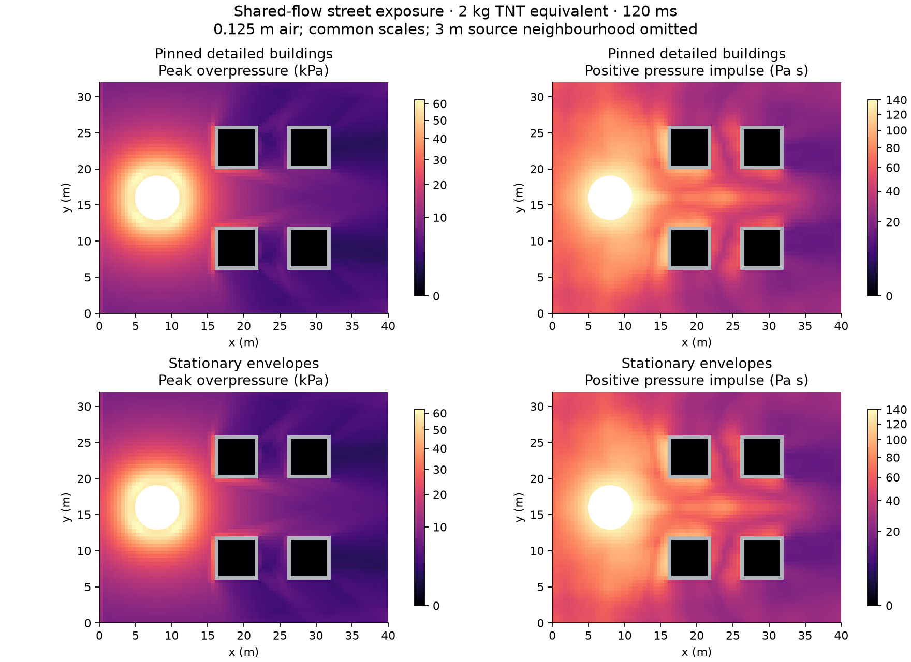
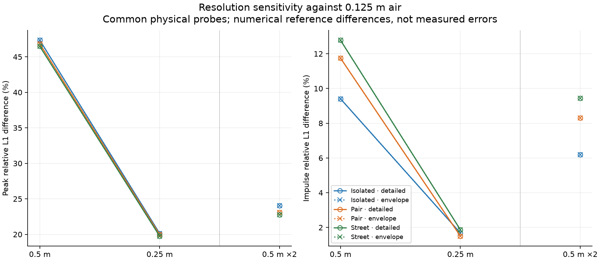
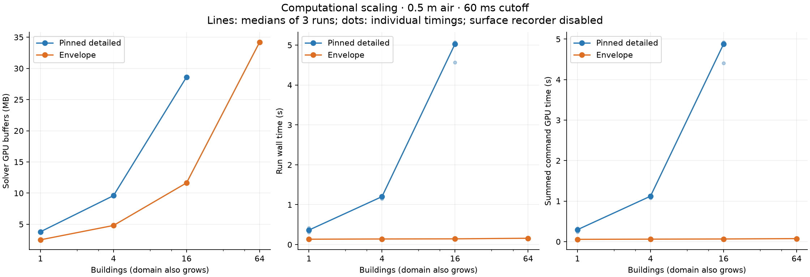
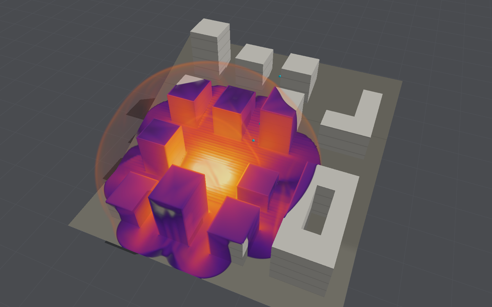

# Stationary building envelopes

Building envelopes keep walls, roofs and openings in the shared air simulation without a
structural mesh. They offer a cheaper representation for neighbourhood exposure studies:
each building still shields and reflects the flow, including waves returning from its
neighbours. They remain stationary throughout a run and predict no deformation or failure.

In the structure editor, **Use Exposure-only Envelope** converts the selected local authored
structure. Its object ID, name, solids and openings survive; materials, reinforcement,
supports and mechanical state are discarded. **Undo** restores the detailed structure.
The resulting buildings appear under **Exposure-only buildings**, where they can be removed.
Geometry editing is done before conversion or in a layout JSON; there is no separate envelope
geometry editor yet. Source-owned imports keep their existing import workflow.

`BuildingEnvelope` and its approximation rules belong to BlastCore in BombCAD. It uses the
existing ContinuumKit `Box` geometry; this milestone introduces no shared-core contract or
package release. Openings are subtracted into bounded box fragments using the same half-open
boundary convention as the air rasteriser. An opening cuts the solids it crosses but not one it
holds whole, as a detailed structure's openings do: a door or a window's glass set in its opening
stays solid in the air, and a detailed structure's annealed glass in an opening becomes a pane. Limits are 2,048 solids/fragments per building,
256 openings per building and 262,144 rigid blocks across a scene (blocks and imports keep
their 2,048); the view draws them all, by a grid of columns once there are more than 256.
Unlike deformable bodies, envelopes have no sixteen-building mechanics limit. Air memory and
resolution still constrain useful scene size.

## Saving and exporting

Layouts encode `buildingEnvelopes` beside the existing geometry, with durable object ownership.
Projects containing envelopes use scene encoding version 6 so older package readers reject
them instead of silently dropping buildings. Projects without envelopes retain their existing
version 3 or 4 encoding, or version 5 for footings and turned support joints. Prototype
envelope packages written as version 5 remain readable and migrate to version 6 on save.
Existing numerical fingerprints are unchanged; envelope geometry
enters new fingerprints while object names and IDs remain excluded.

The viewport draws the subtracted rigid fragments, and ordinary runs retain gauge histories
and the existing pressure/impulse fields. USD exports put each envelope in a separate mesh
with its object ID, name and stationary-envelope representation attached. Opening geometry
also participates in import placement and picking occlusion.

## Surface exposure and loads

An optional `BlastSolver.configureEnvelopeExposure(objects:)` recorder reports the boundary
that the air grid actually resolves. It accepts envelopes and fully pinned detailed reference
bodies at time zero. Moving-body references are rejected. Envelopes are stationary whatever else
moves: beside them other bodies may move, and since 17 October 2026 a moving body never takes the
air beside the faces recorded (the remask leaves those cells air, `remaskPrepare`'s kept air) and
its debris passes the envelopes by, one way, neither loading nor damaging them. A scene of
envelopes alone, or of structures alone, runs as before, to the bit. Loading another scene or
replacing the body set clears the recorder; restarting resets its values.

Every owned solid cell face next to a fluid cell becomes a receiver with area `dx²`, a
position at the voxel face and a normal pointing into air. Interior and exterior surfaces
both contribute. Shared solid faces and domain boundaries contribute nothing, including the
ground attachment. Buildings with overlapping owned solid cells are rejected by the recorder;
a building with no resolved face (buried, or wholly against its neighbours) is kept with none.

After each complete fluid step, a receiver reads the pressure at its adjacent coarse fluid
cell centre, including restricted fine state. This is a cell-pressure approximation to
surface loading, not the solver's wall Riemann flux or a calculated structural reaction.
The initial pressure participates in the peak; temporal integrals use right endpoints for
every accepted fluid interval, including a clipped final interval. Time-limit no-op steps add
nothing. A changed solid/fluid pair marks the receiver invalid.

Snapshots retain current overpressure (Pa), peak positive overpressure (Pa), positive pressure
impulse (Pa s) and signed pressure impulse (Pa s). Summing `-normal × area × overpressure`
gives an estimated force in N; using signed impulse gives an estimated vector impulse in N s.
Signed accumulation preserves suction and cancellation between opposite faces. The core
recorder is opt-in. The app automatically enables it for scenes containing envelopes, with
deformable structures or without; other ordinary scenes allocate no surface recorder.

The Run tab's **Building surface exposure** section selects an owner and shows its recorded
window, resolved area, maximum surface overpressure, area-weighted mean positive impulse,
summed positive loading, current force vector and signed impulse vector. The positive scalar
sum integrates pressure impulse over every resolved interior/exterior face; it is not the
resultant vector impulse. Readouts refresh alongside the chart, up to ten times a second.
The GPU still records every fluid endpoint, so display cadence does not skip integrals.

Pause a run to **Export surface records…** as JSON, with individual face locations, normals,
areas and pressure exposure. Exports are snapshots of the current finite observation window.
Reset clears the live results. The viewport continues to show the existing pressure and
impulse fields; the numerical surface inspector does not add a separate surface colour map.

**Keep Run** stores compact per-building summaries with stable owner IDs. They appear in
saved-run inspection and CSV exports, where their values are labelled at the end of the
recorded window. Individual face arrays are exported separately rather than embedded in
every kept result. Results containing these summaries use saved-run encoding version 3;
earlier records remain readable and retain their encoding when they lack surface results.
These diagnostics do not enter the numerical input fingerprint.

Headless runs collect the same summaries. To write full surface records alongside a kept run:

```sh
.build/release/BombCAD run envelope-layout.json --duration 0.12 --out envelope-run.bombcad --envelope-results surfaces.json --csv exposure.csv
```

`--envelope-results` requires a scene with envelopes (other bodies may move beside them) and at least one
resolved exposed face. It refuses a pre-existing destination. Unavailable surface
recording does not prevent ordinary blast runs, but an explicitly requested surface export
fails with its reason instead of writing absent results as zeros.

## Envelope components and their pressure histories

For damage estimates on envelope buildings ([built](#damage-for-envelope-buildings-built)),
`BlastSolver.configureEnvelopeComponents(objects:options:)` records the load on each part of a
building that responds on its own: stage 1 of that work. The definitions are agreed with the
damage model that reads them (`/Volumes/StudioData/bombcad/envelope-damage/component-spec.md`, v1.2).

**Components** (`BuildingEnvelope.components(owner:cellSize:)`, from the geometry alone):

- A solid whose smallest size is at most 1 m and at most half its middle one is a **wall** (thin
  in x or y) or a **slab** or **roof** (thin in z; a roof when nothing of the building stands
  above it). It is cut at its supports first: a wall where a slab crosses its height or another
  wall meets it inside its length, a slab or roof where walls meet it from below. Then each piece
  is cut into equal panels at most 6 m wide, and 3 m tall where no slab or roof holds the wall;
  slabs and roofs at most 6 × 6 m. Cuts are snapped to the air grid. Each panel is a component,
  with which of its four edges are supported (on another solid or the ground).
- Other solids are **blocks** (map buildings): each side in **façade** strips a storey (3 m) tall,
  a remainder under a metre joining the strip below, and a **roof**. Columns are left out.
- **Panes** (`BuildingEnvelope.panes`, new) are glazing, solid in the air: a one-way damage model
  takes a pane as closed until it fails, so it records the reflected load the glass carries. Each
  is one component, held on four edges. A detailed structure's annealed glass becomes panes when it
  is converted to an envelope, and scenes with panes save at scene encoding 10. Glass is thinner
  than a cell, so a pane takes cells of its own in the air (`BuildingEnvelope.paneCells`, since 17
  October 2026): across it, those whose centres lie in it; through it, those in a solid of the
  building holding it whole (its wall, where the glass is set in the wall without an opening), or
  else the one its middle plane crosses. They are solid from the start and carry the pane's load.
  Before, a pane in a cut opening crossed no cell's centre, so its window was open in the air and
  the pane recorded nothing, and glass set in a wall had its load counted as the wall's (see
  [validation](validation.md#glazing-in-the-air) for what that changes). In refined air's patches
  the pane takes the layer of finer cells its middle lies in (`Box.holdingCells`), so its window is
  closed there too.

Ids are `<owner>/<kind>/<source>.<panel>`. The street study's buildings come out as one panel a
wall and one roof panel.

**Histories** (`envelopeComponentHistories()`): after every complete fluid step, each component's
two sides, the faces whose normal points outward and those pointing in, are averaged over their
faces (the surface recorder's cell-centre pressures, by one GPU thread a component in a fixed
order). Each step's value is integrated into 0.1 ms bins by its overlap with them, so the impulse is
exact whatever the step; the peak of each side, and of the net (outer less inner, pushing inward),
is kept from every step. Options: the bin width; the window; a memory budget (256 MB by default)
that widens the bins to a whole multiple when needed and says so; per-bin maxima (twice the
memory); openings recorded as panes in the open opening, for what the inside sees once glass
has gone; and windows that start when a component's air first wakes (`windowFromArrival`, the
start in `windowStartS`), so that across a district the window need cover only one building's
load. Steps past the window are not binned and the history says `truncated`. Components with no
face on the air are left out.

Headless runs write them with `--envelope-histories <file.json>`; kept runs do not store them yet.
Recording leaves the air bit-identical, and each side's binned impulse equals the mean of its faces'
own integrals (tests in `EnvelopeComponentTests.swift`).

**Cost.** Memory is components × bins × 8 bytes, plus about 13 bytes a face: at 0.25 m, the
street's 4 buildings (20 components, 120 ms) take 0.37 MB, the 64-building neighbourhood
(320 components, 60 ms) 4.4 MB. Each step, a SIMD group a component reads the flags of the tiles of
air its faces lie in. A component whose air is all still is finished there, from the still air's
pressure added as its faces would be (the same bits, tested). The awake ones are listed for two
indirect dispatches: a threadgroup of 256 a component reading its faces (a face in a still tile reads
the still air), then a SIMD group a component summing them in a fixed order. A step with nothing
awake runs only the first pass. The surface recorder skips faces in still air the same way, with
the same bits, which every envelope run gains from.

Timed with `scenebench envelope-histories --dx 0.25 --rounds 7`, interleaved, on a quiet M4 Max
(every GPU slot free, load under 4; 16 October 2026), as the median of seven rounds:

| | Street, 120 ms | Neighbourhood, 60 ms |
|---|---|---|
| Surface recorder skipping still air, against reading every face | 1.00 | 0.81 |
| Histories too, against the surface recorder as now | 1.07 | 1.10 |
| Histories too, against the surface recorder as it was | 1.07 | 0.90 |

Earlier versions of the histories, against the surface recorder reading every face: a thread a
component, +80–130% (timed under load); a thread a face, then summed, with still components
skipped, +5.2% and +14.4%.

What remains is about 20 µs a step, on steps of 0.27 ms (the street) and 0.19 ms (the
neighbourhood): three small dispatches when anything is awake. Sharing the surface recorder's face
reads would not remove it: only awake components read cells, and they are a small part of it.

## Matched building study

```sh
swift build -c release --product scenebench
.build/release/scenebench envelopes /tmp/envelope-study --source-revision=$(git rev-parse HEAD)
python3 Scripts/check-building-envelopes.py /tmp/envelope-study --summary /tmp/envelope-study/summary.json
python3 Scripts/plot-building-envelopes.py /tmp/envelope-study --out /tmp/envelope-study/figures
```

`--quick` runs six 12 ms smoke cases. It establishes operation and initial boundary matching;
the full study is needed to follow the wave through the buildings.

The full matrix uses the [street study's](street-interaction.md) isolated, paired and
four-building layouts, with a conventional 2 kg TNT-equivalent source, fixed 1 m deposition
radius and a 120 ms observation window. The detailed references use 0.5 m solid elements,
with every node restrained. Comparing
against freely responding buildings would confound the cost of the representation with the
physics deliberately removed by an envelope.

Each layout runs at 0.5, 0.25 and 0.125 m uniform air spacing and at 0.5 m refined by two.
Additional cases exercise a doorway and roof opening, source-normalised conservation with
closed boundaries, half CFL at 0.25 m, separate stage profiling and unrecorded replays.
The fixed spatial probes remain 0.5 m apart at 1.5 m height. Comparisons exclude the union
of solid-touching probes across both representations and all resolutions, a 3 m source
radius and a 1 m domain-edge margin. Surface comparisons match physical voxel-face positions
and normals, retaining any unmatched-face count.

Representation gates require matching boundary classifications and surface faces, peak
relative L1 differences below 10% and positive-impulse differences below 5%, both on maps and
surfaces, total surface positive loading differences below 5% and vector impulse differences
below 10%. Total-load comparisons include every resolved face, including any unmatched faces.
These gates assess the approximation against the pinned numerical reference;
they do not establish physical accuracy. Spatial sensitivity uses the finest grid as a
reference. The finest grid itself has no finer or half-CFL companion here.

Load histories sample force at eight-step batch endpoints. Their cumulative signed impulse
includes every accepted fluid step, while force extrema between batch endpoints can be missed.
Gauge histories retain every fluid endpoint. The metadata report stays readable; raw maps,
surface records, gauge/body histories and load histories are separate lossless gzip files.

The retained M4 Max [report](../Benchmarks/BuildingEnvelopes/m4-max/report.json) contains 57
runs produced by revision `6710af3952c14bb263fe2c3de0279d09613ee09f`; its
[checked summary](../Benchmarks/BuildingEnvelopes/m4-max/summary.json) contains 14 representation
comparisons, 20 sensitivity comparisons and four scaling sizes. Every representation pair
has identical spatial maps and surface records, including the opening fixture. The matched
faces, total surface positive loading and vector impulse therefore have zero differences.
The unrecorded and profiled replays also retain identical maps.



The plot uses common square-root colour scales, omits the 3 m source neighbourhood and shows
stencils touching solids in grey. Enclosed air remains visible inside the buildings.

Envelope equality does not remove air-grid sensitivity. For the street's 4,272 common probes:

| Air setting | Peak relative L1 | Impulse relative L1 | Mean arrival difference |
| --- | ---: | ---: | ---: |
| Uniform 0.5 m versus 0.125 m | 46.48% | 12.78% | 1.006 ms |
| Uniform 0.25 m versus 0.125 m | 19.76% | 1.87% | 0.391 ms |
| 0.5 m refined by two versus 0.125 m | 22.75% | 9.43% | 0.553 ms |
| Uniform 0.25 m, half CFL versus nominal CFL | 2.62% | 1.34% | 0.097 ms |

The detailed and envelope curves coincide because their resolved boundaries and air fields
match. Adaptive maps read restricted coarse state, rather than the sharpest fine-cell peak.
The finest result is a numerical reference, not a converged or measured answer.



Closed companions have identical conservation residuals: mass drift is 0.02755% of injected
source mass and energy drift is 0.00107% of source energy, both below the 0.3% gate.

## Scaling study

The scaling runs compare 1, 4 and 16 pinned detailed buildings with matching envelopes, then
run 64 envelopes. Air spacing is 0.5 m and the cutoff is 60 ms. Domain extent grows with the
building count, so total air-cell count grows too. The largest scene need not have exposed
every building by that cutoff; this is a computational scaling study, not complete loading
of a neighbourhood.

Each paired size has three repeats with alternating execution order. Surface recording is
disabled for scaling, and spatial recording remains enabled on both representations.
The report retains each wall/GPU timing, setup time and solver GPU-buffer footprint.
Stage-profile replays separate air, mechanics, coupling and observation; their stage sum
omits encoder gaps and profiling adds overhead. Repeated local timings still vary with
background work and hardware.

Measured medians of three runs on M4 Max, with memory in decimal MB:

| Buildings | Detailed buffers | Envelope buffers | Detailed wall time | Envelope wall time | Detailed GPU time | Envelope GPU time |
| --- | ---: | ---: | ---: | ---: | ---: | ---: |
| 1 | 3.80 MB | 2.51 MB | 0.363 s | 0.134 s | 0.295 s | 0.057 s |
| 4 | 9.59 MB | 4.81 MB | 1.201 s | 0.140 s | 1.122 s | 0.062 s |
| 16 | 28.62 MB | 11.64 MB | 5.031 s | 0.143 s | 4.877 s | 0.066 s |
| 64 | — | 34.21 MB | — | 0.158 s | — | 0.075 s |



The 16-building short-window wall-time ratio is 35.1, but it includes the different amount
of still-air work as well as removed mechanics and coupling. Detailed boundaries keep nearby
air awake for moving-mask/debris processing; envelopes can skip untouched tiles. Extending
the window until distant buildings are exposed would change this balance.

The finer four-building street offers a longer-window comparison. At 0.125 m, a single
120 ms run took 51.79 s wall and 50.55 s GPU with detailed buildings, versus 18.92 s wall and
17.95 s GPU with envelopes. Reported solver buffers fell from 514.84 to 301.22 MB. These are
single local observations; the full-resolution air remains a substantial cost.

The separate 0.25 m profiled replays recorded 2.01 s of mechanics and 0.91 s of coupling for
the detailed scene, both zero for envelopes. Recorded air time was 0.77 s and 0.51 s,
respectively, and observation was 0.12–0.13 s. Stage sums omit encoder gaps, and their
profiled command times (8.34 s and 3.83 s) include extra encoder overhead; use the ordinary
runs for throughput comparisons.

## Shell geometry diagnostics

The earlier shell-reference matrix is retained separately in
[`Benchmarks/BuildingEnvelopes/shell-reference`](../Benchmarks/BuildingEnvelopes/shell-reference).
It does not satisfy the matching-boundary acceptance gates. Diagnose it with:

```sh
python3 Scripts/check-building-envelopes.py Benchmarks/BuildingEnvelopes/shell-reference --diagnostic --summary /tmp/envelope-shell-summary.json
```

The shell mesh joins panels on midsurfaces and its sampled boundaries differ from the authored
box union at some junctions and opening rims. Closed-building probe masks match, but resolved
surface faces differ on the finer grids. In the doorway/roof-opening fixture, one horizontal
probe changes solid classification and the surface sets have 16 unmatched faces at 0.5 m
air spacing and 131 at 0.25 m. Treating those runs as a strict check of envelope geometry
would hide the shell approximation.

The opening fixture's far-field map impulse differs by 1.23% at 0.5 m and 0.83% at 0.25 m,
while the total surface positive loading differs by 11.73% and 6.68%, respectively. The
corresponding vector impulse differences are 24.13% and 34.94%. Far-field agreement therefore
does not establish agreement in surface loading. The matched-solid study isolates the cost
of removing mechanics; this diagnostic matrix records the consequences of changing the
resolved boundary as well.

## Envelopes from imports and map data

Envelopes can also come from geometry made elsewhere, so that a neighbourhood of real buildings
costs what its blocks cost. The code is `Sources/BlastCore/EnvelopeImport.swift`,
`MapBuildings.swift` and, for IFC windows and doors, `Sources/BombCAD/IFCOpenings.swift`. Each
envelope made this way records where it came from (`Scenario.envelopeSources`), which sets its
[standing](standing.md): an approximation for imports, illustrative for map data.

### IFC and other imports

**Use as Exposure-only Envelope** (Run ▸ Imported geometry), or **Use All as Exposure-only
Envelopes** for a group of them, turns an attached rigid import into a building of its own:

- its sampled boxes become the envelope's solids: walls, slabs, roofs, columns and every other
  element the import kept;
- IFC windows and doors become openings, cut as their placed bounding boxes from every solid they
  cross. Windows and doors the importer left out, because their meshes are not closed (the usual
  case: all 24 windows and 14 doors of the duplex fixture fail its watertight check), are read back
  from the retained IFC bytes for their bounds alone. An OBJ or STL import has no elements, so no
  openings;
- the import is removed, so that its geometry is not counted twice, and its note says what was
  kept. Element identities, materials and the link to the source are not kept; Undo restores the
  import.

Limits are the envelopes': 2,048 solids and 256 openings a building, 2,048 fragments in a scene.

**Checked against the same building as rigid obstacles** (`EnvelopeImportStudyTests`, run with
`BOMBCAD_ENVELOPE_STUDY=<folder>`; 10 kg 8 m in front, 80 ms, surfaces recorded on both, the
rigid import through an observer built from its boxes):

| Building, cells | Envelope against the rigid import | With the left-out windows and doors cut |
|---|---|---|
| House, 0.5 m | identical: 278 solid cells, 824 faces | no windows or doors: identical |
| House, 0.25 m | identical: 2,181 cells, 4,087 faces | identical |
| Duplex, 0.5 m | identical: 2,391 cells, 4,880 faces | 29 cells cut; maps 0.10% (peak), 0.51% (impulse); surface loading 0.74% |
| Duplex, 0.25 m | identical: 23,512 cells, 24,941 faces | 100 cells cut; maps 0.06%, 0.24%; surface loading 0.35% |

The envelope is the rigid import to the bit: the same cells in the mask, the same maps and the
same face-by-face surface records. Cutting the windows' and doors' bounds opens a little more
than the holes the converter cut in the walls (frames, sills, reveals): under 0.6% on the maps and
0.8% on the summed surface loading. The net vector impulse changes by 4% and 17%, a small
residual of large opposing face loads, as in the matched study above. Converting takes
milliseconds; reading the 38 windows' and doors' bounds back from the IFC 0.4 s; runs take what
the rigid import's do (0.6 and 3.6 s). Openings raise the duplex's fragments from 63 to 148 at
0.5 m and from 142 to 332 at 0.25 m, which is what limits how many such buildings a scene holds.

### Buildings from map data

**Map buildings** (Run tab) reads building footprints from an OpenStreetMap extract (`.osm`) or
GeoJSON that you supply; BombCAD downloads nothing. Closed ways tagged `building`, and
multipolygon relations (their outer and inner ways joined into rings, inner rings as courtyards),
are buildings; `building:part` is left out, as it lies within its building. GeoJSON Polygons and
MultiPolygons with a `building` property are buildings, or every feature where none has it.

- **Placement.** Longitude and latitude become scene metres by a local equirectangular mapping
  about the scene's corner (the buildings' south-west corner by default). A footprint is
  rasterised on the grid's cells, a cell in where its centre is inside (even–odd over the rings,
  so courtyards stay open), and merged into rectangles: the 13 synthetic buildings make 17
  boxes. Each stands on the lowest point of the [terrain](terrain.md) under it, if there is one,
  and is a solid block: no interior, openings or roof shape.
- **Heights.** `height` (metres, or feet as `40 ft` or `40'6"`), else `building:levels` plus
  `roof:levels` at 3 m a level, else an assumed two levels (6 m); `min_height` or
  `building:min_level` lifts the bottom. The report counts each source.
- **What is left out**, and said: footprints with fewer than three distinct corners or no area,
  those outside the scene or smaller than a cell, and a later building's cells where an earlier
  one already stands (overlaps go to the first). A roof above the domain is lowered to it.
- **Credit.** OpenStreetMap data is under the Open Database Licence: placing buildings adds
  "Buildings © OpenStreetMap contributors, ODbL 1.0" to the scene's attributions, which the
  Map buildings section shows, and the USD export (`customLayerData.attributions`) and the
  results' CSV carry. Only a small synthetic fixture is bundled
  (`Samples/MapBuildings/synthetic-neighbourhood.geojson`), made up rather than taken from a map.



**Checked** by `EnvelopeImportTests` (footprints where their coordinates put them to a cell, each
height fallback, courtyards, the degenerate cases, overlaps and placement on a slope) and **costed**
by `blastbench terrain --study buildings`: placing the 13 buildings takes 1–3 ms; a run with them
takes no longer than the empty scene (0.75–1.0 times as long: they take cells out of the air), on
flat ground or a slope; recording their 26,000 (0.5 m) or 106,000 (0.25 m) faces costs nothing
measurable.

What is lost against the real buildings: openings, interiors, roof shapes, eaves and anything
under a cell; heights where the map has no tag; and positions and heights only as good as the
map's. They shield and reflect the blast as solid blocks of their footprint, nothing more.

## Scope and verification

Tests compare surface integration with independent per-step CPU pressure accumulation,
including suction, check uniform-pressure cancellation, final-interval clipping and restart,
and verify bit-identical air fields with recording enabled on coarse and refined grids.
Project tests cover mixed scenes, version rejection and Undo/Redo restoring the original
structure. Existing ownership, project and multi-body checks cover compatibility.

The envelopes inherit the existing idealised blast model and grid-dependent geometry.
Openings narrower than a cell can close. Walls and slabs thinner than a cell take the layer of
cells their middle lies in (since 17 October 2026: before, a wall between two cell centres vanished, its faces
recorded nothing and the blast passed through it), so they are a cell thick in the air. Fixed geometry cannot represent broken
windows, collapse, debris or evolving shielding. This establishes stationary exposure
behaviour and its computational cost; it does not validate invented buildings against
measurements or establish kilogram-to-kiloton physical coverage.

## Damage references

For a damage model on envelope buildings (below), the street study's layouts are run with the
detailed buildings free to respond: `scenebench envelope-damage`, which records each component (wall,
roof, glazing pane) under the ids the envelope's components will have. The buildings and the charge's
standoff are the street study's, in a domain enlarged to 56 × 48 × 16 m so that afterburning products
are not trapped, on the recommended air at 0.25 m. Each building's walls are 0.2 m reinforced concrete
(one central mesh, 0.3% each way), 0.215 m brick (smeared masonry: shells have no units and joints),
or the concrete with a 6 mm annealed pane 1.5 × 1.25 m in each wall, under a 0.2 m concrete roof, as
shells of 0.125 m in 8 layers, settled under their weight before the blast. Each component records its
deflection history relative to its support edges, rotation, residual, failed share and, for a pane,
when it broke; and, under the same rules on the detailed run and on its envelope twin (the same scene
with each building exposure-only), the area-mean pressure on each face of it, binned as impulse.

```sh
swift build -c release --product scenebench
.build/release/scenebench envelope-damage <dir> --layouts=isolated,street --walls=rc,brick,glass \
    --charges=2,10,50 --representations=detailed,envelope
python3 Scripts/summarize-envelope-damage.py <dir> --out Benchmarks/EnvelopeDamage/summary.json
```

The 19 runs of 16 October 2026 (isolated building at 2 to 500 kg, the four-building street at 10 and
50 kg, the pair at 50 kg) are summarised in [`Benchmarks/EnvelopeDamage/summary.json`](../Benchmarks/EnvelopeDamage/summary.json);
the records, with their histories, geometry and material inputs, are kept off the repository. On the
isolated building, the wall facing the charge:

| Charge | Concrete: peak, rotation | Brick | Glass (the facing pane) | Inside, detailed / envelope |
| ---: | --- | --- | --- | --- |
| 2 kg | 1.3 mm, 0.04° | 2.9 mm, 0.08° | broken at 27 ms | 0.1–0.2 kPa / 0 |
| 10 kg | 3.4 mm, 0.10° | 10.9 mm, 0.31° | broken at 20 ms | 0.2–1.0 kPa / 0 |
| 50 kg | 15 mm, 0.43° | 52 mm, 1.49° | broken at 13 ms | 0.4–2.6 kPa / 0 |
| 200 kg | 73 mm, 2.1° | | broken at 8 ms | 1.6–11 kPa / 0 |
| 500 kg | 209 mm, 6.0° | | broken at 6 ms | 6.5–22 kPa / 0 |

Before anything breaks, the envelope twin's loads on each component match the detailed run's within
about 2% (peak net pressure and positive impulse on the facing wall within 0.5–1.6%), so the one-way
model's input is the detailed building's own. The envelope stays sealed: its inside stays at ambient,
where the detailed buildings' insides rise as panes break and walls move, which is the error a one-way
model makes by not venting. The shells' junctions erode first (the walls' top rows at the roof, a
corner column), even at 0.4°; the panels themselves lose no interior element up to 6°, so rotation,
not erosion, marks a concrete wall's damage here. These are references on one mesh and one air grid,
not measured damage, and the brick walls after cracking are the least trustworthy of them
([brick walls](validation.md#brick-walls-debris)).

## One-way damage: single degree of freedom

Each component of an envelope (a wall panel, a roof, a glazing pane) can be given an equivalent
single degree of freedom driven by the load the air puts on it, the air still seeing the building
whole: `SDOFSystem` integrates K_LM m ẍ + R(x) = p(t) per unit area after Biggs (1964) as UFC
3-340-02 (2008) gives it, with a multi-linear resistance, elastic unloading, rebound, and UFC's
load–mass factors through yield. `EnvelopePanel` builds the systems:

- **Reinforced concrete**: the yield-line resistance of a two-way panel on the bars' and concrete's
  dynamic strengths (UFC Table 4-1: 1.17 and 1.19), the stiffness of a clamped or simply supported
  plate (Timoshenko) on the mean of the gross and cracked sections, elastic–perfectly plastic.
- **Unreinforced masonry**: elastic until the largest moment reaches f_t t²/6, then rocking with
  the resistance falling to nothing at a deflection of its thickness; no arching.
- **Annealed glass** (since 17 October): D. M. Moore's large-deflection plate (JPL 80-34) as UFC
  3-340-02's figures 6-52 and 6-53 give it, simply supported, membrane action stiffening it; it
  breaks when its largest principal stress, weighed over time by glass's static fatigue (Brown's
  integral, exponent 16), reaches the median 60 s strength of ASTM E1300's flaw model with the
  whole pane at that stress, or at ten thicknesses' deflection. Before, it was elastic on
  small-deflection theory until its bending stress reached 45 MPa, which broke Monk and Clubley's
  panes at 0.40–0.46 of the measured time ([validation](validation.md#window-glass)).

It matches UFC's worked examples 3A-5, 3A-6(a) and 4A-1 within 1% (`EnvelopeSDOFTests`).

```sh
swift build -c release --product scenebench
.build/release/scenebench envelope-sdof <damage references> [--edges=fixed|simple] \
    [--glass=large|small|large-at-45] [--out=<file.json>]
```

Driven by each component's load on the envelope twins of the [damage references](#damage-references)
and set against the same component of the detailed building free to respond (summaries in
[`Benchmarks/EnvelopeDamage/sdof-fixed.json`](../Benchmarks/EnvelopeDamage/sdof-fixed.json) and
[`sdof-simple.json`](../Benchmarks/EnvelopeDamage/sdof-simple.json)), 16 October 2026:

- **The loads are not the error.** SDOF on the envelope's loads and on the detailed run's own give
  the same rotation (median ratio 1.02 over 87 components past 0.05°); they part only on the side
  and back walls of buildings already breached.
- **Glass**: of 52 panes, SDOF breaks the 45 the detailed buildings break, a median 0.3 ms
  later (0.67–1.31 of the detailed time), and 6 more that the detailed buildings keep, all under
  light loads (a peak net pressure of 3.7–7.3 kPa). The small-deflection panes before it (with
  fixed edges) broke the same 45 a median 1.7 ms early (0.59–1.20) and 7 more.
- **Concrete walls** (34 past 0.1°): with fixed edges SDOF gives a median 0.59 of the detailed
  rotation, unsafe; with simply supported edges 1.19. The facing wall lies between the two
  (at 50, 200 and 500 kg: 0.61/1.19, 0.70/1.24 and 1.03/1.87 of the detailed); side walls of a
  building whose front fails, and roofs under heavy loads (0.16–0.37 at 200–500 kg fixed, 0.27–0.60
  simple), go further than either, as the frame acts and its junctions erode, which no single panel
  sees.
- **Brick walls** (14 past 0.1°): a median 1.10 of the detailed rotation (0.82–2.54), 2.5 times on the facing
  wall at 50 kg where the shells hold on longer than the rocking mechanism (which the masonry
  references after cracking are least trusted on anyway).
- **Under 0.1°** the detailed panels sit on a floor of 0.02–0.04° that SDOF does not have.
- **Cost**: the detailed building adds 14–35 s a building to a 150 ms event on the M4 Max (the
  air alone takes 10–15 s); SDOF takes under 1 ms a building.
- **Not venting**: the envelope's inside stays at ambient, where the detailed buildings' rise to
  0.1–0.4 kPa with concrete walls whole (1.0 kPa behind cracked brick at 50 kg), 1–2.6 kPa once panes break at 10–50 kg and 11–22 kPa at 200–500 kg.
  A one-way fill (each pane an orifice into the room once SDOF breaks it, driven by its outer
  pressure, the room's air compressing adiabatically) gives 0.9, 4.1, 9.1 and 16.7 kPa against
  the detailed gauges' 1.0, 2.6, 11.0 and 22.4 at 10, 50, 200 and 500 kg (0.75–1.60 times the
  detailed peaks; 0.87–2.23 with the small-deflection panes, which broke sooner). It cannot see a
  breached concrete wall (1.6 and 6.5 kPa at 200 and 500 kg). On the same openings UFC 3-340-02's
  leakage fill (§2-15.5) gives 0.92, 4.37, 8.45 and 13.15 kPa, so the orifice is 0.94–1.27 times
  the UFC's own; but through windows this size both stay at 0.15–0.42 of the load the UFC puts on
  the wall behind, where the air through an open window comes within 25% of it ([UFC
  comparison](validation.md#inside-buildings-against-ufc-3-340-02s-loads-through-openings)).

**In the app.** Runs of scenes with envelopes, structures beside them or not, record each component's load (the
[recorder](#surface-exposure-and-loads) keeps both sides' histories at 0.1 ms) and judge every building
one way as the run goes, at most once a second and again when it stops:

- **Construction.** Each envelope's walls are reinforced concrete, unreinforced masonry or
  reinforced blockwork (grouted or hollow, as a concrete of the masonry's strength), with a
  thickness, a concrete roof, a reinforcement ratio and annealed glass; and, for concrete and
  blockwork walls, their bars in one central mat or in both faces (with the cover), the concrete's
  or the masonry's strength, the bars' yield, and the mass of a cap or canopy carried on a
  freestanding wall's top. These are read from an IFC import's material layers or a map building's
  `building:material` tag; otherwise the default is assumed (0.2 m concrete, 0.3% each way in a
  central mat, 30 MPa, 500 MPa bars, 6 mm glass) and the standing says how many were assumed. The
  editor's Exposure-only buildings section changes them (its Construction group), and projects
  save them.
- **Levels.**
  - Concrete is a range of support rotation between fixed and simply supported edges, judged by
    ASCE/SEI 59-11's limits for single-reinforced slabs: moderate to 2°, heavy to 5°, hazardous to
    10°, failed beyond.
  - Brick is cracked or fallen (deflected past its thickness). No citable limits for unreinforced
    masonry without arching were found.
  - Glass is broken or whole, with the time it broke, and its **hazard** graded (`GlazingHazard`)
    by GSA-TS01's performance conditions and ASTM F1642's hazard ratings: where the glass would
    land, thrown from the middle of the pane at the speed it broke with plus what the load gave
    it afterwards, as a free mass until the load stops pushing in, falling without drag from a
    0.9 m sill: on the floor within 1 m (GSA 3a, ASTM minimal hazard), within 3 m (3b, very low),
    or striking a witness panel 3 m in, at most 0.6 m up (GSA 4; ASTM low to 0.5 m, high above)
    or higher (5, high). A cracked pane held in its frame (GSA 2) is not told apart, nor are the
    tests' counts of fragments and perforations; skylights are not graded. The building's line
    gives its worst pane. Criteria as Graham's summary of GSA-TS01 (2003) and ASTM F1642 gives
    them; no test's fragments are compared.
  - A building with a panel past 2° is flagged as beyond the one-way model.
- **Shown.**
  - The sidebar's Envelope building damage section lists each building's levels, its panes broken
    and when, and the inside through them, with the result's standing. Export damage writes it as
    JSON.
  - The view colours each envelope by the worse end of its range: green none, blue glass broken
    alone, yellow moderate, orange heavy, red hazardous, purple failed.
  - Headless, `BombCAD run … --envelope-damage <file.json>` writes the same JSON and prints a line
    for each building.

These are comparisons with the detailed model on one mesh, but for glass, which has two with
measurement and a design standard: Monk and Clubley's twelve timed annealed panes in the
Shoeburyness tunnel, all broken, which the app's glass breaks at 0.82–1.07 of the measured time,
and ASTM E1300's load resistance, whose stresses it gives within 8% and which it breaks at
0.57–0.72 of ([validation](validation.md#window-glass)).
Freestanding walls, walls spanning one way and slabs held on their edges are compared with measured walls and slabs (below).

## Freestanding walls

A wall whose foot is held (on the ground or a slab) and whose top is not is judged as a cantilever
rather than a panel on its edges; a slab or canopy on its top holds it only if it also rests on another
wall. The load is the recorder's, turned to push from the face the blast strikes (a wall standing
alone has no inside to tell which face is its outer one). `EnvelopePanel`'s cantilever systems:

- **Reinforced concrete**: the base's moment capacity on dynamic strengths, the ultimate unit
  resistance of a cantilever under a uniform load r_u = 2 M_N / L² (UFC 3-340-02 Table 3-1), the
  stiffness 8 E I / L⁴ (Table 3-8) on the mean of the gross and cracked sections, Biggs's load–mass
  factors for a cantilever, 0.65 elastic and 0.66 plastic (UFC Table 3-12), and the support rotation
  atan(top / L) (UFC Table 3-5), graded by ASCE/SEI 59-11's limits as panels are. A mass carried on
  its top (a canopy) adds M / (K_M L) to its mass per area, but only as built: the app does not count it.
- **Unreinforced masonry**: elastic on its gross section until its base cracks, at the moment
  (f_t + σ) t² / 6 with σ its weight's stress there (f_t nothing for a wall stood on the ground), then
  rocking about its base's leeward edge as a rigid block, its weight resisting by ρ g t (t − x) / L at
  a top deflection x, nothing once the top is a thickness out and its weight passes over the edge;
  followed for 3 s after the load, so that a slow topple is seen. Graded uncracked, cracked or fallen.

```sh
swift build -c release --product blastbench
.build/release/blastbench envelope-walls [--cases alsubaei-half,keys-WR1A,…] [--out <dir>] [--from <dir>]
```

Each wall is put in its test's scene as an envelope (`PerimeterWallTests`' and `MasonryDebrisTests`'
geometry and charge, the wing walls rigid, the recommended air on 50 and 100 mm cells), its loads
recorded, and judged as built (its bars, depths and strengths), and by the app's own assessment of the
construction one gives it in the editor, first with what the construction could say before 17 October
2026 (a central mat, the default strengths, no cap, blockwork as concrete), then with its bars in both
faces, its strengths, the canopy's mass and reinforced blockwork:

| Wall | Charge | Cantilever, as built | The app, before / now | Measured | The detailed model |
|---|---|---|---|---|---|
| Alsubaei, half-scale concrete, 1 m high, 0.2 m | 14 kg ANFO at 2 m | top 94 mm, 5.4°, hazardous | 4.2°, heavy / 5.4°, hazardous | light cracking at the foot, no significant deformation (after 12 shots) | clamped: top 37 mm (2.1°); on its footing in sand it rocks, 196 mm |
| Alsubaei, canopied concrete, 2 m stem, 0.4 m | 125 kg at 4 m | top 61 mm, 1.7°, moderate | 7.2°, hazardous / 1.7°, moderate | unfaced: cracks at the foot and across the back, no significant deformation; foam-faced: 7–35 mm at mid-height | clamped: top 54 mm, mid-height 25 mm |
| Alsubaei, reinforced blockwork, 2 m, 0.4 m | 25 kg at 4 m | top 32 mm, 0.9°, moderate | 0.4°, moderate / 0.9°, moderate | top 28 mm; bed joints cracked | top 37 mm |
| The same | 125 kg at 4 m | 11.8°, failed | 5.4°, hazardous / 11.8°, failed | collapsed | comes apart |
| Keys, single-leaf brick, 2 m, 102.5 mm, WR1A / WR1B / WR2C | 41 kg TNT at 10.6 / 13 / 15 m | falls at 0.07 / 0.11 / 0.17 s | the same | all broke and fell | falls as one column |

Six of the seven outcomes are as measured. The miss is the half-scale wall, which both the
cantilever and the detailed model bend far past the light cracking seen: the safe side, and the
validation record's air gives that close-in ANFO wall a load a tenth above the design curves', which
may be more than it took. The blockwork's top is within 16% of its double-integrated 28 mm. The
concrete cantilever goes further than the detailed wall clamped (94 against 37 mm, 61 against 54),
as SDOF's elastic–perfectly plastic far-range strengths would: the detailed bars harden and strengthen
with their rate. With the construction able to say what the walls were (bars in both faces, the
strengths, the canopy's mass, reinforced blockwork), the app's own assessment gives what the bench
gives on all seven; before, it erred where it could not. Keys's walls fall within 0.2 s of
the shock where the detailed walls take about a second to topple: once a 102.5 mm wall's top is a
thickness out, nothing holds it.

## One-way walls

A component held on exactly two opposite edges (a wall between a floor and a slab with its sides
free) spans one way between them: `EnvelopePanel`'s one-way strip, with r_u = 8 M_N / L² simply
supported or 8 (M_N + M_P) / L² fixed (UFC 3-340-02 Table 3-1), the stiffness 384 E I / (5 L⁴) or
384 E I / L⁴ (Table 3-8) on the mean of the gross and cracked sections, and Biggs's load–mass factors,
0.78 or 0.77 elastic and 0.66 plastic (Table 3-12); concrete as a range between the two ends, by
ASCE/SEI 59-11, and masonry with fixed ends as panels are.

M. Hayman's six third-scale reinforced masonry walls (MASc, McMaster, 2014; `Fixtures/Hayman2014`)
are one-way, 1 m between rods top and bottom, 63.3 mm thick and fully grouted, with a layer of D4 or
D7 bars in every cell at mid-thickness, each shot once by 6, 12 or 30 kg of TNT-equivalent at 5 m,
the reflected load on each measured. Each wall's strip, simply supported and built as tested
(f′m 20.8 MPa, E_m 11.8 GPa, bars yielding at 478 or 484 MPa, the density taken as 2,100 kg/m³, not
given), driven by its measured load as a triangle of its peak and impulse
(`blastbench envelope-walls --hayman`, 17 October 2026):

| Wall | Charge | One-way SDOF | Measured | SDOF / measured |
|---|---|---|---|---|
| WML6 (D4) | 6 kg | 22.4 mm, 2.6°, heavy | 15.6 mm, 1.8°, moderate | 1.44 |
| WML12 | 12 kg | 70.8 mm, 8.1°, hazardous | 37.0 mm, 4.2°, heavy | 1.91 |
| WML30 | 30 kg | 16.6°, failed | blew out, the bars ruptured | |
| WMH6 (D7) | 6 kg | 16.9 mm, 1.9°, moderate | 14.6 mm, 1.7°, superficial | 1.16 |
| WMH12 | 12 kg | 23.9 mm, 2.7°, heavy | 18.1 mm, 2.1°, moderate | 1.32 |
| WMH30 | 30 kg | 73.4 mm, 8.4°, hazardous | 50.8 mm, 5.8°, heavy | 1.44 |

The strip bends 1.16 to 1.91 times as far as the walls did, a level worse on four of the five that
stood and failed where WML30 blew out: the safe side throughout, as UFC's far-range strengths with
no hardening and no strain rate in the bars would give against bars that harden and strengthen at
these rates (Hayman's own nonlinear SDOF, with strain rate, came within 4–6% at 6 kg, 11% and 79%
high at 12 kg, and about twice the measured at 30 kg). The loads are the gauges' Friedlander fits, which the thesis's two tables give
differently in places, and the walls' density is assumed.

## Slabs held on their edges

The validation record's measured slabs are panels held on their edges: the contest slab and Reynolds's
six in the blast load simulator and Wu's and Mendonça's on two opposite edges (one-way strips), and
Wang's clamped all round (a two-way panel). `blastbench envelope-slabs` judges each with its edges
simply supported and fixed, built as tested (its bars' area and depth, its concrete's and bars'
strengths), driven by the measured load where the record has one (the contest slab's record, and
its lower shot at 0.764 of it; Reynolds's digitised traces) and otherwise by the model's own air load
on the slab as a rigid envelope in its test's scene, the recommended air on 12.5 or 25 mm cells
(17 October 2026). Peak deflection at the middle, mm:

| Slab | Load | Simply supported | Fixed | Measured | The detailed model |
|---|---|---|---|---|---|
| Contest slab | measured | 282 (2.59) | 8.6 | 109 | 113 |
| The same, lower shot | measured × 0.764 | 92 (1.27) | 2.3 | about 72 | 59 |
| HSCV1 / HSCV2 (4 in) | measured | 143 (1.45 / 1.25) | 2.7 | 98.8 / 114.3 | 94.2 / 94.2 |
| HSCV3 | measured | 61 (0.97) | 1.5 | 62.7 | 52.4 |
| HSCV4 (8 in) | measured | 334 (1.84) | 29 | 181.9 | 161 at a 15% rupture strain |
| HSCV5 / HSCV6 | measured | 116 / 164 (1.34 / 1.91) | 8.0 / 13.8 | 86.4 / 85.9 | 66.3 / 91.2 |
| Wu S5–S8 (one face) | the model's | 2.6, 4.3, 6.9, 12.7 (0.52–0.71) | 1.8–7.1 | 4.0, 8.2, 13.2, 18.0 | 2.1, 3.9, 7.4, 16.3 |
| Wu D5–D8 (both faces) | the model's | 2.7, 4.5, 8.5, 19.7 (0.45–1.42) | 1.4–10.9 | 4.1, 10.1, 12.0, 13.9 | 2.8, 3.9, 7.5, 16.4 |
| Wang A / B, clamped all round | the model's | 9.6 / 5.1 (0.49 / 0.36) | 4.7 / 1.6 | 19.7 / 14.1 | 3.1 / 2.8 clamped |
| Mendonça 2, 4, 5, 7, 9 | the model's | 4.2–4.9 | 3.1–3.9 | 20–38 (with the rig's motion) | about 4 at the first peak |
| Mendonça 1 / 10 | the model's | 17 (2.2°, heavy) / 7.8 (moderate) | 9.3 / 6.6 | both collapsed | both stand |

**Under the measured loads the measured peak lies between the bounds** on all eight: the simply
supported strip, the right edges for the simulator's pin and roller, reads 0.97–2.59 of the
measured peak, the safe side; the fixed one a tenth or less. The strip's far-range strengths are
elastic–perfectly plastic, where the contest slab's bars harden by 64% beyond yield; the record's
own SBEDS figure for the contest slab is 239 mm, as far over. **Under the model's own close-in
loads it reads low, as the detailed model does**: Wu's slabs at 0.45–1.42 simply supported, the
small charges furthest under; Wang's, the one panel clamped all round, at 0.36–0.49; Mendonça's
standing slabs about 4–5 mm where the meters, which the record finds carry the rig's motion, read
20–38, and the two that collapsed are left heavy and moderate, the unsafe side. Where the load is
measured the panel brackets the test; where it comes from the air close in, SDOF and the detailed
model err alike, which points at the load or the rig rather than at the panel.

## Damage for envelope buildings: built

Envelopes make district-scale scenes possible: the air is cheap at that scale (a 3.3 km domain of
145 million cells ran a 500 t burst in 137 s on an unloaded M4 Max; see
[large scenes](large-scenes.md)), but a scene holds at most 16 deformable bodies. Every other
building is a rigid, exposure-only envelope. The plan was a cheaper damage model for those, from
the loads already recorded on their faces, one way, with the air still seeing a rigid building.
That model is now built: each wall panel, roof and pane is a single degree of freedom after UFC
3-340-02 and the PDC's SBEDS, driven by its own pressure history
([one-way damage](#one-way-damage-single-degree-of-freedom), with
[freestanding walls](#freestanding-walls), [one-way walls](#one-way-walls) and
[slabs held on their edges](#slabs-held-on-their-edges)). It is judged as the run goes, in the app
and headless.

The four questions set before building it, and where each is answered:

1. **Its error against the detailed model.** The [damage references](#damage-references) run the
   same layouts with the detailed buildings free, and
   [one-way damage](#one-way-damage-single-degree-of-freedom) sets each component against them:
   the same 45 panes break, concrete walls' rotation lies between the fixed and simply supported
   bounds, and brick walls come in at a median 1.10.
2. **Its error against measurement.** Window glass breaks at 0.82–1.07 of Monk and Clubley's
   measured times ([window glass](validation.md#window-glass)). Six of seven freestanding walls'
   outcomes are as measured, after Alsubaei and Keys ([freestanding walls](#freestanding-walls)).
   Hayman's one-way walls come out 1.16 to 1.91 times as far ([one-way walls](#one-way-walls)).
3. **The error from not venting.** A one-way fill through the broken panes gives the inside 0.75–1.60
   times the detailed buildings' peaks, and 0.94–1.27 times UFC 3-340-02's leakage fill on the same
   openings, but cannot see a breached concrete wall
   ([one-way damage](#one-way-damage-single-degree-of-freedom),
   [UFC comparison](validation.md#inside-buildings-against-ufc-3-340-02s-loads-through-openings)). The air itself still sees every
   envelope whole.
4. **Its cost per building against the air's.** Under 1 ms a building, against 14–35 s for a
   detailed one beside 10–15 s of air
   ([one-way damage](#one-way-damage-single-degree-of-freedom)). The pressure histories it reads
   cost 0.37 MB for a street's four buildings and 4.4 MB for 64
   ([envelope components](#envelope-components-and-their-pressure-histories)).

Its standing is an approximation for glass and concrete panels, and illustrative for brick and
the inside pressure (see [standing](standing.md)).

### Future work

- **Venting in the air.** Opening the cells of panes and walls that fail, so that the inside fills
  and the blast flows through a broken building as it would. It is not on the main line yet.
- **Pressure–impulse curves.** Each component's peak overpressure and impulse placed against
  curves of equal damage: cheaper still, needing no time history.
- **Fragility curves.** A probability of each damage state from the same loads, where published.
