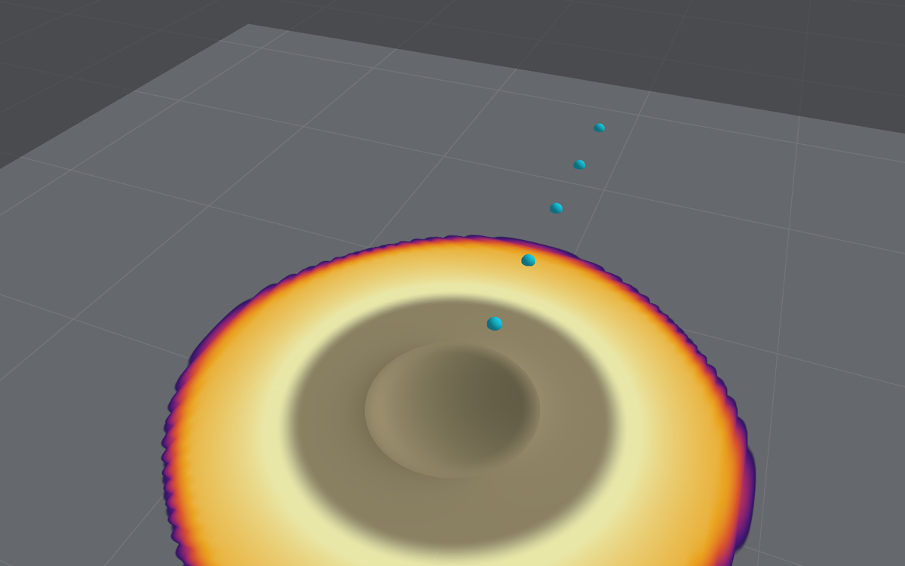

# Cratering

What the ground under a scene is made of, the crater each charge digs in it, and the share of
the charge's energy the air keeps. This is stage 1 of two (see the
[roadmap](roadmap.md#effects-beside-the-blast)): an empirical crater, and the energy a charge
on soft ground gives to the ground instead of the air. Stage 2, a crater that forms coupled to the
blast, is not built.

**Standing: approximation for the crater's diameter, illustrative for its depth and lip.** The
diameter comes from P. W. Cooper's cube-root scaling with Kinney and Graham's scatter, the height
of burst to the charge's centre. Glacial soil (Suffield) takes H. F. Cooper's wet-soil volume law
instead (both since 22 October 2026, [below](#the-centre-datum-22-october-2026)). Five of six
measured craters fall within that scatter, three of them the 500-ton TNT shots at Suffield
([below](#against-measured-craters)). Against H. F. Cooper's 135 high-explosive craters (1976),
charges on the surface read 1.01 of its radius and raised charges 0.90
([below](#against-cooper-1976)). The depth is a rule of thumb in dry ground. Below a shallow
water table the walls slump to Glasstone and Dolan's 10–15°. That brings the three wet sites'
depths within 0.84–1.31 of the estimate, against 0.19–0.29 by the dry rule
([below](#below-a-water-table)). The air's share on soft ground is an approximation, the same for
every soil.

**The crater does not act on the blast.** A crater forms over a time of order √(D/g): about
0.4 s for 100 kg, seconds for a kiloton. By then the blast has gone, and most runs have ended.
So the air keeps the ground as it was before the blast, and the crater is worked out from the
scene, reported and drawn when the run ends. A replay and the USD export draw it growing over that
time ([below](#how-it-grows)). The one effect of the ground that does reach the
air is the energy it takes ([below](#the-air-on-soft-ground)).

## Choosing the ground

In the app, the Run tab's Terrain section has a **Made of** picker:

- **Rigid ground**, the default: the reflecting ground the air model has always had. No crater,
  no energy lost, and debris stops dead.
- **Soil under debris only**: the soft ground under structures' debris (`groundStiffness`, a
  Winkler bed), as before 17 October 2026, and nothing else.
- **Earth or rock**, the rows of Cooper's table of cratering efficiencies (below). Each digs a
  crater and leaves the air less of a charge near it. It also puts the debris on soil, with a
  subgrade modulus to match, which the stiffness slider can still change.

Under earth or rock, **Water table near the surface** and its depth set where the water table is
(see [below](#below-a-water-table)). Choosing saturated soil turns it on, with the water at the
surface; the other types leave it off, deep enough not to matter. A caption under the picker
gives the crater the charge would dig.

The ground type and the water table are saved with the project's run settings (`ground` and
`waterTable` in `settings.json`, left out for rigid ground and a deep water table). Both are part
of the run's fingerprint: the ground because it changes the air, the water table as a run input
beside it.

Headless, `--ground` takes a type as well as `rigid`, `soil` or a modulus, and `--water-table`
takes a depth in metres or `deep`:

```bash
swift run -c release BombCAD run street.bombcad --ground glacialSoil --water-table 1.5 --usd street.usda
```

The summary then ends with a line per crater. For 500 short tons of TNT centred on glacial soil,
for example: "Crater in glacial soil: 92.2 m across (61.5–122.9), 23.0 m deep, lip 5.76 m high out
to 115.2 m".

| Type (`--ground`) | Cooper's site | E_CR | Debris modulus |
|---|---|---|---|
| Rock (`rock`) | Basalt and granite (Mice, Mine Shaft) | 0.20 | 150 MN/m³ |
| Soil over sandstone (`soilOverSandstone`) | Mixed Company, western Colorado | 0.25 | 150 MN/m³ |
| Dry lake bed (`playa`) | Nevada Test Site, New Mexico | 0.45 | 100 MN/m³ |
| Dry alluvium (`alluvium`) | Nevada Test Site, Cooper's reference | 0.50 | 50 MN/m³ |
| Clay over shale (`clay`) | Middle Gust, south-eastern Colorado | 0.55 | 50 MN/m³ |
| Glacial soil (`glacialSoil`) | Suffield, Alberta | 0.75 (not used: H. F. Cooper's wet soil, below) | 100 MN/m³ |
| Clay over claystone (`clayShale`) | Diamond Ore, Montana | 0.95 | 100 MN/m³ |
| Saturated soil (`saturated`) | Coral sand (Eniwetok), saturated clay (Middle Gust) | 2.00 | 15 MN/m³ |

Cooper's table has eleven rows. Two near-duplicates are folded in, and his footnote says they
are "not all of equal confidence". The debris moduli are rough, within the range the soft-ground
setting already gave. Reclaimed fill below a high water table, like Beirut's port, belongs with
saturated soil.

## The crater

**Size.** The apparent crater's radius at the original ground's level is Cooper's equation 29.7
(glacial soil apart, [below](#the-centre-datum-22-october-2026)):

R = K (2 E_CR W e^(−1.457 HOB))^(1/3)

- R is in feet, W is the TNT-equivalent mass in pounds, and E_CR is the cratering efficiency from
  the table above.
- K is 0.97 ft/lb^(1/3), Cooper's constant for TNT (his equation 29.3).
- HOB is the height of burst in charge radii; see [below](#height-of-burst).
- For TNT in the Nevada alluvium this is 0.77 W^(1/3) m across. That is close to Kinney and
  Graham's 0.8 W^(1/3) m, fitted to about 200 accidental explosions.

**One K for every explosive.** Cooper scales K with the explosive's detonation pressure, which
gives ANFO and ammonium nitrate about 0.61. BombCAD instead uses TNT's K for every charge's
TNT-equivalent mass. The two large ammonium-nitrate craters below fall within the scatter that
way (0.89 and 1.24 of the estimate), and outside it with ANFO's K (1.42 and 1.97). That choice
was made on these two events, so for them the check is not independent. BlastCore keeps both
(`CraterExplosive`), and `blastbench snapshot --explosive anfo` uses ANFO's.

**Scatter.** Kinney and Graham give a standard deviation of about a third of the diameter.
Every crater is reported with that one-sigma range. Cooper notes "quite a bit of significant
scatter", put down to mixed explosives and soils.

**Depth and lip.** Shape, from Cooper and Glasstone and Dolan:

- The apparent depth is half the radius (Cooper, p. 430; Kinney and Graham give a quarter of the
  diameter).
- The bowl is a paraboloid from that depth up to the original ground at the apparent radius.
- The lip rises to a crest a quarter of the depth high at 1.25 radii (Glasstone and Dolan,
  §6.71).
- Beyond the crest, the ejecta thin as the 3.86th power of the distance (§6.75), eased to nothing
  at 2.5 radii, the middle of their "two to three times" (§6.74).
- The lip then holds about two thirds of the bowl's volume. Glasstone and Dolan put the ejecta at
  55% of the apparent crater's mass, before counting the upturned rim.

### Below a water table

A water table near the surface keeps a crater shallow. In saturated soil with a high water table,
the walls slump and the crater becomes "shallower and broader", towards slopes of about 10 to 15
degrees (Glasstone and Dolan, §6.11). Water rushing in carries material that would have formed
the lip into the bottom. They also note "hydraulic fill" making a wet crater's final depth
shallower (§6.09), and a water table flattening and widening the crater (§6.78). GEER put
Beirut's shallow crater down to its water table 1.5 m below the quay.

BombCAD takes the slope as 12.5°, the middle of the range. A bowl whose rim slopes at θ is
R tan θ / 2 deep, so the apparent depth below a water table d_w metres down is:

D = min(D_dry, max(d_w, R tan θ / 2))

- The walls below the water slump to θ.
- The crater still reaches the water table, because the dry ground above it holds its shape.
- It is never deeper than in dry ground, so a water table below the dry crater changes nothing.
- 10° and 15° give the depth's range, reported with it. The lip, a quarter of the depth, comes
  down with it.
- The radius is left as it is. Glasstone and Dolan say wet craters are broader but give no figure,
  and saturated soil's cratering efficiency already digs wider.

**Why a slope and not a depth.** No open source gives a crater's depth as a function of the water
table's: not Cooper, nor Kinney and Graham, nor UFC 3-340-02. TM 5-855-1 and the crater databases
(AFWL-TR-71-144, Gould's DNA 6187F) were not to hand ([data wanted](data-wanted.md)). Glasstone
and Dolan's slope is the one open, quantitative statement. The measured wet craters' own depth
over radius sits inside it: 0.124 at Prairie Flat and 0.131 at Dial Pack, against 0.088–0.134 for
10–15°. Beirut's 0.077 is below it, where fill also flowed into the basin.

**True and apparent craters.** The true crater is the hole the charge digs. Fallback and slough
from its walls then fill part of it back, and what is left is the apparent crater (Cooper,
figure 29.1; Glasstone and Dolan, §6.70). Measurements and scaling laws, these included, are of
the apparent crater. No open source gives the true crater a ratio to it: the one figure found,
about 1.7 times the depth at a single dry site, is second-hand. So the true crater is not
estimated. In saturated, cohesive soil the two are said to be nearly the same.

### Height of burst

BombCAD measures the height of burst from the ground to the charge's centre, as both Coopers do
(P. W. Cooper's example 29.2; H. F. Cooper, 1976). A sphere resting on the ground is one charge
radius up. A charge centred on the surface, or below it, counts as a surface burst. Above 3.2
charge radii, where under 1% of the energy couples into the ground, there is no crater: it is an
air burst.

Until 22 October 2026 it measured to the underside, so that a resting sphere counted as a surface
burst. That choice was made on the two 500-ton spheres at Suffield, which fit the surface law
(1.26 and 1.04 of it), but it read every raised charge's crater too wide: H. F. Cooper's 40 raised
charges were 0.57 of it, against 0.90 to the centre ([below](#against-cooper-1976)). Suffield is
now matched instead by digging its glacial soil as H. F. Cooper's wet soil
([below](#the-centre-datum-22-october-2026)).

The air's share on soft ground still tapers on the height to the underside
([below](#the-air-on-soft-ground)), so that no blast moved with the crater's datum.

## The air on soft ground

On rigid ground a charge resting on the surface acts on the air as one of twice its mass in free
air (Glasstone and Dolan, §3.34). Real ground takes part of the energy into the crater and the
ground shock:

- **The share.** Kinney and Graham give a surface burst's apparent-to-actual yield ratio as 1.5 to
  2 (their example 8-7). Kingery and Bulmash, whose curves are for real ground, are reported to
  take 10% as absorbed: 1.8 (Aouad and others, 2021, citing ARBRL-TR-02555; not checked in the
  report itself).
- **Rigid ground:** a charge keeps all of its mass for the air, and the scene loads as before, to
  the bit.
- **Earth or rock:** a charge on the surface keeps 1.8 rather than 2, that is 0.9 of its mass, for
  every soil. No open source gives the share by soil type, beyond Glasstone and Dolan's remark
  that wetter ground couples more (§6.72).
- **Height.** The loss tapers with height as the share going into the ground does in Cooper's
  figure 29.7, e^(−1.457 HOB): about 33% on the surface, 1% at 2.4 charge radii. Here the height
  runs to the charge's underside, as the crater's did before 22 October 2026, so a resting sphere
  loses the full share (`CraterEstimate.couplingHeight`).

The air's charges, balloon or mapped, are laid down with that mass (`Charge.coupled`). Nothing
here has been compared with a burst measured over soft ground. The standing names it as "Ground
that takes energy" and caps the peak and impulse at approximation. Its band is Kinney and
Graham's range: a mass between 0.75 and 1 of the charge's.

## Shown and exported

- **In the app,** the crater is shaded into the ground or the terrain when the run ends. Its
  slopes come from the profile above, darker towards the bottom of the bowl, with its earth laid
  back over the air's colours. It is shaded rather than built, because the air model's ground is
  the domain's floor. The caption gives its size. Kept runs give it in Compare and in their CSV
  (apparent diameter, depth and lip height, at the run's end).
  - **While a run goes on** there is none, as before, unless the run lasts past the time the
    crater takes to form ([below](#how-it-grows)); then it grows with the run, so that it is whole
    by the end.
  - **In a replay** (since 23 October 2026) the crater grows with the replay's time: none at
    t = 0, and at each frame the crater as dug by then. Scrubbing back fills it in again. A run
    from a mapped start records its first frame a little after the blast, with a small bowl
    already dug. A kept run replays its own craters, from its scene and settings, even when the
    project's scene has changed since. Nothing new is recorded: the crater at a time follows from
    the kept run's final crater, so old recordings grow it too.
  - **The crater's tail.** Most runs end before their craters have formed: 4 ms into a 0.5 kg
    charge's 0.14 s on clay, the bowl is 28% of its width and the lip has not risen. So after
    the run's last frame the replay carries on until the last crater has formed, with the air
    and the structures held as that frame left them. The tail plays in real time, a step of
    1/24 s of simulated time to each frame shown, where the run's frames play far slower. The
    bar says "Crater forming, run ended at 4.0 ms" while it is in the tail. The slider gives the
    run's frames and the tail's steps a share each by how long they take to play, with an
    orange mark where the run ends. Play, the steps and the slider all cover the tail. A replay
    opens at the tail's end, the crater whole, and **Done** shows it whole as before. A run that
    lasts past its craters' formation, or digs none, has no tail. Nothing is stored for it: it
    follows from the kept crater. Continuing from the tail takes back the run's last saved
    state.
- **Headless,** the summary prints a line per crater.
- **USD export.** `--usd` and File ▸ Export for Rendering add `/Scene/Crater` (`Crater_1`, …): a
  patch of ground over each crater. Since 23 October 2026 it is flat until its charge fires and
  then grows as the replay draws it, over the run's frames and then over the cloud's, if the run
  follows one, at the cloud's own times. Until then it was flat until the run's last frame and
  cratered at it. The patch keeps a sample wherever the crater has grown by a thirty-second of its
  size or a sixteenth of its lip since the last, and the frames between are interpolated. Where
  the run's frames and the cloud's end before the craters have formed, the scene goes on in a
  tail, as the replay does: a time code each 1/24 s of simulated time (the file's frame rate,
  so in real time) to the latest crater's formation time, the rest of the scene held as its last
  frame left it. `customLayerData` gives `craterTailStartTimeCode` and
  `simulatedSecondsPerCraterTailFrame` then. A cloud that outlasts the crater needs no tail.
  The flat ground plane, or the terrain, is left open under the patch so the bowl
  shows. Its `bombcad:label` holds the final crater's line.
- **`blastbench snapshot --ground alluvium --crater-time 0.1`** draws the craters as dug by 0.1 s.
- **`Terrain.cratered(_:)`** cuts the craters into a terrain for a scene that starts after the
  blast. The terrain must stand high enough: heights cannot go below z = 0, the air domain's floor,
  so raise its datum by more than the crater's depth first. Over a flat floor, use a terrain
  lifted above it.

### How it grows

**Standing: illustrative.** The growth is for the eye. It changes neither the final crater nor
anything in the run, and nothing has been compared with a filmed crater.

- **The formation time** is Holsapple's for the gravity regime, T = 0.8 √(V^(1/3) / g), with V
  the crater's volume. He takes it from Schmidt and Housen (1987) and his own 1993 review
  (figure 12). Here V is the apparent crater's bowl, π R² D / 2. That gives 0.33 s for 100 kg of
  TNT on alluvium, 0.14 s for half a kilogram on clay, and 1.3 s for 500 short tons. A delayed
  charge's crater starts when it fires.
- **The bowl.** Under point-source scaling the crater's growth is set by one coupling parameter,
  C = a U^μ δ^ν, of dimension L^(1+μ) T^(−μ). So any length in the growing flow goes as
  t^(μ/(1+μ)). The radius and the depth both grow so, as (t / T)^(μ/(1+μ)), and reach their final
  values at T. Holsapple's μ is 0.41 for dry soil and 0.55 for wet soil and rock, which makes the
  exponent 0.29 or 0.35: the crater is 82% of its width at half the time. Rock, the clays,
  glacial and saturated soil, and any ground over a shallow water table take 0.55; the dry lake
  bed, alluvium and soil over sandstone take 0.41. That sorting is BombCAD's. The bowl keeps its
  shape, so every point in it only deepens.
- **The lip rises last.** Its height rises over the second half of the formation time, eased, to
  the final height at T. Its crest and the ejecta's reach stand out from the bowl's rim as it
  rises, so no earth lies beyond the rim before then. That choice is BombCAD's own, since the
  ejecta are still in flight as the bowl opens. No open source found gives the lip's growth.
- **What is not modelled.** The growth law holds while the crater is still opening; real growth
  slows before it stops, where this stops at full speed. The true crater, deeper than the
  apparent one before fallback fills it in, is not drawn, so the bowl never overshoots its final
  depth.

`CraterEstimate.grown(atTime:)` gives the crater at a time, and `CraterGrowthTests` checks it: flat
at t = 0, the final crater from T, and monotone between.



## Against measured craters

Predicted diameters are TNT's K on the TNT-equivalent mass. The spheres resting on the ground
(Prairie Flat, Dial Pack) have their centres a charge radius up; the rest are centred on the
surface. Glacial soil digs H. F. Cooper's wet-soil crater. These are the figures since
22 October 2026; the ones before are in [the centre datum](#the-centre-datum-22-october-2026). The
band is one sigma. Where a figure is second-hand, it says so.

| Event | Charge | Ground | Predicted (band) | Measured | Measured over predicted |
|---|---|---|---|---|---|
| Prairie Flat, 1968 | 500 short tons TNT, sphere resting on the ground | Glacial soil, Suffield; high water table | 73.1 m (49–97) | 85.5 m across, 5.3 m deep | 1.17 |
| Dial Pack, 1970 | 500 short tons TNT, sphere resting on the ground | Glacial soil, Suffield | 73.1 m (49–97) | 70.1 m, 4.6 m deep (second-hand) | 0.96 |
| Snowball, 1964 | 500 short tons TNT, hemisphere | Glacial soil, Suffield; saturated | 92.2 m (61–123) | 73 m (second-hand) | 0.79 |
| Sailor Hat Bravo, 1965 | 500 short tons TNT, stack | Rock (basalt, unconfirmed), Kahoʻolawe | 43.6 m (29–58) | 69 m (second-hand) | 1.58 |
| Minor Scale, 1985 | 4,744 t ANFO, about 4 kt TNT, hemisphere | Dry lake bed, White Sands | 118 m (79–157) | 105 m, 24 m deep (second-hand) | 0.89 |
| Beirut, 2020 | Ammonium nitrate, 0.5 kt TNT (0.2–1.1) | Saturated fill | 97 m (65–129) | 117–124 m, 4–5 m deep | 1.24 |

- **Diameters.** Five of six fall within the band: the three Suffield shots, Minor Scale, and
  Beirut at its central yield. The last two sit within it only with TNT's K, the choice made on
  them (above). Sailor Hat's crater is half again as wide as rock's efficiency gives; its rock is
  unconfirmed, and if it was softer ground the gap closes. The estimate under-reads on average,
  by 1.10 over all six (1.18 before 22 October), as Glasstone and Dolan's remark that moist ground
  digs wider would lead one to expect.
- **Depths.** By the dry rule, the three wet sites' measured depths are 0.25 (Dial Pack), 0.29
  (Prairie Flat) and 0.19 (Beirut) of the estimate. With the water table near the surface, they
  are 1.14, 1.31 and 0.84 of it:

  | Event | Water table | Depth, dry rule | Depth, slumped (10–15°) | Measured | Measured over slumped |
  |---|---|---|---|---|---|
  | Prairie Flat | High: the crater "filled rapidly with water" | 18.3 m | 4.05 m (3.2–4.9) | 5.3 m | 1.31 |
  | Dial Pack | High, the same site | 18.3 m | 4.05 m (3.2–4.9) | 4.6 m | 1.14 |
  | Beirut | 1.5 m below the quay (GEER) | 24.2 m | 5.4 m (4.3–6.5) | 4–5 m | 0.84 |
  | Minor Scale | Deep (dry lake bed) | 18.5 m (ANFO's K) | — | 24 m (second-hand) | 1.30 of the dry rule |

  The Suffield shots' water-table depths were not found open: they are taken as within the slumped
  depth, which the craters' flooding implies, and any depth up to 4.05 m gives the same result.
  Two of the three wet craters lie within the slope's range once the radius's own under-reading
  is allowed for (Prairie Flat's radius is 1.17 of the estimate). Beirut is shallower still,
  0.04 of its diameter, "below the lower range" measured for large blasts (GEER), with its fill
  flowing into the basin. At dry White Sands, with no water table, the dry rule with ANFO's K is 1.30 too
  shallow; with TNT's K, the choice made for its diameter, it gives 29.5 m, and the measured depth
  is 0.81 of that.
- **Beirut's yield.** Aouad and others found 257–287 t of TNT from the crater by another scaling
  law, below the 0.5 kt from the blast. On saturated soil with TNT's K, this estimate needs about
  0.95 kt for 120 m: inside the range of the yield estimates (0.2–1.1 kt), but nearly twice the
  central one. With the burst's height unknown, and the crater widened by fill flowing into the
  basin, neither figure checks the other.

Not found open, and wanted ([data wanted](data-wanted.md)): the test reports themselves. These
are Jones's Prairie Flat crater study, Roddy's tables for Snowball, Dial Pack and Mixed Company,
the DNA's Minor Scale reports, Gould's DNA 6187F, and the 200-event database of AFWL-TR-71-144.
The DTIC copies were refused or down while this was written.

## Against Cooper 1976

On 21 October 2026, against H. F. Cooper's estimates of crater dimensions (RDA-TR-2604-001, 1976;
[Fixtures/Cooper1976](../Fixtures/Cooper1976/README.md), `blastmodel craters-cooper`,
`CraterCooper1976Tests`). It is a different Cooper from the P. W. Cooper whose law BombCAD uses.
His report gathers the high-explosive cratering tests of the 1960s and early 1970s by medium and
height of burst:

- each crater's apparent volume per ton, V/Y;
- its scaled height H = HOB / V^(1/3), from 0.75 above the surface to 0.8 below it.

Figures 9–12 give 135 points (dry soil, wet soil, soft rock, hard rock), digitised for the
fixture. They are mostly 256 lb and 1,000 lb charges, so the comparison is of scaling, not of
any one test.

**How the points are set beside BombCAD.**
- **Radius.** Cooper's radius is 1.2 V^(1/3); 95% of his data lie within 1.1–1.4 (his equation 14).
- **Charge.** Each point is a ton of TNT whose centre is H V^(1/3) above the ground.
- **BombCAD's height.** From that, the height to the underside, in charge radii. Below the
  surface, BombCAD counts the charge as on it.
- **Ground.** BombCAD's stand-in for each medium: dry alluvium, saturated soil, soil over
  sandstone (Mixed Company, one of figure 11's sites), and rock.
- **Assumed.** Cooper's ton is taken as a short ton, and his heights as measured to the charge's
  centre. The report does not say either.

His radius over BombCAD's, the geometric mean (range), and the share within BombCAD's one-sigma
band (two thirds to four thirds):

| Where the charge is | Points | Height to the underside (before 22 October) | Height to the centre (BombCAD since) |
|---|---|---|---|
| On the surface, \|H\| ≤ 0.05 | 21 | 1.01 (0.81–1.35), 95% | the same |
| Above it, H > 0.05 | 40 | 0.57 (0.31–0.94), 30% | 0.90 (0.50–1.52), 75% |
| Below it, H < −0.05 (counted as on it) | 74 | 1.72 (0.99–3.26), 18% | the same |

By medium, on the surface: dry soil 0.96, wet soil 0.99, soft rock 1.15, hard rock 1.01.

- **On the surface BombCAD's crater is Cooper's.** Charges centred on the ground read 1.01 of
  BombCAD's radius, all four media within 4–15%, 20 of 21 points inside its band. That puts the
  diameter's standing on 21 small charges besides the six large craters above. Its volumes also
  sit inside Cooper's ranges, though they are higher than his best estimates. Centred
  on the surface, BombCAD's paraboloid holds 1,290–1,580 ft³/ton in dry soil, against his 1,000
  (600–1,800). Saturated soil holds 5,730, against 4,000 (2,000–8,000). Rock holds 573, against
  500 (300–700).
- **Above the ground BombCAD's craters were too wide.** With the height to the underside, the
  points read 0.57 of its radius, and only 12 of 40 lie inside its band. Measured to the centre,
  as Cooper and P. W. Cooper's own example measure it and BombCAD has since 22 October 2026, they
  read 0.90, with 30 of 40 inside.
  - **Why.** BombCAD's taper is P. W. Cooper's e^(−1.457 HOB) in charge radii. Cooper's own
    e^(−5.2 H) in V^(1/3) is gentler per charge radius: about 0.87 in dry soil and 0.55 in wet,
    where V^(1/3) is larger. So the taper alone does not explain it. Counting from the underside
    takes a whole radius off every height, and that is what reads them wide.
  - **For a 1-tonne sphere resting on dry soil.** Cooper's best estimate is a radius 1.00 of
    BombCAD's to the centre, and was 0.62 of it to the underside.
- **The choice of the underside had been made on Suffield** ([above](#height-of-burst)), where
  the 500-ton spheres fit the surface law. Cooper's method fits them without it:
  - **Wet soil.** He puts these as wet soil (V₀ 4,000, high water table), with the height to the
    centre. That gives 73 m, against the measured 85.5 and 70.1 m (1.17 and 0.96).
  - **BombCAD's glacial soil** (E_CR 0.75) dug about half the volume of Cooper's wet soil. The
    underside convention made up for the low efficiency there, and over-read every other raised
    charge. Cooper's method on the other measured craters gives Snowball 0.79, Sailor Hat
    1.50, Minor Scale 0.88 and Beirut 1.27: five of six within a third, as BombCAD's are.
- **Below the surface the craters are larger, as expected.** Buried charges are not modelled, and
  count as on the surface. A charge buried to H = −0.2 to −0.4 digs 1.4 to 2 times the radius
  (Cooper's e^(5.2 |H|), 3 to 8 times the volume). The points read 1.72 of BombCAD's radius on
  average, and up to 3.3. This is the size of the gap that [stage 2](#stage-2) would close.
- **Depth.** Cooper's best depth is 0.5 V^(1/3) with his radius 1.2 V^(1/3): 0.42 of the radius
  (0.25–0.64 over his ranges), against BombCAD's half. Wet craters larger than about 10⁵ ft³ come
  out shallower (his figure 20), as the [slumped walls](#below-a-water-table) make them.
- **The scatter is as Cooper states it.** His own best-estimate curve runs through his points at
  0.95–1.00 of their radii, 80–100% of them within a third. He puts repeat shots in one medium
  within a factor of 3–4 in volume and 50% in dimensions.

**Standing:** the diameter stays an approximation. A charge on the surface reads 1.01, on 21
small charges in four media beside the six large ones. A raised charge (a car's, a charge on a
table) reads 0.90, 30 of 40 within the band, since the datum moved to the centre (below); it read
0.57 before.

### The centre datum (22 October 2026)

The user decided on 22 October 2026 to measure the crater's height of burst to the charge's
centre (`CraterEstimate.heightOfBurst`), and to dig Suffield's glacial soil by H. F. Cooper's own
wet-soil law (`GroundType.usesWetSoilVolumeLaw`). The two go together: with the centre datum and
the old glacial soil, Prairie Flat and Dial Pack would read 2.05 and 1.69 of the estimate, outside
the band.

**Glacial soil's law.** The volume is V = 4,000 ft³ a short ton (his table 1's wet soil)
× e^(−5.2 H), H = HOB / V^(1/3) solved with it (his equation 6). The radius is 1.2 V^(1/3) (his
equation 14). Another explosive scales it as P. W. Cooper's K does. Making glacial soil saturated
under P. W. Cooper's law instead was tried by hand: it leaves Prairie Flat at 1.48, outside the
band. An efficiency large enough to fit the resting spheres (about 4) would put Snowball's
hemisphere at 0.62, also outside. Cooper's law keeps all three Suffield shots in:

| | Before (underside, E_CR 0.75) | Since 22 October |
|---|---|---|
| Cooper's raised charges, radius | 0.57 (0.31–0.94), 30% within | 0.90 (0.50–1.52), 75% |
| Cooper's surface bursts | 1.01 (0.81–1.35), 95% | the same |
| Prairie Flat (85.5 m) | 67.7 m, 1.26 | 73.1 m (49–97), 1.17 |
| Dial Pack (70.1 m) | 67.7 m, 1.04 | 73.1 m, 0.96 |
| Snowball (73 m, a hemisphere) | 67.7 m, 1.08 | 92.2 m (61–123), 0.79 |
| Prairie Flat's and Dial Pack's depths, slumped | 1.41 and 1.23 | 1.31 and 1.14 |
| Sailor Hat, Minor Scale, Beirut | 1.58, 0.89, 1.24 | the same (centred on the surface) |

**What moved.**
- **Every raised charge's crater.** A car's charge, or a charge on a table: a sphere resting on
  the ground digs 0.62 of the radius it did, and a charge higher up less again. On glacial soil,
  every crater moves, being Cooper's wet soil now.
- **Charges centred on the surface or below it** are unchanged, but on glacial soil.
- **The air's share on soft ground and its blast** are unchanged: they still taper on the height
  to the underside (`CraterEstimate.couplingHeight`). So is the crater's reported `groundShare`.
- **The highest burst that digs a crater**, 3.2 charge radii, is now to the centre.
- **No solver digest reads the crater**, and no run's loads moved. `CraterTests`,
  `CraterCooper1976Tests` and the crater's standing are updated.

## Limitations

- Empirical scaling only: no soil mechanics, ejecta, or ground shock driven by the charge
  (stage 2).
- The crater does not act on the blast or on anything during the run: debris, fragments, ground
  points and thermal sight lines see the pre-blast ground.
- A raised charge's crater reads a little wide: H. F. Cooper's raised charges are 0.90 of its
  radius ([above](#against-cooper-1976)).
- Glacial soil alone digs by H. F. Cooper's wet-soil law, chosen on Suffield's three shots; the
  other types keep P. W. Cooper's.
- Surface and above-ground bursts only; a charge below the surface counts as on it. Buried bursts
  scale differently (Cooper's W^(1/3.4) fits, §29.4) and are not covered.
- The depth is a rule of thumb in dry ground, and below a water table rests on one slope (10–15°)
  rather than on any measured relation with the water table's depth. Wet craters' widening and
  their slow slumping (hours in sand, months in clay; Glasstone and Dolan, §6.11) are not modelled.
- One K for every explosive, chosen on two events.
- The air's share is the same for every soil, and its taper with height is the crater's coupling
  curve, not a measured airblast one.
- Craters in the app are shaded, not cut into the air model's ground. The USD and
  `Terrain.cratered` give the shape.
- The crater's growth in a replay and the USD is illustrative: a formation time from the
  gravity regime and a point-source power law, with the lip's rise BombCAD's own choice.
- Several charges dig separate craters, which simply add where they overlap.

## Stage 2

A crater coupled to the blast near the charge: soil that flows, ejecta thrown into the air, and
the shock the charge drives directly into the ground, which also loads and vents the early blast
([distributed computing](distributed-computing.md#the-long-term-visions-effects)). It starts with
a check under the project's sharing rule, for an existing or in-progress model to adopt.

On 17 October 2026, for stage 1:

- **ContinuumKit** had no cratering, soil-flow or ejecta model.
- **Edgerton**'s "ejecta" are presentation effects for projectile impacts on gel.

Stage 2's material flow and fracture overlap Edgerton's volume solver and cohesive cracks, so
the check is to be redone then.

### The first rung, and the stop (22 October 2026)

**The gate** (emmettl/bombcad-work#23).
- **Sharing check, redone.** ContinuumKit still has no soil model. Edgerton's Metal MPM is a
  chosen visual model for gel and apple, with no soil law and no explosive coupling. BombCAD's own
  Drucker–Prager (the structure solver, the soil column, the half-space) is the only reuse route.
- **The judge.** Clarke et al., *Characterisation of buried blast loading* (Proc. R. Soc. A 476,
  2020, CC BY), with its figshare dataset 12124224. 78 g of PE4, a 3:1 disc, sits under a rigid
  plate with Hopkinson bars to 100 mm:
  - in the free air of an empty steel pot (series A);
  - on Leighton Buzzard sand (B);
  - buried 28 mm in it at three moistures, then other depths, stand-offs and soils (C–L).

  The buried loads are soil momentum: a delayed blast and a hail of sand in dry sand, an intact
  slug that about doubles the impulse in saturated sand.

**The first rung, with no soil** (`scenebench clarke-airblast`, a quarter of the rig on mirror
planes, 93.6 g of TNT at the authors' 1.2): does BombCAD's air carry series A and B within ±20%?

| Total impulse on the plate to 100 mm | Measured | BombCAD, 2.5 mm | 1.25 mm | Ratio |
|---|---|---|---|---|
| A, free air in the pot | 61.4 N s | 40.0 | 40.1 | 0.65 |
| B, on the sand (rigid ground) | 63.3 N s | 34.6 | 35.4 | 0.56 |

| Peak specific impulse, MPa ms | 0 mm | 25 mm | 50 mm | 75 mm | 100 mm |
|---|---|---|---|---|---|
| A measured | 3.92 | 3.57 | 2.39 | 1.67 | 1.04 |
| A, BombCAD 1.25 mm | 1.69 | 1.56 | 1.37 | 1.24 | 1.09 |
| B measured | 3.86 | 3.61 | 2.65 | 1.54 | 1.22 |
| B, BombCAD 1.25 mm | 1.42 | 1.37 | 1.25 | 1.10 | 0.93 |

- **The air is right for the charge it models.** B's centre reads 1.42 MPa ms against
  Kingery–Bulmash's 1.41 for a hemisphere of the same mass at Z = 0.42, and its peak 55 MPa
  against 55. A's centre reads 1.69 against 1.57, 8% over, which the pot's confinement accounts
  for. The impulse is converged: it moves by under 3% from 2.5 to 1.25 mm.
- **The plate saw a different charge.** The measured centre impulse is about 2.7 times
  Kingery–Bulmash's, and falls from the axis to 100 mm, where BombCAD's sphere and the measurements
  agree. That is the disc's flat face toward the plate and the explosive's near field. BombCAD's
  charges are spheres, mapped from a one-dimensional solution, so it cannot carry them.
- **Stopped by the rung's rule:** both totals miss by more than 20% before any soil.
  - A soil body would be judged against a load the air already misses by half.
  - What would come first is charges of other shapes: a disc or cylinder start, from an
    axisymmetric solution or a fine three-dimensional deposit.
  - Then the rung again, then the soil body (12–18 session-days in the plan).
- **The air share's taper datum** (to the underside or the centre) gets no evidence here.
  Clarke's charges are all on or in the ground.

## Sources

- H. F. Cooper Jr., *Estimates of Crater Dimensions for Near-Surface Explosions of Nuclear and
  High-Explosive Sources*, RDA-TR-2604-001, R&D Associates for Lawrence Livermore Laboratory,
  1976, OSTI [6696719](https://www.osti.gov/biblio/6696719): table 1, figure 7, equations 6, 14
  and 15, and figures 9–12's points ([Fixtures/Cooper1976](../Fixtures/Cooper1976/README.md)).
  Distribution unlimited; the user's copy is outside the repository.
- P. W. Cooper, *Explosives Engineering*, Wiley-VCH, 1996, chapter 29, "Scaling craters":
  equations 29.3–29.7, table 29.1, figures 29.6–29.7, examples 29.1–29.2. The book prints equation
  29.5's detonation pressure in kbar, but its figure 29.6 and example 29.1 work only in GPa.
- G. F. Kinney and K. J. Graham, *Explosive Shocks in Air*, 2nd edition, Springer, 1985:
  equation 1-4 and its scatter, and example 8-7.
- S. Glasstone and P. J. Dolan, *The Effects of Nuclear Weapons*, 3rd edition, 1977: §3.34, §6.09
  and §6.70–6.75.
- C. N. Kingery and G. Bulmash, *Airblast Parameters from TNT Spherical Air Burst and
  Hemispherical Surface Burst*, ARBRL-TR-02555, 1984: the 10% into the ground, as reported by
  Aouad and others below.
- D. J. Roddy, G. W. Ullrich, F. M. Sauer and G. H. S. Jones, "Cratering motions and structural
  deformation in the rim of the Prairie Flat multiring explosion crater", *Lunar Science VIII*,
  1977 (NTRS 19780057835): Prairie Flat's crater.
- *Roundup* (NASA Manned Spacecraft Center), 31 July 1970: the 500-ton crater at Suffield on
  23 July 1970, taken as Dial Pack's by its date, place and charge. Second-hand, through search
  results of the scan.
- Snowball's diameter (BRL Report 1818 for the charge; the crater from secondary accounts), Sailor
  Hat Bravo's (US Navy photograph KN-10831; Maui News, 2010), and Minor Scale's (White Sands
  Missile Range Museum, 2023): all second-hand.
- GEER-070, *The 2020 Beirut Explosion*, 2021, §3.2: crater, ground and water table; C. M. Aouad
  and others, "Beirut explosion: energy yield from the fireball time evolution", *Shock Waves*,
  2021: the hydrographic survey, the crater-based yield and Kingery and Bulmash's 10%; S. E. Rigby
  and others, *Shock Waves*, 2020: the 0.5 kt (0.2–1.1).
- K. A. Holsapple, "Theory and equations for 'Craters from Impacts and Explosions'", the notes
  to his online crater calculator (hosted by the Lunar and Planetary Institute,
  [theory.pdf](https://www.lpi.usra.edu/lunar/tools/lunarcratercalc/theory.pdf)): the coupling
  parameter (equation 3), μ by material (the table in §2), and the formation time (equation 8),
  after R. M. Schmidt and K. R. Housen, *International Journal of Impact Engineering* 5, 1987, and
  K. A. Holsapple, *Annual Review of Earth and Planetary Sciences* 21, 1993, figure 12: the
  crater's growth in a replay.
- A. W. Patteson, Operation Hardtack Project 1.4, 1960: lips of 15–20% of the crater's volume
  for surface bursts in dry sand, against Glasstone and Dolan's 55% (not used).
