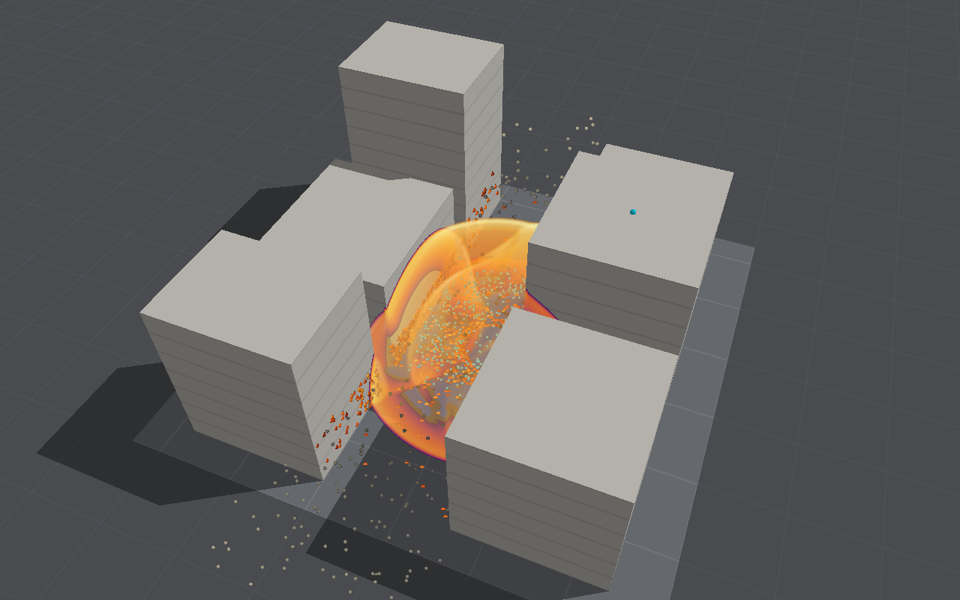
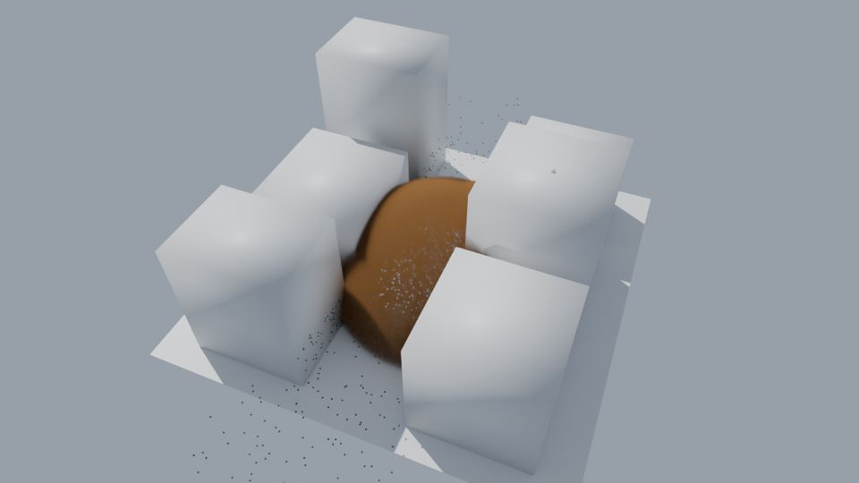

# Fragments flown alongside a run

A cased charge's fragments, and passive tracers, flown through the blast one way: the air pushes
them, they do not push back. The app draws them over a run as it goes; headless runs export them.
The model can run on this Mac's CPU or on another Mac, fed the air a frame at a time over SSH, which is what it was built to try: a live one-way consumer, the first
of the separable models in [Distributed computing](distributed-computing.md#separate-models-on-separate-machines).

**Standing: approximation when the casing's thickness and diameter are given, illustrative
otherwise.** With the casing's dimensions, the masses and their number are Mott's, the launch
speed Gurney's and the drag measured, the recognised method; it reproduces Cooper's worked
examples and is within a factor of 1.36 of his counted bomb fragments ([below](#against-coopers-data)).
No arena test of speeds or ranges has been compared. Without them the number of fragments is
chosen, not derived, and the result is illustrative.

```bash
swift run -c release BombCAD run street.bombcad --fragments casing.json --consumer my-mac.local --usd street.usda --vdb street.volumes --fragment-results impacts.json
```

`--consumer local` (the default) runs the fragments on this Mac's CPU. The description is JSON;
any field left out takes its default:

```json
{
  "casingMass": 50,
  "count": 2000,
  "casing": "cylinder",
  "axis": [0, 0, 1],
  "spread": 0.25,
  "gurneyVelocity": 2440,
  "wallThickness": 0.012,
  "innerDiameter": 0.25,
  "explosive": "TNT",
  "fragmentDensity": 7850,
  "tracers": 500,
  "tracerRegion": {"min": [22, 21, 0.5], "max": [38, 37, 6]},
  "seed": 1
}
```

## The model

- **Masses** follow Mott's distribution, P(mass > m) = exp(−√(m/μ)). Given the casing's wall
  thickness t and inside diameter d (`wallThickness`, `innerDiameter`, in metres), μ is Mott's,
  M_K = B t^(5/6) d^(1/3) (1 + t/d) in pounds and inches, the mean mass 2 M_K², and the real
  number of fragments the casing's mass over it (Cooper's §27.3; his t^(5/16) is a misprint, as his
  Example 27.7 shows). B is the explosive's for mild steel (Cooper's Table 27.2), or
  `mottCoefficient`. Each fragment flown then stands for as many real ones as share the casing's
  mass, its weight in the results. Without the dimensions, `count` fragments share the casing's
  mass and each stands for one. `massExponent` (½, Mott's) generalises the form to
  exp(−(m/μ)^β); 1 is Grady's exponential, which fits Cooper's bomb better (below). The largest of
  2,000 from a 50 kg casing is about 0.7 kg.
- **The explosive** (`explosive`: TNT, Composition B, Composition A-3, Cyclotol (75/25), H-6 or
  Tetryl) sets √(2E) and B together, from Cooper's Tables 27.1 and 27.2; `gurneyVelocity` and
  `mottCoefficient` override them.
- **Launch speed** is the Gurney equation's, √(2E) / √(M/C + ½) for a cylinder and
  √(2E) / √(M/C + ³⁄₅) for a sphere, M the casing's mass and C the charge's; √(2E) is 2,440 m/s
  for TNT. A cylinder sprays its fragments out round its axis within `spread` of square to it, a
  sphere evenly. They start at the charge's radius.
- **Flight** is gravity and drag from the local air, ½ ρ C_d A |u − v| (u − v): the blast's
  density and wind act on each fragment. A fragment is taken as a tumbling cube, whose mean
  presented area is a quarter of its surface, 1.5 e². C_d is the measured curve for tumbling
  fragments on that area, Hansche and Rinehart's for tumbling cubes from Mach 0.5 to 3.5, as Moxnes
  et al. (2017) restate it: 0.82 at Mach 0.5, held below (their cubes' drag fell further there),
  rising to 1.25 at Mach 1.25, down to 1.1 at Mach 3 and 1.1 beyond. Drag is integrated exactly for a rate held over each step, so the stiff
  drag on the smallest fragments does not limit the step.
- **Tracers** are massless and go with the air.
- **Impacts** are recorded where a fragment first meets the ground, a rigid block or the
  structure's starting outline: the point, time, speed and energy. A fragment does not load what
  it hits, and the structure's outline does not move. Every independent structure contributes
  its starting regions; impacts in multiple-structure scenes include the stable `objectID`.
  The optional owner table and impact ID preserve decoding of older single-structure streams
  and results. Beyond the air's domain the air is still, and fragments still in flight when the
  run ends fly on in still air until they land (up to five minutes more), so the results count
  every fragment's landing.

## In the app

Turn on **Cased charge** in the Run tab's Fragments section. It starts with a casing a tenth of
the charge's mass, 2,000 fragments and 300 tracers across 16 m round the charge, and sets the
casing's mass, the number of fragments and tracers, and the casing's shape; the launch speed it
gives is shown. The description is saved with the project (as `fragments.json`), takes effect
from the next run, and is undone and redone with the layout's edits (⌘Z). With Macs set for sweeps in Settings, **Fly on** sends the fragments to
the one chosen, over a connection kept open between runs and shared with any other model run
there; should that Mac drop, they carry on here.

During a run the view draws them over the blast as dots of a fixed size on screen, whatever their
true size: fragments in flight dark when slow and white-hot at their launch speed, tracers in cyan,
and where fragments landed, from yellow at a joule to dark red at ten megajoules. Under Display,
each kind can be hidden and the dots' size set. A line under the section counts the fragments in
flight and landed, and the hardest impact.

**Keep Run** keeps the fragments with the run: what was flown, its launch speed and every impact.
Compare gives a line for each run that flew them, the run's CSV lists the impacts (time and
energy in joules, by fragment and surface), and **Use this run's inputs** brings its casing back.
They do not act on the air, so they are no part of the run's input fingerprint.



**The air is untouched.** The app takes a frame at the end of the first batch past each
millisecond, and one at the end, rather than stopping the run at fixed times, and with fragments
on holds a batch to about a millisecond of simulated time by taking fewer steps, never shorter
ones; the tests check that the air's gauges and the structure's response are the same to the last
bit with fragments on or off. The cost is that the frames fall where batches end, which follows
the playback's timing, so the fragments in the app differ a little from one run to the next. For a fragment study that repeats exactly, use `BombCAD run
--fragments`, which stops at fixed frames.

`blastbench snapshot --fragments casing.json` flies them alongside an offscreen snapshot, as the
view draws them (the figure above).

## Running alongside the blast

At each frame, the run cuts out a block of the air (`AirSlice`) around the particles, density,
velocity and pressure as 16-bit floats, and sends it to the consumer (`FragmentConsumer`), which
flies the particles from the last frame's air to this one's, interpolating in space and between
the two in time, and reports where they have got. The block for frame *k* is the report after
frame *k* − 5 grown by as far as the fastest particle (or, for tracers, the blast's wind, taken as
up to 2.5 km/s) can go in the frames between, and thinned to every second or third cell above a
million samples.

The run may get up to four frames ahead; then it waits, through a gate in `SimulationModel`'s run
loop that holds the next batch without blocking the main thread. Because each block comes from a
report always in by then, the air sent, and so the result, do not depend on how the two sides keep
time: the consumer on another Mac gives the same result as on this one, to the last bit.

On another Mac, the consumer is a session of `BombCAD worker` (see
[Sharing a sweep](run-comparison.md#sharing-a-sweep-with-another-mac)), over the same SSH
connection: the worker protocol (since version 2) carries each block as a raw binary payload, and the
trajectories come back the same way.

Frames are the export's (`--frame-interval`, 1 ms by default). Without a structure the run stops
at each frame, ending a time step there: every millisecond, in the street on the medium grid,
1,608 steps instead of 1,527 and a near-façade peak 1% lower; every 2 ms, 1,562 steps.

## Measured

The street canyon on the medium grid (8.4 million cells, 0.17 s, 100 kg), a 50 kg casing, frames
every millisecond, the Mac Studio (M4 Max) running the blast and either itself or the CI Mac mini
(M4) the fragments, over Thunderbolt:

| Particles | Consumer | Air sent | Rate | Run waited | Run | Same result |
|---|---|---|---|---|---|---|
| 2,000 fragments, 500 tracers | This Mac | 1.63 GB, 171 frames | about 200 MB/s | 0 s | 6.6 s | |
| 2,000 fragments, 500 tracers | The mini | 1.63 GB | about 200 MB/s | 0 s | 8.4 s | Yes |
| 50,000 fragments, 10,000 tracers | This Mac | 1.59 GB | 203 MB/s | 1.66 s of 7.84 | 8.1 s | |
| 50,000 fragments, 10,000 tracers | The mini | 1.59 GB | 205 MB/s | 1.43 s of 7.79 | 9.7 s | Yes |

Against 3.9 s for the run without fragments. The Studio was heavily loaded by other work at the
time, so the run times are rough; the mini's extra second or two is connecting and sending it this
build. The fragments are cheap: one CPU core keeps up with a few thousand, and only around 60,000
does the run wait for the consumer, on the mini or here. So this consumer gains nothing by moving,
as [expected](distributed-computing.md#separate-models-on-separate-machines); it exercises the
streaming a costlier consumer would need. The Thunderbolt link carried the air at about 200 MB/s
without the run waiting for it.



At 24 ms the blast still fills the street while the fragments (dark, drawn enlarged) have outrun
it past the blocks; the tracers (light) are carried in it. Rendered in Blender 5.2 with Cycles from
the export, the fragments enlarged by a geometry-nodes modifier: at true size they are millimetres
to centimetres across.

## Against Cooper's data

Cooper (1996, ch. 27) gives the data digitised in `Fixtures/Cooper1996/`: B for mild steel
cylinders and 13 explosives (Table 27.2), √(2E) for 25 (Table 27.1), one counted fragmentation
test (Fig. 27.13, a cast-iron aerial bomb from Strømsøe and Ingebrigtsen, its geometry not
given), and Hoerner's drag against Mach for idealised shapes (Figs. 27.15–27.18). Steel
cylinders and the common military explosives, then; nothing for other metals, spheres,
pre-formed fragments or improvised casings. `FragmentCloudTests` check the first two.

- **His worked examples.** A 1 in steel cylinder with a quarter-inch wall round Detasheet
  (B 0.08) gives M_K 0.0315 and 140.6 fragments, of them over 10, 5, 1 and 0.1 g 1.3, 5.0, 31.7
  and 87.7, his 1, 5, 31 and 87, rounded down; Gurney for M/C 6.39 and √(2E) 2,357 m/s gives his
  0.898 km/s.
- **The counted bomb.** Mott's form fitted to the points, N₀ 686 and μ 0.252 g, is within a
  factor of 1.36 (rms) across 0.13 to 8.8 g: too many of the smallest and the largest, too few
  in between. The generalised form fits with β 0.94 within 1.12, so set `massExponent` 1 for cast
  iron and other brittle casings; Mott's ½ stays the default, as fitted to steel shells.
- **Velocity decay.** The distances steel cubes launched at 1,500 m/s fly to half their speed,
  and until they carry less than 79 J (the hazardous-fragment energy), at sea level:

  | Drag | 1 g | 11 g | 100 g |
  |---|---|---|---|
  | The previous law (0.9, 1.3, 1.1) | 26.5 m, 48 m | 58.8 m, 228 m | 123 m, 721 m |
  | The measured tumbling curve (now the default) | 26.7 m, 49 m | 59.4 m, 234 m | 124 m, 756 m |
  | Hoerner's cube face-on, on e² | 27.0 m, 51 m | | |
  | Hoerner's cube edge-on, on e² | 40.6 m, 75 m | | |
  | Hoerner's cube face-on, on 1.5 e² | 18.0 m, 34 m | | |

  Hoerner's curves are for a fixed orientation, and turned into a tumbling fragment's drag they
  span 30% shorter to 50% longer, depending on the area and orientation assumed. The measured
  tumbling curve needs no such choice, so it is now the default; it moves the distances by under
  5%.

## Hazard

Where the fragments land on open ground is judged as the US explosives safety standards judge an
arena test (`GroundHazard`):

- **Hazardous fragments** strike with 79 J (58 ft-lb) or more, and the **hazardous fragment
  distance** is where they fall below one per 55.7 m² (600 ft²) of ground, a 1% chance of one
  striking a person's 0.56 m² (6 ft²): DoD 6055.09-M, equation V3.E3.T2-1 (now DESR 6055.09),
  as FAA Guide 437.53-1 (2011) restates it. Fragments of 14.9 J (11 ft-lb) or more, FAA's
  threshold for serious injury, are counted too.
- Landings are binned in rings round the charge (the first a metre across, each after a tenth
  wider, so the distance is found to within 10% at any range) and eight directions, each landing counting for the real fragments it stands for. Each
  direction's distance is the outer edge of its furthest cell at or over the criterion; the
  hazard distance is the largest. Fragments stopped by a structure or block are counted apart:
  they do not reach the open ground behind it.
- **Sampling.** The density in a far cell rests on the few fragments flown that land there. When
  fewer than ten set the distance, the summary says so: fly more fragments (`count`) and the
  distance settles.

**An example**: 100 kg of TNT in a 150 kg steel cylinder (12 mm wall, 250 mm bore, its axis
level along x), 1 m above open ground. Mott gives 18,400 fragments of a mean 8 g, launched at
1,725 m/s. With 200,000 flown, every one landed, 42% of them hazardous and the furthest
hazardous one 1,334 m out. The hazardous fragment distance is 49.8 m side-on to the casing,
where its spray goes (set by 38 and 46 fragments flown), and within the first metre elsewhere,
where only those thrown down land close. With 20,000 flown it was 50–55 m, set by 5–6 fragments
and flagged to fly more. Most hazardous fragments go far, but thinly: past 50 m they are under
one per 55.7 m². (`/Volumes/StudioData/bombcad/fragments/hazard/`.)

Shown in the summary printed, in `--fragment-results` (`hazard`: the cells, the directions'
distances, the shares hazardous and injurious, the furthest hazardous landing), in the USD scene
as a ring of points (`/Scene/FragmentHazard`), and in the app (below).

**In the app**, once a run ends, the fragments still in flight are flown on to land, and the line
under the Fragments section gives the hazardous fragment distance. Under Display, **Hazardous
fragment distance** draws it on the ground: a red circle at the distance, and a lighter arc in
each direction that falls short of it, at its own distance. A kept run keeps the hazard: Compare
gives the distance, and the CSV a row for it and for each direction.

The same criteria judge [debris](structural-model.md#debris-as-a-hazard) where a run makes it (rubble particles,
`StructureModel.rubbleParticles`), flown on from where the run leaves it (`DebrisResult`,
`BombCAD run --debris-results`), and the [glass of envelope buildings](building-envelopes.md#one-way-damage-single-degree-of-freedom)
is graded by GSA's and ASTM's window hazard levels.

## Output

- **The USD scene** (`--usd`) gains `/Scene/Fragments` and `/Scene/Tracers`, Points prims whose
  positions follow the frames; a fragment's width is its edge. Blender imports them as point clouds.
- **`--fragment-results`** writes the impacts, masses, counts and [hazard](#hazard) as JSON,
  without the trajectories, which are in the scene; `/Scene/FragmentHazard` rings the hazard
  distance.
- The summary printed gives the fragments landed on each surface and the highest impact energy,
  and how much air was sent and how long the run waited.

## Limitations

- Masses checked against one counted bomb and Cooper's examples; launch speeds and ranges against
  no arena test. The spray's angles are rough, and every fragment is a tumbling cube of the
  casing's steel.
- Mott's B is for mild steel cylinders; other metals, spheres, pre-formed and improvised casings
  need their own `mottCoefficient` and `massExponent`, which nothing here supplies.
- One way: fragments do not load the structure or the air, and the structure they can hit is its
  starting outline.
- The casing's own energy is not taken from the air's: the blast is the bare charge's.
- No break-up, no ricochet, no penetration; a fragment stops where it first hits.
- Only the coarse grid's air, also where refinement sharpens the shock.
- In the app, frames fall at the ends of batches, just past each millisecond, so its fragments vary
  a little from run to run (above).
- A kept run keeps the fragments' impacts, not their paths.
- The hazard distance is as good as the ranges, which no arena test has checked, and counts only
  landings on open ground: no ricochet, no fragments stopped by people or vegetation, and the
  density of fragments passing through the air above a person is not counted, only where they
  land.

## Sources

- R. W. Gurney, *The initial velocities of fragments from bombs, shells and grenades*, BRL Report
  405, 1943.
- N. F. Mott, Fragmentation of shell cases, *Proceedings of the Royal Society A* 189 (1947) 300–308.
- P. W. Cooper, *Explosives Engineering*, Wiley-VCH, 1996: Gurney's equations and constants
  (Table 27.1), Mott's B (Table 27.2), Fig. 27.13's counted fragments, Hoerner's drag curves.
- J. F. Moxnes, Ø. Frøyland, I. J. Øye et al., Projected area and drag coefficient of high
  velocity irregular fragments that rotate or tumble, *Defence Technology* 13 (2017) 269–280,
  doi:10.1016/j.dt.2017.03.008: the projected area of a tumbling body (a quarter of its surface)
  and Hansche and Rinehart's measured drag of tumbling cubes, Mach 0.5 to 3.5.
- FAA, *Calculation of Safety Clear Zones for Experimental Permits*, Guide 437.53-1 (2011): the
  hazardous fragment's 79 J and 600 ft² from DoD 6055.09-M, and its own 11 ft-lb.
- D. E. Grady, *Fragmentation of Rings and Shells*, Springer, 2006: the exponential form.
