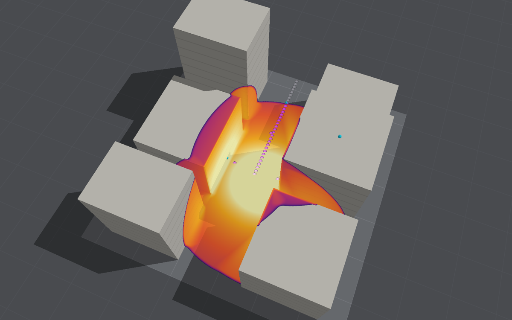

# Ground shock away from the charge

The ground's shaking under chosen points, estimated from the overpressure the run records on the
ground. It works one way: the air presses on the soil, and the soil does not press back. The air
model's ground stays a rigid reflecting boundary. A run in the app or a headless one streams
the bottom layer of cells to the estimate a frame at a time, a one-way consumer like the
[fragments](fragments.md) and the [thermal radiation](thermal-radiation.md). It belongs among the separable models in
[Distributed computing](distributed-computing.md#separate-models-on-separate-machines).

**Standing: illustrative.** There are two models: the textbook one-dimensional estimate of
air-induced ground shock from the protective design manuals, and a layered soil column under
each point, solved step by step through the overpressure's history on the ground. The column is
checked against closed-form solutions. Compared with one measurement, a 1 t surface burst at 21
and 42 m, both put the vertical velocity 20 to 80 times what was measured, at ranges near and
past where the ground's wave outruns the air ([below](#against-measured-ground-motion)). Use them to see roughly how hard and how far the ground shakes under a
blast, and how layers and the soil's unloading change that, and where the simple estimate stops
applying. Do not use them for design, for damage to buried services or for vibration limits.

```bash
swift run -c release BombCAD run street.bombcad --ground-shock ground.json --ground-results ground-results.json
```

With `--consumer ground=<ssh host>` the estimate is made on another Mac, fed the ground's air
frame by frame (see [Several consumers on several machines](distributed-computing.md#several-consumers-on-several-machines)).

The description is JSON, and any field left out takes its default:

```json
{
  "soil": {"density": 1600, "waveSpeed": 300},
  "points": [[24, 15], [32, 39.5]],
  "line": {"from": [30, 32], "to": [62, 32], "count": 17},
  "depths": [0, 1, 3],
  "arrivalThreshold": 1000
}
```

The points are (x, y) on the ground in metres. `points` comes first, then `line`, which puts
`count` points evenly from `from` to `to`, ends included. `depths` are in metres below each
point. `waveSpeed` is the soil's loading wave speed, the speed of a compression wave in it.
`arrivalThreshold` is the overpressure, in pascals, that marks the blast's arrival at a point.

That description uses the manuals' estimate, as every description saved before the column did.
`"model": "column"` asks for the soil column instead, and `profile` describes its layers:

```json
{
  "model": "column",
  "line": {"from": [33, 32], "to": [63, 32], "count": 31},
  "depths": [0, 1, 3, 10],
  "profile": {
    "layers": [
      {"thickness": 2, "density": 1600, "waveSpeed": 300, "unloadingWaveSpeed": 600, "damping": 0.02},
      {"thickness": 6, "density": 1900, "waveSpeed": 900, "damping": 0.02}
    ],
    "base": {"density": 2500, "waveSpeed": 2500},
    "dampingFrequencies": [10, 500],
    "timeStep": 5e-5
  }
}
```

Layers run from the surface down, each with its thickness (m), density (kg/m³), loading wave
speed and, optionally, unloading wave speed (m/s, at least the loading one; left out, the layer
is elastic) and Rayleigh damping ratio (0 to 0.5, none if left out). `base` is what lies under
the last layer: `"rigid"`, rock held still, or a half-space's density and wave speed. Left out,
the last layer goes on for ever. `dampingFrequencies` are the two frequencies (Hz) at which
each layer's damping has its ratio, and `timeStep` the step the column aims for (s). Without a
`profile`, the column is one elastic layer of `soil` going on for ever.

## The manuals' estimate

Each point is treated as a vertical column of uniform soil, pressed at its top by the air.
Where the air's front sweeps over the ground faster than the soil's own wave, as it always does
in soft dry soil and does near the charge in stiffer soil, the motion below the surface is mainly
a compression wave running straight down. That is the protective design manuals'
one-dimensional picture of air-induced ground shock.

- **On the ground**, the soil moves down at **v = P / (ρc)**, P the peak overpressure, ρ the
  soil's density and c its loading wave speed. ρc is its acoustic impedance. This is the plane
  wave relation σ = ρcv for a compression wave. Its top sinks by **d = I / (ρc)**, I the
  overpressure's positive impulse.
- **With depth** the wave arrives z/c later. Real soil gives way more on unloading than on
  loading, which wears the peak down as the wave travels. The manuals' factor
  **α = 1 / (1 + z / (c t_d))** stands in for that. The peak stress at depth z is αP and the
  velocity αP/(ρc). Here t_d = 2I/P, the length of the triangular pulse with the same peak and
  impulse, so c t_d is the pulse's length in the soil. The displacement is left at I/(ρc), the
  elastic column's value at every depth. That is an upper estimate, since it ignores the loss
  the factor stands for.
- **Sideways**, the soil's wave trails the air's front at an angle θ to the ground, with
  sin θ = c/U, U the front's speed. The particles move square to that wavefront, so the
  horizontal velocity is v tan θ. U comes from the peak overpressure by the Rankine–Hugoniot
  relations, U = c₀ √(1 + (γ+1)/(2γ) · P/p₀), c₀ being the ambient sound speed.
- **Regimes.** The horizontal estimate grows without bound as U falls towards c, where the
  wavefront stands upright. It is given only where **U ≥ √2 c** (superseismic), where it is no
  larger than the vertical. Between c and √2 c (transseismic) only the vertical estimate is given.
  Below c (outrunning) the soil's wave runs ahead of the blast. It shakes the ground before the
  air arrives, through motion that came in from nearer the charge, which this model does not
  have. There the vertical estimate is only the air's share. The √2 cut-off is this project's
  choice, not the manuals'.

**From the run.** P and I are the solver's own peak overpressure and positive impulse in the
bottom cell, kept every time step. Frames a millisecond apart would miss a ground-level peak
between them, but these fields do not. The consumer also counts each frame's overpressure
towards the peak. That covers a point already inside the blast as laid down at time zero, before
the solver's first step. Between cell centres it interpolates from the open cells only. A point
with only solid cells round it, under a block or the structure at every frame, is reported as
covered and has no response. The arrival is the first frame at which the peak has passed the
threshold, so it can be up to a frame late.

## The soil column

Under each point the column follows the compression wave down through layered soil, step by
step, pressed at its top by the overpressure on the ground. It replaces the manuals'
attenuation factor with the mechanism the factor stands for, and adds what uniform soil cannot
show: waves sent back from a stiffer layer or rock below, a layer ringing over a stiff base, and
the compaction the blast leaves behind.

- **The soil.** Each layer loads along its loading modulus ρc² and unloads and reloads along a
  stiffer one, ρc_u², c_u being the unloading wave speed. This is the bilinear hysteretic soil
  of the protective design literature (Newmark and Haltiwanger, and Salvadori, Skalak and
  Weidlinger, below): the soil gives at its loading modulus only beyond anything it has carried
  before, and comes back stiffly, so it is left compacted, and each loading and unloading loses
  energy. The peak runs down at the loading speed c, and the unloading behind it, at c_u,
  catches it and wears it down. That is the loss with depth the manuals' factor
  1/(1 + z/(c t_d)) describes. With c_u = c the layer is elastic and the peak carries down
  undiminished.
- **Damping.** Each layer can also take Rayleigh damping, a ratio ξ at two frequencies, made of
  a part proportional to mass and a part proportional to stiffness. Between the frequencies the
  damping is a little less than ξ, outside them more.
- **Beneath.** Under the last layer, rock held still (`rigid`), which sends every wave back, or
  an elastic half-space, which takes them away through a dashpot of its impedance ρc at the
  column's foot (Lysmer and Kuhlemeyer's boundary). If the last layer goes on for ever, the
  column carries it on below the deepest depth asked for, by half as much again and two metres,
  before the dashpot. A dashpot can only take away the loading wave cleanly, so this keeps what
  comes back from the foot well behind the peak.
- **The scheme.** Explicit central differences in time on a column of one-dimensional finite
  elements with lumped masses, which is the same as a staggered velocity–stress grid. Each
  element is as thin as is stable: a wave at the layer's unloading speed crosses it in one step.
  An elastic, undamped layer then runs at a Courant number of one, where the scheme carries a
  wave, even a jump, without error. Just below one, a jump would ring up to a fifth too high.
  The price is that each layer's thickness is rounded to a whole number of elements, so an
  interface can be up to half an element, c_uΔt/2, out: under a centimetre in soil unloading at
  300 m/s at the default step. In soil that unloads stiffly, the loading wave crosses an element in r = c_u/c steps.
  The scheme is then first order at the front, and the peak converges as the step shrinks
  (below). The mass-proportional damping is centred in time, and the stiffness-proportional part
  is taken from the last half-step's strain rate. The step is shortened to keep that stable,
  c_u²(Δt² + 2βΔt) ≤ h², and so that every layer has at least two elements. The default step is
  50 µs.
- **The load between frames.** A frame comes every millisecond, too coarse for a shock's
  rise, but each carries the solver's peak and positive impulse so far, kept every time step.
  The load is rebuilt between frames as straight lines that keep both. Where the peak rose above
  the earlier frame's value, the shock arrives with a jump to that peak, then falls in a line to
  the next frame's value, its arrival placed so that the interval's positive impulse is the
  solver's. Elsewhere a line runs through a midpoint chosen to keep the impulse, held between
  zero and the peak. Each of the column's steps then takes the load's mean over a window of
  twelve of its steps centred on it (0.6 ms at the default). That keeps the impulse exactly and
  gives the jump its rise: a sharper rise makes the surface's node ring, up to two fifths too
  fast in soil that unloads at twice its loading speed. The window is not widened to the time
  the front takes to cross a cell, as the solver's own shock is already that wide in the peak
  and impulse it keeps. It is centred, so the column's arrivals can be up to half of it early,
  and it shaves a peak falling after the shock by w/(2t_d) for a triangle of length t_d and
  window w: 7% for a 4 ms pulse, a fifth for the 1.4 ms pulse 4 m from 100 kg, 5% for 1 t at
  21 m.
- **Sideways.** The column is vertical, and the air presses only straight down on the ground,
  so nothing in it drives horizontal shear. A horizontal shear column is natural for an
  earthquake coming up from below, not for a load pressing from above. The horizontal velocity
  stays the estimate's geometric one, now layer by layer. The air's front sweeps over the
  ground with a horizontal slowness of 1/U, which by Snell's law is the same in every layer, so
  the soil's wave trails at sin θ = c/U, c being the loading speed of the layer at that depth. The
  horizontal velocity is v tan θ there, where that layer is superseismic (U ≥ √2 c).
- **What it gives.** At each depth asked for: the peak vertical stress, velocity and
  displacement, the displacement left at the last frame (the soil's compaction), the stress
  wave's arrival (the first time the stress there passes the arrival threshold), and the
  velocity at every frame. Each point also gets a profile: the peaks at 25 depths from the
  surface to the deepest asked for.

### Checks

The tests (`SoilColumnTests`, `GroundShockTests`) check the column against what is known in
closed form:

- **Uniform elastic soil.** A pulse runs down as d'Alembert's solution, v(z, t) =
  p(t − z/c)/(ρc), to 1% of the peak everywhere at 3 m. The peak velocity is the estimate's
  P/(ρc) and the displacement its I/(ρc), at every depth, to 0.5%. The work done on the column
  is the half-space's ∫p²/(ρc) dt to 0.2%, and all of it is carried away through the foot.
- **Two layers.** A pulse from soft soil into stiff, and from stiff into soft (impedances
  480,000 and 1,710,000 Pa·s/m): the stress sent back is (Z₂ − Z₁)/(Z₂ + Z₁) of the incident, and
  that passed on 2Z₂/(Z₁ + Z₂), both to 1%.
- **A layer over a stiff base.** 10 m of soil at 300 m/s, over rock held still and over a
  half-space eight times as stiff, rings at c/4H = 7.5 Hz. The same column with a shear wave's
  speed, 150 m/s (the same equation, with G = ρVs² in place of ρc²), rings at Vs/4H = 3.75 Hz.
  Both are within 1%, the highest peak of the surface velocity's spectrum.
- **Bilinear soil against the characteristics.** For a load that only falls after it arrives,
  the front's stress at depth z is S(z) = 2/(1 + r) Σₙ kⁿ σ₀(kⁿ z/a), with r = c_u/c,
  k = (r − 1)/(r + 1) and a = c r/(r − 1). This was derived here by the method of characteristics:
  each unloading wave sent down from the top catches the front, and the series is its echo off
  the front and the surface. For a triangle of peak P and length t_d, it falls in a straight
  line, P[1 − z(1 − 1/r²)/(2c t_d)], down to z = c t_d r/(r − 1), and then as 1/z with a ripple.
  For stiff unloading it reaches P/2 at z = c t_d, where the manuals' factor does too. The
  column follows it to within 3% at a 25 µs step and within 8% at the default, and closer as
  the step shrinks (`blastbench soilcolumn`, below). The lost energy, σ²(1/M − 1/M_u)/2 of the
  front's peak σ at every depth, matches to 5%.
- **Energy.** In a layered, hysteretic, damped column, the work done on the top balances the
  kinetic energy, the strain work, the damping and what is radiated, to rounding at every step:
  the central difference's own energy identity. Damped soil over rock, once still, has damped
  all the work put in, to 0.1%.
- **The load.** A Friedlander pulse framed every millisecond is rebuilt with the solver's
  impulse to 0.01% at every frame through its positive phase, and with its peak. A column
  driven by the rebuilt load moves within 6% of one driven by the pulse itself.
- **Older files.** Descriptions and results saved before the column read back as the estimate.

The peak stress against the closed form, `blastbench soilcolumn` (1,600 kg/m³ loading at
300 m/s and unloading at 600 m/s, 100 kPa falling to nothing over 4 ms, the default step
50 µs):

| Step | Element | 0.5 m | 1.2 m | 3 m | 5 m |
|---|---|---|---|---|---|
| 200 µs | 12 cm | 0.974 | 1.016 | 1.019 | 0.911 |
| 100 µs | 6 cm | 1.073 | 0.943 | 0.967 | 0.966 |
| 50 µs | 3 cm | 0.985 | 0.930 | 0.991 | 0.984 |
| 25 µs | 1.5 cm | 1.002 | 0.980 | 1.000 | 1.010 |
| 12.5 µs | 0.75 cm | 1.002 | 0.986 | 1.004 | 0.991 |

The convergence is ragged, as a front smeared over a few elements is, and first order.

## Output

`--ground-results` writes, for each point:

- the peak overpressure on the ground, its positive impulse and the triangular pulse's duration;
- the arrival, the front's speed and its regime (`superseismic`, `transseismic` or `outrunning`);
- at each depth, the peak vertical stress, vertical and horizontal particle velocity, vertical
  displacement and the stress wave's arrival;
- the overpressure on the ground at every frame, for anyone wanting the shape of the load;
- whether the point was covered;
- with the column, at each depth the displacement left at the last frame, the downward
  velocity at every frame and the peak downward and upward accelerations (only as fine as the
  load's averaging window, so no prediction), and the point's profile of peaks from the
  surface down.

The file also gives the model, the column's profile, each frame's time, the frames, the bytes of
air streamed and the time the run spent on them.
The summary printed gives the fastest surface motion and where it was, the points without a
horizontal estimate, and the covered points.

With `--usd` as well, the scene gains `/Scene/GroundShock`, Points just above the ground at the
points with open ground, as wide as half their spacing along a line (half a metre otherwise).
Each carries what the ground did there as primvars, for colouring in Blender: `peakOverpressure`
(kPa), `impulse` (Pa·s), the surface's `verticalVelocity` (mm/s) and `verticalDisplacement` (mm),
and `arrival` (ms, −1 where the blast never came), and with the column the `settlement` left at
the surface (mm). File ▸ Export for Rendering… puts the
project's ground points in the scene unless told not to.

## In the app

Turn on **Ground points** in the Run tab's Ground shock section. It starts with 16 points along
the ground from a metre beside the charge to a metre short of the domain's edge, the way the
ground runs furthest, over a soil column of dry soil, 1,600 kg/m³ loading at 300 m/s and
unloading at twice that, going on for ever. **Model** chooses the soil column or the manual
estimate; projects saved before the column open with the estimate. Sliders set the soil's
density and wave speed, the number of points (8 to 64) and the line's two ends, to the half
metre. For the column, **Unloading** sets how much faster the soil unloads than it loads (1 to
4 times, 1 for elastic soil); **Beneath** puts more of the same, stiff soil (1,900 kg/m³ at
900 m/s), rock (2,500 kg/m³ at 2,500 m/s) or rigid rock under a top layer whose depth
**Layer depth** sets (0.5 to 20 m); and **Down to** reaches 3, 5, 10 or 20 m. The
points are saved with the project (as `groundShock.json`), take effect from the next run, and
are undone and redone with the layout's edits (⌘Z). With Macs set for sweeps in Settings,
**Run on** estimates the shaking on the one chosen, as the fragments and the thermal radiation
can; should that Mac drop, it carries on here. Other points, depths and profiles need the JSON
description and `BombCAD run`.

The view draws the points as dots just above the ground: grey until the blast reaches them, then
from blue at 1 mm/s of downward surface velocity, through violet, to near white at 10 m/s, on a
log scale. Points under a block or the structure are not drawn. Under Display they can be
hidden, and they share the fragments' dot size. A line under the section counts the points the
blast has reached and names the one where the ground moves fastest.

With the column, a chart under that line follows one point, the fastest unless another is
stepped to: **Peaks with depth** draws the fastest the soil moved down at each depth and how far
down it was left, and **Motion at depth** the downward velocity at each depth asked for through
the run, a value a frame. Both update as the run goes.

**Keep Run** keeps the points and their estimates, without the overpressure or velocity
histories but with the column's profiles of peaks. Compare
gives a line for each run that had them, the run's CSV gives each reached point's peak
overpressure and its vertical velocity at each depth (at the arrival there), and **Use this
run's inputs** brings its points back. Like the fragments, they do not act on the air, so they
are no part of the run's input fingerprint, and the tests check that a run's gauges are the
same to the last bit with them on or off.

The app takes a frame at the start, at the first batch's end past each millisecond, and at the
end, as it does for the fragments, but the points do not shorten the batches as the fragments
do. The peak and impulse come from the solver's own fields, so they are unaffected. The arrival,
though, is the end of that batch, which at unlimited speed can be several milliseconds late. The
column's load is rebuilt between those frames, so it is coarser there too. For arrivals, and for
the column's motion, use `BombCAD run`, which frames every millisecond. `blastbench snapshot --ground-shock
ground.json` draws the points offscreen as the view does (the figure below).



## Running alongside the blast

At each frame (`--frame-interval`, 1 ms by default) the run cuts out the bottom layer of cells
over the points' bounds plus one cell (`GroundSlice`). For each cell this holds the overpressure
now, the peak so far and the impulse so far, as 32-bit floats, with NaN over solid cells. The
consumer (`GroundShockConsumer`) samples it at each point, on a queue of its own here or as a
session of `BombCAD worker` on another Mac, the slice travelling as a raw binary payload (see
[Several consumers on several machines](distributed-computing.md#several-consumers-on-several-machines)).
Either way it gives the same result. The estimate is cheap, a sample per point per frame. The
column costs more, a column's steps per point per frame, but is still small beside the air's
step (below), so another Mac gains it little.

As with fragments, a run without a structure stops at each frame and ends a time step there.
In the street on the medium grid that means 1,608 steps instead of 1,527. Estimating ground
shock does not change the air: the tests check that a run with it gives the same gauges, to the
last bit, as a run with the same frames and none.

## Measured

The open-ground preset (100 kg on the ground at the centre of a 64 m domain), the medium grid
(0.25 m cells), 0.17 s, points every metre along the ground, dry soil of 1,600 kg/m³ at
300 m/s. Ranges are from the charge.

| Range | Peak on the ground | Impulse | t_d | Front speed | v at surface | v at 3 m | d | Horizontal at surface |
|---|---|---|---|---|---|---|---|---|
| 4 m  | 1,389 kPa | 976 Pa·s | 1.4 ms  | 1,215 m/s | 2.89 m/s | 0.36 m/s | 2.0 mm | 0.74 m/s |
| 7 m  | 433 kPa   | 641 Pa·s | 3.0 ms  | 735 m/s   | 0.90 m/s | 0.21 m/s | 1.3 mm | 0.40 m/s |
| 10 m | 188 kPa   | 481 Pa·s | 5.1 ms  | 547 m/s   | 0.39 m/s | 0.13 m/s | 1.0 mm | 0.26 m/s |
| 14 m | 91 kPa    | 369 Pa·s | 8.2 ms  | 452 m/s   | 0.19 m/s | 0.08 m/s | 0.8 mm | 0.17 m/s |
| 20 m | 45 kPa    | 276 Pa·s | 12.3 ms | 400 m/s   | 0.09 m/s | 0.05 m/s | 0.6 mm | none: transseismic |
| 28 m | 25 kPa    | 204 Pa·s | 16.1 ms | 375 m/s   | 0.05 m/s | 0.03 m/s | 0.4 mm | none: transseismic |

The inputs inherit the air model's accuracy. On these cells the ground's peaks are about 77–82%
of Kingery–Bulmash's and the impulses 80–86%
([Validation](validation.md#kingerybulmash-the-design-practice-standard)): at 14 m, 91 kPa
against 116, and 369 Pa·s against 430. The velocities, proportional to the peak, are low by the
same proportion. Within 3 m of the charge the estimate gives 5 to 20 m/s. That is inside the
region of the charge's own crater, where the model does not apply (below).

The same run with a stiff soil, 1,900 kg/m³ at 1,500 m/s: the ground's wave outruns the air's
front from 4 m out, where U falls below 1,500 m/s. At 14 m the vertical estimate is 32 mm/s,
about a sixth of the dry soil's, because ρc is six times larger.

### The soil column on open ground

The same run, points every metre from 1 m to 31 m, with the column down to 10 m in four soils:
the dry soil elastic (`elastic`); unloading at twice and three times its loading speed (`r = 2`,
`r = 3`); and 2 m of it unloading at twice its speed over 6 m of stiff soil (1,900 kg/m³ at
900 m/s) on rock (a half-space of 2,500 kg/m³ at 2,500 m/s), both layers with 2% damping
(`layered`). The downward peak velocity, mm/s, at 0, 1, 3 and 10 m, and the settlement the
column left at the surface by 0.17 s:

| Range | Estimate | Elastic | r = 2 | r = 3 | Layered | Left, r = 2 |
|---|---|---|---|---|---|---|
| 4 m  | 2,894, 878, 367, 121 | 2,327 at every depth | 2,307, 710, 197, 38 | 2,381, 590, 165, 28 | 2,365, 679, 128, 50 | 7.5 mm |
| 7 m  | 902, 435, 213, 77 | 821 | 831, 427, 141, 22 | 853, 388, 121, 7 | 841, 413, 102, 40 | 3.9 mm |
| 10 m | 391, 243, 139, 55 | 384 | 394, 277, 119, 15 | 411, 251, 101, 11 | 398, 270, 76, 31 | 2.5 mm |
| 14 m | 189, 137, 89, 40 | 187 | 189, 161, 94, 12 | 190, 154, 81, 11 | 190, 158, 53, 21 | 1.8 mm |
| 20 m | 94, 74, 53, 26 | 93 | 94, 88, 61, 13 | 94, 87, 56, 8 | 93, 87, 32, 13 | 1.3 mm |
| 28 m | 53, 43, 32, 17 | 52 | 53, 51, 40, 12 | 53, 50, 37, 9 | 53, 50, 20, 8 | 0.9 mm |

Taken on 17 October, on that day's air and with the load averaged over the column's window
(the table of 10 October shaped the rise into the load instead).

- At the surface every column gives the plane-wave relation P/(ρc), as the estimate does,
  within 1 to 5% from 10 m out. Nearer, the window shaves the short pulses: by a fifth at 4 m,
  where the pulse lasts 1.4 ms, and by 5 to 9% at 7 m.
- The elastic column carries the peak down whole, as it should. The loss with depth is all the
  soil's hysteresis.
- With stiffer unloading the peak wears down faster, as the closed form says. At 3 m the
  bilinear column and the manuals' factor agree within about a factor of two. With r = 2, close
  in, where the pulse is short (1.4 ms at 4 m), the column wears the peak down faster than the
  factor, and further out, where it is long (16 ms at 28 m), slower. At 10 m the column gives
  mostly a quarter to a third of the factor's velocity (from a twelfth to seven tenths): by then
  the unloading has caught the front, and the stress falls as 1/z rather than as the factor's
  1/(1 + z/L).
- In the layered column the 3 m point is in the stiff soil. There the velocity is the stress
  passed on over the stiff soil's impedance, which is 3.6 times the soft soil's. At 10 m, in the
  rock, the velocity is up to twice that with the soft soil going on for ever, out to 14 m,
  since the stiff soil is elastic and does not wear the peak down further. Beyond 20 m it is
  the same or lower.
- The elastic column's surface ends a fraction of a millimetre up, not down: the blast's suction
  phase gives back almost all its positive impulse, and the elastic soil follows. The bilinear
  soil is left compacted: 7.5 mm at 4 m, under a millimetre beyond 25 m.

**The column's cost.** Over those runs, 31 points to 10 m took 4.0 ms a frame in the elastic
soil (1,130 elements a column, the finest, at 300 m/s), 2.4 ms with r = 2 (570 elements), 1.5 ms
with r = 3 (380) and 0.7 ms layered (230). The air took 260 to 470 ms a frame, and the run never
waited for the column. Its cost grows with the points, the elements and the steps: halving the
step quadruples it. `blastbench soilcolumn`, 31 points to 3 m, gave 0.15, 1.0 and 4.1 ms a frame
at steps of 100, 50 and 25 µs, about 6 to 8 ns an element-step. All of these were taken on a Mac
Studio loaded by other work, and they vary by a factor of two from run to run. On 17 October,
with the load averaged, the same four took 1.3, 6.4, 1.8 and 2.1 ms a frame against about 190
ms of air: the window costs nothing, and the spread is the Mac's load.

**Cost.** In the street canyon on the medium grid, 21 points spread over 49 m × 25 m took a
slice of 199 × 101 cells a frame: 41 MB over 171 frames. Cutting the slices out and consuming
them took 0.02 s of a run of 8 to 9 s. On open ground, 31 points along a line took 0.8 MB and
0.001 s. The Mac Studio (M4 Max) was heavily loaded by other work at the time, and successive
runs of the same case varied by several seconds. The estimate's own cost is lost in that noise:
the run's cost is the frames' extra steps, not the estimate.

## Against measured ground motion

One test so far: Xia et al.'s 1 t of TNT on the ground in the Gobi desert, measured 0.5 m deep
at 21 and 42 m (*Applied Sciences* 12, 7987, 2022). The comparison is `blastbench groundmotion`
against `Fixtures/XiaChen2022`. **It does not hold.** Fed the air model's ground pressures or
Kingery–Bulmash's, both models put the vertical velocity at 0.5 m at 0.22 to 0.26 m/s at 21 m and
0.057 to 0.062 m/s at 42 m. That is 20 to 30 times the measured accelerations' integral at 21 m, and 50 to
80 times at 42 m, though within a factor of three of a velocity gauge that clipped. The
measured motion is mostly horizontal, at ranges where the air's front runs at or below the
soil's wave speed, where the models say they do not apply.

**The test.** One charge, 50 kg of cast TNT setting off 950 kg in bags, on sand and gravel laid
on hard alluvial ground. In a box in a pit 0.5 m deep at each range: three-axis
accelerometers, and at 21 m a velocity sensor. The paper prints each component's peak
acceleration and plots the histories. The 42 m velocity sensor's cable was cut, and the 10 t
shot gave nothing.

| Range | Peak acceleration, X, Y, Z (m/s²) | Integrated velocity: X, Y, vertical down (m/s) | Velocity gauge |
|---|---|---|---|
| 21 m | +10.5/−5.4, +12.9/−9.5, +1.6/−3.6 | 0.031, 0.045, 0.009–0.012 | clipped at 0.085 for ~60 ms, component not stated |
| 42 m | +1.3/−0.4, +0.8/−0.3, +0.25/−0.36 | 0.004, 0.003, 0.0008–0.0012 | cable cut |

The velocities are the digitised accelerations integrated, each record's pre-event offset
removed or not (the range). They are the comparison's main uncertainty: the clipped velocity
gauge read more than any integrated component reaches, and the paper does not say why.
The records' time zero is not stated, so arrival times are not compared.

**The soil** was not measured. The authors fitted a seismic speed of 457 m/s, with UFC
3-340-01's relation for shock driven directly into the ground, to the two peak accelerations.
They took 2,050 kg/m³ for their numerical model from tests on another sand. Both are used
here: as the column's loading speed and density, with unloading at one, two and three times
the loading speed.

**The model.** A quarter of the burst in the corner of a domain 48 m square and 31 m high,
on the recommended air (afterburning, hot air and far-field faces), on 0.5 and 0.25 m cells.
The ground is streamed to the points every 0.2 ms. The same points are also fed
Kingery–Bulmash's Friedlander pulse, with the curves' peak, impulse, duration and arrival.

| Range | Load (air model, 0.25 m; Kingery–Bulmash) | Front speed, regime at 457 m/s | Vertical velocity at 0.5 m: estimate; columns (r = 1, 2, 3) | Measured (integrated) |
|---|---|---|---|---|
| 21 m | 228 kPa, 1,243 Pa·s, at 16.6 ms; 254 kPa, 1,285 Pa·s, at 18.6 ms | 582 m/s, transseismic | 0.221; 0.239, 0.232, 0.231 (Kingery–Bulmash: 0.244; 0.258, 0.241, 0.241) | 0.009–0.012 |
| 42 m | 55 kPa, 735 Pa·s, at 59.4 ms; 59 kPa, 694 Pa·s, at 62.8 ms | 412 m/s, outrunning | 0.057; 0.059, 0.058, 0.058 (Kingery–Bulmash: 0.060; 0.062, 0.061, 0.061) | 0.0008–0.0012 |

- **Velocity.** Every model gives about P/(ρc), the column within a few per cent of the
  estimate: at 0.5 m the soil's unloading has worn little off a pulse 7–14 m long in it. The
  air model's peaks are 90% and 93% of Kingery–Bulmash's on 0.25 m cells (83% and 86% on 0.5 m,
  the velocities likewise), its impulses within 6%, which changes nothing in the conclusion.
- **Against the soil's unknown stiffness.** Fed Kingery–Bulmash, the column unloading at twice
  its loading speed gives 0.35 m/s at 21 m if the soil loads at 300 m/s, 0.12 at 1,000 m/s
  and 0.066 at 1,800 m/s. At 42 m it gives 0.090, 0.029 and 0.016. Even the stiffest is five to
  seven times the integrated vertical at 21 m and thirteen to twenty times at 42 m. No plausible
  soil closes the gap.
- **Acceleration.** Fed the air model, the columns' peak vertical accelerations are 130 to
  310 m/s² at 21 m and 20 to 61 at 42 m, 35 to 170 times the measured 3.6 and 0.36 m/s². Fed
  Kingery–Bulmash's sharper shock, they reach 1,200. They are the load's rise over the soil's
  impedance, and the rise is the solver's smeared shock or the column's averaging window, so
  the model gives no acceleration to compare: on 0.25 m cells they are up to twice those on
  0.5 m. The measured accelerations do say that the vertical motion at 0.5 m rose over many
  milliseconds, not the fraction of a millisecond the air's shock takes.
- **Regime.** At 21 m the air's front runs at 582 m/s (604 by Kingery–Bulmash), between the
  soil's 457 m/s and √2 times it: transseismic, with no horizontal estimate. At 42 m it runs at
  412 m/s, outrun by the soil's wave, where the vertical estimate is only the air's share. If
  the hard ground is stiffer than about 600 m/s, both ranges are outrun. The measurements fit that: horizontal
  accelerations three to eight times the vertical and velocities three to four times, the motion that one-dimensional, vertical,
  air-induced models leave out.

**How far it holds.** On this one test, the vertical air-induced velocity from the manuals'
relation and from the column is 20 to 80 times what the accelerometers imply, at ranges near
and past the outrunning limit. Only the clipped velocity gauge, of unknown component, comes
within a factor of three. Neither model is shown to hold for the motion of the ground at these
ranges, and the horizontal motion that dominated is not modelled. The test cannot show whether
they hold where they claim to, closer in and superseismic: no gauge stood there. Standing stays
illustrative.

## Limitations

- Illustrative, as above. Compared with one measurement, Xia et al.'s 1 t surface burst
  ([above](#against-measured-ground-motion)), where the vertical velocity is 20 to 80 times what
  the accelerometers imply, at ranges near and past the outrunning limit.
- One-dimensional. The column has layers and rock beneath, but no water table of its own (a
  saturated layer can be given only as a stiffer layer), no surface waves, and nothing from the
  shape of the ground. The estimate is uniform soil.
- The column's soil is bilinear: one loading and one unloading modulus. Real soil stiffens as
  it is compressed (its loading curve bends up and a shock forms), has a strength, and loads
  differently at different rates; none of that is here, so stresses beyond what the soil can
  take are not limited. The loading and unloading wave speeds are inputs. The app's default,
  unloading at twice the loading speed, is this project's illustrative choice, not a measured
  soil. The estimate has one wave speed, and its loss with depth is the manuals' empirical
  factor; its displacement is an upper value, with no permanent set.
- In soil that unloads stiffly, the column's peak is first order in the step: within 8% of the
  closed form at the default 50 µs, 3% at 25 µs (four times the cost). The load is averaged over
  at least twelve of the column's steps, so very short pulses, close to the charge, are
  smoothed, and arrivals can be up to 0.3 ms early. The column's accelerations are the load's
  rise over the soil's impedance, so they are only as fine as that window: no prediction.
- Horizontal motion only where the front is clearly superseismic, by a crude geometric argument,
  layer by layer for the column. Where the ground's wave outruns the blast, the motion that
  arrives first is not modelled at all.
- **Not near the charge.** The crater, the ground shock the charge drives directly into the
  ground, and ejecta are not modelled. Within a few crater radii (a few metres for 100 kg on the
  ground) both models are meaningless. That region is two-way and needs its own model
  ([Distributed computing](distributed-computing.md#separate-models-on-separate-machines)).
- One way: the soil does not absorb, soften or vent the blast. The air model's ground stays
  rigid.
- The peak and impulse are the coarse grid's, in the bottom cell, whose centre is half a cell
  above the ground. They inherit its under-resolved peaks (above), and refined patches are not
  used. Between cells, the points take interpolated peaks, not the peak of an interpolated history.
- The estimate's t_d = 2I/P is the triangular pulse's. In a street, multiple reflections make a
  longer, ragged load, and a single triangle describes it poorly. The column takes the load's
  shape from the frames, but between frames only as the rebuilt lines (above).
- Points under a block or the structure get nothing. The building's own load on its foundations
  is not passed to the soil, and the footings' soil under the structure
  ([structural model](structural-model.md#footings)) is a separate model.
- The USD scene holds each point's final values, not how they grew. In the app, arrivals and the
  column's load are only as fine as the batches (above), and the points lie on one straight
  line.

## Future work

- The soil's loading curve bending up (locking soil) and a water table, as layers that load
  differently, and a check of the bilinear moduli against uniaxial-strain tests on a real soil.
- The ground points in the app as a grid over an area as well as a line, and the column's depth
  drawn in the view beside them rather than only in a chart.
- A comparison with air-induced ground motion measured where the air's front is superseismic,
  with gauges at several depths and the site's soil measured: Prairie Flat or Pre-Dice Throw II
  ([Data wanted](data-wanted.md#to-fetch)). The only one so far, Xia et al.'s, stood near and
  past the outrunning limit.
- The motion the ground's own wave carries ahead of the blast where it outruns it, mostly
  horizontal, which dominated Xia et al.'s records.

## Sources

- *Structures to Resist the Effects of Accidental Explosions*, UFC 3-340-02, US Department of
  Defense, 2008: ground shock, air-induced ground motion, and the superseismic and outrunning
  cases.
- *Fundamentals of Protective Design for Conventional Weapons*, TM 5-855-1, US Army, 1986:
  air-blast-induced ground shock, its attenuation with depth and the outrunning case.
- N. M. Newmark and J. D. Haltiwanger, *Air Force Design Manual: Principles and Practices for
  Design of Hardened Structures*, AFSWC-TDR-62-138, 1962 (DTIC AD0295408): the one-dimensional
  soil column under a moving air-blast load, and the attenuation with depth by 1/(1 + z/L).
- Crawford and others, *The Air Force Manual for Design and Analysis of Hardened Structures*,
  AFWL-TR-74-102, Air Force Weapons Laboratory, 1974.
- Pathak and others, "A designer's approach for estimation of nuclear-air-blast-induced ground
  motion", *Advances in Civil Engineering* (2018) 3029837: air-induced motion in the
  superseismic zone is mainly one-dimensional and vertical.
- G. F. Kinney and K. J. Graham, *Explosive Shocks in Air*, 2nd edition, Springer, 1985: the
  shock's speed from its overpressure.
- K. F. Graff, *Wave Motion in Elastic Solids*, Dover, 1991: plane compression waves, σ = ρcv,
  and their reflection and transmission at an interface.
- M. G. Salvadori, R. Skalak and P. Weidlinger, "Waves and shocks in locking and dissipative
  media", *Journal of the Engineering Mechanics Division*, ASCE 86 (1960): one-dimensional waves
  in soils that load and unload along different curves, by characteristics.
- J. Lysmer and R. L. Kuhlemeyer, "Finite dynamic model for infinite media", *Journal of the
  Engineering Mechanics Division*, ASCE 95(EM4) (1969) 859–877: the dashpot at the foot.
- S. L. Kramer, *Geotechnical Earthquake Engineering*, Prentice Hall, 1996: a layer's
  resonance at a quarter wavelength over a stiff base, and Rayleigh damping in soil columns.
- T. J. R. Hughes, *The Finite Element Method: Linear Static and Dynamic Finite Element
  Analysis*, Prentice Hall, 1987: the central difference with lumped masses and its stability
  with stiffness-proportional damping.

The soil column's closed form for bilinear soil, the series above, was derived here by
characteristics and checked against the column; it is not quoted from any of these sources.
The manuals' own text could not be consulted while this was written (see
[Data survey](data-survey.md#3a-air-induced-ground-shock)). The relations above are the standard
ones they are known for, re-derived here and checked analytically by the tests. Equation numbers
are therefore not quoted, and the √2 cut-off for the horizontal estimate is this project's
choice.
