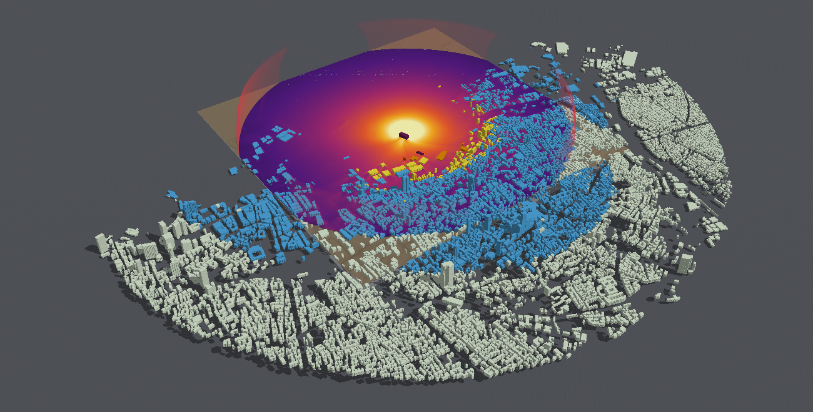

# A city in minutes: the air near, the surrogate far

A district run spends most of its time on air that has stopped mattering much. Beyond a
kilometre at 0.5 kt the shock is weak and nearly spherical, yet the full Beirut run still carries
it on 4 m cells for another 6 s and 3 km. The hybrid mode runs the air in 3-D only out to a
hand-over radius. Beyond it, each façade's load comes from the [façade load
surrogate](surrogate-first-look.md), matched to the near run where both hold. It is the first step
of [Horizons](roadmap.md#horizons) item 3, "City scale in minutes". It is in the app under File ▸
New District, and headless in SceneBench.

## What holds and what does not

Judged on Beirut at 0.2, 0.5 and 1.1 kt ([Beirut, 2020](beirut-2020.md)), handing over at 1 km:
inside 1.25 km against the full 4 m runs, and beyond it, since 25 October 2026, against full runs
with their top clear (8 m air refined to 4 m, a 640 m top;
[below](#judged-again-against-a-clear-top-reference-25-october-2026)). The 4 m runs' 320 m top
drained the far loads, and everything first judged against them beyond 1.25 km was judged again.

- **Holds: inside the hand-over.** The near run is the full run there. On a box reaching 1,320 m
  (the hand-over and 4 m/kg^(1/3) beyond it), its façade strips' peaks are the full run's to within
  3–8% (median 1.00) and its glass states identical.
- **Holds: the time.** The near run took 135, 335 and 230 s on the CI mini against the full run's
  1,604, 2,017 and 2,464 s. The far field's loads take a few seconds, and laying out and judging
  all 14,169 buildings about a minute on the Studio. At 0.5 kt the whole district takes about
  7 minutes against 34.
- **Holds: the glass to 1.5 km.** The share of building sides with some glass broken comes within
  0.05 of the clear-top run's to 1.5 km at 0.2 kt, to 2 km at 0.5 kt and to 3 km at 1.1 kt.
- **Holds: arrivals.** Beyond the hand-over, Kingery–Bulmash's arrival scaled to the near run's
  comes 2–4% before the full run's (1–4% before the clear-top run's). Against Rigby et al.'s observers past 1 km that is 0.95–1.08
  of the observed at 0.5 kt, and 0.91–1.02 at 1.1 kt.
- **Holds: the loads to 2.5 km**, on the terms refitted on clear-top runs with far terms for
  façades deep in a city and the match carried flat, all adopted on 25 October 2026, each wall
  facing as its building's map outline since 28 October
  ([adopted](#adopted-the-clear-top-terms-the-match-carried-flat-and-a-higher-top-25-october-2026),
  [the far terms](#adopted-the-far-terms-25-october-2026),
  [the outlines](#adopted-facing-as-the-outlines-28-october-2026)). Against the clear-top run the far
  field's peaks are 0.87–1.09 of the run's over 1–2.5 km, the lower the further out, and its
  impulses 1.05–1.14 (peaks 0.87–1.07 facing as the cells, 0.82–1.05 without the far terms). On the terms and trend of 23 October
  they were 0.67–0.99 and 0.71–1.03, low; against the drained 4 m runs they had read 1.12–1.19 high
  at 1.1 kt ([why](#the-full-runs-top-drains-its-far-loads-25-october-2026)).
- **Does not: the glass beyond 1.5 km at the smallest yield. It reads low, the unsafe side.** At
  0.2 kt it breaks glass on 0.67 of the sides at 1.75–2 km where the run breaks 0.90 (0.37 before
  25 October), and on 0.30 at 2–2.5 km against 0.75: the pulse's front, not the loads
  ([glass by chance](glass-probability.md#why-some-broken-and-thrown-past-3b-read-low-the-pulses-front-and-the-far-loads-25-october-2026)).
- **Does not: blown-out glass beyond 1.25 km.** Its share falls short of the clear-top run's by up to
  0.35 in a band (1.1 kt: 0.22 against 0.57 at 2–2.5 km; 0.5 kt: 0.68 against 0.84 at
  1.25–1.5 km), against 0.52 before 25 October.
- **Does not: walls and roofs beyond the hand-over.** They take the surrogate's standing, which
  says to run the scene for the structure.
- **Inherits the full run's verdict against GEER.** Close in it breaks more glass than GEER saw;
  the far edge is about right ([Beirut](beirut-2020.md#what-holds-and-what-does-not)).

## How it works

1. **The near run.** The district is laid out on a box reaching the hand-over and its open faces'
   clearance beyond (4 m/kg^(1/3): 320 m at 0.5 kt). The air runs until the blast has passed the
   hand-over and its façades have been loaded (3 s at 1 km), with each façade strip's history
   recorded. Its half side is a multiple of the cells, so that its cells and buildings are the full
   layout's.
2. **The match.** Over the near run's strips just inside the hand-over (0.8–1 of it), the median
   of its peak over the surrogate's, and of its first impulse. Over those from half the hand-over,
   the slope of that ratio's logarithm with the logarithm of distance. Over its gauges from
   500 m, the median of their arrival over Kingery–Bulmash's (`HybridFarField.fit`).
3. **The far field.** Every component beyond the hand-over takes the surrogate's prediction (its
   features along a line over the ground, Kingery–Bulmash's base, the fitted terms). Its peak and
   impulse are scaled by the match at the hand-over and carried on its trend; its arrival is
   scaled likewise (`HybridFarField.apply`). It is then a triangular pulse, as in the first look.
4. **The damage.** The near run's histories inside, the far field's pulses beyond, judged by the
   same SDOF, panes and glazing mixes as a run's (`EnvelopeDamageAssessment`).

The shielding in the far field is the surrogate's: the buildings a line over the ground passes
through, the length inside them, ridges and the ground's rise. It was fitted to BombCAD's runs,
and one shielding model serves both the first look and the hybrid.

Matched at 0.5 kt, the surrogate needed its peak raised by 1.09 and its impulse by 1.20 at 1 km,
falling as distance^-0.47 and ^-0.30 beyond.

## Against the full run, by band

Sides with some glass broken, full run / hybrid (the surrogate unscaled), and the hybrid's
façade peak over the full run's (median). The 0.2 kt column was rerun on 19 October with the
surrogate held at its fitted range's ends, which moves its far edge; the others predate it.

| Distance | 0.2 kt | 0.5 kt | 1.1 kt | Peak, 0.2 / 0.5 / 1.1 kt |
|---|---|---|---|---|
| 0.5–1 km | 1.00 / 1.00 | 1.00 / 1.00 | 1.00 / 1.00 | 1.00 / 1.00 / 1.00 |
| 1–1.25 km | 1.00 / 1.00 (1.00) | 1.00 / 1.00 (1.00) | 1.00 / 1.00 (1.00) | 0.95 / 0.99 / 0.99 |
| 1.25–1.5 km | 0.99 / 0.95 (0.97) | 1.00 / 1.00 (1.00) | 1.00 / 1.00 (1.00) | 0.88 / 0.93 / 0.96 |
| 1.5–1.75 km | 0.84 / 0.68 (0.82) | 0.99 / 0.99 (1.00) | 1.00 / 1.00 (1.00) | 0.89 / 0.98 / 1.04 |
| 1.75–2 km | 0.61 / 0.33 (0.52) | 0.91 / 0.93 (0.98) | 0.99 / 1.00 (1.00) | 0.79 / 0.91 / 0.99 |
| 2–2.5 km | 0.23 / 0.07 (0.15) | 0.66 / 0.51 (0.77) | 0.94 / 0.95 (1.00) | 0.76 / 0.88 / 1.00 |
| 2.5–3 km | 0.02 / 0.02 (0.06) | 0.18 / 0.18 (0.47) | 0.65 / 0.78 (0.97) | 1.09 / 1.12 / 1.29 |

Carrying the trend only to 1.5 times the hand-over and holding it beyond, as the app does, moves
the share broken at 1.75–2 km to 0.40, 0.96 and 1.00, at 2–2.5 km to 0.10, 0.69 and 0.99, and at
2.5–3 km to 0.04, 0.38 and 0.95 (0.2, 0.5 and 1.1 kt). That is closer to the full run at 0.2 kt
and at 2–2.5 km at 0.5 kt, and further at 2.5–3 km at the larger yields. Carrying it to twice the
hand-over lands between the two (`--trend-reach`).

Fading the match back to the surrogate's own loads past the reach instead of holding it
(`--trend-damping d`: the match's logarithm falls by e each d of log distance) was judged the same
way on 20 October, rerunning the hold on the same build. Over 1–2.5 km, the mean error in the
share of sides with some glass broken, against the full run, at 0.2, 0.5 and 1.1 kt:

| Past 1.5× the hand-over | 0.2 kt | 0.5 kt | 1.1 kt | Blown out, 1.1 kt |
|---|---|---|---|---|
| Held (the app's) | 0.103 | 0.013 | 0.012 | 0.043 |
| Faded, d = 0.7 | 0.090 | 0.021 | 0.013 | 0.026 |
| Faded, d = 0.35 | 0.080 | 0.029 | 0.013 | 0.023 |

Fading helps at the small yield, where the surrogate's own form is the better one, and with the
blown-out share at the large one. It does worse at 0.5 kt, and beyond 2.5 km it raises the share
broken above the full run's at the larger yields (0.41–0.44 against 0.18 at 0.5 kt; 0.96 against
0.65 at 1.1 kt), where the held match already ran over. No fading length gains overall, so the app
holds the match (`FarFieldSet.trendDamping` nil). The results are in
`$BOMBCAD_DATA/hybrid-damp` (`compare.py`).

Beyond about 2.2 km the full run's own side faces lie near the buildings
([Beirut](beirut-2020.md#what-the-model-can-and-cannot-represent)), so its far bands are the less
sure reference. Impulses run 1.04–1.5 times the full run's from the hand-over to 2.5 km, and up to
1.9 times at 2.5–3 km.


### On the refitted surrogate (23 October 2026)

The surrogate's terms were refitted on air refined to 2 m and given shielding by the charge's
surroundings (emmettl/bombcad-work#56; [the first look](surrogate-first-look.md#adopted-23-october-2026)).
The same judge on the adopted terms, trend from 500 m carried on (`hybrid-judge --trend-from 500`),
as the table above, with a rising trend held at nothing (below):

| Distance | 0.2 kt | 0.5 kt | 1.1 kt | Peak, 0.2 / 0.5 / 1.1 kt | Impulse, 0.2 / 0.5 / 1.1 kt |
|---|---|---|---|---|---|
| 1–1.25 km | 1.00 / 1.00 (1.00) | 1.00 / 1.00 (1.00) | 1.00 / 1.00 (1.00) | 0.99 / 0.98 / 0.98 | 1.04 / 1.07 / 1.14 |
| 1.25–1.5 km | 0.99 / 0.98 (0.97) | 1.00 / 1.00 (1.00) | 1.00 / 1.00 (1.00) | 0.95 / 0.97 / 0.98 | 1.09 / 1.14 / 1.28 |
| 1.5–1.75 km | 0.84 / 0.83 (0.77) | 0.99 / 1.00 (1.00) | 1.00 / 1.00 (1.00) | 1.01 / 1.07 / 1.12 | 1.25 / 1.34 / 1.58 |
| 1.75–2 km | 0.61 / 0.55 (0.48) | 0.91 / 0.98 (0.98) | 0.99 / 1.00 (1.00) | 0.97 / 1.07 / 1.15 | 1.26 / 1.36 / 1.67 |
| 2–2.5 km | 0.23 / 0.17 (0.13) | 0.66 / 0.75 (0.73) | 0.94 / 1.00 (0.99) | 0.97 / 1.08 / 1.19 | 1.42 / 1.55 / 1.98 |
| 2.5–3 km | 0.02 / 0.06 (0.04) | 0.18 / 0.44 (0.42) | 0.65 / 0.97 (0.96) | 1.49 / 1.51 / 1.68 | 1.82 / 1.93 / 2.54 |

- **The small yield's far edge closes up.** At 0.2 kt the share broken now falls 0.01–0.06 below
  the full run's from 1.5 to 2.5 km, where it fell 0.16–0.28 below.
- **The large yield still reads high beyond 1.5 km**, peaks 1.12–1.19 of the full run's at 1.1 kt
  and impulses 1.6–2.0 times; the blown-out share at 1.5–1.75 km is 0.88 against the run's 0.69.

**Why it read higher still, and the hold on a rising trend.** The trend is the near run's ratio to
the surrogate over 500 m to the hand-over, carried on. On the terms before, that ratio fell with
distance at every yield (slopes −0.31, −0.43 and −0.40 in the peak at 0.2, 0.5 and 1.1 kt): the old
terms read the near band at Z 5–10 low (0.85–0.91 of the run) and Z 10–14 about right. Carried on,
it pulled the far field down, which at 1.1 kt happened to cancel the surrogate's own far over-read
there (1.1–1.4 times the full run at Z 14–28, before and after the refit alike) and at 0.2 kt
pulled the share broken 0.16–0.28 too low. The refit lifted the near band to the 2 m runs' level
(0.97–1.03), so the slopes went to −0.01, −0.02 and **+0.09**. Neither the seed (×1.01–1.06) nor
the shielding (behind buildings within Z 8 only, at most ×0.92 at Warehouse 12's openness) moved it.
Carried 2.5 times out, the rising 1.1 kt slope read the far peaks 1.18–1.29 high and blew out 0.96
at 1.5–1.75 km. Since 23 October 2026 a slope that would raise the match outward is held at
nothing (`HybridFarField.fit`, emmettl/bombcad-work#56). It changes nothing at 0.2 and 0.5 kt,
whose slopes fall, nor anything fitted on the terms before. Over 1–2.5 km, the mean error in the
share of sides, against the full run (some broken / blown out):

| | 0.2 kt | 0.5 kt | 1.1 kt |
|---|---|---|---|
| The terms before, held past 1.5× (the app's) | 0.102 / 0.006 | 0.010 / 0.074 | 0.012 / 0.040 |
| Refitted, the rising slope carried | 0.026 / 0.002 | 0.036 / 0.042 | 0.014 / 0.072 |
| **Refitted, a rising slope held at nothing** | 0.026 / 0.002 | 0.036 / 0.042 | 0.014 / **0.046** |

Fitting the trend only from Z 10 (where the refit's 2 m and the near run's 4 m cells agree) or not
at all gave the same at 1.1 kt and worse impulses at 0.5 kt (up to 2.1 times). What is left at
1.1 kt was taken for the surrogate's own far over-read, part of it the full run's far faces. It is
the full run's top ([below](#the-full-runs-top-drains-its-far-loads-25-october-2026)). The judgements are in `$BOMBCAD_DATA/refit56/takeover`:
`judge-adopt/hybrid-*` before the hold, `hybrid-try/` with it (`base-*` carried, `held-*` as the
app holds it) and the other trend bands.

### Strips the near run does not hold (24 October 2026)

A review asked whether façade strips inside the hand-over with no matching near-run strip kept
the surrogate's own loads, unscaled and unreported (emmettl/bombcad-work#76).

- **How many.** On Beirut, 7,855 of the 26,131 façade strips inside 1 km that `hybrid-judge`
  compares, in 367 buildings, and 14,948 of 50,272 in `district-hybrid` (about 30%). The count is
  the same at every yield. The cause is the bench's two layouts, not the run. Each projects the map
  about its own corner, whose latitude sets the east-west scale (`MapBuildingPlacement`), and puts
  the charge at its box's centre. The near box's corner lies 1.2 km nearer the charge. So between
  the two layouts every building sits 0.48 m differently east-west from the charge, give or take
  0.12 m at 1 km east or west. That moves some footprints by a cell (166 of the buildings) and the
  ground under others by centimetres (201), and their strips' boxes no longer match. In the app
  (`DistrictLayout.hybrid`) the far set holds only buildings that the near scene does not place,
  so none of its strips needs a match. They do sit up to half a metre east-west from where the near
  layout would have put them, well under a cell.
- **What they get.** Since 19 October (87deaa26) `district-hybrid` gives them the far field, with
  the match at their distance, and counts them. `hybrid-judge` left them out of its comparison.
  Now it judges them on the far field too. Its bands give how many each holds, and it sets them
  against the full run apart. `district.json` records them (`unheldStrips`, with `otherInside` for
  the walls, slabs and roofs inside the hand-over, which take the far field as well).
- **Whether it matters.** Little. Their peaks on the far field are 1.02, 1.02 and 1.03 of the full
  run's (median, at 0.2, 0.5 and 1.1 kt), but scatter 0.29–0.41 in log, against 0.03–0.08 for
  the strips the near run holds. Their sides' glass is all broken in the run and in the hybrid at
  every yield. All are blown out at 0.5 and 1.1 kt, and at 0.2 kt 0.85 against the run's 0.84, with
  the glass state the run's on 0.84 of the sides. Taking them into the 0.2 kt comparison moves its
  750–1,000 m band's blown-out share from 0.91 to 0.87 (run 0.78). It moves its exact glass states
  from 0.87 to 0.84 and its peak scatter from 0.05 to 0.13. Nothing beyond the hand-over moves,
  and the match is taken from the held strips alone, as before. Matching the layouts (projecting
  about the charge) would move every district layout, so it is left for its own change.
- **Distances.** `hybrid-judge` measured a strip's distance in plan when the review read it; since
  87deaa26 it takes the surrogate's own, from the charge to the face in 3-D, as `district-hybrid`,
  `HybridFarField.judge` and the glass chances do. What stays in plan is by building: the GEER
  bands `district-hybrid` reports, since GEER's survey bands are distances on the map, and which
  near buildings `HybridFarField.judge` takes as beyond the hand-over. At 1 km a strip 40 m up lies
  0.8 m further in 3-D than in plan.

The judgements are in `$BOMBCAD_DATA/scratch/issue76` (`unheld/held-*`, `district/`).

### The full run's top drains its far loads (25 October 2026)

At 1.1 kt beyond 1.5 km the far field read 1.12–1.19 of the full run's peaks, and blew out 0.88
of the sides at 1.5–1.75 km against the run's 0.69 (emmettl/bombcad-work#96). Two causes were
suspected: the surrogate's own over-read at large yields, or the full run's open faces. The faces
were checked first, and they are the cause.

**Where the full run's loads fall.** By direction from the charge, the 4 m run's façade peaks over
Kingery–Bulmash's reflected peak stay level to 2.25 km to the east, along the coast (0.48–0.53 at
1.1 kt), and over the sea (the line of gauges north, 0.77–0.78 of the incident peak from 1.4 to
2.4 km). To the south, over the hills (ground 60–100 m above the charge), they fall from 0.44 at
1–1.5 km to 0.18 at 2–2.25 km. The fall starts at the same distance in metres at 0.2, 0.5 and
1.1 kt, so it is not a scaled-distance effect. The surrogate over the run is 0.90–1.08 to the east
and southeast within 2.25 km. To the south it is 1.34 at 1.5–1.75 km and 2.34 at 2–2.25 km
(adopted terms, 1.1 kt; 0.2 and 0.5 kt alike). The far field's high reading is that sector.

**The top moved.** The same district on 8 m cells at 1.1 kt, with the full run's faces (5 km
box, 320 m top) and with others, façade strip by strip (peak over the 320 m top's, median):

| Top, box | 1–1.25 km | 1.25–1.5 km | 1.5–1.75 km | 1.75–2 km | 2–2.25 km | 2.25–2.5 km | South, 2–2.25 km |
|---|---|---|---|---|---|---|---|
| 400 m, 5 km | 1.00 | 1.02 | 1.21 | 1.43 | 1.50 | 1.74 | 1.99 |
| 480 m, 5 km | 1.00 | 1.02 | 1.21 | 1.43 | 1.55 | 1.97 | 2.45 |
| 640 m, 5 km | 1.00 | 1.02 | 1.21 | 1.43 | 1.55 | 1.96 | 2.43 |
| 960 or 1,280 m, 5 km | 1.00 | 1.02 | 1.21 | 1.43 | 1.55 | 1.96 | 2.43 |
| 640 m, 6 km | 1.03 | 1.07 | 1.26 | 1.48 | 1.60 | 2.01 | 2.53 |

(The 400 m row is from the 400 m top over the 640 m's, times the 640 m's over the 320 m's. The
6 km box reads 3% higher even at 500 m: the two layouts' projection, not the side faces.)

- **It is the top.** A top at 640 m or more gives the same loads to the third figure to 2.5 km.
  Moving the side faces 500 m further out adds nothing beyond the layouts' own 3%.
- **It is not scaled with the yield.** At 0.2 and 0.5 kt the 640 m top over the 320 m reads
  1.17/1.37/1.47 and 1.19/1.40/1.51 at 1.5–1.75, 1.75–2 and 2–2.25 km, against 1.21/1.43/1.55 at
  1.1 kt, although the 320 m top is 5.5, 4.0 and 3.1 m/kg^(1/3) above the charge. Over the sea the
  north line is the same to 2.2 km with either top. The draining reaches the ground from about 5–6
  times the top's clearance over it: 320 m over the 90 m hills drains the peaks from 1.25 km;
  400 m from 1.75–2 km; 480 m leaves the peaks clear to 2.5 km and the impulses within 2–7% from
  2 km; 640 m leaves both clear.
- **Impulses** move more: ×1.57, 1.85 and 2.03 at 1.5–1.75, 1.75–2 and 2–2.25 km.
- **Peak maps** (`field-export --levels`) agree: at 2 m over the ground, the 640 m top over the
  320 m reads 1.4–3.2 to the south from 1.5 to 2.5 km, 1.0–2.1 to the southeast and southwest,
  and within 1.0–1.1 to the east, north and west.

So the Beirut runs' 320 m top, chosen because a 640 m top gave the same peaks over the sea to 2.4 km
([Beirut](beirut-2020.md#the-recipe)), does not hold over the land south of the port. The
full runs' loads there are low beyond about 1.25 km at every yield.

**The judge with its top clear (8 m cells).** The whole chain run again on 8 m cells: near runs
to 1,324 m (so that their cells are the full run's: 2,500 − 1,324 is a multiple of 8), the full run
with the 320 m top and with a 640 m one, and `hybrid-judge` against each, the trend from 500 m as
above. Far field over the full run's peak (median), and sides blown out / some glass broken
(run / hybrid):

| | 1.5–1.75 km | 1.75–2 km | 2–2.5 km | Blown out, 1.5–1.75 km | Some broken, 2–2.5 km |
|---|---|---|---|---|---|
| 1.1 kt, 320 m top | 1.18 | 1.36 | 1.43 | 0.62 / 0.67 | 0.94 / 0.99 |
| 1.1 kt, 640 m top | **0.99** | **0.99** | **0.85** | 0.95 / 0.67 | 1.00 / 0.99 |
| 0.5 kt, 320 m top | 1.11 | 1.24 | 1.25 | 0.05 / 0.02 | 0.71 / 0.67 |
| 0.5 kt, 640 m top | **0.95** | **0.92** | **0.77** | 0.10 / 0.02 | 0.99 / 0.67 |
| 0.2 kt, 320 m top | 1.07 | 1.14 | 1.15 | – | 0.35 / 0.11 |
| 0.2 kt, 640 m top | **0.92** | **0.87** | **0.72** | – | 0.74 / 0.11 |

Over 1–2.5 km, the mean error in the share of sides, some broken / blown out, against the run:

| | 0.2 kt | 0.5 kt | 1.1 kt |
|---|---|---|---|
| 320 m top | 0.144 / 0.014 | 0.023 / 0.097 | 0.016 / 0.015 |
| 640 m top | 0.293 / 0.013 | 0.071 / 0.127 | 0.001 / 0.199 |

Holding the trend past 1.5 times the hand-over, as the app does, moves none of these by more than
0.04 in the peak.

- **On 8 m cells the judge reproduces the 4 m finding** (1.18–1.43 at 1.1 kt against the 320 m
  top, 1.12–1.19 on 4 m cells), and with the top clear the over-read goes. **So the surrogate's
  own over-read at large yields does not stand, and no far correction downward was built:** it
  would take the far field further below a fair run.
- **The far field reads low against a fair run**, the more so the smaller the yield and the
  further out: peaks 0.85–0.99 at 1.1 kt, 0.77–0.95 at 0.5 kt and 0.72–0.92 at 0.2 kt over
  1.5–2.5 km. Its glass then errs on the unsafe side. At 1.1 kt it blows out 0.67 of the sides at
  1.5–1.75 km against the run's 0.95. At 0.2 kt it breaks glass on 0.11 of the sides at 2–2.5 km
  against 0.74.
- **The 4 m numbers above** (the tables since 19 October) are against the drained runs beyond
  about 1.25 km, and so are the glass figures they quote there. A 4 m full run with its top clear
  (640 m: 250 million cells, about 33 GB by these runs' footprints) does not fit on the shared
  Studio. On 8 m cells refined once to 4 m under a ceiling, with the near runs refined the same
  way, it would.
- **Elsewhere.** The full runs are the reference for `glass-calibrate`, for the Beirut glass
  against GEER, for the quick estimate's far loads (`surrogateFarLoads`) and for the 23 October
  judgement that kept the full-length peak refit out ([the
  surrogate](surrogate-first-look.md#the-peak-terms-on-the-full-length-boxes-23-october-2026)).
  That refit read the far field higher than the adopted terms, which against a clear top would be
  the right way. Each beyond about 1.25 km needs judging again. The surrogate's own fit runs reach
  1.0–1.3 km under tops of 296–532 m, mostly inside the draining reach.
- **New District's top** is 4 m/kg^(1/3) above the charge (`DistrictLayout.top`): 234 m at 0.2 kt,
  320 m at 0.5 kt. A whole district run to 2.5 km over hills has the same problem. From these runs,
  a top at the highest ground plus a fifth of the radius would keep the loads to the radius
  (590 m for Beirut at 2.5 km: 1.85 times the cells at 0.5 kt). That is a default, and the user's
  decision; it was adopted on 25 October 2026 (below). The near run handing over at 12 m/kg^(1/3) is clear on flat ground. Over hills 90 m
  high, at 0.2 kt, the reach, 5 × (234 − 90) m, is about the hand-over (702 m).

The runs, extracts and judgements are in `$BOMBCAD_DATA/scratch/issue96`: `faces*/` (the tops and
boxes, `faces.sh`, `faces-more.sh`), `strips/` (the 4 m runs' strips with the surrogate),
`fieldmaps/`, `near8/` and `judge8/` (`judge8.sh`). Each 8 m run took 18–35 s on the Studio.
Judged again against 4 m-like runs with their top clear [below](#judged-again-against-a-clear-top-reference-25-october-2026).

### Judged again against a clear-top reference (25 October 2026)

Everything the drained 4 m runs judged beyond about 1.25 km was judged again against a reference
with its top clear (emmettl/bombcad-work#97).

**The reference.** Beirut's district on 8 m cells refined once to 4 m (threshold 0.005), under the
ceiling New District uses (no air refined more than 63 m above the ground: 98% of the buildings to
31 m, and four cells), the footprints on 4 m cells and the ground a staircase, as New District's
refined air is. The box is the full runs' (5 km), the top 640 m, which clears the draining rule
above (five to six times 550 m over the hills is beyond the 2.5 km radius). That is 31 million coarse
cells and 188,458 components. A run to 8 s took 65–81 s on the Studio, with at most 26,938 refined
blocks (the pool never ran out) and about 20 GB at its peak, most of it the histories being judged. The near runs are the same air on the
1,324 m box (so their cells are the full run's), with the same top, run to 3.5 s (New District's
length for a 1 km hand-over): 10–16 s. Its strips are laid on the 8 m cells and read the 4 m cells
against each face, so the surrogate is asked for 4 m cells' loads when judged against it
(`--surrogate-dx 4`, which `surrogate-judge`, `hybrid-judge` and `glass-calibrate` now take;
`hybrid-judge` also takes `--coefficients`). Its peaks inside 1.5 km are 0.95–0.96 of the 4 m runs'
(building sides matched by distance, 1.1 kt); beyond, 1.01 at 1.5–1.75 km rising to 1.46 at
2.25–2.5 km, the drained runs' shortfall.

**Checked one level up first.** 16 m cells refined to 8 m in the same way (ceiling 95 m by the same
rule), against uniform 8 m cells, both on the staircase, 1.1 kt. Building sides' peaks, matched by
the building's centre (the refined run's strips are 16 m wide, so strips cannot be matched one for
one), refined over uniform:

| Top | 0.5–1 km | 1–1.25 km | 1.25–1.5 km | 1.5–1.75 km | 1.75–2 km | 2–2.25 km | 2.25–2.5 km |
|---|---|---|---|---|---|---|---|
| 640 m | 0.94 | 0.95 | 0.94 | 0.93 | 0.92 | 0.92 | 0.91 |
| 640 m, to the south | 0.93 | 0.94 | 0.93 | 0.94 | 0.93 | 0.93 | 0.93 |
| 320 m | 0.94 | 0.94 | 0.89 | 0.88 | 0.87 | 0.88 | 0.87 |

- **With the top clear the refined setup keeps the uniform grid's far strips:** its ratio to the
  uniform run falls by 3% from 500 m to 2.5 km, and by none to the south.
  The level itself, 6–9% low, is the coarser strips and the capped refinement, and it is there at
  500 m too.
- **Under the 320 m top it drains more than the uniform grid** (0.87–0.89 beyond 1.25 km; strip by
  strip the 640 m top over the 320 m reads 1.32, 1.58 and 1.66 at 1.5–1.75, 1.75–2 and 2–2.25 km
  where the uniform 8 m run reads 1.23, 1.45 and 1.61), so a refined run needs its top clear as
  much.
- The ceiling at 72 m in place of 95 m moves the sides by 1.5% or less, and cut cells in place of
  the staircase by 1.7% or less (1.4% refined).

**The hybrid against it.** As the 23 October table (trend from 500 m carried, a rising one held at
nothing; the app's hold past 1.5 times the hand-over in brackets), sides with some glass broken,
reference / hybrid, and the hybrid's façade peak and impulse over the reference's (median):

| Distance | 0.2 kt | 0.5 kt | 1.1 kt | Peak, 0.2 / 0.5 / 1.1 kt | Impulse, 0.2 / 0.5 / 1.1 kt |
|---|---|---|---|---|---|
| 1–1.25 km | 1.00 / 1.00 (1.00) | 1.00 / 1.00 (1.00) | 1.00 / 1.00 (1.00) | 0.98 / 0.98 / 0.99 | 0.97 / 0.98 / 1.03 |
| 1.25–1.5 km | 1.00 / 0.95 (0.95) | 1.00 / 1.00 (1.00) | 1.00 / 1.00 (1.00) | 0.91 / 0.93 / 0.96 | 0.90 / 0.93 / 1.02 |
| 1.5–1.75 km | 0.98 / 0.67 (0.68) | 1.00 / 0.99 (1.00) | 1.00 / 1.00 (1.00) | 0.86 / 0.91 / 0.97 | 0.85 / 0.88 / 1.01 |
| 1.75–2 km | 0.90 / 0.37 (0.40) | 1.00 / 0.96 (0.97) | 1.00 / 1.00 (1.00) | 0.80 / 0.89 / 0.97 | 0.82 / 0.84 / 0.99 |
| 2–2.5 km | 0.75 / 0.10 (0.12) | 0.99 / 0.66 (0.71) | 1.00 / 0.99 (0.99) | 0.67 / 0.73 / 0.82 | 0.71 / 0.74 / 0.91 |
| 2.5–3 km | 0.50 / 0.02 (0.03) | 0.96 / 0.25 (0.33) | 1.00 / 0.93 (0.94) | 0.63 / 0.60 / 0.72 | 0.64 / 0.65 / 0.84 |

Blown out, reference / hybrid: at 0.5 kt 0.84 / 0.33 at 1.25–1.5 km and 0.25 / 0.04 at
1.5–1.75 km; at 1.1 kt 0.98 / 0.82, 0.79 / 0.34 and 0.57 / 0.05 at 1.5–1.75, 1.75–2 and
2–2.5 km. Over 1–2.5 km, the mean error in the share of sides, some broken / blown out:

| Judged against | 0.2 kt | 0.5 kt | 1.1 kt |
|---|---|---|---|
| The drained 4 m runs (23 October, trend carried) | 0.026 / 0.002 | 0.036 / 0.042 | 0.014 / 0.046 |
| The refined runs under the 320 m top, trend carried | 0.194 / 0.042 | 0.040 / 0.122 | 0.006 / 0.026 |
| **The clear-top reference, trend carried** | **0.308 / 0.040** | **0.076 / 0.171** | **0.002 / 0.226** |
| … the trend held past 1.5 times the hand-over (the app's) | 0.294 / 0.040 | 0.063 / 0.170 | 0.001 / 0.221 |
| … the match carried flat (no trend) | 0.251 / 0.036 | 0.047 / 0.135 | 0.001 / 0.205 |

- **The far field reads low, the unsafe side,** as the 8 m judge found: peaks 0.67–0.99 of the
  reference's over 1–2.5 km on the median (0.95–1.19 against the drained runs), impulses
  0.71–1.03 (1.04–2.0). At 0.2 kt it breaks glass on 0.10 of the sides at 2–2.5 km where the
  reference breaks 0.75; at 1.1 kt it blows out 0.05 of them where the reference blows out 0.57.
  Glass with some broken stays within 0.05 to 1.5 km at 0.2 kt, to 2 km at 0.5 kt and to 2.5 km at
  1.1 kt.
- **Part of it is the trend.** The refined near runs fall against the surrogate over 500–1,000 m
  (slopes −0.135 and −0.120 in the peak at 0.2 and 0.5 kt, where the uniform 4 m near runs gave
  −0.01 and −0.02), and carried on that pulls the far field down. Carried flat, the far peaks at
  1.5–2.5 km are 0.75–0.93 at 0.2 kt and 0.81–0.98 at 0.5 kt, and the errors fall (table); the rest
  is the surrogate's own far form. The trend was not changed: what a near run on refined air
  should hand over is the next thing to judge (Future work).
- **Arrivals** beyond the hand-over come 1–4% before the reference's (median 2%), as before.

**Elsewhere** (the details on each page):

| Result | Against the drained 4 m runs | Against the clear-top reference |
|---|---|---|
| The quick estimate's loads beyond Z 20 at 0.5 kt (`surrogateFarLoads`) | 1.03–1.65 of the run's | 0.72–0.92 (the refined 320 m runs: 1.19–1.51) |
| … its glass by side deep in the district, 0.2 / 0.5 / 1.1 kt (`surrogateGlassSides`) | 0.84 / 0.77 / 0.83 | 0.54 / 0.75 / 0.72 (0.73 / 0.81 / 0.87) |
| Glass chances, blown out: Brier / skill; the test | 0.017 / 0.84; pass | 0.038 / 0.64; fail, tenths up to 0.16 under |
| … thrown past 3b; some broken: skill; the test | 0.73; 0.66; both pass | −2.79; −5.35; both fail, the middle tenths 0.2–0.45 under |
| Openings blown out against GEER (surrogate loads only): skill | 0.19 | 0.18 |
| Beirut at 0.5 kt, sides blown out at 1.5–1.75 / 1.75–2 / 2–2.5 km (GEER W3 0.09 / 0.02 / 0.15) | 0.07 / 0.02 / 0.00 | 0.24 / 0.06 / 0.02 (0.12 / 0.03 / 0.01) |

(In brackets, the same refined air under the 320 m top: its layout's own difference from the 4 m
runs, apart from the top.) The glass chances were calibrated against runs that under-loaded the
far façades; against the reference all three states read low and fail the protective-design test,
and the standing says so ([glass by chance](glass-probability.md#judged-against-a-clear-top-reference-25-october-2026)).
Beirut's far edge against GEER ([Beirut](beirut-2020.md#glass-as-a-mix-of-panes)) holds only at
1.75–2 km now: at 1.5–1.75 km the model blows out more than GEER saw, as it does closer in.

**The full-length peak refit of 23 October, judged again**
([the surrogate](surrogate-first-look.md#the-peak-terms-on-the-full-length-boxes-23-october-2026)).
Rejected then because the glass chances and the hybrid both got worse against the drained runs.
Against the reference (the refit's terms as `--coefficients`, no special build):

| | Adopted terms | Full-length refit |
|---|---|---|
| Glass chances, Brier: blown out / thrown past 3b / some broken | 0.038 / 0.096 / 0.053 | **0.030 / 0.077 / 0.036** |
| … skill: blown out / thrown / some broken; the test | 0.64 / −2.79 / −5.35; fail | 0.71 / −2.05 / −3.37; fail |
| Openings blown out against GEER, skill | 0.18 | 0.17 |
| Quick estimate, loads beyond Z 20 at 0.5 kt; glass deep in the district, 0.2 / 0.5 / 1.1 kt | 0.72–0.92; 0.54 / 0.75 / 0.72 | 0.81–1.02; 0.61 / 0.82 / 0.77 |
| Hybrid, held (the app's): mean error some broken, 0.2 / 0.5 / 1.1 kt | 0.294 / 0.063 / 0.001 | 0.301 / 0.062 / 0.001 |
| … blown out | 0.040 / 0.170 / 0.221 | 0.043 / 0.173 / 0.214 |
| … trend carried: some broken; blown out | 0.308 / 0.076 / 0.002; 0.040 / 0.171 / 0.226 | 0.326 / 0.088 / 0.002; 0.043 / 0.173 / 0.233 |

So it would now go the other way. The glass chances, the reason it was kept out, are better on
the refit in every state, and the quick estimate's glass and far loads come nearer the reference.
The hybrid as the app runs it is unchanged within 0.007 of the share of sides; carried on, its
steeper trend (−0.27 and −0.24 at 0.2 and 0.5 kt) costs 0.012–0.018. By the rule the user set on
23 October (adopt if neither got worse beyond noise), the refit passes. Neither set of terms
calibrates the chances against the reference, which needs the chances or the far terms refitted
on clear-top runs. Adopting is the user's decision; `Coefficients.fitted` is unchanged.

**New District's top.** `DistrictLayout.top` takes 4 m/kg^(1/3) above the charge and at least half
of it above the highest roof or ground. On Beirut's 2.5 km the towers (roofs to 280 m) set it: 400,
440 and 488 m at 0.2, 0.5 and 1.1 kt on 8 m cells (the 234 and 320 m given above are the rule's
first term alone, as a district without towers would have it). The proposal is a top at least the
highest ground plus a fifth of the radius: 102 + 500 m, 608 m on 8 m cells. Measured on the
refined air:

| | 0.2 kt | 0.5 kt | 1.1 kt |
|---|---|---|---|
| Top today / proposed (cells ×) | 400 / 608 m (×1.52) | 440 / 608 m (×1.38) | 488 / 608 m (×1.25) |
| Run, 8 s on the Studio, today / 640 m | 57 / 65 s | 69 / 75 s | 75 / 81 s |
| Side peaks today over 640 m, 2–2.25 / 2.25–2.5 km (south) | 1.00 / 0.93 (0.86 / 0.74) | 1.00 / 1.00 (0.99 / 0.92) | 1.00 / 1.00 (1.01 / 1.00) |
| Some glass broken today / clear, 1.75–2 / 2–2.5 / 2.5–3 km | 0.88 / 0.63 / 0.24 → 0.91 / 0.72 / 0.39 | 1.00 / 0.99 / 0.84 → 1.00 / 0.99 / 0.87 | 1.00 / 1.00 / 0.97 → unchanged |
| Panes broken, 2–2.5 / 2.5–3 km | 0.07 / 0.01 → 0.07 / 0.02 | 0.42 / 0.17 → 0.44 / 0.23 | 0.83 / 0.65 → 0.84 / 0.67 |

- "Clear" is the 640 m run. The 608 m top gives the 640 m top's sides to the third figure at
  0.5 kt (every band to 2.5 km), and its glass to the second.
- On a refined run the cells above the ceiling are coarse, so the time grows by 8–14% for 25–52%
  more cells; on uniform cells it would grow with the cells. A district without towers would move
  far more: under its rule's 320 m at 0.5 kt the refined run broke glass on 0.77 of the sides at
  2–2.5 km, against 0.99.
- For a near run (radius the hand-over, 1 km) the proposal is 302 m, under today's rule, so the
  hybrid's near runs would not change.

**Proposed, not changed:** New District's top at least the highest ground plus a fifth of the
radius. On Beirut it costs 25–52% more cells and 8–14% more time on refined air, and moves the
glass only at 0.2 kt beyond 1.75 km (some broken 0.72 against 0.63 at 2–2.5 km). Its value is in
districts without tall buildings, where today's top is the charge's 4 m/kg^(1/3). The default is
the user's decision. (Adopted on 25 October 2026:
[below](#adopted-the-clear-top-terms-the-match-carried-flat-and-a-higher-top-25-october-2026).)

The runs, scripts and judgements are in `$BOMBCAD_DATA/scratch/issue97`: `check/` (`check.sh`, the
16 m check), `ref/` (`ref.sh`: the references, near runs and tops), `judges/` (`judges.sh`, each
judge with the adopted and refit terms), and `sides.py`, `compare.py` and `hybtab.py` for the
tables.

### The terms refitted on clear-top runs, and the match carried flat (25 October 2026)

emmettl/bombcad-work#98. The surrogate's fit runs had drained tops too, so they were remade with
their tops clear and the terms, the rise share and the chances' scatter refitted on them
([the surrogate](surrogate-first-look.md#refitted-on-clear-top-runs-25-october-2026), where the
whole judgement is). Both were built as options, off by default, and adopted the same day
([below](#adopted-the-clear-top-terms-the-match-carried-flat-and-a-higher-top-25-october-2026)):
the candidate terms (`FacadeLoadSurrogate.TermSet.clearTop`, `hybrid-judge --terms clear-top`) and
the match carried flat (`FarFieldSet.matchFlat`; `hybrid-judge` without `--trend-from`). In the
table, "adopted" is the terms of 23 October, adopted until then. Against the clear-top
reference, over 1–2.5 km, mean error in the share of sides, some broken / blown out:

| | 0.2 kt | 0.5 kt | 1.1 kt |
|---|---|---|---|
| Adopted terms, the trend held (the app's) | 0.294 / 0.040 | 0.063 / 0.170 | 0.001 / 0.221 |
| Adopted terms, the match flat | 0.251 / 0.036 | 0.047 / 0.135 | 0.001 / 0.205 |
| Candidate terms, the trend held | 0.266 / 0.031 | 0.045 / 0.129 | 0.001 / 0.152 |
| **Candidate terms, the match flat** | **0.181 / 0.018** | **0.024 / 0.062** | **0.000 / 0.108** |

- Each helps, and together they halve the error at every yield.
- Their peaks over the reference's are 0.82–1.05 over 1–2.5 km, and the impulses 1.05–1.14.
- At 0.2 kt the share with some glass broken is still 0.63 against the reference's 0.90 at
  1.75–2 km, and 0.25 against 0.75 at 2–2.5 km.
- Adopting both was proposed to the user, and they were adopted the same day ([below](#adopted-the-clear-top-terms-the-match-carried-flat-and-a-higher-top-25-october-2026)).

### Adopted: the clear-top terms, the match carried flat and a higher top (25 October 2026)

emmettl/bombcad-work#99. The user adopted all three on 25 October 2026:
- **The clear-top terms** (`FacadeLoadSurrogate.TermSet.clearTop`) are the default for the far
  field, as for the quick estimate and the glass chances. The terms of 23 October stay by name,
  `--terms fitted` in the benches and "Façade terms of 23 October" in the app, so earlier records
  can be reproduced.
- **The match carried flat** (`FarFieldSet.matchFlat`) is on for every far set New District makes.
  It is saved with the project. Sets saved before have it off and keep the trend, and Far field ▸
  "Carry the run's match flat" changes it for a project.
- **New District's top** (`DistrictLayout.top`) is at least the highest ground plus a fifth of the
  district's radius, besides today's rule. On Beirut's 2.5 km that is 102 + 500 m, 608 m on 8 m
  cells, against 400–488 m before: 25–52% more cells and 8–14% more time on refined air
  ([measured above](#judged-again-against-a-clear-top-reference-25-october-2026)). The near run of a
  hybrid takes the floor over its hand-over (302 m at 1 km), under today's rule there, so Beirut's
  near runs are unchanged. The benches' scenes give `--height` and are unchanged too.

The far field as New District now makes it, against the clear-top reference (sides with some glass
broken, reference / hybrid; the hybrid's façade peak and impulse over the reference's, median):

| Distance | 0.2 kt | 0.5 kt | 1.1 kt | Peak, 0.2 / 0.5 / 1.1 kt | Impulse, 0.2 / 0.5 / 1.1 kt |
|---|---|---|---|---|---|
| 1–1.25 km | 1.00 / 1.00 | 1.00 / 1.00 | 1.00 / 1.00 | 1.04 / 1.04 / 1.02 | 1.05 / 1.05 / 1.05 |
| 1.25–1.5 km | 1.00 / 0.99 | 1.00 / 1.00 | 1.00 / 1.00 | 1.02 / 1.03 / 1.01 | 1.06 / 1.07 / 1.08 |
| 1.5–1.75 km | 0.98 / 0.85 | 1.00 / 1.00 | 1.00 / 1.00 | 1.00 / 1.04 / 1.04 | 1.10 / 1.10 / 1.11 |
| 1.75–2 km | 0.90 / 0.63 | 1.00 / 0.99 | 1.00 / 1.00 | 0.96 / 1.04 / 1.05 | 1.13 / 1.13 / 1.14 |
| 2–2.5 km | 0.75 / 0.25 | 0.99 / 0.88 | 1.00 / 1.00 | 0.82 / 0.88 / 0.91 | 1.07 / 1.07 / 1.08 |
| 2.5–3 km | 0.50 / 0.08 | 0.96 / 0.58 | 1.00 / 0.99 | 0.81 / 0.76 / 0.82 | 1.08 / 1.05 / 1.06 |

- **Peaks 0.82–1.05 of the reference's over 1–2.5 km, impulses 1.05–1.14** (`hybridFarPeak`,
  `hybridFarImpulse`), against 0.67–0.99 and 0.71–1.03 on the terms and trend before. The impulses
  now read a little high, the safe side.
- **Glass with some broken** stays within 0.05 of the reference to 1.5 km at 0.2 kt, to 2 km at
  0.5 kt and to 2.5 km at 1.1 kt, as before; at 0.2 kt it is 0.13–0.50 under at 1.5–2.5 km
  (0.31–0.65 before). Blown out is up to 0.39 under in a band (1.1 kt, 2–2.5 km: 0.18 against
  0.57), against 0.52 before.
- **The mean error over 1–2.5 km**, some broken / blown out: 0.181 / 0.018, 0.024 / 0.062 and
  0.000 / 0.108 at 0.2, 0.5 and 1.1 kt, against 0.294 / 0.040, 0.063 / 0.170 and 0.001 / 0.221.
- The arrivals do not move. The standing quotes this table since 25 October 2026.

The judges are #98's (`$BOMBCAD_DATA/scratch/issue98/judges-final`, `hybrid-clear-flat-*`); the
new defaults reproduce its candidate's judges to the digit (`$BOMBCAD_DATA/scratch/issue99`).

### Far terms past 2 km of city (25 October 2026)

emmettl/bombcad-work#104 fitted far terms for façades deep in a city, on runs that reach 3 km
across made-up dense districts, as the candidates `--terms deep-city` and `deep-city-front` (with
the glass front refitted alongside). The whole judgement is on
[the surrogate's page](surrogate-first-look.md#far-terms-past-2-km-of-city-25-october-2026).

For the far field against the clear-top reference, the match carried flat, the mean error over the
bands from 500 m, some broken / blown out:

| | 0.2 kt | 0.5 kt | 1.1 kt |
|---|---|---|---|
| clear-top (default) | 0.166 / 0.015 | 0.062 / 0.040 | 0.001 / 0.089 |
| with the front | 0.034 / 0.016 | 0.012 / 0.030 | 0.000 / 0.054 |
| deep-city | 0.152 / 0.015 | 0.036 / 0.039 | 0.000 / 0.076 |
| deep-city with its front | **0.022 / 0.015** | **0.000 / 0.033** | **0.000 / 0.039** |

At 0.2 kt, some broken at 2–2.5 / 2.5–3 km reads 0.63 / 0.46 with both, against the reference's
0.75 / 0.50.

### Adopted: the far terms (25 October 2026)

The user adopted the deep-city terms as the default that evening, the glass front still off
("Adopt deepCity, front off", emmettl/bombcad-work#105). The far field takes them as the quick
estimate does, with the match carried flat as New District sets it. The clear-top terms stay by
name: `--terms clear-top` in the benches and Envelope Damage ▸ "Façade terms of 25 October
(earlier estimates)" in the app. A district saved before needs nothing: its far set holds the
buildings and the hand-over, not the terms, so it is judged on the defaults as #99's were.

The far field as it now is, against the clear-top reference (sides with some glass broken,
reference / hybrid; the hybrid's façade peak and impulse over the reference's, median; #104's
`hybrid-deep-city-flat-*`, which the new defaults give to the digit,
`$BOMBCAD_DATA/scratch/issue105`):

| Distance | 0.2 kt | 0.5 kt | 1.1 kt | Peak, 0.2 / 0.5 / 1.1 kt | Impulse, 0.2 / 0.5 / 1.1 kt |
|---|---|---|---|---|---|
| 1–1.25 km | 1.00 / 1.00 | 1.00 / 1.00 | 1.00 / 1.00 | 1.04 / 1.04 / 1.02 | 1.05 / 1.05 / 1.05 |
| 1.25–1.5 km | 1.00 / 0.99 | 1.00 / 1.00 | 1.00 / 1.00 | 1.02 / 1.03 / 1.01 | 1.06 / 1.07 / 1.08 |
| 1.5–1.75 km | 0.98 / 0.86 | 1.00 / 1.00 | 1.00 / 1.00 | 1.00 / 1.05 / 1.04 | 1.10 / 1.10 / 1.11 |
| 1.75–2 km | 0.90 / 0.65 | 1.00 / 0.99 | 1.00 / 1.00 | 0.98 / 1.06 / 1.07 | 1.13 / 1.13 / 1.14 |
| 2–2.5 km | 0.75 / 0.29 | 0.99 / 0.93 | 1.00 / 1.00 | 0.87 / 0.92 / 0.96 | 1.07 / 1.07 / 1.08 |
| 2.5–3 km | 0.50 / 0.12 | 0.96 / 0.74 | 1.00 / 1.00 | 0.90 / 0.85 / 0.91 | 1.08 / 1.05 / 1.06 |

- **Peaks 0.87–1.07 of the reference's over 1–2.5 km, impulses 1.05–1.14** (`hybridFarPeak`,
  `hybridFarImpulse`), against 0.82–1.05 and the same impulses on the clear-top terms. The far
  terms are peak only.
- **Glass with some broken** is within 0.05 of the reference to 1.5 km at 0.2 kt, to 2 km at
  0.5 kt and now to 3 km at 1.1 kt. At 0.2 kt it is 0.12–0.46 under at 1.5–2.5 km (0.13–0.50 on
  the clear-top terms). Blown out is up to 0.36 under in a band (1.1 kt, 2–2.5 km: 0.21 against
  0.57), against 0.39.
- **The mean error over 1–2.5 km**, some broken / blown out: 0.168 / 0.018, 0.012 / 0.060 and
  0.000 / 0.087 at 0.2, 0.5 and 1.1 kt, against 0.181 / 0.018, 0.024 / 0.062 and 0.000 / 0.108 on
  the clear-top terms.
- The arrivals do not move. The standing quoted this table from the adoption until 28 October
  2026, when the outline's facing was adopted ([below](#adopted-facing-as-the-outlines-28-october-2026)).

### On lines balanced by angle to the cells (26 October 2026)

emmettl/bombcad-work#107 judged the far field again with `hybrid-judge --by-angle`: on the
diagonal lines alone (30–45° from a cell axis), which the solver's grid takes least off
(emmettl/bombcad-work#106), and balanced by angle
([the surrogate](surrogate-first-look.md#glass-judged-on-lines-balanced-by-angle-to-the-cells-26-october-2026)).
- On the diagonals the peaks read 0.82–0.99 of the reference's over 1–2.5 km, against 0.87–1.07
  on every line, and the impulses 0.99–1.07. The 1–2 km over-read is the axis lines'.
- The glass's mean error over 1–2.5 km on the diagonals (some broken / blown out) is 0.219 / 0.044,
  0.017 / 0.109 and 0.000 / 0.149 at 0.2, 0.5 and 1.1 kt. With the glass front it is 0.063 /
  0.011, 0.001 / 0.031 and 0.000 / 0.027.
- The standing quoted the diagonal peaks beside the adopted ones (`hybridFarPeakDiagonal`). That
  note was retired on 28 October 2026: with Beirut turned 45° to the cells
  (emmettl/bombcad-work#108), the reference's peaks went with the façades, not the line's angle,
  and the split by angle was the surrogate's facing, read off the cells' staircase
  ([incidence from outlines](surrogate-first-look.md#façade-incidence-from-map-outlines-28-october-2026)).

### Adopted: facing as the outlines (28 October 2026)

The user adopted `deep-city-outline` for the quick estimate, the glass chances, the hybrid and the
close calls that day: the deep-city terms refitted with each wall facing as its building's map
outline, not as the cells' staircase of faces (emmettl/bombcad-work#109;
[the surrogate](surrogate-first-look.md#adopted-facing-as-the-outlines-28-october-2026)). The glass
front is still off. The far field takes the terms as the quick estimate does. The deep-city terms
stay by name: `--terms deep-city` in the benches and Envelope Damage ▸ "Façades facing as the cells
(earlier estimates)" in the app. A far set saved before needs nothing, but its buildings, laid out
before 28 October, carry no outlines and face as the cells under the new terms; New District lays
them out with their outlines.

The far field as it now is, against the clear-top reference (sides with some glass broken,
reference / hybrid; the hybrid's façade peak and impulse over the reference's, median; #109's
`hybrid-deep-city-outline-*`, `$BOMBCAD_DATA/scratch/issue109/judges`, which ran these terms by
name):

| Distance | 0.2 kt | 0.5 kt | 1.1 kt | Peak, 0.2 / 0.5 / 1.1 kt | Impulse, 0.2 / 0.5 / 1.1 kt |
|---|---|---|---|---|---|
| 1–1.25 km | 1.00 / 1.00 | 1.00 / 1.00 | 1.00 / 1.00 | 1.05 / 1.04 / 1.03 | 1.05 / 1.05 / 1.05 |
| 1.25–1.5 km | 1.00 / 0.99 | 1.00 / 1.00 | 1.00 / 1.00 | 1.03 / 1.03 / 1.02 | 1.07 / 1.07 / 1.08 |
| 1.5–1.75 km | 0.98 / 0.87 | 1.00 / 1.00 | 1.00 / 1.00 | 1.02 / 1.06 / 1.06 | 1.10 / 1.10 / 1.11 |
| 1.75–2 km | 0.90 / 0.67 | 1.00 / 0.99 | 1.00 / 1.00 | 0.99 / 1.07 / 1.09 | 1.12 / 1.12 / 1.14 |
| 2–2.5 km | 0.75 / 0.30 | 0.99 / 0.93 | 1.00 / 1.00 | 0.87 / 0.93 / 0.97 | 1.07 / 1.07 / 1.08 |
| 2.5–3 km | 0.50 / 0.12 | 0.96 / 0.73 | 1.00 / 1.00 | 0.90 / 0.85 / 0.92 | 1.08 / 1.05 / 1.06 |

- **Peaks 0.87–1.09 of the reference's over 1–2.5 km, impulses 1.05–1.14** (`hybridFarPeak`,
  `hybridFarImpulse`), against 0.87–1.07 and the same impulses facing as the cells: 0.01–0.02
  higher from 1.5 km at 0.5 and 1.1 kt.
- **Glass with some broken** is within 0.05 of the reference to 1.5 km at 0.2 kt, to 2 km at
  0.5 kt and to 3 km at 1.1 kt, as before. At 0.2 kt it is 0.11–0.45 under at 1.5–2.5 km
  (0.12–0.46 facing as the cells). Blown out is up to 0.35 under in a band (1.1 kt, 2–2.5 km: 0.22
  against 0.57), against 0.36.
- **The mean error over 1–2.5 km**, some broken / blown out: 0.160 / 0.020, 0.012 / 0.051 and
  0.000 / 0.074 at 0.2, 0.5 and 1.1 kt, against 0.168 / 0.018, 0.012 / 0.060 and 0.000 / 0.087
  facing as the cells. The blown out comes nearer the reference at 0.5 and 1.1 kt.
- The arrivals do not move. The standing quotes this table since the adoption.

## Using it

- **Bench (headless):** two steps, the near run and then the district.

  ```bash
  scenebench district-compare <inputs> --dx 4 --height 320 --radius 1320 --until 3 --window 0.5 --save-loads near-loads --out near
  ```

  ```bash
  scenebench district-hybrid <inputs> --dx 4 --height 320 --radius 2500 --near-loads near-loads --near-radius 1320 --near-report near/comparison.json --handover 1000 --out district.json
  ```

  `district.json` holds each building's damage, as `BombCAD run --envelope-damage` writes it, with
  the mode's method, its standing and the match. `scenebench hybrid-judge` sets it against a full
  run's saved loads; unlike `district-hybrid`, it fits the trend only when given `--trend-from`
  (500 m for a hand-over at 1 km), and otherwise carries the match on flat.
- **In the app:**

  

  Beirut at 0.5 kt through New District on a Studio, cells left to the advisor: the whole district
  would have taken 5 m cells, so it handed over at 950 m on uniform 3 m cells. The run and the
  judgement of the 7,245 far buildings took 8 minutes, the judgement 91 s of it, matched at the
  hand-over at peak ×1.06 and impulse ×1.27 (`HybridDistrictImageTests`). On uniform 4 m cells
  given by hand it took 3 minutes, matched at ×1.12 and ×1.21.

  File ▸ New District with **Near field and far field** on (the default when the
  radius reaches 1.25 times the hand-over). The sheet hands over at 12 m/kg^(1/3), rounded to 50 m,
  and draws the hand-over on the map. Lay Out weighs that against this Mac's memory and the run's
  time, with the cells left to the advisor.
  - **No far field** while the whole district runs in the air on 4 m cells (those the surrogate
    was fitted on) within an hour unloaded.
  - **Otherwise the hand-over is brought in** by tenths, to half of it and no nearer than 50 m,
    until the near run does. The sheet says which, and why
    (`NewDistrictModel.advisedHandover`). The project's air reaches the hand-over; the buildings beyond
  it are kept beside it (saved as `farField.json`, never voxelised) and drawn with the rest. When the run
  ends they are judged in seconds on the cores and painted with their damage, labelled "far field
  estimate" in the Envelope damage section with the match and its standing. Their sides' glass
  chances are drawn over the far field's scatter and each building's glass strength, as the
  quick estimate's are (`HybridFarField.judge(..., glass:)`), and the view colours by them. Since
  25 October 2026 New District's far sets carry the match flat (`FarFieldSet.matchFlat`; Far field
  ▸ "Carry the run's match flat", saved with the project). Districts made before carry the trend to
  1.5 times the hand-over and hold it from there (`FarFieldSet.trendReachDefault`; see below).
  New District's top is at least the highest ground plus a fifth of the radius
  ([adopted](#adopted-the-clear-top-terms-the-match-carried-flat-and-a-higher-top-25-october-2026)).

## Channelling down a street (20 October 2026)

Does a street lined with buildings carry the blast further than open ground, so that the far field
needs a term for it? This was [emmettl/bombcad-work#13]'s question.

**Against Beirut's full runs.** At 0.5 and 1.1 kt, over 1–1.5 and 1.5–2.5 km, a street-canyon
feature fitted to the residuals of the full 4 m runs against the surrogate took a coefficient of
only +0.01–0.02 on log peak. With the canyon and open-run features together, the peak scatter fell
from 0.217 to 0.209, and the impulse scatter did not change. The only structure in the residuals was
line of sight: a clear view −0.15, an enclosed one +0.1. That is the surrogate's own term list,
owned by emmettl/bombcad-work#4. But 4 m cells cannot resolve 10–20 m streets, so a fine test followed.

**The fine canyon** (`blastbench canyon`):

- **Charge:** 1 t of TNT on rigid ground.
- **Street:** a straight radial street 10 or 20 m wide, from 60 to 260 m out, between continuous
  walls 15 m tall and 20 m deep.
- **Gauges:** in the air cell beside the wall, 1.5 m up and at half the walls' height, and on the
  centreline. They stand at Z 8–24 (80–240 m), and each is set against a gauge at the same point
  on the same grid with the buildings taken away.
- **Domain:** a quarter of the burst. The street's centreline and the charge's other side are
  mirrors, and the open faces are 1.5 √(R W^(1/3)) from the gauges.

Each run took under a minute, so the cells went down to 0.5 m.

Wall gauge 1.5 m up, canyon over open ground, peak / positive impulse:

| Cells | Street | Z 8 | Z 10 | Z 12 | Z 14 | Z 16 | Z 20 | Z 24 |
|---|---|---|---|---|---|---|---|---|
| 4 m | 10 m (8 m as laid) | 1.38 / 1.34 | 1.39 / 1.23 | 1.31 / 1.11 | 1.18 / 0.98 | 1.05 / 0.88 | 0.83 / 0.79 | 0.69 / 0.84 |
| 1 m | 10 m | 1.27 / 1.35 | 1.39 / 1.23 | 1.41 / 1.08 | 1.37 / 0.94 | 1.29 / 0.82 | 1.09 / 0.64 | 0.90 / 0.88 |
| 0.5 m | 10 m | 1.22 / 1.35 | 1.37 / 1.22 | 1.44 / 1.03 | 1.44 / 0.93 | 1.40 / 0.83 | 1.25 / 0.65 | 1.07 / 0.85 |
| 4 m | 20 m (16 m as laid) | 1.29 / 1.30 | 1.34 / 1.26 | 1.32 / 1.18 | 1.25 / 1.10 | 1.17 / 1.01 | 1.00 / 0.87 | 0.86 / 0.79 |
| 1 m | 20 m | 1.24 / 1.29 | 1.29 / 1.24 | 1.38 / 1.18 | 1.39 / 1.08 | 1.36 / 1.01 | 1.26 / 0.88 | 1.14 / 0.81 |
| 0.5 m | 20 m | 1.27 / 1.29 | 1.27 / 1.24 | 1.37 / 1.17 | 1.44 / 1.01 | 1.42 / 0.95 | 1.36 / 0.83 | 1.25 / 0.72 |

- **It exceeds 1.2×.**
  - **Peak:** 1.2–1.45 times open ground's along most of the street on fine cells; the mean log
    ratio is +0.27 (10 m) and +0.29 (20 m) on 0.5 m cells.
  - **Impulse:** 1.2–1.35 times in the first 20–40 m of the street. It falls to 0.65–0.85 at its
    far end. There the pulse arrives early, sharp and short (5–6 ms ahead of open ground at Z 20).
    The higher pressure in the street vents over the roofs within about 40 ms, against open
    ground's 85 ms.
  - Mid-height gauges read up to 0.1 lower in peak than the 1.5 m ones. The centreline reads the
    same as the wall: across the street the pulse is plane.
- **Width over distance hardly matters.** Over w/R of 0.04–0.25, the 10 m and 20 m streets agree
  to within about 0.1. The gain is set by the distance along the street:
  - the peak's rises over the first 40–80 m and then falls;
  - the impulse's falls from the street's mouth.
- **Height matters most.** The same streets with walls 7.5 m and 30 m tall, on 0.5 m cells, peak /
  impulse:
  - **7.5 m:** 0.76–1.23 / 0.94–1.12, the mean log ratio −0.01 to +0.09. Within 1.2× throughout.
  - **30 m:** 1.22–2.04 / 1.28–1.78, the mean log ratio +0.43 to +0.48 in peak and +0.40 to
    +0.46 in impulse. It still grows at the street's far end.
- **The 4 m cells lose the gain with distance.** On 4 m cells the 10 m street is 8 m wide as laid,
  one cell either side of the centreline. Its peak ratio falls from 1.38 to 0.69 along the street,
  against 1.22–1.44 to 1.07 on 0.5 m cells. The impulse ratios stay within 0.15 of the fine
  ones. On open ground at 1 t, 4 m cells are 0.4 m/kg^(1/3) and read 0.36–0.40 of
  Kingery–Bulmash's peak; 0.5 m cells read 0.79–0.88. The impulse comes within 4–9% on every grid.

**What it means for the far field.** The air scales with the cube root of the charge, so this test
at 1 t is a 500 t burst with 80–160 m avenues between walls 120 m tall. The governing group is the
walls' height over W^(1/3), which sets them against the positive phase's length (that too scales
with W^(1/3)):

| H / W^(1/3) | Example | Peak (mean log) | Impulse (mean log) |
|---|---|---|---|
| 3 | 30 m walls, 1 t | 1.22–2.04 (+0.43 to +0.48) | 1.28–1.78 (+0.40 to +0.46) |
| 1.5 | 15 m walls, 1 t | 1.07–1.45 (+0.27 to +0.29) | 0.65–1.35 (−0.05 to +0.01) |
| 0.75 | 7.5 m walls, 1 t | 0.76–1.23 (−0.01 to +0.09) | 0.94–1.12 (−0.01 to +0.01) |
| 0.25 | 20 m walls at 500 t (Beirut) | 0.95–1.04 (−0.02) | 0.99–1.00 (0.00) |

The last row was run at 1 t scaled: walls 2.5 m tall and 5 m deep, streets 2.5 and 5 m wide. On
0.5 m cells, that is 4 m cells at 500 t in both shock and street.

The hybrid hands over at 12 m/kg^(1/3). It is used only when the whole district cannot run in an
hour: mostly for hundreds of tonnes and more, since a smaller charge's district of interest runs
whole. There, ordinary city blocks are at H/W^(1/3) of 0.2–0.4, and at 0.25 the street came within
0.95–1.04 of open ground. That agrees with Beirut's residuals. Channelling does
matter, by 1.2–2 times, for small charges in deep streets (H/W^(1/3) ≥ 1, as for 1 t between
15–30 m buildings). The near run carries those charges in the air.

**Proposed term, not built.** A canyon term for the surrogate, should a far field ever carry a charge
of a few tonnes. emmettl/bombcad-work#4 owns the surrogate's term list.

- **Feature:** for a façade whose line of sight to the charge runs down a street, the street's
  wall height h = H/W^(1/3) and the scaled distance along it, ℓ = L/W^(1/3).
- **Form:** ln(p_canyon/p_open) ≈ 0.5 [1 − exp(−(h − 0.6))] for h > 0.6, and nil below. This
  fits the mean log peaks above to within 0.08. It needs a shape in ℓ: the peak's rises over
  ℓ 2–8, and the impulse's falls from +0.3 at the mouth to −0.2 to −0.4 by ℓ 14 when h = 1.5. It also
  needs the 30 m case's growth to its far end.
- **Fit on:** this bench, for more heights, lengths and angles to the charge. A street not radial
  to the charge (the usual case) was not run.

At kiloton yields it is a correction of 0.01 or less, below the far field's scatter (σ 0.2).

**Built since, in the surrogate** (20 October 2026, emmettl/bombcad-work#4). With mouths at 20 and
120 m as well as 60 m, the gain follows the street's length against the distance to its mouth more
than the walls' height alone. In log peak it is 0.68 u e^(−ℓ/8h), u = ln(Z/Z at the mouth), which
puts 85% of the 146 wall gauges within 1.2× leaving one run out (the form above, 62%; none, 36%). Streets off the
charge were run too. See [the surrogate](surrogate-first-look.md#shielding-streets-and-the-close-in-branch-20-october-2026)
and [protective design](protective-design.md#stage-4-streets).

The results are in `$BOMBCAD_DATA/canyon/`:

- `canyon-m1000-dx4.00_2.00_1.00_0.50.csv`: 15 m walls on 4, 2, 1 and 0.5 m cells;
- `h7`, `h30` and `kt-scaled`: the other heights;
- `hist`: histories on 4 and 0.5 m cells.

[emmettl/bombcad-work#13]: https://github.com/emmettl/bombcad-work/issues/13

## Limitations

- **The hand-over must lie where the near run's façades are loaded in full.** At 1 km on Beirut
  the near run reaches 3 s; a nearer hand-over leaves the surrogate more to carry.
- **One charge on the ground**, as the surrogate and Kingery–Bulmash assume.
- **The trend is a straight line in log distance**, fitted over the near run's half of the
  hand-over. Where the district changes beyond it (a ridge, the sea, a denser core), the surrogate's
  own terms must carry the change.
- **Judged on one city.** Beirut's full runs are its reference, with their own limits on 4 m cells;
  beyond 1.25 km, refined runs with their top clear, whose peaks are 0.95–0.96 of the 4 m runs'
  where both hold.

## Future work

- **A hand-over chosen by the run**, where the shock has weakened past a threshold, rather than
  given.
- **The far field low beyond 1.5 km** (25 October 2026). Against the clear-top reference it reads the
  far peaks 0.67–0.86 at 0.2 kt and blows out too few sides at every yield. The terms refitted on
  clear-top runs and the match carried flat halve the error, and both wait on the user
  ([above](#the-terms-refitted-on-clear-top-runs-and-the-match-carried-flat-25-october-2026)). What
  is left is mostly at 0.2 kt, and in the share with some glass broken, which the far loads no
  longer explain.
- **The far edge at the small yield.** Neither holding the trend nor fading it to the surrogate's
  own form (above) closes the 0.2 kt shortfall at 1.75–2.5 km without overshooting the larger
  yields beyond 2.5 km. A trend fitted per yield from the near run's own spread, or a refit of the
  surrogate's distance terms at low scaled distances, is the next thing to try.
- **Far buildings in the app's other views.** They are painted in the viewport and the map, but
  picking, the inspector and the damage table's per-component rows hold only the near buildings.
