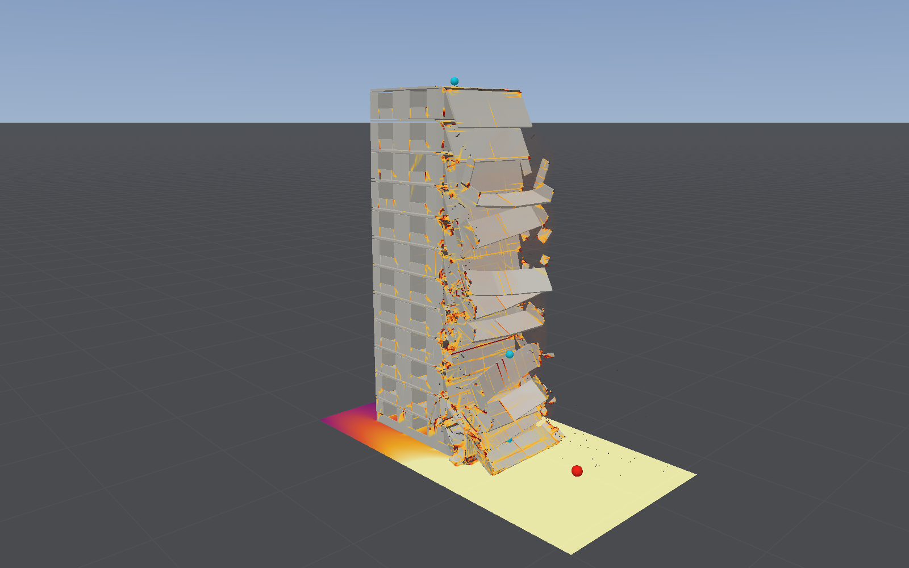
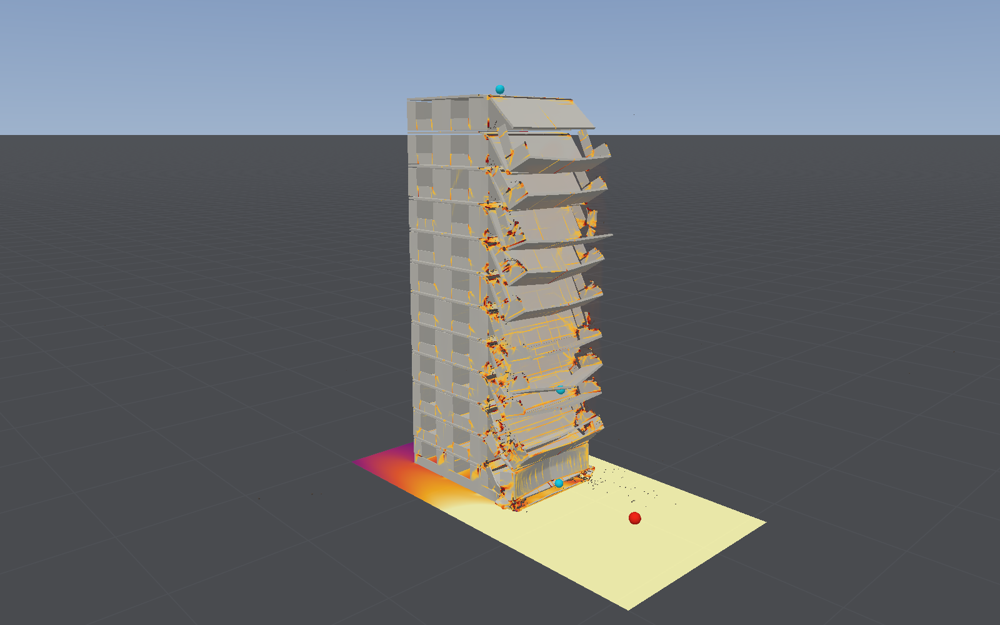

# A large-panel block of flats

Two presets show progressive collapse through the joints of a precast building with no frame,
the kind that partly collapsed at Ronan Point in 1968:
- **Large-panel flats: gas in a corner flat**
- **Large-panel flats: street charge**

They are showcases, run on the model as it stands. Nothing here has been compared with a
measurement. Collapse has been compared once, blind, and missed (see the [standing](#its-standing)).

## The building

A twelve-storey block of storey-high precast wall panels standing on precast floors, three bays
long and one flat deep, its proportions and joints after the inquiry into Ronan Point (H.
Griffiths, A. Pugsley and O. Saunders, *Report of the Inquiry into the Collapse of Flats at Ronan
Point, Canning Town*, Ministry of Housing and Local Government, HMSO, 1968):

| | Ronan Point (the inquiry) | This block |
|---|---|---|
| Storeys | 22 on an in-situ podium, 210 ft high, 80 by 60 ft, five flats a floor about a central corridor (§39) | 12 on a clamped base, 31.5 m high; one side of the corridor, three bays |
| Wall panels | storey high (about 8 ft), 9 ft wide, 6 or 7 in thick, solid concrete (§103) | 2.275 m high, each wall line one panel, 175 mm, a light central mesh |
| Floors | precast slabs 7 in thick, 13 or 15 ft long, reinforced and cored, resting at their ends on the flank and cross walls (§101, §103) | one 175 mm plate a storey, 4.375 m bays, bars in the soffit, four fifths solid |
| Plan | the corner flat 29 ft deep to the corridor (Plan (b)) | 8.75 m deep, 13.1 m long |
| Concrete | 5,700 psi on works cubes at 28 days (§108) | 31 MPa on cylinders; face walls 20 MPa, 1,800 kg/m³ |
| Joints | each panel set on dry-packed mortar on the floor below (§106); at the flank walls (H.2) the floor tied to the wall only by a strap over the lifting bolt, found loosely bolted through oval slots (§112–114); at the cross walls opposing slabs joined by in-situ concrete with bars (Figure F) | each wall stands on the floor below across a gap of one element and the floor rests on it across another, joined by `Anchorage.betweenParts`: at the flank walls friction alone (0.7, mortar on concrete as Batalha's seats measured), at the cross walls a construction joint (1 MPa tension, 1.3 MPa cohesion, friction 0.7) |
| Face walls | light, non-load-bearing, held on ledges (§102) | 87.5 mm, a window 2.1 by 1.4 m in each bay, bonded to the wall lines |

Meshed with solid elements of 87.5 mm, two through each wall and floor: 670,560 elements, 940 t,
92 joints with 18,400 node pairs. Each storey's floor is continuous over the cross walls (the
in-situ joint with its bars), and each wall line is one panel along its length (the vertical
joints of Figure C, in-situ concrete through U-bars). The parts must be solid elements: joints
between parts are not made for shells.

`blastbench panelblock --case gravity` checks it under its own weight, damped, as the [IFC
corpus](ifc-import-corpus.md) checks an imported building: **it stands**, 99.7% of its weight
reaching the ground, 1.7 mm at most, no joint separated or off its seat.

## Gas in a corner flat

Stoichiometric methane fills the back half of the west corner flat on the tenth floor
(43 m³, the kitchen and hall: Ronan Point's gas collected in the hall of a corner flat on the
eighteenth of 22, and was town gas, which the model does not have), lit at the cooker. The flat's
two windows are vent panels. Air on 0.125 m cells (`blastbench panelblock --case gas`).

GAS_IMAGE

**With the windows holding to 25 kPa (the preset)**, so that the pressure can find the walls:
- the flat reaches **15 kPa by 0.5 s**;
- there the **light face wall under the front window breaks out** (20 elements fail) and the
  flat vents through it; the pressure rises no further and the gas burns out over two seconds,
  much of it outside;
- the **flank wall slides 22 mm on its joints and holds**: in this block it would slide off at
  about 20 kPa (its friction under the two storeys and roof above), close to the 2.8 psi (19 kPa)
  the inquiry's tests found for Ronan Point's;
- **nothing collapses.** The weakest part of this flat's enclosure is its face wall, not the
  load-bearing flank, and the explosion goes out through it.

**With ordinary glazing**, windows going at 3 kPa (`--vent 3`), the panels release at 0.3 s
and the flat vents at **3.3 kPa**; the flank wall slides 3 mm.

So the gas does not set off a progressive collapse here, where at Ronan Point it did: there the
pressure, by the inquiry's account, displaced the flank wall before anything else gave. Whether
a flat's face walls and windows or its flank wall go first decides it, and this block's face walls
are the assumed part (87.5 mm of 20 MPa concrete; Ronan Point's are not described beyond being
light and non-load-bearing).

## A street charge

500 kg of TNT 8 m from the east flank wall, a metre up (`blastbench panelblock --case street`,
air on 0.25 m cells, 1.2 million of them):

The ground floor's flank wall takes 2.7 MPa of reflected pressure and is pushed into the
building; its floor goes with it. In the first 0.1 s half the joints' pairs have lost their
strength and 1,151 have slid off their seats, but the cross walls hold. Then the east bay goes
storey by storey from the bottom up: each flank wall panel loses the floor it stood on, slides
off and drops, and the bay's floors, losing their flank-end bearing, hinge down about the cross
wall, where the continuous floor cracks over it (4.8 m at 0.6 s, 6.2 m at 1.5 s). The two west
bays stand. It is the mechanism of Ronan Point's corner, the floors of one bay falling once the
wall at their end is gone, set off from below rather than from the eighteenth floor.

**The run blows up between 2 and 3 s**, as the falling bay's pieces land on the ground (see
[below](#what-the-runs-found-along-the-way)); the frames up to 2 s are before it. The outcome
for the block as a whole after 2 s is not known from this run.

| Charge at 8 m | What happens |
|---|---|
| 250 kg | The joints slide up to 118 mm and 678 pairs come off their seats; no element fails, and the block stands, 126 mm out at 3 s |
| 500 kg (the preset) | The east bay comes down storey by storey, as above; blows up after 2 s |
| 1,000 kg | The ground floor's flank wall and floor are thrown 4 m in 0.16 s; the run blows up within 0.3 s |

## What the runs found along the way

- **The joints' gaps leaked.** A cell of air is solid when a third of it is full of elements;
  the one-element gap of each joint left a row of cells open along every wall on cells finer than
  0.175 m, 4.5 m² of slots round the flat, and its gas burnt at under 0.3 kPa. The preset fills
  the gaps above and below the gas flat with rigid scenery for the air (the mortar bed and
  screed), which the panels do not touch and which stays put when they move.
- **Vent panels opened at once beside a deformable structure.** They were placed in the mask
  after the structure had captured the rigid mask its remasking starts from; the first remask
  opened them. Fixed (see [vent panels](deflagration.md#vent-panels)).
- **A young flame is slow on coarse cells** ([deflagration](deflagration.md#limitations)): on
  0.25 m cells the flat's gas had hardly burnt in 3 s. The gas preset needs 0.125 m.
- **Fast debris on the ground can blow a solid structure up.** Under 1,000 kg at 8 m the
  ground-floor flank wall is thrown 4 m in 0.16 s, and where its pieces land the structure went
  to NaN within 0.05 s; with either node contact or ground contact off it did not. Not fixed
  here.

## Its standing

The app derives it from the scene, as for every layout: every result is *illustrative* (a gas
deflagration makes the structure's illustrative; joints between parts are noted), and under
what is not compared it lists collapse, compared once, blind, and missed (two slabs under a
blast left standing), and failure that holds under mesh refinement, which none does yet.
`blastbench panelblock --case gas --standing` prints it.

What is and is not compared, in short:
- **The joints:** the friction law against Batalha's precast seat tests (μ within 2–4%); no
  large-panel joint, and no H.2 joint, has been compared.
- **The gas:** the flame against FM Global's vented chamber (0.4–0.6 of its peaks lit in the
  middle, 0.9–1.8 at a back wall); not in a flat, not with town gas, whose hydrogen burns
  faster than the methane used here.
- **The collapse:** not compared. Ronan Point's corner fell from the 22nd floor to the podium;
  this block is not Ronan Point, and its outcome is not a prediction of it.

## Cost

670,560 solid elements on a 87.5 mm step make it the most expensive layout here: 3 s of the street
charge took 76 minutes, 4 s of the gas 83, 1,250 to 1,500 times slower than real time on an M4 Max
shared with other work ([performance](performance.md#collapse)). In the app, set *Stop after* to
3 or 4 s: the default stops at a quarter of a second.
