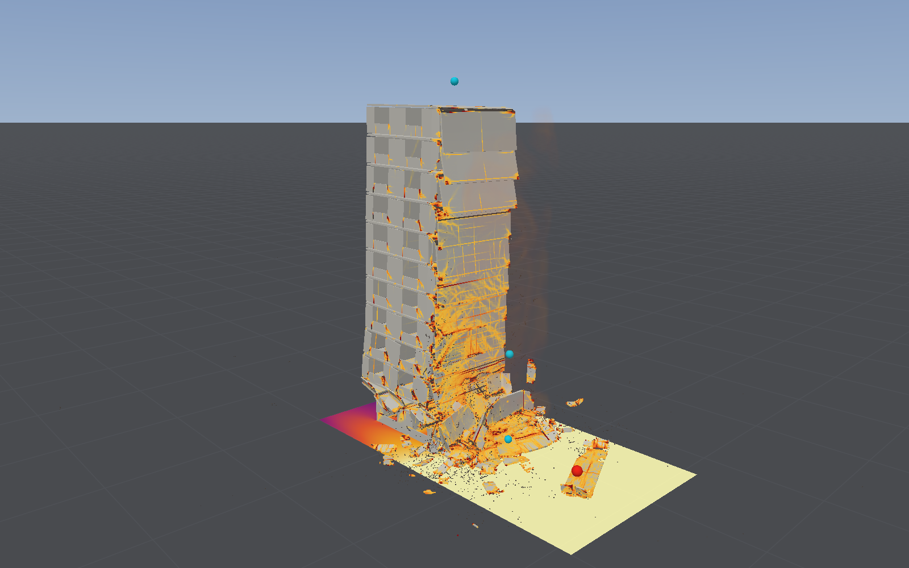
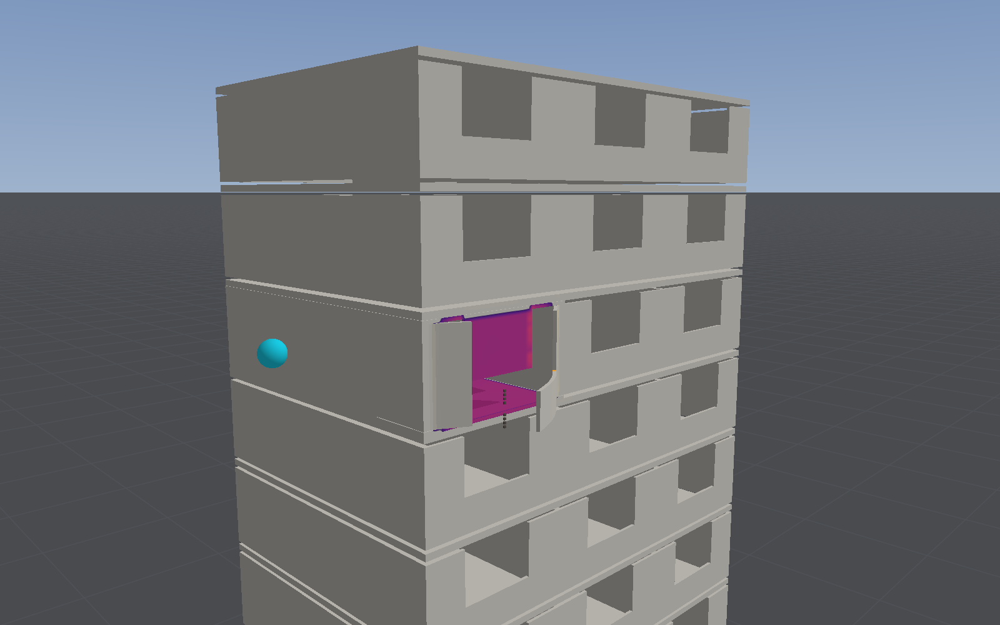

# A large-panel block of flats

Two presets show progressive collapse through the joints of a precast building with no frame,
the kind that partly collapsed at Ronan Point in 1968:
- **Large-panel flats: gas in a corner flat**
- **Large-panel flats: street charge**

They are showcases, run on the model as it stands. Nothing here has been compared with a
measurement; the gas flat is set against the inquiry's own estimates of what each wall needed
to give ([below](#against-the-inquirys-estimates)). Collapse has been compared once, blind, and missed (see the [standing](#its-standing)).

## The building

A twelve-storey block of storey-high precast wall panels standing on precast floors, three bays
long and one flat deep, its proportions and joints after the inquiry into Ronan Point (H.
Griffiths, A. Pugsley and O. Saunders, *Report of the Inquiry into the Collapse of Flats at Ronan
Point, Canning Town*, Ministry of Housing and Local Government, HMSO, 1968):

| | Ronan Point (the inquiry) | This block |
|---|---|---|
| Storeys | 22 on an in-situ podium, 210 ft high, 80 by 60 ft, five flats a floor about a central corridor (§39) | 12 on a clamped base, 31.5 m high; one side of the corridor, three bays |
| Wall panels | storey high (about 8 ft), 9 ft wide, 6 or 7 in thick, solid concrete (§103) | 2.275 m high, each wall line one panel, 175 mm, a light central mesh |
| Floors | precast slabs 7 in thick, 13 or 15 ft long, reinforced and cored, resting at their ends on the flank and cross walls (§101, §103) | one 175 mm plate a storey, 4.375 m bays, bars in the soffit, four fifths solid |
| Plan | the corner flat 29 ft deep to the corridor (Plan (b)) | 8.75 m deep, 13.1 m long |
| Concrete | 5,700 psi on works cubes at 28 days (§108) | 31 MPa on cylinders; face walls 20 MPa, 1,800 kg/m³ |
| Joints | each panel set on dry-packed mortar on the floor below (§106); at the flank walls (H.2) the floor tied to the wall only by a strap over the lifting bolt, found loosely bolted through oval slots (§112–114); at the cross walls opposing slabs joined by in-situ concrete with bars (Figure F) | each wall stands on the floor below across a gap of one element and the floor rests on it across another, joined by `Anchorage.betweenParts`: at the flank walls friction alone (0.7, mortar on concrete as Batalha's seats measured), at the cross walls a construction joint (1 MPa tension, 1.3 MPa cohesion, friction 0.7) |
| Face walls | light, non-load-bearing, held on ledges (§102) | 87.5 mm, a window 2.1 by 1.4 m in each bay, bonded to the wall lines |

Meshed with solid elements of 87.5 mm, two through each wall and floor: 670,560 elements, 940 t,
92 joints with 18,400 node pairs. Each storey's floor is continuous over the cross walls (the
in-situ joint with its bars), and each wall line is one panel along its length (the vertical
joints of Figure C, in-situ concrete through U-bars). The parts are solid elements: joints between
parts in shells act at their nodes, without moments, too crude for these walls' bearings.

`blastbench panelblock --case gravity` checks it under its own weight, damped, as the [IFC
corpus](ifc-import-corpus.md) checks an imported building: **it stands**, 99.7% of its weight
reaching the ground, 1.7 mm at most, no joint separated or off its seat.

## Gas in a corner flat

Stoichiometric town gas, Ronan Point's own fuel ([a British town gas](deflagration.md#hydrogen-and-town-gas),
half hydrogen), fills the back half of the west corner flat on the tenth floor (43 m³, the kitchen
and hall: Ronan Point's gas collected in the hall of a corner flat on the eighteenth of 22), lit at
the cooker. The flat's two windows are vent panels. Air on 0.125 m cells (`blastbench panelblock
--case gas`; `--gas methane` for the methane the preset had before town gas was in the model).

**With the windows holding to 25 kPa (the preset)**, so that the pressure can find the walls:
- the flat reaches **12 kPa on the flank wall by 0.5 s** (3.9 kPa at 0.3 s, 9.6 at 0.4);
- there the **light face wall under the front window breaks out** (20 elements fail) and the
  flat vents through it; the pressure rises no further and the gas burns out over three seconds,
  much of it outside;
- the **flank wall's joints slide 1 mm and hold**;
- **nothing collapses.** The flat vents through its face wall before the pressure on the flank
  wall reaches what its joints hold.

**On methane** (`--gas methane`) it goes the same way: 14 kPa at 0.5 s, the face wall out, the
flank sliding 7 mm. Town gas burns a third faster at stoichiometric (0.55 against 0.41 m/s), but
the pressure stops at what the face wall holds, 12–15 kPa, whichever gas.

**With ordinary glazing**, windows going at 3 kPa (`--vent 3`), the panels release at 0.3 s
and the flat vents at **3.3 kPa**; the flank wall slides 3 mm (a run before structures were settled
under their own weight first, 17 October 2026).

### Against the inquiry's estimates

The inquiry worked out what each part of flat 90's enclosure needed to give (§118–126), for a
flat with four storeys above it:

| Part | The inquiry, Ronan Point's flat 90 | This block's flat, the model |
|---|---|---|
| Light face walls | blew out "almost immediately", at about ¼ psi (1.7 kPa) (§118) | held to 12 kPa (14 on methane), then broke out under the front window |
| Flank panel's joint at floor level | displaced at about 800 lb/ft² (5.54 psi, 38 kPa), friction at the dry mortar relieved by the gas on the floor (§122) | held (friction 0.7 under the wall and the floors above it) |
| Flank panel's joint at ceiling level (H.2) | broken at about 400 lb/ft² (2.78 psi, 19 kPa), the gas lifting the ceiling off the shelf's friction, the tie plate acting only once the stud reached the end of its slot (§123) | slid 1 mm at 12 kPa (7 mm at 14 on methane) and stopped as the flat vented |
| Floor slabs | down at 3.89 psi (27 kPa), the ceiling up at 2.22 psi (15 kPa) in tests (§124) | the ceiling lifted but did not fail |
| What starts the collapse | "an average gas pressure on the flank wall of 3 lb/in²" (21 kPa) (§126) | not reached: 12 kPa |

**The model's flank is not stronger than the inquiry's.** On methane its joints slid 7 mm at
14 kPa, below the inquiry's 19 kPa for the joint at the ceiling, as the gas lifted the floor above
off it, the mechanism the inquiry describes; with two storeys and the roof above it rather than
four, it has less weight to hold it. What the inquiry's flat had that this one does not is
pressure: about 3 psi on the flank wall, from gas that had collected in the hall (it put the hall's
peak at about 12 psi, from a buckled fuse-box cover, §64) and burnt before the face walls and window
could vent it. Here the flat's pressure stops at 12–14 kPa, on its own town gas as on methane:
- **the flame.** Town gas, about half hydrogen, burns a third faster than methane at stoichiometric
  in the model's table; but the model's vented flames read low, 0.4–0.6 of FM Global's methane tests
  lit in the middle and 0.19–0.39 of their lean hydrogen tests ([deflagration](deflagration.md#hydrogen-and-town-gas-1)),
  and a flame lit in the middle of a uniform cloud of 43 m³ is not one lit in a hall full of a
  layer of gas;
- **the face wall**, here a panel of 87.5 mm concrete bonded to the walls, held to 12 kPa where
  the inquiry's went at ¼ psi. A weaker face wall would vent the flat sooner and lower the
  pressure further, so it is not what spares the flank; the flame is.

So the model, given this flat, under-reads a Ronan Point–type gas event, on Ronan Point's own gas:
the unsafe side, through the gas load rather than the joints. Nothing here was tuned to reach the
inquiry's 3 psi.

## A street charge

500 kg of TNT 8 m from the east flank wall, a metre up (`blastbench panelblock --case street`,
air on 0.25 m cells, 1.2 million of them):

The ground floor's flank wall takes 2.7 MPa of reflected pressure and is pushed into the
building; its floor goes with it. In the first 0.3 s half the joints' pairs have lost their
strength and 2,345 have slid off their seats, but the cross walls hold. Then the east bay goes
storey by storey from the bottom up: each flank wall panel loses the floor it stood on, slides
off and drops, and the bay's floors, losing their flank-end bearing, hinge down about the cross
wall, where the continuous floor cracks over it (5.0 m at 1 s, 6.5 m at 1.5 s). From 2 s the
bay's lower floors tear off the cross wall and fall into the street; by 4 s nine storeys of the
bay lie in a pile in front of the block, 24,891 elements failed, and its top three floors still
hang, cantilevered off the cross wall. The two west bays stand. It is the mechanism of Ronan
Point's corner, the floors of one bay falling once the wall at their end is gone, set off from
below rather than from the eighteenth floor.

| Charge at 8 m | What happens |
|---|---|
| 250 kg | The joints slide up to 118 mm and 678 pairs come off their seats; no element fails, and the block stands, 126 mm out at 3 s |
| 500 kg (the preset) | The east bay comes down storey by storey, as above |
| 1,000 kg | The ground floor's flank wall and floor are thrown 4 m in 0.16 s; the run blew up within 0.3 s as they landed, before the fix below |

## What the runs found along the way

- **The joints' gaps leaked.** A cell of air is solid when a third of it is full of elements;
  the one-element gap of each joint left a row of cells open along every wall on cells finer than
  0.175 m, 4.5 m² of slots round the flat, and its gas burnt at under 0.3 kPa. The preset fills
  the gaps above and below the gas flat with rigid scenery for the air (the mortar bed and
  screed), which the panels do not touch and which stays put when they move.
- **Vent panels opened at once beside a deformable structure.** They were placed in the mask
  after the structure had captured the rigid mask its remasking starts from; the first remask
  opened them. Fixed (see [vent panels](deflagration.md#vent-panels)).
- **A young flame is slow on coarse cells** ([deflagration](deflagration.md#limitations)): on
  0.25 m cells the flat's gas had hardly burnt in 3 s. The gas preset needs 0.125 m.
- **Fast debris on the ground blew a solid structure up.** Under 1,000 kg at 8 m the ground-floor
  flank wall is thrown 4 m in 0.16 s, and where its pieces landed the structure went to NaN
  within 0.05 s (with node contact or ground contact off it did not); under 500 kg it did so
  after 2 s. A bare element pressed flat on the hard ground was left with no volume; it is now
  removed (df4baa88), and the 500 kg run goes to 4 s.

## Its standing

The app derives it from the scene, as for every layout: every result is *illustrative* (a gas
deflagration makes the structure's illustrative; joints between parts are noted), and under
what is not compared it lists collapse, compared once, blind, and missed (two slabs under a
blast left standing), and failure that holds under mesh refinement, which none does yet.
`blastbench panelblock --case gas --standing` prints it.

What is and is not compared, in short:
- **The joints:** the friction law against Batalha's precast seat tests (μ within 2–4%); no
  large-panel joint, and no H.2 joint, has been compared.
- **The gas:** town gas's burning velocities are Lautkaski's, from vented-oven flame speeds;
  the flame has been compared in FM Global's vented chamber with methane (0.4–0.6 of its peaks lit
  in the middle, 0.9–1.8 at a back wall) and lean hydrogen (0.19–0.39), not with town gas and not
  in a flat. Against the inquiry's estimates the flat's pressure reads
  low, the unsafe side: 12 kPa (14 on methane) where Ronan Point's flank wall saw about 21 kPa
  ([above](#against-the-inquirys-estimates)).
- **The flank joint against the inquiry's estimate:** sliding at 12–14 kPa where the inquiry put
  the H.2 joint's strength at 19 kPa, so not on the unsafe side; an estimate, not a test.
- **The collapse:** not compared. Ronan Point's corner fell from the 22nd floor to the podium;
  this block is not Ronan Point, and its outcome is not a prediction of it.

## Cost

670,560 solid elements on a 87.5 mm step make it the most expensive layout here: 3 s of the street
charge took 89 minutes, 4 s of the gas 83, 1,250 to 1,350 times slower than real time on an M4 Max
shared with other work ([performance](performance.md#collapse)). In the app, set *Stop after* to
3 or 4 s: the default stops at a quarter of a second.
