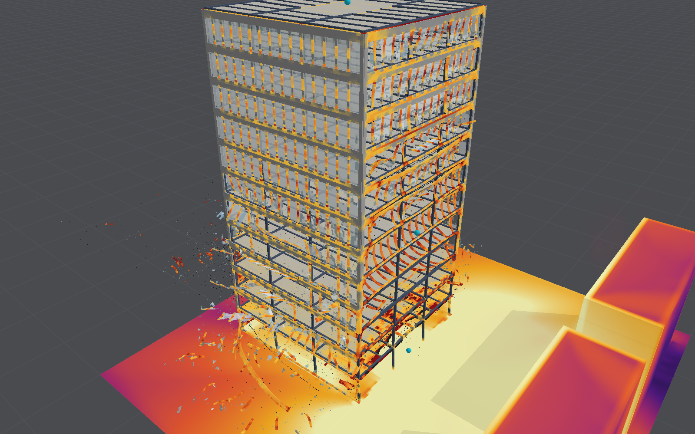
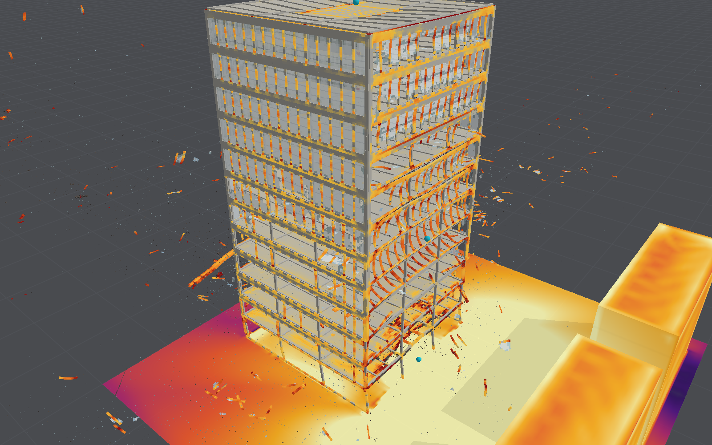

# Twelve-storey office, steel and glass

A sample layout of modern construction, beside the older [twelve-storey
tower](shell-model.md) of flat slabs on concrete columns. It is a speculative office: a
concrete core, a steel frame with composite floors, and a glazed curtain wall. Across the street
stand two smaller buildings as envelopes, and a van's worth of explosive is parked at the kerb.

**Standing.** A showcase on the model as it stands, compared as a building with nothing measured
([standing](standing.md)). Its gauges take the open blast's bands (Kingery–Bulmash on today's
air). Its structure is an approximation: its steel members are compared with Nassr's blasted
beams and columns ([shell model](shell-model.md#validation)), its connections are not, and
its toughened glass is the annealed panes' model with a higher strength. Its damage is
illustrative, and the neighbours' envelope damage is the one-way model's, an approximation.

## The building

| Part | As modelled | Typical practice, and the source |
|---|---|---|
| Storeys | 12 of 3.8 m floor to floor, 45.6 m high | 3.6–4.0 m for speculative offices, 4.0–4.2 m for prestige ones [1] |
| Plan | 22.5 m square, a 7.5 m grid, three bays each way | Façade columns typically at 5.4–7.5 m; planning grids in multiples of 1.5 m [1] |
| Stability | A reinforced concrete core in the middle bay, 7.5 m square, of 300 mm walls with 565 mm² of bars a metre in each face, each way; a doorway into it on every floor | "Concrete cores are the most practical system for buildings of up to 40 storeys" [1] |
| Columns | Twelve 305 × 305 × 118 UC on the perimeter | 305 UC for 5–12 floors carried, 356 UC for 10–40 [1]; properties from the SCI's tables [4] |
| Primary beams | 457 × 191 × 67 UB on the column lines, both ways | Composite primaries at a span-to-depth ratio of 16–18 [2]: 16.5 here |
| Secondary beams | 356 × 171 × 45 UB at 2.5 m between the primaries | Composite secondaries at 22–25 [2]: 21 here, a little deep |
| Floors | 130 mm of concrete on a 60 mm steel deck, spanning 2.5 m; the deck as 1,200 mm² of bars a metre along its span, 30 mm up, and an A193 mesh near the top | A 130 mm slab on a 60 mm deck at 3 m spans is a common reference [3]; SCI P359 covers slabs 100–200 mm thick [5] |
| Curtain wall | Unitised: aluminium mullions at 1.5 m, 65 × 150 mm, a storey high and fixed to the slab edges, 0.25 m outside the column lines | Unitised systems of 125–150 mm depth, units up to 2.7 × 3.6 m (Schüco USC 65 F) [6] |
| Glazing | 10 mm toughened glass, vision lites 1.25 m wide from 0.25 m above each floor to 2.95 m; an opaque spandrel above, to the next floor | Toughened glass's characteristic bending strength is 120 MPa (EN 12150-1), against 45 MPa annealed [7]; outer panes of 6 mm toughened glass are usual in insulating units [8] |

### How it is meshed

Everything is shells and beams of 0.25 m. Some parts are simplified to fit that mesh, and each
simplification is listed here.
- **Steel members.** A beam element's section is a rectangle. Each rolled section is a rectangle
  0.6 of its depth wide, of steel scaled to the section's major-axis bending stiffness, plastic
  bending strength and mass (`SteelSection`, as the [IFC import](structural-editing.md) does for
  flanged sections). Its axial stiffness is then about twice the section's.
- **Composite floors.** The beams lie on their slab's midsurface and share its nodes: full shear
  connection between them, but without the composite section's lever arm. The floors are a
  little less stiff than real composite ones.
- **Connections.** Every joint of the frame is rigid, because the shell model has no pinned
  joints. A real frame of this kind has simple (pinned) beam-to-column connections and leans on
  its core.
- **Curtain wall.** It is one plate, 150 mm thick (a mullion's depth), round each storey of each
  face. Its frame material (`ScenarioPreset.curtainWallFrame`) is scaled so that a strip one
  element wide bends as stiffly and as strongly as a mullion, and weighs as much. The vision
  lites are openings in it, each glazed with a pane: an opening cuts the frame but keeps the pane
  it holds, which joins the frame round its edge ([shells](shell-model.md), item 6). The
  spandrels are the frame plate itself.
- **The glass** is one pane of 10 mm toughened glass, standing for an insulating unit. It fails
  as annealed glass does, at its own strength.
- **The neighbours across the street** are envelopes: rigid and exposure-only, each with forty
  windows of 6 mm annealed glass, judged one way by [envelope damage](building-envelopes.md)
  as the tower moves: its outline never takes the air at their faces, and its debris passes them
  by. Each pane fills its window through the wall's thickness in the air, so that the window is
  closed at any cell size (until 17 October 2026 it was a 6 mm box no cell centre lay in, and
  the windows were open holes, never judged). Run headless for 0.1 s on coarse air, both lose all
  forty panes, the first at 10 ms, their rooms rising to about 25 kPa, and their front walls go
  past the one-way model's 2°.

## Under gravity

Stood under gravity alone for 0.3 s, damped at 50/s, and judged as the [IFC
corpus](ifc-import-corpus.md#under-gravity) judges imported buildings (`GravityCheck`,
`blastbench gravity --preset office`), it **stands**:
- **Weight:** 32,200 kN (3,280 t, 5.3 kN/m² of floor), and 99.9% of it is carried.
- **Movement:** the peak displacement is 7 mm, no element fails, and nothing is still moving at
  the end.

The older twelve-storey tower stands the same way (99.9%, 7 mm).

Since 17 October 2026 the frame is brought to rest under its own weight before the blast
([settling](structural-model.md#settling-under-its-own-weight)). Before then gravity came on at
once when a run started, and the frame sagged its 7 mm while the blast was on its way.

## The blast

Run with `blastbench snapshot --preset office --dx 0.5 --time 3 --frames 0.05,0.25,1,2`: 1,000 kg
at the kerb, 5 m from the front façade, on 0.5 m air.

| Time | What happens |
|---|---|
| 50 ms | The front's glazing on the lowest floors breaks up as the wave crosses it; the wave runs along the façades and across the street to the neighbours |
| 250 ms | The front has lost its glass over the lower half, leaving the mullions and transoms. Blast entering through it pressurises the floors and blows out side glazing near the front. Glass and frame are thrown into the street and out of the sides |
| 1 s | Fragments are still in flight, tens of metres out to the sides and into the street, some whole strips of frame with their glass; the frame and the core stand |
| 3 s | Still standing: the steel frame and core carry it, with 32,249 of 236,868 elements failed, nearly all of them glass and curtain-wall frame |

The largest displacement the run reports, hundreds of metres, is a glass fragment's flight. The
structure's own movement is far smaller.

The frame is probably too strong against the blast near the charge. Each column is a rectangle
0.19 m wide where the real section's flanges are 0.31 m, so it catches less of the blast. Its
joints are rigid where a real frame's are pinned, so it is stiffer. And the equivalent
rectangle's axial stiffness is about twice the section's.

### Cost

220,788 shells and 16,080 beams on 1.5 million cells of 0.5 m air: **3 s simulated in 3,296 s**
(55 minutes, 1,100 times slower than real time) on the Studio. The air was frozen after 1.2 s,
and from then on the structure alone runs. That is about 14 times the older tower's cost per
second simulated. Two causes:
- **Elements:** there are 2.4 times as many, the glass and curtain wall among them.
- **Time step:** it is 2.1e-5 s against the older tower's 5–6e-5 s. Steel's wave speed is high
  (7,300 m/s in the scaled sections), and the mesh keeps lines 0.157 m apart round each column
  for its head.

## Sources

1. SteelConstruction.info, [Concept design](https://steelconstruction.info/topics/design/concept-design/) (SCI and BCSA): floor-to-floor heights, column spacing, planning grids, stability systems and column sizes by floors carried.
2. SteelConstruction.info, [Framing schematics](https://steelconstruction.info/resources-for-students/framing-schematics/): span-to-depth ratios of composite beams.
3. Structville, [Design of composite slab with profiled metal deck](https://structville.com/2020/07/design-of-profiled-metal-deck-composite-slabs.html): a worked example of a 130 mm slab on a 60 mm deck at 3.0 m spans.
4. SCI P363, *Steel building design: design data* (the "Blue Book"): the properties of the 305 UC, 457 UB and 356 UB.
5. SCI P359, [*Composite design of steel framed buildings*](https://www.SteelConstruction.info/images/c/c7/SCI_P359.pdf): composite slabs of 100–200 mm on decks of 45–100 mm.
6. Schüco [USC 65 F unitised façade](https://www.bimobject.com/en/schueco/product/schueco_usc_65): basic depths of 125 and 150 mm, units up to 2.7 × 3.6 m.
7. EN 12150-1, thermally toughened soda lime silicate safety glass: characteristic bending strength 120 MPa.
8. Priedemann façade lab, [Wicona and Glas Trösch unitised element](https://priedemann.net/en/services/facade-lab/exhibition/wicona-glas-troesch.html): a 6 mm toughened outer pane.
