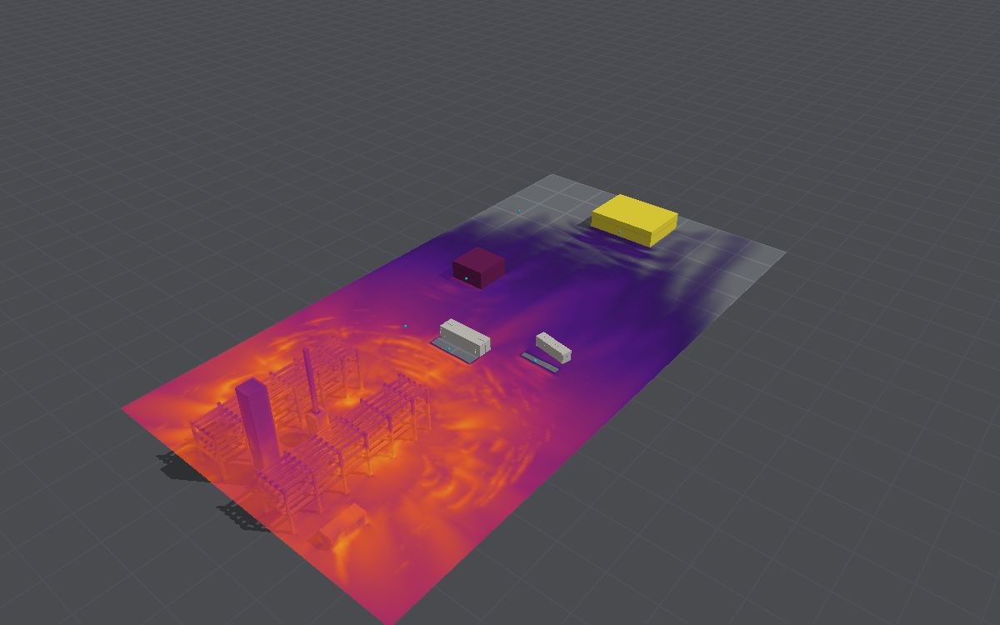
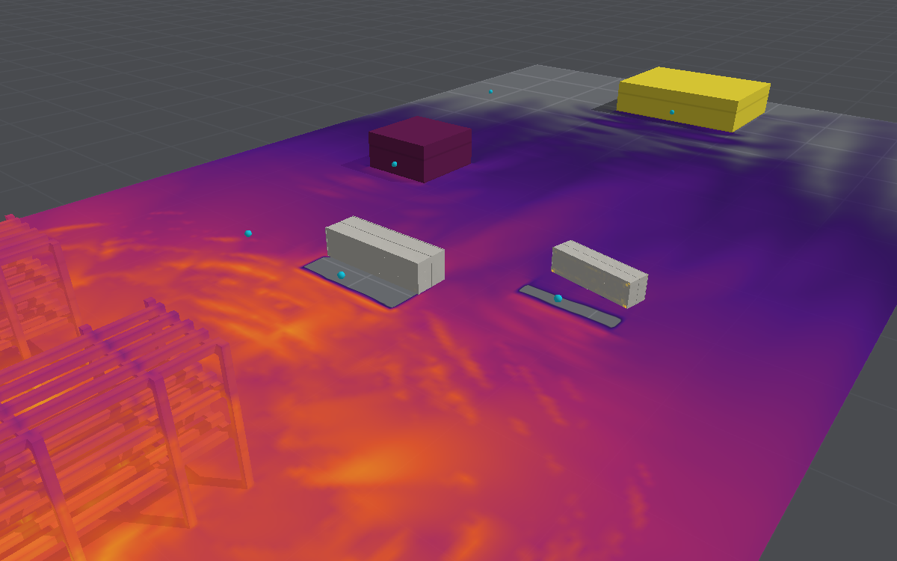

# Vapour cloud explosion at a process plant

A sample layout ("Vapour cloud explosion at a process plant"; `ProcessPlantScene`,
`blastbench snapshot --preset plant`): an accidental explosion of a flammable cloud in a
congested process area, beside the buildings people work in. It is drawn after the explosion at
BP's Texas City refinery on 23 March 2005, as the US Chemical Safety Board reported it, made
smaller to run on a laptop. It is illustrative: the model's flame has not been compared with any
open, congested cloud, and congestion speeds a real flame up far beyond what it resolves (see
[What the model can and cannot represent](#what-the-model-can-and-cannot-represent)).

## The source

US Chemical Safety and Hazard Investigation Board, *Investigation Report: Refinery Explosion and
Fire, BP Texas City, Texas, March 23, 2005*, Report 2005-04-I-TX, March 2007 ([CSB]); and the CSB's
trailer damage table of 30 June 2006 ([CSB-T]). Page numbers are the report's printed pages.

| | Texas City (source) | This scene |
|---|---|---|
| Release | Raffinate (C5–C8 alkanes, mean molecular weight 94) from the blowdown drum's stack; 18,800 kg in 106 s, about 6,400 kg of it vapour at 60 kg/s ([CSB] Table H-2, H.9) | A ready-mixed cloud of stoichiometric propane, 46 × 48 × 6 m, about 530 m³ of propane (1 t): a sixth of the vapour |
| Fuel | Medium reactivity in the Baker–Strehlow–Tang scheme (only methane and CO low) | Propane, the model's medium-reactivity gas |
| Cloud | Burned area about 18,600 m², spread to the south-east by a 5 mph wind ([CSB] p. 64–65) | 2,200 m² over the process area and 10 m beyond it, a ninth of the area |
| Ignition | An idling diesel pickup 25 ft (7.6 m) from the blowdown drum ([CSB] p. 22, 66) | 7.6 m from the drum, 0.5 m up |
| Plant | The ISOM unit: the blowdown drum, 10 ft across and 27 ft tall, its stack 119 ft; the raffinate splitter, 12.5 ft across and 170 ft tall; elevated equipment over 30–50% of the plan around the drum at 15–30 ft ([CSB] p. 33, 38, H.11) | The drum (3 m across, 8 m tall) and its stack to the domain's top (23 m); the tower 3.8 m across, 22 m tall; two pipe racks, 8 m wide and 34 m long, three tiers at 4, 7 and 10 m of five 0.5 m pipes at 1.5 m centres; two vessels; all rigid |
| Trailers | The double-wide (75 × 13 ft, wood-framed) 121 ft from the drum to its nearest point, 140 ft to its centre: 12 killed; the QA/QC trailer (30 × 8 ft) at 136–150 ft: 3 killed; both destroyed and their frames thrown 12–15 ft ([CSB-T]; [CSB] p. 68, App. F) | A steel blast-resistant module, 37 m (121 ft) from the drum; a steel-skinned portable cabin of the QA/QC trailer's plan, 46 m (150 ft) from it |
| Other buildings | The ISOM satellite control room, masonry, heavily damaged ([CSB] H.5); more than 40 trailers damaged, 13 destroyed ([CSB] p. 69) | A brick control room 62 m from the drum and a concrete office 108 m from it, as envelope buildings with 6 mm annealed windows |

### What was measured, and estimated

The CSB's blast analysis (by FLACS and from the damage) put the free-field overpressure at
2.5–2.8 psi (17–19 kPa) at the double-wide and QA/QC trailers, 2–2.5 psi at the six-pack trailers
and the catalyst warehouse (235–249 ft), 2–5 psi over most of the ISOM unit, about 1 psi at the
first row of tanks and 0.5 psi beyond ([CSB] H.3, H.17.1, Fig. 12; App. F p. 256). Its Table H-1
sorts the trailers' damage by distance from the drum:

| Trailer | Damage | Distance |
|---|---|---|
| Wood-framed | Destroyed, debris thrown, occupants killed or seriously injured | 140–240 ft (43–73 m) |
| | Significant wall damage, flying glass | 240–620 ft |
| Metal semi-trailer or fifth wheel | Wall and roof failure | 220–250 ft (67–76 m) |
| Steel container units | Large deformation | 340 ft (104 m) |

### The blast-resistant module and the cabin

- **The module** is a 40 × 12 × 10.3 ft unit (12.2 × 3.66 × 3.14 m), of the kind Omega-Risk tested
  (Hashemi, MSc thesis, Istanbul Technical University, 2022, §3.1): corrugated A36 plate welded
  to an A500 HSS frame, seven intermediate columns along each long wall. Vendors give 3/16–5/16 in
  plate and rate such units at 8 psi for 200 ms. Here the plate is 1/4 in (6.35 mm) and flat, the
  frame 0.1 m steel bars at about 1.5 m (the bending stiffness of an HSS 6 × 6 × 3/8 at twice its
  mass), the steel S355, all shells and beams of 0.25 m. Its walls are therefore weaker than a
  corrugated plate's, between their frame members.
- **The cabin** is an ordinary site cabin of 1.5 mm steel sheet on 50 mm steel bars at 1.2 m, of
  the QA/QC trailer's plan (30 × 8 ft, 2.6 m high): a metal trailer in the CSB's table. Texas
  City's were wood-framed, which the model has no material for.
- **Both rest on the ground**, held by friction alone (0.5; `Anchorage.resting`), so that they can
  slide and lift as the trailers did.
- **The envelope buildings** are rigid in the air and judged afterwards, component by component,
  by the one-way damage model ([building envelopes](building-envelopes.md)): the control room of
  0.215 m brick (unreinforced masonry), the office of 0.2 m concrete at 0.3% each way.

## What the model can and cannot represent

- **The flame is the model's turbulent deflagration** ([deflagration](deflagration.md)): a burning
  velocity wrinkled by its cellular instability and by the turbulence below the grid, the flow
  round the racks and vessels resolved where they are a cell or more across. On 0.5 m air the
  0.5 m pipes are one cell, the front four cells (2 m) thick.
- **Congestion is what makes a vapour cloud explosion.** Each row of obstacles a flame passes
  through stretches it and its speed grows, row by row, to hundreds of metres a second: the
  Baker–Strehlow–Tang method gives medium-reactivity fuel in medium congestion, open in three
  dimensions, a flame Mach number of 0.44, in high congestion 0.50, and between two planes
  1.0–1.6 (DNV, *Obstructed Region Explosion Model – Theory*, 2026, Table 2). The model resolves
  none of that feedback below its grid and only some above it. It has been compared with vented
  rooms (0.4–1.8 of FM Global's tests) but with no open, congested cloud. **Its pressures here are
  a lower bound, and could be several times too low**: the unsafe side.
- **No transition to detonation**, which highly congested, reactive clouds can make.
- **The cloud is uniform and stoichiometric**, already mixed, without the rich core and lean
  edges of a real release; the wind and the release are not modelled.
- **The domain is 150 × 80 × 24 m**, the stack cut at 23 m; its open faces stand still air beyond
  them.

## Running it

```bash
swift run -c release blastbench snapshot --preset plant --dx 0.5 --time 2.5 --envelope-damage
```

prints each gauge's peak and positive impulse, each building's damage and each envelope building's
damage code, and renders the peak overpressure on the surfaces.

## Results

**With the model's own flame the explosion is all but silent.** On 0.5 m air the flame burns
through the cloud in about 2.5 s, and the peak is 0.3 kPa in the process area and 0.1 kPa at
37 m, against the CSB's 17–19 kPa there: a hundredth to a two-hundredth. No building is damaged.
This is the gap described above: the flame never speeds up as congestion makes a real one.

**So the layout raises the burning velocity by a factor fitted to the CSB's estimate**
(`FlameAcceleration.factor`, the venting literature's turbulence factor; here
`ProcessPlantScene.congestionFactor`). It stands for the congestion-driven acceleration the model
does not resolve. Over the factor, on 0.5 m air to 1.2–2 s (`--flame-factor`), the free-field
peak at 37 m was:

| Factor | 1 | 5 | 6 | 6.5 | 7 | 8 | 10 | 20 |
|---|---|---|---|---|---|---|---|---|
| Peak at 37 m, psi | 0.01 | 1.7 | 2.3 | 2.4 | 3.2 | 6.8 | 9.9 | 42 |

The pressure rises steeply with the factor, as about its third power or more, so a fit to one
point says little about the next. 6.5 is used. A single run's peak is uncertain by about ±20% (an earlier 6.5 run,
the envelope buildings not yet in the air, gave 3.6 psi).

**With the fitted flame** (`blastbench snapshot --preset plant --dx 0.5 --time 2
--envelope-damage`; 39–219 s on the Studio, depending on its load from other work), on 0.5.0's
build. Its defaults have changed since the factor was fitted, and the same factor now gives 3.2 psi
at 37 m, above the 2.5–2.8 psi it was fitted to (the run repeats to the digit); it has not been
refitted:

| Where | Model | Texas City (CSB) |
|---|---|---|
| In the process area | 6.3 psi (44 kPa) | 2–5 psi over most of the unit, 10+ psi at the compressor deck |
| Free field, 37 m from the drum | 3.2 psi | 2.5–2.8 psi at the double-wide and QA/QC trailers (fitted) |
| On the module's face | 6.9 psi, reflected | |
| At the brick control room, 62 m | 1.7 psi; its walls fail and four of its six panes break | 1.5–2.5 psi at the ISOM satellite control room, masonry, heavily damaged |
| At the concrete office, 108 m | 0.7 psi; moderate damage, and 7 of its 10 panes break | about 1 psi at the first row of tanks; windows broken out to 0.75 mile |
| Free field, 100 m | 0.4 psi | about 0.5 psi beyond the 1 psi line |

- **The blast-resistant module** slides 3.8 m from where it stood, its walls whole: no element
  fails. That is a module rated for 8 psi meeting 3.2 psi side-on, 6.9 psi reflected on its face,
  for the long duration of a deflagration. Resting on gravel by friction alone, it is pushed
  bodily; tested units, anchored or not, slid under a short pulse by 0.74–1.25 in. Anchoring it
  is what vendors advise.
- **The portable cabin** is thrown 6.3 m and its walls dented (the yellow of yielding steel in the
  picture), but no element fails. At 46 m the CSB found wood-framed trailers destroyed, and metal
  trailers' walls and roofs failing out to 67–76 m: the model's steel cabin comes off more lightly
  than the record's trailers, the unsafe side.
- **The envelope buildings** show the components' damage: the brick control room failed, as the
  ISOM satellite control room was heavily damaged; the concrete office is moderately damaged and
  loses 7 of its 10 panes.





**What to take from it.** The scene shows how the buildings around a plant fare against one
another, the module against the cabin and the masonry against the concrete, once the cloud's
pressure is right. It cannot say what that pressure is: that came from the CSB's estimate, through
the factor. A congestion model, such as the Baker–Strehlow–Tang flame speeds or FLACS's sub-grid
obstacles, is what would make it predictive.

BombCAD's [congestion model](congestion-model.md) is not yet that: with the racks' pipes as
congestion and the factor at 1 (`blastbench snapshot --preset plant --congested`), the scene gives
0.01 psi at 37 m, as the model alone does. The racks' tiers stand mostly above the 6 m cloud, and
the unit's congestion at grade is not in the layout. The factor stays at 6.5.

[CSB]: https://www.csb.gov/assets/1/20/CSBFinalReportBP.pdf
[CSB-T]: https://www.csb.gov/UserFiles/file/CSB_BPTrailerData6-30_06.pdf
