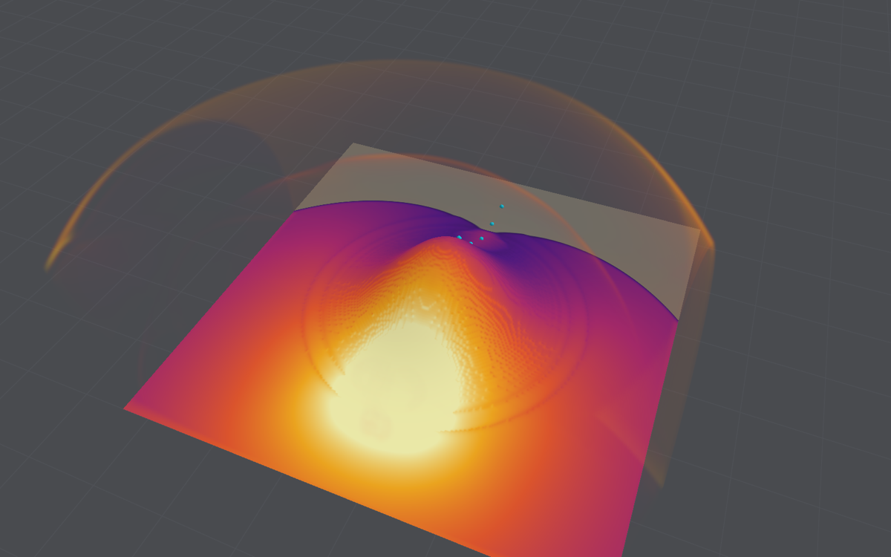

# Terrain

The ground under a scene can have a shape: hills, ridges, slopes, or a crop of a digital
elevation model (DEM). The air sees it as rigid solid, cell by cell, as it sees a block. It is
what the [long-term vision](long-term-vision.md) means by terrain interaction, at the scale of a
neighbourhood or a small landscape: shielding behind a rise, reflection up a slope, a blast that
arrives late and weakened over a crest. Flat ground stays the default and is unchanged to the
last bit.

The code is `Sources/BlastCore/Terrain.swift` (the heightfield), `ElevationGrid.swift` (DEM
import), `Shaders/Refine.metal` (`refineFill`, the fine cells' outline) and, for the checks,
`ShockReflectionTheory.swift`, `WedgeReflectionStudy.swift` and `Sources/blastbench/TerrainBench.swift`.

## The model

- **A heightfield.** `Scenario.terrain` is a regular grid of elevations (nodes `spacing` apart
  from an `origin`), joined bilinearly between nodes and carried flat beyond its edge. Heights
  are metres above the domain's floor, z = 0, which stays the reflecting face beneath it. It is
  a property of the scene beside its objects, not one of them; the multiple-object scene schema
  is unchanged.
- **In the air's mask.** By default the surface is cut through the cells on every level (see [Cut
  cells](#cut-cells)). When the staircase is chosen, a cell is solid where its centre lies below
  the surface, on the coarse
  grid (set on the CPU when the scene loads, beside the blocks) and on every level of
  refinement (`refineFill` evaluates the same bilinear surface at each fine cell's centre). So
  the terrain is a staircase of whole cells at each level's own resolution, as a block is; the
  fine outline is checked cell for cell against the CPU's surface on both levels.
- **Charges on or above it.** A charge is laid down in the fluid cells within its sphere and
  normalised over them, so a charge on a slope releases all its energy into the air, as on flat
  ground. "Place the charge on the ground" in the app sets it on the surface. The mapped
  one-dimensional start treats the terrain as an obstacle it must not reach.
- **Persistence.** Heights are saved as little-endian 32-bit floats in base64. A scene without
  terrain encodes exactly as before (saved-run fingerprints are unchanged). A project with
  terrain is scene encoding 8, which older readers refuse rather than open as flat ground.
- **Bit-identical when flat.** A flat heightfield gives the same `blastbench digest` hashes as
  no terrain: uniform, refined once and refined twice (`blastbench digest --terrain flat`).

### Refinement over a terrain

Where the coarse and fine outlines differ, a new patch must decide what the fine cells hold. A
fine cell of air under a solid coarse cell takes still air, as beside a block. The gas a coarse
cell of air held over fine cells that are terrain is *given up*, not shared among its fluid fine
cells as it is for a block: shared, it raised their pressure by the solid share (an eighth of a
cell solid, 14%), which flagged the blocks beside them for refinement, and patches spread along
a sloping surface two cells a step, far ahead of the blast. Given up, it balances on average the
still air gained on the other side of the surface: a closed box over a hill gains 0.08% of its
mass and energy in 120 steps (0.2% when it was shared, besides the false pressures). Such
patches are pinned, as all patches whose outlines differ are, so the refined shell along the
ground is kept once the blast has passed. On [cut cells](#cut-cells) (refined once) none of this
arises: the fine cells hold what the coarse cell held, share for share, and patches are released.

Rigid blocks too where the air is near still (within 5% of ambient), since 18 October 2026. A block whose edges fall between the coarse cells
takes part of the cells beside it at a finer level, and sharing the gas squeezed it into what was
left. At threshold 0.005 that flagged the blocks beside, and their patches did the same. In
Beirut's district refined twice, the refinement ran ahead of the blast from building to building:
a precursor of 20–200 kPa, 50–200 m ahead of the shock, which the gauges took for its arrival
(0.72 s at 584 m, against 1.15 s by Kingery–Bulmash). Refined once it hardly showed, and over
terrain alone not at all. A cut cell under a block's fine outline is likewise left as filled,
not made to hold its coarse cell's gas share for share: the shares disagree there, and the
correction pulled the pressure down by 1–5 kPa ahead of the blast. With both, the same district
refined twice (600 m box, 8 m cells to 2 m at threshold 0.005) has nothing over 300 Pa ahead of
the shock after the first 0.2 s. Its arrivals 552–584 m out come 3–4% before Kingery–Bulmash's,
as unrefined ones do, and its peaks on the line are unchanged. Where the blast has raised the
air, a block's share is still shared, so a closed room's gas is conserved once the blast fills
it; before then, and in a room the charge hardly raises (5 kg in 7,300 m³, 1 kPa), patches
placed beside a block give up about what they gain (−0.05–0.1% net in the tests' rooms). A
narrower band, half the refinement threshold, let the precursor's own disturbance carry it on:
the 552 m arrival came 20% early. A moving structure's outline always shares its gas.

Restriction likewise, since 18 October 2026: a coarse cut cell where a block's fine outline takes
some of its fine cells becomes the mean of the air in those left, weighted by their shares, as a
cell without a cut becomes the mean of its fluid fine cells. Divided by the coarse cell's own
share, which knows nothing of the block, it came out short by the block's share, as low as half
the fine air's pressure (`blockedRestriction` in the tests). A released patch leaves such a
deficit in the coarse air, and once level 2's pool runs out patches come and go. Beirut's 1 km box
refined twice, which runs out, showed façade loads of −1.5 to −2.5 kPa before the blast and
arrivals at 0.8 s from 584 to 807 m, the suspected result; the 600 m box, its pool run out too,
did not show them either way.

## Importing a DEM

`ElevationGrid` reads, with no library:

- **ESRI ASCII grids** (`.asc`): `ncols`, `nrows`, `xllcorner` or `xllcenter`, `yllcorner` or
  `yllcenter`, `cellsize` (or `dx` and `dy`) and `NODATA_value`, rows north to south. The format
  does not say its units; degrees are assumed when the cell is under a thousandth and the corner
  lies within longitude and latitude, metres otherwise, unless the caller says.
- **GeoTIFFs** (`.tif`): one band, classic TIFF in either byte order, strips or tiles,
  uncompressed, LZW or Deflate, horizontal or floating-point predictor, 8 to 32-bit integers or
  32 or 64-bit floats; placed by ModelPixelScale and ModelTiepoint (or a ModelTransformation
  without rotation), PixelIsArea or PixelIsPoint, geographic or projected by GTModelTypeGeoKey,
  and GDAL's nodata tag.

A crop becomes the scene's terrain: nodes `spacing` apart over the scene's extent from a chosen
origin in the DEM's coordinates, each the bilinear elevation there, less the crop's lowest
elevation (or a given datum), times an optional vertical scale. Nodes without data take the
crop's lowest elevation, and the report says how many. A grid in degrees is mapped by local
metres (an equirectangular projection on a sphere of the Earth's mean radius, good to a part in
a thousand over a few kilometres); a projected grid's coordinates are taken as metres and not
reprojected.

In the app, Run ▸ Terrain ▸ Import elevation grid… crops from the grid's south-west corner, with
sliders to move the crop, and scales the relief down to 60% of the domain's height if it is
more. `blastbench terrain --dem file --origin x,y --size 200,200 --spacing 1` reports a crop;
`--terrain file.asc` lays one under any `blastbench` scene.

No DEM was downloaded for this work. The fixtures in `Samples/Terrain` are synthetic (a 20 m hill
on a slope, 24 × 18 cells of 5 m), written by numpy and tifffile, with LZW, Deflate,
floating-point-predictor, tiled and big-endian copies recompressed by libtiff's `tiffcp`, an
independent encoder.

## Checks

All on the Mac Studio, single precision, on the staircase, which was the only surface until cut
cells (`--staircase` reproduces them now). The runs and their CSV files are in
`/Volumes/StudioData/bombcad/terrain/`.

### A slope: regular and Mach reflection

A plane shock of Mach 2 running up a planar slope, the shock-tube wedge problem. Whether it
reflects regularly (the reflected shock meets the surface) or as a Mach reflection (a Mach stem
grows along the surface, its triple point leaving it at an angle χ) depends on the slope's angle;
two-shock theory puts the transition at 50.6° (detachment) or 50.8° (sonic) for Mach 2 in air,
and Hornung and Taylor found that the inviscid transition, taken from experiments by
extrapolating to infinite Reynolds number, is the sonic criterion; at finite Reynolds number the
boundary layer keeps regular reflection a little below it. Three-shock theory, closed with a
straight stem normal to the surface, gives χ.

`blastbench terrain --study wedge` runs it two ways: as terrain, a slope rising from flat ground
(a staircase of whole cells), and, as a control without the staircase, on the flat ground with
the shock tilted to meet it at the slope's angle. Cells 10, 5 and 2.5 mm, the foot of the shock
measured after 1 m along the surface (100, 200 and 400 cells), 8 cells across. χ follows from
how far the foot leads where the incident shock would meet the surface; regular reflection reads
a lead of 0.4–1.4 cells, the shock's own thickness.

| Slope | Theory χ | Smooth, 100 / 200 / 400 cells | Terrain, 100 / 200 / 400 cells |
|------:|---------:|------------------------------:|-------------------------------:|
| 30°   | 8.50°    | 9.14 / 8.99 / 8.89°           | 5.29 / 6.48 / 7.22°            |
| 40°   | 4.40°    | 4.80 / 4.72 / 4.65°           | 1.21 / 2.36 / 3.26°            |
| 45°   | 2.70°    | 2.71 / 2.71 / 2.74°           | regular / regular / 1.03°      |
| 48°   | 1.78°    | 1.65 / 1.70 / 1.74°           | regular                        |
| 50°   | 1.21°    | 0.59 / 0.35 / 0.73°           | regular                        |
| 51°–60° | regular | regular                     | regular                        |

- **On smooth ground** the triple point's angle converges to three-shock theory (within 0.4° at
  30° and 40°, 0.04° at 45° and 48°; at 50°, within a degree of the transition, the stem is a few
  cells and reads low), and the transition falls between 50° and 51°, at the
  detachment and sonic criteria. The solver reflects shocks correctly; it has no boundary layer,
  so it agrees with the inviscid criterion rather than with experiments at finite Reynolds
  number.
- **On the terrain's staircase** Mach reflection is delayed: regular reflection persists down to
  between 40° and 45° on 100 and 200 cells along the run and between 45° and 48° on 400, and χ is
  under-read (5.3, 6.5 and 7.2° at 30° against 8.9° on smooth ground), converging slowly, at first
  order, as the steps shrink against the run. The steps behave as roughness. The peak pressure on
  the surface also overshoots near the transition (19 times ambient at 48° on the staircase, where
  smooth ground's Mach stem gives 12.5) where the steps' faces take the shock almost square on;
  regular reflection's pressure is 2–10% above two-shock theory on both.
- Three-shock theory with a straight stem has no solution at 20° (the flow behind the incident
  shock is subsonic to the triple point); χ there is 13.7–14.1° on smooth ground and 9.4–11.1° on
  the staircase.

Each run costs 0.1 to 9 s (0.1 to 1.9 million cells).

### Shielding behind a ridge

`blastbench terrain --study shield`: 100 kg TNT on the ground (half of it, against a mirror at
y = 0), 0.25 m cells, a ridge across the domain whose crest is 20 m from the charge, triangular in
section with flanks 2 heights long (27°) or 1 (45°, "steep"), and a wall of the same height 0.5 m
thick. The ground's peak overpressure and positive impulse along the centreline, over those of
flat ground at the same horizontal distance, and the first arrival against flat ground's at the
length of a string pulled taut over the profile from the charge (the shortest path through the
air):

| Behind the crest | 3 m | 6 m | 9 m | 13 m | 17 m | 23 m | 35 m |
|---|---|---|---|---|---|---|---|
| Ridge 2 m: peak, impulse | 0.78, 0.83 | 0.97, 0.93 | 1.00, 0.95 | 1.02, 0.95 | 1.02, 0.96 | 1.02, 0.95 | 1.01, 0.97 |
| Ridge 4 m | 0.74, 0.75 | 0.68, 0.71 | 0.84, 0.83 | 0.94, 0.88 | 0.97, 0.89 | 1.00, 0.89 | 1.01, 0.92 |
| Ridge 8 m | 0.59, 0.65 | 0.54, 0.61 | 0.53, 0.58 | 0.52, 0.55 | 0.65, 0.67 | 0.78, 0.72 | 0.87, 0.75 |
| Steep ridge 4 m | 0.53, 0.71 | 0.85, 0.85 | 0.91, 0.87 | 0.96, 0.88 | 0.99, 0.89 | 1.01, 0.90 | 1.01, 0.91 |
| Wall 4 m | 0.48, 0.79 | 0.59, 0.84 | 0.67, 0.86 | 0.74, 0.86 | 0.80, 0.86 | 0.85, 0.84 | 0.89, 0.86 |

What simple geometry expects, and found:

- **Arrival follows the path over the crest.** On the windward face and at the crest the blast
  arrives within 1% of flat ground's arrival at the taut-string distance; behind the obstacle it
  comes 1.5–5% later, as a diffracted shock weakened below the incident one should.
- **The whole lee is in shadow** (from a charge on the ground every point behind the crest is),
  and shielding grows with height: a 2 m ridge (0.1 of the crest's distance) barely shields; an
  8 m one nearly halves peak and impulse on its lee slope. Beyond the lee foot the peak recovers
  towards flat ground's (to 0.97 within 9 m of a 4 m ridge's foot, to 0.87 19 m past an 8 m
  ridge's); the impulse stays 5–25% low much further, the shadow's deficit carried on.
- **Steeper shields more close in, and a wall most.** The wall, the steepest obstacle of the same
  height, cuts the peak to 0.48 just behind it and recovers to 0.9 only at 10 heights; the gentle
  ridge's surface carries the flow over its crest and down its lee.
- **The windward face is loaded by reflection**: 1.6–2.1 times flat ground's peak and 1.3–1.9
  times its impulse on the slopes facing the charge.

No measured terrain-shielding data has been compared (none open was found); these are checks of
consistency and of geometry, not validation.

### A hill's resolution sensitivity

`blastbench terrain --study hill`: the same burst and a round Gaussian hill 6 m high, falling to
1/e at 8 m, its top 20 m from the charge, on 0.5, 0.25 and 0.125 m cells and on 0.25 m cells
refined by 2 (fine cells of 0.125 m at the shock). Gauge peak and impulse (from the gauge's
history) over flat ground's on the same cells:

| | 0.5 m | 0.25 m | 0.125 m | 0.25 m refined |
|---|---|---|---|---|
| Windward foot, 10 m out: peak | 0.88 | 2.02 | 2.31 | 1.62 |
| impulse | 1.12 | 1.68 | 1.62 | 1.41 |
| Top: peak, impulse | 0.90, 0.87 | 0.92, 0.85 | 0.89, 0.85 | 0.90, 0.86 |
| Lee, 6 m past the top: peak, impulse | 0.72, 0.71 | 0.63, 0.67 | 0.54, 0.67 | 0.56, 0.69 |
| 13 m past: peak, impulse | 0.95, 0.78 | 0.93, 0.80 | 0.88, 0.80 | 0.80, 0.80 |
| 23 m past: peak, impulse | 1.08, 0.93 | 1.17, 0.90 | 1.27, 0.91 | 1.13, 0.91 |
| 35 m past: peak, impulse | 1.10, 0.95 | 1.17, 0.92 | 1.27, 0.89 | 1.17, 0.89 |

- **The shadow converges**: the impulse behind the hill agrees within 6% on all four grids, as a
  ratio and in absolute terms (148–155 Pa·s 6 m past the top; 0.78–0.80 of flat ground's 13 m
  past). Impulse is what the shadow takes.
- **The windward foot does not** at 0.5 m (the reflection off the hill's lower slope is
  unresolved), and its peak keeps rising with resolution, as peaks near a charge do on flat
  ground (see [Validation](validation.md#with-refinement)).
- **Behind a round hill the centreline peak exceeds flat ground's**, by 8–27% 23 and 35 m past
  the top, growing with resolution: the waves diffracted round both flanks meet there and merge. It
  is a real effect of a round obstacle (a ridge, uniform across, has none), and it is not
  converged.
- Refined by 2, the 0.25 m grid gives the 0.125 m grid's top and close shadow (6 m past it) and
  its impulse throughout, but a lower peak further behind and less of the focusing and of the
  windward reflection.

### Cost

- **Building the mask** takes 0.05–0.2 s on the CPU for 2.2 million cells; the fine outline is part
  of placing each patch.
- **Uniform air**: a terrain costs no more a step than flat ground (its solid cells are fewer cells
  to sweep): the hill's runs took 0.75 to 1.1 times flat ground's on a shared machine. The number of
  steps can differ where the terrain changes the flow (the 8 m ridge, whose windward foot is 4 m
  from the charge, took 23% fewer: the reflection pushes the hottest gas out of the domain).
- **Refined air**: 1.1 to 1.25 times flat ground's refined run, from the patches kept along the
  surface behind the blast.
- **Memory**: four bytes a node, once on the CPU and once a refinement level on the GPU.

## Cut cells

`SolverConfiguration.terrainCutCells` (on by default since 15 October 2026; `--staircase` on any
blastbench scene, or Run ▸ Terrain ▸ Cut cells along its slopes off in the app, for whole cells)
cuts the ground's surface through the cells instead of rounding it to whole ones, so a slope is
a slope. Only the terrain is cut; blocks, structures and moving bodies keep their whole cells.
The code is `Sources/BlastCore/TerrainCutCells.swift` (the geometry), `sweepCell` and
`redistributeCutDefects` in `Shaders/Solver.metal`, and for refined air `cutGeometryAt`,
`fineSweepCell`, `refineRedistributeCut` and `refineCutPassUp` in `Shaders/Refine.metal`.

- **Geometry, once.** For each cell the surface crosses: its share of air, α, and the share of
  each of its faces open to the air (the apertures), by 8 × 8 points of quadrature over the
  bilinear surface (good to about 1/64). In a heightfield's column the air's share only grows
  going up, so a column's cut cells are one run with solid below and whole cells above. The wall
  in a cell is the difference of its apertures, axis by axis, so the faces and the wall close
  exactly and air at rest stays at rest to the last bit, with and without gravity.
- **Fluxes.** The sweeps stay dimensionally split. A cut cell's faces pass their flux times their
  aperture; its wall pushes with the pressure of the Riemann problem between the cell's gas and
  its mirror about the wall's normal (a deviation from the hydrostatic pressure under gravity).
  Solid cells beside a cut cell take its gas mirrored about its wall, not about the cell face,
  so the reconstruction sees the slope; beside a whole cell (over ground lying on a cell's face,
  or a cliff) they mirror it across the face, as on the staircase. (Until 16 October such a cell
  took another column's wall: a closed box over a plateau on cells' faces gained 0.24% of its
  mass in 200 steps.)
- **The small cells.** A cell with α far below one cannot take its own conservative update at
  the solver's time step. It takes the whole cell's update instead, and the difference between
  that and its conservative one is kept and, once a step (after the last sweep, so that
  the split sweeps' tangential fluxes cancel), shared out: the cell keeps α of it and passes the
  rest up its column to the first cell at least half air. This is flux redistribution (Chern and
  Colella; Colella, Graves, Keen and Modiano), applied per column. Mass, momentum, energy and
  the products' species are conserved to round-off, with afterburning and gravity (the tests in
  `TerrainCutCellTests`), and the time step is the whole cells' one.
- **Gauges, painting and totals.** A gauge or painted peak on the surface reads the first cell at
  least half air. Charges deposited in cut cells weight by α; the solver's totals count α of
  each cut cell.
- **Refined.** A patch works out its fine cells' shares and apertures on the GPU when it is
  placed, by the coarse grid's quadrature at its own size: the very points the coarse grid's fall
  on, so that a coarse cell's share is the mean of its fine cells'. The coarse grid takes more
  points where the air is refined (16 to an edge refined once by 2, 32 twice, at most 32), so that
  each level keeps about 8 to its own cells' edges; at 2 × 2 the second level's walls came out
  coarse and its triple point 0.4° lower. Its fine cells take the coarse grid's cut-cell update. Each substep's differences are shared
  out up the fine columns, through the patches stacked above, and what reaches the top of a stack
  goes to the coarse cell above it. A coarse cell beside a patch records its flux through their
  face times the face's aperture, as the fine cells do theirs, and a cut cell takes its
  refluxing into its difference. The coarse grid shares out its differences after refluxing: a
  cell under a patch drops its own (its fine cells hold its air), and what reaches one goes into
  its fine cells. Restriction weights the fine cells by their shares over the coarse cell's, and
  a new patch's fine cells are made to hold what the coarse cell held, share for share, so
  placing and releasing patches neither gains nor loses gas: such patches are not kept, as the
  staircase's are. Refined twice, the second level sees the first as the first sees the coarse
  grid: its differences pass up into the first level's cells, and the first level shares out its
  own after the second has refluxed into them, a cell it covers dropping its own, what reaches one
  then carried down by the second level's sync. A closed box over a hill holds its mass and energy
  to 2–4e-8 over 120 steps, refined once (650 patches along the slope) or twice (4,200 at the
  second level), also with afterburning and gravity (`TerrainCutCellTests`). Without terrain, or
  with cut cells off, the refined runs' digests are unchanged to the bit, once or twice.
- **A block on a sliver.** A cell less than half air with a block standing on the cell above it
  is solid (since 17 October 2026): its air would be shut in between the ground and the block,
  and the difference its column passes up would come back to it, magnified (1 − α)/α times, every
  step. A building whose base lay below the ground made such cells in Beirut's district stage
  (a twelfth air under the silo, 500 t 70 m off), and the run went to NaN. Refined levels apply
  the rule to their own cells as each patch is placed (since 18 October 2026): a block too thin
  for the coarse cells to stand on a sliver can cap a fine one, and refined once the same district
  ran away 0.04 s in. A coarse cut cell whose fine cells are then all solid keeps what it had.
- **A structure on a sliver** (since 18 October 2026). A structure standing on the terrain, as on
  footings stepped into a slope, caps cut cells in the same way, and "Two-storey frame on a
  hillside" went unstable as the blast reached it. Each time the air's outline is remade
  (`remaskCapSlivers`, between `remaskPrepare` and `remaskApply`), a cut cell less than half air
  with the structure solid in the cell above, and any shut in beneath it, becomes solid, its
  difference for the step dropped; it stays solid for the rest of the run, so that a rocking
  footing does not open and refill it, even if the structure later slides away or falls (it held
  less than half a cell of air). The pass runs only where a structure stands on the terrain, so
  other runs are as they were to the bit. Refined air does not apply it to its own cells yet, so
  for now refined runs with a structure standing on the terrain (a solid's base within half a
  metre of the ground above the floor under it, `structureStandsOnTerrain`) keep the terrain as a
  staircase (`cutsTerrain(of:)`); the same rule in `refineRemaskPrepare` is next.
  The two levels can still disagree. A fine sliver whose cell above is air at its own level but
  lies under a block in its parent's cells passes up into a solid cell. That happens where the
  second level's pool is full and the patch above is not placed. What such a column carries up
  and cannot pass goes to its last cell of air taken as at least half air, so a sliver's density
  can no longer be driven below nothing; at most half of what is carried is lost, there only
  (since 18 October 2026). Before this, Beirut's district on 8 m cells refined twice to 0.005,
  with a 3 GB pool (the second level full), floored a sliver's density 0.875 s in. The step after
  read a NaN wave speed and was 0.62 s long; it now runs as with a second level that has room.
  A wave speed that is NaN, infinite or negative now stops the batch, unstable, where it would
  have set a step far too long.
- **A block's cell on a patch's face.** Where a patch's face meets coarser air and the fine cell
  inside is solid, the fine level gives refluxing the wall's flux through that face. Beside a
  block standing in cut ground, that flux was the whole face's, while the coarser cut cell outside
  had recorded its flux through the face times its own aperture, the terrain's open share, its
  wall taking the rest; the difference, the pressure on the terrain's share, was added to the
  cut cell every step and scattered by its small share of air. In still air ahead of a blast it
  stirred hundreds of pascals to kilopascals, refined twice most (once, about a twentieth as
  much), and arrived in Beirut's south-east as a precursor about 0.7 kPa ahead of the shock and
  ringing at about 25 Hz. The wall's flux is now taken through the fine face's open share (since
  19 October 2026): the air ahead stays within a pascal (`TerrainCutCellTests.stillAheadBesideBlock`,
  3.8 kPa before).
- **Between a block and the ground.** A cut cell with a block on one side along a sweep and the
  terrain's solid on the other mirrors itself about its normal into the terrain and plainly into
  the block. The ghost beyond the block was built from the near ghost before the terrain's mirror
  replaced it, so the block's face's two states were not each other's mirror and gas passed
  through it: a street over a hill, its buildings standing in the slope, gained 0.34 kg and
  0.28 MJ in 60 steps in a closed box (cut cells only; on blocks standing on the ground, nothing).
  Each ghost beyond a wall is now built from the near ghost as it stands, by its wall's own rule,
  on every level (since 19 October 2026); the box keeps its gas to round-off
  (`TerrainCutCellTests.blockInSlopeConserves`, 1.6e-5 of it gained before).
- **A cell above a hot sliver can floor** (traced 19 October 2026, left as it is). Refined once
  over the 20° slope (the open ground's 100 kg on the recommended air), a fine cell 0.96 air whose
  lower face is half open, over a sliver a twentieth air full of hot products, has its internal
  energy taken below nothing once a step from step 26 to 40. It happens in the fine
  redistribution, never in a sweep, and only in a substep whose sweeps run z first. The z sweep
  gives the cell the sliver's inflow through its whole face. The y and x sweeps then carry its
  gas, flowing at 2 km/s along the ground, out at the enthalpy that inflow raised. At the
  substep's end the redistribution takes back about 0.9 of the inflow: the cell's own difference
  for its half-open face, and the sliver's share passed up. Part of that energy has already left.
  With x first the inflow comes last, is taken back before it can leave, and nothing floors. In
  400 steps (0.08 s) the run floors 44 times, all in that cell and its mirror, and the floor adds
  3.6 kJ: 1e-5 of the charge's energy, in cells far below ambient pressure, where no peak or
  impulse is read. Gravity had made such a floored cell a NaN (fixed in `reconstructGravity`).
  If a scene ever shows more, the remedy is a redistribution that gives a cell no more than its
  internal energy can take, carrying the rest on up the column: conservative, nothing floored,
  and unchanged to the bit where nothing floors.
- **A deflagration's air** is cut too, since 17 October 2026 (it kept the staircase before). Its
  mixture is carried across cut cells at the same limited linear mass fractions on both sides of
  each face, with the sub-grid mixing's carrying through each face's open part, and near the cut
  cells a small cell's species are not held at zero while its difference is shared out (holding
  them made gas). A closed box over a hill, half filled with methane–air and burning, holds its
  mass and the cloud's gas to 2–7e-7 and its energy with the heat yet to come to 1e-6
  (`TerrainCutCellTests`). Vent panels keep the terrain (placing them used to forget it, on the
  staircase too). Mixture filling the space above a 20° and a 30° slope, lit 0.1 m above it,
  without gravity, the same problem as on a flat floor turned (`blastbench deflagration slope
  --angle 20|30 --until 0.45`, 5 cm cells): the burnt gas reaches equivalent hemispheres of 0.4,
  0.6, 0.8 and 1.0 m at 186, 248, 304 and 350 ms on the flat floor; on cut cells at 184, 242, 292
  and 334 ms (20°) and 192, 254, 304 and 346 ms (30°), within 1–5%; on the staircase at 180, 236,
  282 and 322 ms (20°) and 158, 214, 258 and 296 ms (30°), 3–8% and 14–15% early, its steps
  speeding the flame as obstacles do. A deflagration's air is never refined, so it is cut on the
  uniform grid only. FM Global's vented chamber, on a flat floor, is unchanged to the bit.
- **Saved runs.** A run over terrain on cut cells records `"terrainCutCells": true` in its
  settings; one on the staircase, and every run saved before cut cells, records nothing, and a
  project saved so reopens on the staircase it ran on. The standing names "Terrain as a
  staircase" when a run uses it, and the error bands say which surface the scene had.

### Cut cells on a slope

The wedge problem above, on the cut surface (`blastbench terrain --study wedge --cut-cells`, on
the Mac mini). χ, the triple point's angle:

| Slope | Theory | Cut, 100 / 200 / 400 cells | Smooth, 400 | Staircase, 400 |
|------:|-------:|---------------------------:|------------:|---------------:|
| 30°   | 8.50°  | 8.48 / 8.46 / 8.28°        | 8.89°       | 7.22°          |
| 40°   | 4.40°  | 4.62 / 4.50 / 4.36°        | 4.65°       | 3.26°          |
| 45°   | 2.70°  | 2.72 / 2.68 / 2.74°        | 2.74°       | 1.03°          |
| 48°   | 1.78°  | 1.13 / 1.16 / 1.41°        | 1.74°       | regular        |
| 50°   | 1.21°  | regular                    | 0.73°       | regular        |

- **The cut slope reflects as smooth ground does.** χ is within 0.25° of theory at 30–45° on
  every grid and 0.4–0.65° low at 48°, where smooth ground is within 0.1°. Over 30–48° the mean
  error is 0.23, 0.20 and 0.17° on 100, 200 and 400 cells, against the staircase's 2.6, 2.0 and
  1.5° and smooth ground's 0.30, 0.23 and 0.18°.
- **Mach reflection appears between 48° and 50°** on all three grids, against 50.6° in theory
  and 50–51° on smooth ground; the staircase's is between 40° and 48° and moves with the grid.
- **Regular reflection's pressure** (the median on the surface behind the foot, 55° and 60°) is
  13.6–13.9 times ambient against two-shock theory's 13.7 and 13.8; the staircase's is 12.8–13.7,
  with spikes to 19 near the transition where steps take the shock square on.

Refined (`--refine 2`, and `--refine-levels 2`), against the staircase refined alike; the
finest cells along the run in brackets:

| Slope | Theory | Cut, once (200 / 400) | Staircase, once | Cut, twice (400) | Staircase, twice |
|------:|-------:|----------------------:|----------------:|-----------------:|-----------------:|
| 30°   | 8.50°  | 8.08 / 8.33°          | 6.67 / 7.24°    | 8.01°            | 7.15°            |
| 40°   | 4.40°  | 4.64 / 4.44°          | 2.34 / 3.33°    | 4.65°            | 3.15°            |
| 45°   | 2.70°  | 2.76 / 2.66°          | 0.54 / 1.13°    | 2.77°            | 1.27°            |
| 48°   | 1.78°  | 1.14 / 1.32°          | regular         | 1.66°            | regular          |
| 50°   | 1.21°  | regular               | regular         | regular          | regular          |

Over 30–48° the mean error refined once is 0.34 and 0.18° on cut cells (uniform cut cells on the
fine level's grid: 0.20 and 0.17°), against 1.9 and 1.4° on the staircase; refined twice it is
0.23° against 1.4°. The triple point reads up to 0.5° low at 30°, where the patches' edges cross
the cut cells. (Refined twice on 0.02 m coarse cells, 50 along the run, the triple point is
measured to about a degree, by the coarse cells, and the smooth control scatters as much.)

### Cut cells behind a ridge

The ridge study above (`blastbench terrain --study shield`) with and without `--staircase`, on
0.25 and 0.125 m cells, on the Mac mini; peaks from the gauges, impulse at the first cell at
least half air. Ratios to flat ground on the same cells, staircase / cut cells:

| | 0.25 m | 0.125 m |
|---|---|---|
| Ridge 4 m, windward face 3 m before the crest (x = 22 m): peak | 2.12 / 1.55 | 2.37 / 1.56 |
| its arrival against flat ground's at the taut path | +0.0 / −2.9% | −0.7 / −2.9% |
| Ridge 2 m, windward face: peak | 1.97 / 1.45 | 2.11 / 1.54 |
| Ridge 8 m, windward face (x = 19 m): peak | 1.68 / 1.16 | 1.81 / 1.19 |
| Steep ridge 4 m, windward face: peak | 2.04 / 1.92 | 2.21 / 2.10 |
| Ridge 4 m, crest: peak, impulse | 1.15, 0.82 / 0.92, 0.64 | 1.20, 0.73 / 0.89, 0.53 |
| Ridge 4 m, 6 m behind the crest: peak, impulse | 0.68, 0.71 / 0.61, 0.73 | 0.65, 0.72 / 0.57, 0.73 |
| Ridge 8 m, 13 m behind: peak, impulse | 0.52, 0.55 / 0.45, 0.58 | 0.49, 0.57 / 0.42, 0.58 |
| Ridge 4 m, 35 m behind: peak, impulse | 1.01, 0.92 / 0.99, 0.93 | 1.06, 0.92 / 1.04, 0.93 |

- **The windward faces differ most, and the cut cells converge there.** The 27° faces load
  1.15–1.6 times flat ground's peak on cut cells, 1.6–2.4 times on the staircase. Between the two
  grids the cut cells' peaks move by 0–6% and the staircase's rise by 7–12%, as each step's face
  takes the blast square on wherever it is. On cut cells the blast arrives on the face 1–10%
  before flat ground's at the same path: a Mach stem leads where the incident shock meets the
  surface, as the wedge problem shows; on the staircase it arrives as a regular reflection
  would. A blast of Mach 1.2–1.5 on a 27° slope reflects as Mach reflection in theory (detachment
  at 43–49° for those strengths), so the staircase's high peaks are the steps', not the slope's.
- **Behind the crest the two agree within 0.1** in peak and 0.03 in impulse, and the far field
  within 0.02 to 0.05: shielding is much as the staircase had it, the cut cells shielding a
  little more close behind. The crest's impulse (a kink, 0.5–0.8 of flat ground's) does not
  converge on either.
- **Refined once** on 0.25 m cells (fine cells of 0.125 m), the cut cells give what uniform
  0.125 m cells give: 1.58 and 1.51 on the 4 m ridge's windward face (1.60 and 1.56 uniform),
  1.52 on the 2 m ridge's (1.54) and 1.16 on the 8 m ridge's (1.19); 0.57 and 0.71 6 m behind the
  4 m crest (0.57 and 0.73). Refined twice (0.0625 m at the second level): 1.62 and 1.54 on the
  4 m ridge's face, 1.61 on the 2 m ridge's and 1.18 on the 8 m ridge's. The staircase refined reads 1.75–1.77 on the 4 m ridge's face once and 1.72–1.79
  twice, less than its uniform 0.125 m cells' 2.37, as only the patches' steps are fine.
- **On the recommended air** (afterburning and hot air, `--afterburn --air thermal`, 0.25 m
  cells) the ratios hold: 1.51 and 1.54 on the 4 m ridge's windward face on cut cells (1.52 and
  1.55 on ideal gas without afterburning), 2.14 on the staircase (2.12–2.13); 1.93 and 2.05 on
  the steep ridge's (1.92 and 2.04); peaks behind the crest within 0.01. The impulse behind the
  ridge rises on both, to about 0.8 of flat ground's 3–13 m behind the crest (0.7 on ideal gas),
  as the afterburning products burn on. Cut cells cost 13–15% more a step than the staircase
  there. On the slope, with hot air, the triple point moves 0.15–0.3° lower on both, cut cells
  still within 0.33° of ideal-gas theory at 30–45° and the staircase 2.4° off.
- **At 500 t with gravity** (`blastbench landscape --study terrain --gravity --cut-cells`, 4.3 m
  cells) the ridges' ratios are the 100 kg ones within 0.01 to 0.03, as on the staircase (see
  [Large scenes](large-scenes.md#over-terrain-at-scale)). Along the valleys the peaks agree
  within 0.05–0.15 and the impulse far down the 68 m valley reads 1.4 times flat ground's on
  cut cells against 1.2 on the staircase, whose steps line the valley's sides: not compared
  with anything.

### The cut cells' cost

On the Mac mini, unloaded, 2.2 million cells (the ridges on 0.25 m cells):

- **Per step**, 6–13% more than the staircase without gravity and 15–25% with it at 500 t, as
  first written (every swept cell looked up its column several times a sweep, and the tiles
  holding cut cells were swept from the start). Since 16 October a cell above its tile's
  columns' cut cells (`TerrainCutGeometry.tileCeilings`) skips that work, and those tiles wake
  when the blast or a cell's difference reaches them, bit-identical in 72 digests (ridge, slope
  and hill; uniform, refined once and twice; with gravity or without). On the recommended air,
  `blastbench profile --preset open --dx 0.25 --terrain ridge|slope`, the ridge went from 25% to
  15% more a step than the staircase and the slope from 20% to 13%; the cut cells take 5–7%
  fewer steps, so over the run 10% and 6%. What is left is the sweep compiled for cut cells:
  with every cell skipping their work it costs as much (14.65 against 14.5 ms a step on the
  ridge), and the redistribution next to nothing; sweeping the tiles clear of them with the
  plain sweep won back a few percent more but moved results by rounding, and was left out. The number of steps is the same
  within 1%, except the 8 m ridge's (6% more on cut cells, where the staircase pushed the
  hottest gas out of the domain).
- **Refined once on the recommended air** (`blastbench profile --preset open --dx 0.25 --terrain
  slope --refine 2`, the mini unloaded, three runs each): the slope's cut cells take 80–82 s of GPU
  time against the staircase's 69–71 s (+15%, +24% a step, 7% fewer steps), but finish sooner by
  the clock (61–62 s against 77–79 s), the staircase keeping nearly twice the patches along the
  surface (5,886 against 3,157 on average). The difference is the fine sweep: about three times
  the staircase's per patch, of which most (5,040 down to 2,200 per patch) is the fine cut cells'
  own update, two more Riemann problems a sweep each (the wall's pressure and the rounding taken
  out for air at rest), on hot air's costly equation of state; the patches lie on the surface,
  so nearly every group of 32 threads waits on a cut cell. Not its thread limit (1,024 either
  way), nor the geometry worked out for cells beyond a patch (a tenth). Recorded, not fixed: doing
  the cut cells' update in a pass of its own would compile differently and move results by
  rounding.
- **Refined**, the ridges cost within 5% of the staircase refined alike once (6.3–6.6 ms a step
  on 0.25 m cells refined by 2) and within the mini's noise twice (0.7 to 1.1 times, 28–36 ms a
  step): the fine cells' geometry is worked out once a patch is placed, and patches along the
  surface are released once the blast has passed instead of kept. The pool holds a third fewer
  patches (64 bytes more a fine cell). The coarse geometry's finer quadrature takes 0.3 s at 2.2
  million cells refined once and 0.7 s twice.
- **Building the geometry**: 0.08 s against the staircase mask's 0.03 s at 2.2 million cells,
  0.4 s against 0.2 s at 17.7 million.
- **Memory**: 16 bytes a column and 64 a cut cell (shares, walls and the step's differences),
  under 1% of the air's state over these ridges.

## Downstream

- **Thermal radiation.** The terrain is in the sight lines (`ThermalTerrain.swift`): a segment
  is blocked where it passes below the surface. Over one cell the bilinear surface along a
  segment is a quadratic in the distance, so the lowest the segment comes beneath it is found
  exactly, at the cell's edges and the quadratic's turning point. The CPU walks the cells under a
  segment row by row; the GPU puts each cell in the acceleration structure beside the blocks, as
  a box from the floor to its highest node, and runs the same test, every product that is added
  written as a fused multiply-add so that both compilers do the same arithmetic. The volume's
  march stops where a ray first meets the surface. Receivers on the ground lie on the surface, a
  millimetre off it along its normal, and take that normal for their horizon; faces of blocks
  under the surface are buried.
- **Ground points** read the first cell of air above the surface in each column (`GroundSlice`),
  carry the surface's height and normal, and their soil column runs **along the normal**, not
  straight down: the air presses square on the surface, and a column stands for a plane wave
  sent into a half-space from its loaded face, which travels along the face's normal. So on a
  slope a column's depths, stress and "vertical" motion are along the normal into the ground, its
  layers lie parallel to the surface, and its answer is the level column's under the point's own
  load. A flat heightfield gives the flat ground's results to the bit.
- **Freestanding objects** (the rigid world of Compute Motion) rest, slide and tip on the
  surface: each corner and tyre is held off it along the normal under it, with friction in its
  tangent plane, and each node of the terrain under an object is held out of the object's faces,
  as a block's corners are, so a box across a step's edge turns about the edge. A node pushes
  only within 60° of the normals of the cells round it; otherwise nodes lying in a slope's face
  catch a sliding box on its leading edge. Compute Motion crops the terrain with the scene and
  judges tilt from the ground's normal. Laying a terrain, or adding, duplicating or editing an
  object, sets it on the ground with its lowest corner or tyre on it.
- **Fragments** land where their path meets the surface, found by bisection along each step.
- **Map buildings** stand on the lowest point of the terrain under their footprint (see
  [building envelopes](building-envelopes.md#buildings-from-map-data)); uphill, the terrain
  fills in under them.
- **Footings** sit wherever the nodes they tie are, so a body over a step is connected by a
  support region a level, each with its own connection and footing at its height, and stay level,
  as footings cut into a hillside are. Each reads the ground round it from the terrain
  ([on a slope](structural-model.md#footings)): its sides buried as deep as the surface stands
  over its base, its earth pressures for ground rising or falling away, its bearing capacity cut
  by Vesić's (1 − tan β)² for the ground falling away beyond it. "Two-storey frame on a hillside" stands a frame
  on six such footings across a 1 in 4 slope.
- **The clamp and the ground's connection** hold a base where it stands on the terrain: the
  nodes of its lower faces within half an element of the surface under them (`isOnGround`), as
  near as a base built of elements can follow a slope; on level ground, the nodes at z = 0 as
  before. A base on a slope can be built in steps and clamped or connected to the ground as it
  is, without a support region a level.
- **What falls lands on the terrain**: a structure's loose nodes, shell and beam nodes and rubble
  particles stop at the surface under them rather than at z = 0 (`structureTerrainLanding`,
  `shellTerrainLanding`, `rubbleMove`), with the floor's friction and, if chosen, its soft
  ground; a node buried at rest, as a base set into a slope, goes no deeper than it started.
  The landing is along z, with friction in the plan, as on the floor; a pass after the node pass,
  dispatched only over a terrain, so level ground's runs are bit for bit as they were. Fragments,
  envelope debris and the hazard outputs already found the surface.
- **The app's 3D view** draws the terrain as a mesh of its nodes, lit by its normal, with 10 m
  contours, tinted by the blast's field in the air half a cell above it, or, while the thermal
  radiation is shown, painted with the ground's receivers' values. Objects, ground points and
  receivers stand on it. **The USD export** writes it as `/Scene/Terrain`, a mesh of its nodes
  with its source, with the ground points and receivers on it.

### Checks downstream

All tests, in `ThermalTerrainTests`, `TerrainGroundTests`, `TerrainContactTests` and
`TerrainDrawingTests`:

- **A ridge hides the fireball.** A receiver 25 m behind a 10 m ridge sees nothing of a fireball
  low before it and all of one risen above it (the same rays, the same answer as flat ground);
  one centred on the plane through the receiver and the crest is 54% seen. On the GPU and the CPU,
  for the opaque sphere and for the volume's march.
- **The exact test against sampling.** On a rough terrain of random heights (every cell
  twisted, rays running off the nodes), 1,975 segments agree with the surface sampled at 4,000
  points along each, 694 of them blocked; and the GPU gives the CPU's answer for each of 50,000
  rays, with blocks among them.
- **Statics on a 20° slope.** A box stays with μ = 0.45 (tan 20° = 0.36); with μ = 0.25 it slides
  at g (sin θ − μ cos θ) within 2%; dropped level onto the slope it lands on an edge, turns onto
  its face and rests at 20.0°. **Across a step's edge** it stays with its centre of mass 5 cm short
  of the edge, and with it 5 cm past it turns about the edge (the end on the plateau lifting, the
  edge on the bottom face) and falls off. In Compute Motion a crate on a 15° slope in a small
  blast stays on it, upright to it.
- **Ground points** on a 30° slope are open, on the surface, along its normal; those up the slope
  facing the blast see the reflection.

**Cost**, on the street canyon with a hill or a ridge laid under it (`blastbench thermal
--terrain hill`), 500,000 rays a frame: the GPU's visibility test 5–18 ms a frame (1–2 ms on
flat ground), its volume march 9 ms (the same as on flat ground); the CPU's test, its fallback,
90–135 ms a frame, 0.8–1 s of its cores' time, where it was 1 ms: rays that run low over the
surface cross a cell a metre. The GPU and the CPU agree on every receiver.

## Limitations

1. **A staircase of whole cells when chosen.** Slopes are then steps one
   cell high, at each refinement level's own cells. They delay Mach reflection by 3–11° and
   under-read the triple point's angle by 20–75% on 100–400 cells along a run (above), converging
   at first order. [Cut cells](#cut-cells), the default, remove this; refined, the triple point
   reads up to 0.5° lower than on a uniform grid of the finest cells.
2. **Rigid, smooth and reflecting.** No crater cut during the run (an empirical one is estimated
   and drawn after it, see [cratering](cratering.md)), no soil that gives or absorbs (soft ground
   takes a share of a charge's energy before the run, the same place), no vegetation or
   roughness besides the staircase's, no snow or water. The floor under the terrain still reflects.
3. **Refinement near the surface.** Placing a patch gains still air on one side of the surface and
   gives up gas on the other (0.08% of a closed box's gas in 120 steps over a hill). Patches along
   the surface are kept once placed. A refined coarse cell records the largest impulse of its fine
   cells, and next to a terrain some of those sit in the staircase's corners: the painted impulse
   on refined terrain near the windward face read up to 50% above the gauge's own (1382 against
   915 Pa·s); gauges are right.
4. **DEM import is basic.** No reprojection (a projected grid's coordinates are taken as metres;
   degrees by a local equirectangular mapping), no vertical datum, no JPEG, PackBits or
   multi-band files, no rotated rasters (BigTIFF is read). Resampling is bilinear without averaging, so a DEM much
   finer than the nodes is aliased rather than smoothed. Missing data takes the crop's lowest
   elevation.
5. **Downstream, in part**:
   - the fireball's radiated power is measured over the floor, and the equivalent sphere's part
     "above the ground" is above z = 0; the CPU's sight-line test is slow over a terrain (above);
   - a ground point's soil column is level ground's turned along the normal: no slope's
     static shear, no layers that cut the surface, no focusing by its shape; its front speed and
     horizontal estimate are level ground's;
   - freestanding objects find the surface by their corners and the terrain's nodes: a terrain
     edge between nodes crossing an object's edge is not found, as between boxes, and a step is a
     slope one node apart. The single-object studies (`ExperimentalRigidBoxSimulation`, the car's
     and the demos) keep the floor;
   - a footing's sides and bearing capacity follow the slope, but its stiffness and radiation are
     the level half-space's, and its bearing capacity near a steep crest is below Meyerhof's
     (judged on closed forms only). What lands on the terrain is pushed out along z, not the
     surface's normal, and slides with the floor's friction in the plan;
   - a fragment step that crosses a ridge and comes down beyond it within one step passes through
     it (steps are far shorter than any hill);
   - blocks and structures cast no shadows on the terrain in the view, nor it on them, and the USD
     export has no freestanding objects to set on it.
6. **The domain must hold it**: heights from the floor up, the domain taller than the highest
   point; its open faces cut through the terrain as through the air.

## Future work

- **A footing's stiffness on a slope**, given data for it; landing along the surface's normal.
- **DEM reprojection** (UTM from geographic) and area-averaged downsampling.
- **Measured terrain shielding** or blast over hills, to validate rather than check.
- **Landscape scale**: the shielding study holds at 500 t, scaled (see [Large
  scenes](large-scenes.md#over-terrain-at-scale)); the app cannot yet make such a scene.

## Sources

- J. von Neumann, "Oblique reflection of shocks", Navy Department, Bureau of Ordnance, Explosives
  Research Report 12, 1943 (*Collected Works* vol. 6, Pergamon, 1963). Two- and three-shock theory
  and the detachment criterion; known here through the literature below.
- H. G. Hornung and J. R. Taylor, "Transition from regular to Mach reflection of shock waves. Part 1.
  The effect of viscosity in the pseudosteady case", *Journal of Fluid Mechanics* 123, 143–153,
  1982. The inviscid transition, extrapolated from experiments to infinite Reynolds number, at the
  sonic criterion; regular reflection persists beyond it at finite Reynolds number. Abstract read.
- G. Ben-Dor, *Shock Wave Reflection Phenomena*, 2nd ed., Springer, 2007. The wedge problem, the
  transition criteria and three-shock theory; not consulted for numbers here.
- The oblique-shock relations (θ–β–M, the pressure ratio and the Mach number behind) as in any
  text on gas dynamics, for example J. D. Anderson, *Modern Compressible Flow*, 3rd ed.,
  McGraw-Hill, 2003, chapter 4; checked here by the largest deflection at Mach 2 (22.97°) and the
  normal-reflection limit (15 times ambient at Mach 2).
- I.-L. Chern and P. Colella, "A conservative front tracking method for hyperbolic conservation
  laws", Lawrence Livermore National Laboratory, UCRL-97200, 1987; and P. Colella, D. T. Graves,
  B. J. Keen and D. Modiano, "A Cartesian grid embedded boundary method for hyperbolic
  conservation laws", *Journal of Computational Physics* 211, 347–366, 2006. Flux redistribution
  for the small cells: the cut cells' scheme; known here through the literature below.
- R. Klein, K. R. Bates and N. Nikiforakis, "Well-balanced compressible cut-cell simulation of
  atmospheric flow", *Philosophical Transactions of the Royal Society A* 367, 4559–4575, 2009; and
  N. Gokhale, N. Nikiforakis and R. Klein, "A dimensionally split Cartesian cut cell method for
  hyperbolic conservation laws", *Journal of Computational Physics* 364, 186–208, 2018.
  Dimensionally split cut cells, apertures and the wall's pressure from a mirrored Riemann problem;
  their flux stabilisation was tried here first and over-read χ as the grid was refined, from
  the split sweeps' tangential flux, which redistribution once a step removed.
- ESRI, *ASCII raster format* (the `.asc` header keywords), and OGC, *GeoTIFF Standard* 1.1, 2019
  (ModelPixelScale, ModelTiepoint, ModelTransformation, the GeoKey directory); Adobe, *TIFF Revision
  6.0*, 1992, and Adobe Technical Note 3 (1995) for the floating-point predictor, as libtiff
  implements it. Written from memory and checked against libtiff's output.
