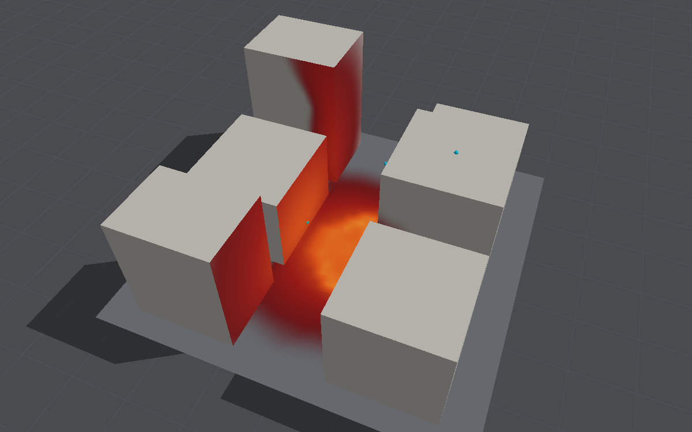

# Thermal radiation from the fireball

The fireball's radiant heat on the ground and the scene's faces, reckoned frame by frame
alongside a run: the irradiance at each point, its peak, and its time integral, the fluence. The
fireball is the air model's own hot gas, so it grows, moves, takes the shape of the streets and
cools as the blast does; the radiation is worked out from that shape in blocks, a few to a
hundred kilobytes a frame, which is what makes it the best candidate in
[Distributed computing](distributed-computing.md#the-long-term-visions-effects) for running apart
from the blast.

**Standing: illustrative.** Each ingredient is a textbook approximation, the fireball is only as
good as the gas model makes it (below), its absorption coefficients are assumptions, and its
total has been set against two TNT shots by the same group. On the first it exceeds what was
measured three to five times, or two to three with the gas [losing what it
radiates](#the-gas-losing-what-it-radiates), an option (see [Measured](#the-volume-against-the-shape)).
On [Dial Pack](#against-dial-pack), 500 tons, its pulse has the wrong shape: far too faint at
first, dark in the middle, and too bright late. Use it to see where a scene's
surfaces see the fireball and how that compares between layouts, not for burn, ignition or damage
thresholds.

What the radiation does to the surfaces, conducted into their materials for each one's peak
temperature, with ignition thresholds from tests marked illustrative, is [Surfaces heated by the
fireball](surface-heating.md).

```bash
swift run -c release BombCAD run street.bombcad --thermal thermal.json --thermal-results thermal-results.json --usd street.usda
```

With `--consumer thermal=<ssh host>` the radiation is reckoned on another Mac, fed the fireball
frame by frame, and with `--consumer thermal=auto --worker <ssh host>` wherever the run is
estimated to wait least (see [Several consumers on several machines](distributed-computing.md#several-consumers-on-several-machines)).
On this Mac its march shares the GPU with the blast and can slow a run with many receivers by
more than its own time.

The description is JSON; any field left out takes its default, so `{}` will do:

```json
{
  "luminousTemperature": 1500,
  "fireball": "volume",
  "absorption": 0.1,
  "sootYield": 0.185,
  "marchStep": 0.5,
  "emissivity": 1,
  "surfaceSpacing": 1,
  "groundSpacing": 2,
  "samples": 128
}
```

`fireball` is `volume`, the luminous cells as a partly transparent gas, or `shape` or `sphere`, an
opaque flame of the gas's shape or its equivalent sphere radiating at `emissivity`, which applies
to those two only. A description saved before the volume names its model and keeps it.

## In the app

Turn on **Fireball's radiant heat** in the Run tab's Thermal radiation section, and set how
much the hot **gas absorbs** a metre and the temperature it is **luminous above**; the receivers'
spacing, the directions sampled, the fireball model (its cells, as a volume) and its soot keep
their defaults. A project whose description names the shape or the sphere shows their
**emissivity** instead. The description is saved with the project (as
`thermal.json`), takes effect from the next run, and is undone and redone with the layout's edits
(⌘Z). With Macs set for sweeps in Settings, **Run on** reckons the radiation on the one chosen, over
a connection kept open between runs and shared with any other model run there, such as the
[fragments](fragments.md#in-the-app); should that Mac drop, it carries on here. **Automatic**
chooses at each run's start, from what the last run measured and a probe of each Mac.

During a run, **Surfaces** under Display offers **Thermal fluence** and **Peak irradiance** beside
the blast's fields, and paints the one chosen onto the ground and every face that has receivers,
interpolated between them: each surface's receivers are a grid, and the colour at a point is
bilinear between the four nearest, on a log scale (a receiver under another solid takes the mean
of its neighbours, so a surface has no holes at its edges). The scale runs over four decades,
0.1 to 1,000 kJ/m² or kW/m², from dark red through orange to pale yellow, as metal glows hotter;
below its bottom the surface keeps its own grey, as for the blast's fields, and the legend gives
the units. It is painted as it stands after each frame reckoned, also when those come in after
the run has ended. A line under the section gives the largest fireball so far, its temperature
now, the highest fluence and the number of receivers, and any frames still to reckon; Reset
clears it all.



`blastbench snapshot --thermal thermal.json --mode fluence` (or `--mode irradiance`) reckons it
alongside an offscreen snapshot, a frame a millisecond, and paints it as the view does (the figure
above, with `--preset street --air thermal --afterburn --time 0.06 --no-wave`).

**Keep Run** keeps the result with the run: the description, every receiver with its peak
irradiance and fluence, and the fireball at each frame, as `--thermal-results` writes them.
Compare gives a line for each run that reckoned it (the largest fireball, how long it was
luminous, the highest fluence), the run's CSV adds the fireball's diameter and temperature
through the run, and **Use this run's inputs** brings the description back. Like the fragments,
it does not act on the air, so it is no part of the run's input fingerprint.

**The air is untouched.** The app finds the fireball at the end of the first batch in each
millisecond of simulated time, and at the run's end, rather than stopping the run there: batches
take fewer steps, never shorter ones, to end just past each millisecond. The tests check that the
gauges and the structure's response are the same to the last bit with it on or off. The frames
therefore fall a little after each millisecond, where a step ends, and differ slightly from those
of `BombCAD run --thermal`, which stops at each; for a study that repeats exactly, use that.

The receivers are reckoned on a queue of their own, here or on the other Mac; the run may get up
to four frames ahead of them, and then waits, as for the fragments. On the street's 10,500
receivers that is about 29 ms a frame on the Mac Studio over the afterburning street's run, 12 ms of it the
GPU's march (see [Measured](#the-volume-against-the-shape)), against about
80 ms a frame on the CPU's cores for the shape, so well within the run's own pace. A sweep's cases on this Mac reckon it
too, as they fly any fragments, and wait for the last frames before they are kept; cases sent to
other Macs run the blast alone.

On another Mac it is a session of `BombCAD worker`, of the kind any model fed by the blast uses
(see [Several consumers on several machines](distributed-computing.md#several-consumers-on-several-machines)):
the fireball goes out, its shape a few to a hundred kilobytes a frame and its cells up to
1.6 MB after it as raw bytes, and in the app each receiver's fluence and peak irradiance so far
come back after each frame, as raw floats, to draw. The receivers are laid out on both sides from
the same scene and description. The worker marches the volume on its GPU where it has one; for
the shape and the sphere its result is the same as this Mac's to the last bit, whether either Mac
tests the receivers' view on its GPU or its CPU, and for the volume the GPU's and the CPU's
marches agree to a thousandth of the highest irradiance.

## The model

- **The fireball** at each frame is every cell of air at least `luminousTemperature` kelvin hot
  (1,500 K by default), from the gas model's own temperature, p / (ρR) for ideal and thermally
  perfect air and the equilibrium temperature for dissociating air. The GPU sums it in blocks of
  two cells a side at the end of the batch that lands on the frame, and the blocks are doubled
  until their box holds no more than 32,768 (a metre a side when the fireball fills the street
  on 0.25 m cells, half a metre while it is smaller). Each keeps the share of its air that is
  luminous and the fourth root of that gas's mean T⁴, the temperature of a black body that
  radiates as it does on average. For the volume, every cell in the blocks' box is cut out too,
  in the same pass: its temperature to the kelvin, zero if it is not luminous, and with
  afterburning the density of its unburnt detonation products. The cells are merged in twos,
  fours and so on only if the box would hold more than a million; the street's fireball at
  170 ms is 86 by 82 by 44 cells, 1.6 MB.
- **The volume** (the default) is the luminous gas as a partly transparent medium. Each cell
  absorbs κ a metre, `absorption` for the hot gas itself plus its soot (below), and emits κB, B =
  σT⁴/π the radiance of a black body at its own temperature, so the emissivity is not set but
  follows from the optical depth along each ray: an optically thin fireball gives each receiver
  its cells' emission, 4κσT⁴ a cubic metre spread evenly in all directions, and a thick one σT⁴
  of its outer cells, hiding its hotter core. Along each of a receiver's directions (below) the radiance
  is gathered from the far side in: L = Σ B (1 − e^(−κs)) e^(−τ), τ the optical depth between
  the receiver and each step s, until something is in the way or less than 10⁻⁴ of what lies
  beyond could get through. The cells' luminous share, κ and κB are interpolated between their
  centres, and the gas is where the share is at least one half, as the shape's surface is, so
  that the opaque limit is the shape and not a staircase of cubes: seen at an angle, cubes show
  their sides, and an opaque sphere of whole cubes 40 across came out 4% too bright from five
  radii away. The ray steps through the cells it crosses, and within those where gas may be
  found by steps of at most `marchStep` cells, each taking the gas at its two ends and, where the
  share passes one half between them, only the part beyond that, which makes the step's error
  second order.
- **Its absorption** is the volume's assumption. The hot gas's own, water vapour and carbon
  dioxide, is taken as grey, 0.1 a metre by default: the Planck means of the TNF workshop's
  RADCAL fits at 2,000 K, 1.2 for water and 5.5 for carbon dioxide a metre and atmosphere, give
  about 1.4 a metre for TNT's products burnt in air (23% carbon dioxide and 8% water), but that
  is the limit for thin gas; over metres the bands saturate and a grey gas absorbs far less. The
  soot follows the unburnt products, which only afterburning keeps track of: `sootYield` of
  their mass, 0.185 for TNT, whose products by the H₂O–CO rule keep half its carbon as soot
  (C₇H₅N₃O₆ → 2.5 H₂O + 3.5 CO + 3.5 C + 1.5 N₂), as particles small against the wavelength, as
  explosives' soot is seen to be, absorbing 1817 f T a metre (f its volume fraction at
  1,800 kg/m³; Williams, Shaddix and others). Neither has been checked against a TNT fireball's optical depth.
  Hot air adds its own (`hotAirAbsorption`, on by default since 19 October 2026), the Planck mean
  of equilibrium air at the cell's temperature and density: Kivel and Bailey's predictions of
  what it emits, as Howe correlates them (NASA TN D-1031, figure 6), E = 2α(ρ/ρ₀)^τ W/cm³ at each
  of 1,000 to 18,000 K, read as κ = E/4σT⁴. At the normal density it is 0.03 a metre at
  3,000 K, 0.8 at 6,000 K and 3 at 8,000 K, rising with the density's power 1.2 to 1.6: a shock's
  layer at 6,600 K and five times the density absorbs about 10 a metre, where the fireball's gas
  at 2,500 K and a tenth of it absorbs under a thousandth, and nothing changes. The cells carry
  it, worked out where they are cut out (`HotAir`, and its copy in `Extract.metal`), as the mean
  of their luminous gas's.
- **The shape** (`"fireball": "shape"`) is a solid flame: its surface is where the blocks'
  share, interpolated between their centres, is one half, and it radiates from there at the
  temperature of the block it is in. This "solid flame" treatment is the usual one for fireballs in hazard assessment, there
  with an empirical sphere's diameter, duration and surface emissive power; here the air model
  supplies the shape and temperatures. Interpolating the share, rather than taking each block
  as a cube, keeps a ragged outline of cubes from catching grazing rays: as cubes, a ball 40
  blocks across came out 4% too bright from 10 m. With `"fireball": "sphere"` it is instead one
  equivalent sphere (the luminous volume, its centroid and the mean T⁴), as before, for
  comparison.
  The shape and the sphere radiate from their surface as a grey body, εσT⁴, ε the `emissivity`;
  1, a black body, is the most they could.
- **Each receiver** sees the gas or the flame's surface at some radiance, εσT⁴ / π for the
  shape and the sphere, so its irradiance is that radiance times cos θ, integrated over the
  directions in which it sees the fireball. Those are sampled tile by tile: the luminous blocks
  (for the volume, the cells with any luminous gas) are gathered into up to 16 compact tiles
  (the least compact cut in two across its longest side, until each fills at least a fifth of
  the sphere round it), and each tile's directions are spread evenly over the cone its sphere subtends,
  `samples` in all, shared by each cone's solid angle and how much of it the tile fills, at least
  four a tile. Each direction is followed through the gas, or to where it first meets the
  surface, so the flame in front hides what is behind it; where the cones overlap, each ray
  counts over the density of samples there from every cone it lies in (the balance heuristic),
  so every ray that meets the flame counts and none twice. A ray counts where it is above the
  receiver's horizon and nothing is in the way, above the ground, of a block or the structure's
  starting outline (tested together, see [Ray tracing](ray-tracing.md)). One compact fireball is
  one tile, sampled as the sphere is, and gives the sphere's answer; a receiver inside the flame
  gets all of εσT⁴.
  The volume is marched on the GPU, one threadgroup a receiver, the first block or structure in
  each ray's way found on the ray-tracing hardware; for the shape and the sphere, whether each
  ray is clear is tested there, and the rest is on the CPU's cores. Where the Mac has no GPU with
  ray tracing, all of it is on the CPU, with the same answer to a thousandth for the volume and
  to the bit for the others ([Ray tracing](ray-tracing.md#in-bombcad-the-fireballs-radiation));
  `BOMBCAD_THERMAL_VISIBILITY=cpu` in the environment keeps it on the CPU.
- **The fluence** at each receiver is the irradiance integrated over the frames by the trapezium
  rule; the peak irradiance is the highest at any frame.
- **The receivers** lie over the ground, `groundSpacing` apart, and over every face of the blocks
  and the structure's starting regions that the air touches, `surfaceSpacing` apart, a millimetre
  off their surface. Points inside another solid are left out, as are undersides.
- **The air between is transparent**: no absorption by water vapour or carbon dioxide, which
  over tens of metres takes a few per cent to a few tens of per cent, nor by smoke or dust.

The run's summary also gives what the fireball **radiated in all**, as a share of the charge's
energy. For the volume it is measured: each frame, 256 points on a dome over the fireball facing
in and 256 on the ground within it facing up, with nothing in the way but the ground, sum what
crosses them, all the gas sends into the air but what goes straight into the ground beneath it
(for an opaque sphere, σT⁴ over its surface above the ground, to 3% in the tests). For the shape
and the sphere it is εσT⁴ over the part of the equivalent sphere above the ground, which for the
street's shape agrees with the same measurement to under 1%. Unless the gas [loses what it
radiates](#the-gas-losing-what-it-radiates), nothing takes that energy out of it, so a share
beyond what fireballs of that explosive are seen to radiate shows the gas stays hot and luminous
too long, or the absorption or emissivity is too high.

## The gas losing what it radiates

With `SolverConfiguration.radiativeCooling` set (`blastbench … --radiate`; not yet in the app or
`BombCAD run`), the air model's luminous gas gives up the heat it radiates, as the volume above
takes it to absorb and emit, so the radiation no longer runs one way only. It is off by default:
see [With the gas cooling](#with-the-gas-cooling) for why.

- **The medium is the volume's.** Each cell at least `luminousTemperature` hot absorbs κ, the
  gas's own `absorption` plus its soot's 1817 f T, and emits κB, B = σT⁴ / π; cooler gas neither
  emits nor absorbs. Given `--thermal`, blastbench takes all three from its description, so the
  gas loses what the volume radiates.
- **A cell loses** κ(4πB − G) a cubic metre, G the radiation reaching it from every direction:
  the divergence of the radiative flux, the radiation's term in the energy equation (Modest). G
  is found along the lattice's 26 directions, to a cell's faces, edges and corners, each standing
  for its share of the sphere, the directions nearer it than any other (0.575, 0.465 and
  0.442 sr). Along every line of cells in each direction the radiance is carried across the box
  round the luminous cells, both ways, from zero at its edge: a cell crossed over a path s takes
  I(1 − e^(−κs)) from the beam and adds B(1 − e^(−κs)), κ and B taken as uniform across it.
  This is Lockwood and Shah's discrete transfer method on the lattice, and, as in the
  photon-conserving schemes of radiative transfer in astrophysics (Abel, Norman and Madau), what
  the beam gains in a cell is exactly what the cell loses, so the gas loses exactly what leaves
  it, into the air, the ground and the scene's faces.
- **Its limits come out right.** Thin gas loses 4κσT⁴ a cubic metre, and an opaque fireball
  σT⁴ over its surface: for a sphere exactly, as any set of directions sharing out the sphere
  gives; for a flat face, from 2% more to 7% less by how it lies to the lattice, a face along its
  axes least.
- **It is taken on the GPU** every `interval` steps of the run's count, four by default (since 19
  October 2026 not also at each batch's end, so that a run comes out the same however it is
  batched),
  for the time since: the box round the luminous cells is found as the medium is made, the 13
  lines are marched together (one at a time in a box of over a million cells), and each luminous
  cell's loss over that time comes off its energy, its density and momentum unchanged. A cell
  may lose at most a quarter of its internal energy at once, a guard never reached: the outer
  cells of an opaque fireball at 3,000 K lose under a hundredth of their heat a step. Where the air is refined, the coarse cells lose it and the
  fine cells under them lose as much a volume, as they take what debris trades with the air, so
  that the levels agree and the energy is still conserved across their edges.
- **What it radiated** is added up in a fixed order, so runs repeat exactly, as
  `BlastSolver.radiatedEnergy` and, batch by batch, `radiationHistory`; in a closed box the gas's
  energy falls by just that.
- **Assumed**: the volume's grey gas and soot (above); cold, black surroundings, the air beyond
  the box, the ground and the solids absorbing all that reaches them and sending nothing back
  (air at 288 K radiates under a seven-hundredth of what gas at 1,500 K does); no scattering; each cell's medium
  uniform across it, and luminous or not, where the volume interpolates its share; and the loss
  over the steps since it was last taken worked out from the state at their end.

Checked (`RadiativeCoolingTests`), with a sphere of gas 2 m in radius at 2,500 K and the
surrounding pressure, on 0.25 m cells, so that nothing moves:

| Absorption | Thin, 0.01/m | 1/m | Opaque, 20/m |
|---|---|---|---|
| What it radiates in a step, against an isothermal sphere of its optical radius (Modest) | within 0.01% | +0.015% | +0.6% |
| Its centre's loss, against 4κσT⁴ e^(−κR) | +0.04% | +0.9% | none, as e^(−40) gives |
| Against the volume's measurement round it (thin: 0.05/m) | +0.6% | +0.07% | −2.0% |

Over five steps the thin sphere's centre cools as dT/dt = −4κσT⁴ e^(−κR) / (ρc_v) integrates, to
0.5%, and the opaque sphere's not at all. The energy budget closes: in a closed box the gas loses
what it radiated to 3 × 10⁻⁷ of it, 1.2 × 10⁻⁶ with two levels of refinement under a blast
crossing the sphere, and with afterburning what burns is what the gas keeps and radiates, its
soot included, to a thousandth of what it radiated. Taking it every fourth step instead of every
step radiates 0.3% more over 200 steps in which the sphere loses 15% of its heat. Off, two builds
give the same `blastbench digest`, with and without refinement.

## Measured

The street canyon on the medium grid (0.25 m cells, 100 kg, 0.17 s), frames every millisecond,
on the Mac Studio (M4 Max), heavily loaded by other work at the time, so the times are rough.
These first tables are the shape and the sphere, as they were before the volume
([below](#the-volume-against-the-shape)):

| Gas | Largest fireball | Luminous until | Radiated (ε = 1) | Highest fluence | Run, without and with |
|---|---|---|---|---|---|
| Default (cold air, no afterburning) | 4.2 m across, at 1 ms | 44 ms | 0.4 MJ, under 1% | 9 kJ/m², ground | 4 to 7 s and 6.5 s |
| Afterburning and hot air | 14.6 m across, still growing at 170 ms | the run's end | 78 MJ, 19% | 265 kJ/m², ground; 264 kJ/m², a block's face | 8.3 s and 28.3 s; later, less loaded, 10.5 s and 11.5 s |

The largest fireball is given as the sphere of its volume; the fluences are from its shape. The
runs' times were measured with the sphere (below for the shape's cost).

**The gas model decides the answer.** With the default gas the charge's products cool by
expanding as cold air would, so the luminous region is a few metres across and gone within
50 ms. With afterburning and hot air the products burn with the air they mix with and the gas
keeps its heat, and the fireball fills the street. Fireballs of high explosives are known to
scale with the cube root of the charge, last for tens to hundreds of milliseconds, and to be near
1,800 K and above early on; the second is the more plausible, and the one to use for a thermal
study. Since the radiated energy is not taken from the gas, its 19% at emissivity 1 is an upper
bound that a lower emissivity scales down in proportion.

Without a structure, each frame stops the run, ending a time step there (1,856 steps instead of
1,780 with afterburning), as for [fragments](fragments.md#running-alongside-the-blast). The
receivers, about 10,500 of them in the street, each sampling 128 directions against six blocks,
are reckoned on a queue of their own, so the run does not wait for them until the end.

**The receivers on the GPU.** Measured with the fireball as its sphere, on the afterburning
street later the same day, the M4 Max
loaded by other work (load averages of 13 to 51), each build run four times, interleaved, with
the CPU time from `time` and the GPU time from the process's `accumulatedGPUTime` in the
I/O Registry:

| `BombCAD run`, 0.17 s | Wall | CPU time | Of it the radiation's |
|---|---|---|---|
| Without `--thermal` | 9.8 to 12.0 s | 0.5 to 0.7 s | |
| With, before the GPU test | 11.0 to 12.6 s | 3.6 to 4.3 s | about 3.4 s |
| With, the visibility tested on the CPU | 11.6 to 12.1 s | 3.6 to 4.2 s | about 3.4 s |
| With, the visibility tested on the GPU | 11.6 to 12.5 s | 2.7 to 3.2 s | about 2.4 s |

The run takes as long either way: the receivers were never what it waited for. What the GPU
saves is the CPU's cores, a third of the radiation's CPU time, for a few hundredths of a second of
GPU time over the run, too little to see against the blast's 4 to 7 s (and other sessions' work
inflating it). `blastbench thermal --frames 171` times the receivers alone, on a sphere growing to
15 m across: 12 ms of the cores' time a frame on the CPU (1.6 ms of wall time), 5 ms with the
visibility on the GPU (1.3 ms), which takes it in 0.16 to 0.22 ms. The rest is laying out the
rays and summing them, still on the CPU, to which the fireball's shape adds the search for where
each ray meets it (below). The two tests agreed to the bit on every receiver.

**The shape against the sphere.** `blastbench snapshot --thermal thermal.json --thermal-compare`
reckons the same frames with both. In the street with afterburning and hot air, by 170 ms the
flame fills the street in blocks a metre a side, 23 by 20 by 11 of them, in 16 tiles:

| Surface | Highest fluence, shape | Highest fluence, sphere | Mean fluence, shape against sphere |
|---|---|---|---|
| Ground | 265 kJ/m² | 182 kJ/m² | +15% |
| Block 1 | 264 kJ/m² | 171 kJ/m² | +17% |
| Block 4 | 139 kJ/m² | 93 kJ/m² | +1% |
| Block 0 | 98 kJ/m² | 51 kJ/m² | −8% |
| Blocks 2, 3 and 5 | 10 to 21 kJ/m² | 16 to 25 kJ/m² | −20 to −35% |

The flame pressed against the faces and the ground of the street gives the receivers nearest it
half as much again as a ball of the same volume at its centroid, and nearly twice as much on
block 0; the faces that see little of the flame (blocks 2, 3 and 5) get a fifth to a third less.
On the ground most receivers get less from the shape (the median ratio is 0.65) and the nearest
much more; on blocks 1 and 4 most get more (median ratios 2.1 and 1.6). With the default gas the fireball is a
compact ball a few metres across, one tile, and the two agree to within 8% at the highest
fluence (9 against 8 kJ/m²). With 512 samples instead of 128, each surface's highest fluence
moves by under 5% and its mean by under 2%.

Its cost, measured alternately with the sphere on the same frames while the Mac Studio was
loaded by other work: about 80 ms a frame on the CPU's cores for the street's 10,500 receivers
once the flame fills the street, against 4 ms for the sphere, almost all of it following the
rays through the blocks (the sight lines take under a millisecond). Finding the fireball,
on the thread that drives the GPU, went from 0.05 ms to 0.1 to 1.7 ms a frame as the flame grows,
sorting its blocks and doubling them, under half a per cent of the 0.4 s each frame's blast
took. A frame of the shape is 3 bytes a block, 15 to 90 KB, and as JSON a third more.

### The volume against the shape

The afterburning street with hot air again, 0.17 s, the same frames reckoned with the volume's
defaults and with the shape (`blastbench snapshot --preset street --air thermal --afterburn
--time 0.17 --thermal thermal.json --thermal-compare`), on the Mac Studio with load averages of
150 to 240 from other sessions:

| Surface | Highest fluence, volume | Highest fluence, shape | Peak irradiance, volume | Peak, shape | Mean fluence, volume against shape |
|---|---|---|---|---|---|
| Ground | 248 kJ/m² | 265 kJ/m² | 3.2 MW/m² | 2.7 MW/m² | −4% |
| Block 1 | 269 kJ/m² | 264 kJ/m² | 3.0 MW/m² | 2.9 MW/m² | +18% |
| Block 4 | 117 kJ/m² | 139 kJ/m² | 2.1 MW/m² | 2.7 MW/m² | +10% |
| Block 0 | 130 kJ/m² | 98 kJ/m² | 1.8 MW/m² | 1.6 MW/m² | +40% |
| Blocks 2, 3 and 5 | 15 to 26 kJ/m² | 10 to 21 kJ/m² | 0.2 to 0.4 MW/m² | 0.1 to 0.3 MW/m² | +43 to +56% |

Most receivers get more from the volume (median ratios 1.1 to 1.6 by surface; 1.3 on the
ground), the faces that see little of the flame most of all, while the nearest get about as much
or less. Which of its differences does this is not settled: the volume follows the flame to its
cells, a quarter of the shape's blocks, so flame thinner than a block radiates, and takes each
cell's own temperature rather than its block's mean. With 512 directions instead of 128, each
surface's highest fluence moves by under 1% and its peak irradiance by under 3%; with steps of a
quarter of a cell instead of a half, by under 0.1%.

**The soot decides it.** At 170 ms 30 kg of the 100 kg's products are still unburnt, and their
soot makes the fireball opaque: with it, the gas's own absorption hardly matters. Without it, the
grey coefficient for the hot gas, the assumption, sets the answer almost in proportion while the
gas is thin:

| Absorption | Radiated | Share of the charge's 418 MJ | Highest fluence, ground | Peak irradiance, ground |
|---|---|---|---|---|
| Default: 0.1/m and soot | 87.9 MJ | 21.0% | 248 kJ/m² | 3.2 MW/m² |
| Soot alone | 89.8 MJ | 21.5% | 248 kJ/m² | 3.2 MW/m² |
| 1/m, no soot | 86.0 MJ | 20.6% | 229 kJ/m² | 2.6 MW/m² |
| 0.1/m, no soot | 47.9 MJ | 11.4% | 91 kJ/m² | 1.1 MW/m² |
| 0.01/m, no soot | 6.9 MJ | 1.6% | 13 kJ/m² | 0.16 MW/m² |
| The shape, ε = 1 | 77.8 MJ | 18.6% | 265 kJ/m² | 2.7 MW/m² |

**Against a TNT fireball.** The thermal measurements of the 100-tonne TNT hemisphere fired at
Suffield in 1961 (Tate and Pattmann) put what it radiated at 3.8% and 6.6% of its energy, by two
kinds of instrument, its radiance peaking about 20 ms after the detonation; scaled by the cube
root of the charge, 100 kg would peak at about 2 ms. The volume's 21% is three to five times as
much, and its course is the wrong way round: 0.2% by 20 ms, 1.4% by 50 ms, 6.5% by 100 ms and
21% by 170 ms, when its fireball is still at 2,400 K and growing. The volume is opaque here, so the
excess is not the emissivity: the gas never loses the heat it radiates (21% of the charge's energy
would cool it markedly), and stays hot and luminous far longer than a real fireball, while its
first milliseconds, a fireball a few cells across, are faint. With the gas losing what it
radiates ([below](#with-the-gas-cooling)), 12.8%: two to three times as much, its timing still
wrong. Treat the volume's fluences, like the shape's, as an upper bound, and its timing as wrong.

**Its cost.** Each binary run three times, interleaved, the branch before the volume (the shape,
compared with the sphere) and after (the volume, compared with the shape), each model's time on
the same 171 frames from the same blast:

| Per frame, medians of three | Before | After |
|---|---|---|
| The shape, on the CPU's cores | 136 ms (133 to 147) | 163 ms (144 to 173) |
| The volume, all of it | | 29 ms (28 to 30) |
| Of which the GPU's march | | 12 ms (11.7 to 12.0) |
| Finding the fireball, on the thread that drives the GPU | 2.3 ms | 6.7 ms |

The volume costs a fifth of the shape: the GPU follows its 1.3 million rays a frame through the
cells in 12 ms, and the rest is making the medium and its tiles from the cells and measuring what
it radiates. Cutting the cells out adds about 4 ms a frame to finding the fireball, about 1% of
the half second each frame's blast took here. On the CPU alone the same march is about thirty times slower:
`blastbench thermal` on a sphere of cells growing to 15 m across over 30 frames takes 18 ms a
frame with the GPU (8 ms of it the GPU's) and 540 ms on the cores, the two agreeing to 0.001%.

### With the gas cooling

The same street, afterburning and hot air, with the gas [losing what it
radiates](#the-gas-losing-what-it-radiates) (`--radiate`, the volume's defaults):

| At 170 ms | Without | With |
|---|---|---|
| Radiated, measured round the fireball | 87.9 MJ, 21.0% of the charge's energy | 53.5 MJ, 12.8% |
| Lost by the gas | | 65.8 MJ, 15.7% |
| Radiated by 20, 50 and 100 ms | 0.2%, 1.4%, 6.5% | 0.1%, 1.4%, 5.2% |
| Fireball across at 20, 50, 100 and 170 ms | 5.5, 11.8, 13.7, 14.6 m | 5.3, 11.7, 13.5, 14.2 m |
| Its temperature then | 1,608, 1,878, 2,187, 2,371 K | 1,590, 1,840, 2,047, 2,089 K |
| Hottest gas | 3,101 K | 2,482 K |
| Highest fluence: ground, blocks 1, 4 and 0 | 248, 269, 117, 130 kJ/m² | 121, 118, 84, 63 kJ/m² |
| Blocks 2, 3 and 5 | 15 to 26 kJ/m² | 9 to 17 kJ/m² |
| Peak irradiance: ground, block 1 | 3.2, 3.0 MW/m² | 3.2, 0.9 MW/m² |
| Steps | 1,856 | 1,814 |

**Out to 500 ms the difference grows.** Without the cooling the fireball goes on growing and
heating, to 15.3 m across and 2,540 K at 500 ms (its hottest gas 3,640 K), and has radiated, as
measured round it, 653 MJ, 156% of the charge's energy, the ground's highest fluence 1.4 MJ/m².
With it the fireball is largest at 166 ms and then shrinks and cools, 13.9 m and 2,040 K at
300 ms, 13.2 m and 1,860 K at 500 ms; it has radiated 198 MJ, 47% (the gas lost 249 MJ, 60%),
the ground's highest fluence 400 kJ/m², and the run takes 10% fewer steps. Either way it is
still luminous at 500 ms: 8 to 10 kg of products are still burning, and radiating takes the gas
only down to the luminous temperature, so what ends a fireball here is its mixing with cold
air, which on these cells is the grid's own.

**The cloud is lower.** The [rise](fireball-rise.md) is handed the air's state at the run's end,
at 500 ms with the cooling 951 kg at 1,068 K rather than 960 kg at 1,262 K, a fifth less heat
above the air's. It stops rising at the same 365 s, its top at 454 m rather than 482 m, 6% lower,
as a thermal's height going as the quarter power of its heat (0.79^¼ = 0.94) would have it; at
600 s its spread top is 343 m rather than 365 m. The rise model is unchanged. Its comparison with
Church's clouds was handed gas that had kept its radiated heat, so with the cooling its tops would
come down by a few per cent, from 4% above his on average at two minutes towards them; the
rise's own radiation (its `emissivity`, off by default) starts at the hand-over, so turning both
on counts no heat twice.

**The gas loses about a fifth more than is measured round it**, because the measurement leaves
out what goes straight into the ground beneath the fireball, which the gas loses too; clear of
the ground the two agree within 2% (above). In a street the fireball lies on the ground and
against the faces, which take the rest.

**Against a TNT fireball it is closer but not close.** By 170 ms the fireball has radiated 12.8%
of the charge's energy, against the 3.8% to 6.6% measured, and its course is still the wrong way
round: 0.1% by 20 ms, where the real one, scaled to 100 kg, would have peaked at 2 ms. What is
left is not the gas keeping its heat: the products go on burning for the whole run, releasing
some twice the charge's energy again (30 kg are unburnt at 170 ms, 8 at 500 ms), and the share is
of the charge's energy alone; and its first milliseconds are faint, as before, the hot gas spread
over cells far larger than a charge. The soot's absorption and its yield, which make it opaque,
are untested assumptions too.

**The blast is unchanged.** Against Kingery–Bulmash (`blastbench validate --afterburn --air
thermal`, 0.25 m cells, 100 ms) every incident and reflected impulse moves by 0.2% or less, every
peak by 0.4% or less and every arrival by 0.1 ms: the shock has left the fireball long before it
radiates much. In closed rooms (`blastbench gas --afterburn --air thermal`) the gas radiates 4.5%
to 7.7% of the charge's energy into the walls by 80 ms and its pressure falls by 2% to 4%, from
98–108% of UFC 3-340-02's to 94–105%, a heat loss real rooms have and the manual's chart, worked
out without it, leaves out.

**Its cost.** The street to 170 ms without frames, each build run four times, interleaved, with
load averages of 60 to 80 from other sessions: 6.1 to 6.3 s before, 6.1 to 6.3 s after with it
off, and 6.2 to 6.3 s with it on. That is 5% more a step, about 0.17 ms on 3.5, and 4% fewer
steps, the cooler gas allowing longer ones. Taken every step and with the 13 directions marched
one after another it was 30% more a step; most of the rest is making the medium over the awake
cells. The directions' slices take 52 MB, and the medium and loss 12 bytes a cell.

**On by default since 19 October 2026** (`SolverConfiguration.recommended`, and in the app with
afterburning and hot air: **Fireball cools as it radiates**; projects run before then keep their
gas's heat, and the harnesses pinned to the balloon start keep it too). It changes the blast's
loads by under half a per cent, but against Clough and Clubley's 41 kg fireball (below) it is what
lets the fireball fade: without it the gas holds 2,500 K for the whole second. It costs about
nothing in time (5% more a step, 4% fewer steps) and 12 bytes a cell and 52 MB of memory, which
the run advisor prices: some 1.2 GB on a grid of a hundred million cells. Its total radiated is
still above the 4–7% measured for TNT. From 19 October 2026 the loss is taken every fourth step of
the run's count and no longer also at each batch's end, so that a run comes out the same however
it is batched.

### Against Clough and Clubley's 41 kg fireball

L. G. Clough and S. K. Clubley, "Gauging the fireball: simulation and testing" (University of
Southampton, 2013): 41 kg of TNT equivalent on the ground, with boxes 1 m up at 4, 6 and 8 m
carrying flux gauges facing up (calorimeters, so radiant and convective together) and
thermocouples. The cameras saw the fireball reach the 4 m box at 3.2 ms and the 6 m box at 16 ms,
grow to 12.5 m across at 24 ms, never reach 8 m, and last about a second. `blastbench gauging`
runs it on 0.25 m cells, on the mapped start (the grid's clock from 25 ms), with and without the
gas cooling; the flux is the volume's radiant flux on a gauge facing up on each box's top:

| | Measured | Without | With the gas cooling |
|---|---|---|---|
| The fireball's widest, as a hemisphere | 12.5 m at 24 ms | 13.1 m, held to 1 s | 12.5 m at 100 ms, 6.3 m by 1 s |
| Its mean temperature at 0.3, 0.5 and 1 s | | 2,500, 2,500, 2,500 K | 1,870, 1,730, 1,520 K |
| Flux at 4 m: peak; at 300 and 500 ms | 145 W/cm² at 32 ms; back to nothing by about 500 ms | 198 at 280 ms; 198, 197 | 175 at 100 ms; 50, 19 |
| Peak flux at 6 and 8 m | 85 and 30 W/cm² | 75 and 17 | 35 and 7 |
| Radiated, measured round it, of the charge's energy | | 282% | 45% |

With the cooling the fireball reaches the measured size, never the 8 m box, and fades over the
second as measured; without it, it holds near the flame temperature, its flux flat. Both reach
their size four times too late, the luminous gas reaching the 4 m box at 22.5 ms against 3.2:
the products have cooled below the luminous temperature as they expanded
([before the grid's clock](#before-the-grids-clock)). The flux at 6 and 8 m reads a half and a
quarter of the gauges', which took the hot gas's convection too.

### Before the grid's clock

Since 18 October 2026 a run starts from a [mapped one-dimensional
solution](air-blast-model.md#a-finely-resolved-start), and the grid's clock starts only when its
shock has spread to the mapped radius: some 9 ms for 1 kg on 0.5 m cells, 25 ms for 41 kg on
0.25 m cells, 200 ms for Dial Pack on 4 m cells. The fireball before then is taken from the
one-dimensional solution (`BlastSolver.earlyFireballFrames`), solved again from the start and
kept at the frames' times: its temperatures, as the grid's air model reads them, and its unburnt
products, laid onto a box of up to 262,144 voxels round the luminous gas, finer than the grid's
cells while the fireball is small, each sampled eight times. The app sends them, a frame a
millisecond, before the grid's own, and headless runs and the benches likewise, so a run's
thermal record starts at detonation again. (Between the mapped start's default on 18 October and
these frames, a run's record began at the hand-over: 0.5.0's known limitation.)

The early frames take the products' soot only within the products' own gas: the sphere holding
the charge's mass (with its mirrors), which in one dimension is where the products are, as the
equations carry no mass across the contact. The eddy diffusivity the start mixes with
(16 W^⅓ m²/s, 1,230 m²/s at Dial Pack) spreads the products, a tag on the gas, out to the shock
and past it from the first step, about 1.8 m by 1.25 ms, where a real fireball's mixing grows
from the contact; their soot blackened the shock's layer of air with a cooler skin, 3,300 K over
5,600 K at 0.5 ms and 1,700 K over 5,400 K at 2 ms, and hid the front. Without the soot the
layer, 0.6 m of air at up to 6,600 K and five times the ambient density, is as transparent as
0.1/m makes it; with hot air's own absorption (above), about 10 a metre at its hottest, it shows.

The volume marches these frames through the solution's own shells (`FireballFrame.spheres`,
one sphere a charge), exactly, piece by piece between the shells' boundaries, rather than through
their voxels: the front is about a voxel thick (0.23 m at 1 ms) against the soot-black products
behind it, and the voxels' κB, interpolated with κ between their centres, gave most of its voxel
the products' cooler radiance, three-fifths of the exact intensity (an opaque shell 0.6 m thick
round a black core, `blastbench shell-sphere`, comes out exact on 0.25 m voxels; the solution's
own front 0.65 to 0.86 of exact). The voxels still give the frames' shape, the directions each
receiver samples, and the picture; the shells are marched on the CPU's cores, as the GPU's march
knows only voxels: 0.1 s a frame for 3,600 receivers round Dial Pack's fireball at 1.25 ms, where
its voxels take 0.2 s on the GPU (`blastbench shell-sphere --time-ground 2`).

Against Dial Pack (`blastbench dialpack --mapped`, the charge on the ground so that it can be
mapped, 4 m cells, to 0.5 s), the intensity toward 1,700 m in cal/sr/s × 10⁷, the 18 October
frames, and since 19 October with the soot within the products, hot air absorbing and the
shells marched; and exact rays through the same one-dimensional solution, on its own 0.15 m
cells (`blastbench radial-profile --reach 2.5 --dump`):

| | Measured | Balloon | Mapped, early frames | Since 19 October | Exact, same solution |
|---|---|---|---|---|---|
| 1 ms | 80 | | 33 | 88 | 91 |
| The first maximum, 1.25 ms | 157 | 25 | 38 | 94 | 99 |
| 2 ms | 80 | 19 | 47 | 82 | 84 |
| 3 ms | 69 | | 32 | 54 | 55 |
| 5 ms | 74 | | 28 | 41 | 43 |
| The second maximum, 25 ms | 112 | 20 | 16 | 25 | |
| 50 to 200 ms | 55 to 101 | 0 to 4 | 0 to 3 | 0 to 3 | |
| Fluence at 600 m by 0.5 s | 3.83 kJ/m² | 0.77 | 1.54 | 1.57 | |

No one change does it: through the voxels, the soot within the products and grey air gives 46 at
1.25 ms, hot air with the soot spread to the shock 38, both 55. Together, and marched through the
shells, the first maximum comes at about the right time, three-fifths of its height, and falls
away as measured; the exact rays' remaining difference is the frames' half-millisecond spacing.
The rest, to 157, would need the front hotter than the 6,600 K the start's air reaches: the
report finds 7,500 to 8,000 K. Air that dissociates in equilibrium would make it cooler, not
hotter: behind a shock at the start's 3.9 km/s it reaches 4,960 K where the start's thermally
perfect air reaches 6,320 K (the Rankine–Hugoniot jump with each of the air models), a third of
the radiance, so it was not tried in the start. What is short is the shock's speed near the
charge: at the start's front, 10.2 m at 1.25 ms, Kingery–Bulmash's shock moves at 5.0 km/s, behind
which air in equilibrium reaches 6,800 to 7,500 K, the report's range; the start's products,
expanding as hot air does, drive it at 3.9. With JWL's products (`mappedChargeProducts`, tried for
the loads and not adopted) the front reaches 7,700 K at 1 ms and 8,000 K at 1.25 ms (`blastbench
radial-profile --jwl`), but those cells, air by the mass behind them, hold 70% to 90% products by
the tag the eddy diffusivity spreads, which the products' law reads; until the tag stays behind
the contact early, the products' law at the front cannot be trusted, and the first flash rests at
three-fifths.

Against Clough and Clubley's 41 kg (`blastbench gauging`), the products reach 3 m by 3.2 ms (the
camera's fireball 4 m), but they have cooled below the luminous temperature as they expanded,
and the gas at least 1,500 K is 1.3 to 4 m across from 2 to 10 ms: the luminous hemisphere
reaches the 4 m box at 22.5 ms (20 ms on the balloon) against 3.2 ms. Hot air's absorption
changes none of this, nor the gauges' flux once the fireball reaches them; at 41 kg the shock is
too weak by the time it leaves the products to glow.

### Against Dial Pack

Dial Pack, 500 tons of TNT as a sphere resting on the ground at Suffield in 1970, was measured
by the same group as the 100-ton shot above, with bolometers and calorimeters at 600 and
1,700 m (Pattman, DREO Report 642; transcribed in
[Samples/DialPack1970](../Samples/DialPack1970/README.md)). They give the fireball's radiant
intensity from 1 ms to 15 s and its total, both corrected for the atmosphere. The total is
3.5 to 3.7 × 10¹⁰ cal, 7.0% to 7.4% of the report's blast yield of 10⁹ cal a ton. Most of it comes
late: a fifth by 1 s, a third by 2 s, the rest over the next 13 s, as the fireball rises.

**The run.** `blastbench dialpack` fires 453.6 t (500 short tons) as a sphere 4.08 m in radius on
the ground, with afterburning and hot air, in 480 × 480 × 240 m of air. It reckons, frame by frame,
the irradiance at an instrument 1.5 m up at each range, aimed along the ground at the charge, by
the volume, the shape and the sphere (the last two opaque, at emissivity 1).
`Scripts/compare-dial-pack.py` sets the result against the report: the intensity toward 1,700 m,
H r², and what has been radiated by each time by the report's own reckoning, 4πr² times the
fluence at 1,700 m.

**500 tons is within reach.** Cells scale with the cube root of the charge, so 500 t on 4 m cells
costs what 100 kg on 0.24 m cells does. That is 0.9 million cells here, 2 s in 140 s on the Mac
Studio under load. 8 m cells take 32 s for 3 s, and 2 m cells 190 s for 0.3 s. Refining the air by 2
leaves the fireball's later fluence as it was (4.86 against 4.88 kJ/m² at 600 m by 1 s on 4 m
cells) but costs six to eleven times as long; the runs below are unrefined. The air between is
transparent and the radiation grey, where the measurements are corrected for the atmosphere and
taken through silica, 200 to 4,500 nm, which passes about 90% of a 2,000 K black body: the
model's figures would be about a tenth lower in the instruments' band.

| 4 m cells | Measured | Volume | With the gas cooling | Shape, ε = 1 | Sphere, ε = 1 |
|---|---|---|---|---|---|
| Intensity toward 1,700 m at 1.25 ms (the first maximum), cal/sr/s × 10⁷ | 157 | 25 | 25 | 21 | 36 |
| At 25 ms (the second) | 112 | 20 | 20 | 21 | 11 |
| At 100 ms | 78 | 1 | 1 | 1 | 1 |
| At 1 s | 45 | 83 | 73 | 87 | 135 |
| At 2 s | 34 | 150 | 112 | 200 | 301 |
| Fluence at 600 m by 2 s | 11.3 kJ/m² | 18.2 | 15.5 | 23.7 | 31.4 |
| At 1,700 m | 1.41 kJ/m² | 2.26 | 1.92 | 2.98 | 3.93 |
| Highest irradiance at 600 m | 18.2 kW/m², at 1.25 ms | 18.5, at 2 s | 13.1, at 2 s | 23.9 | 34.8 |
| Radiated by 2 s, by the report's reckoning | 2.4% of 10⁹ cal a ton | 3.9% | 3.3% | 5.2% | 6.8% |
| Measured round the fireball; lost by the gas | | 5.3% | 4.8%; 5.8% | | |

On 8 m cells to 3 s the volume has radiated 7.2% by the report's reckoning (6.1% with the gas
cooling) against 3.2% measured by then: by 3 s the model has given off as much as Dial Pack did in
all 15 s, and its intensity, 144 (103 cooling) against 28, is still rising.

**The pulse has the wrong shape, at every resolution tried.**
- *Its first maximum is far too faint.* At 1.25 ms the fireball is about the right size: the
  report's apparent area, 1.3 × 10⁶ cm², is a disc 13 m across, and the model's is 15 to 39 m
  across at 0.5 ms on 2 to 8 m cells. But it is about 4,000 K where the report finds 7,500 to
  8,000 K, so its radiance is a sixteenth: the model has no thin, very hot luminous shock layer,
  its shock being smeared over cells. Finer cells make it fainter, not brighter (1,290, 450 and
  180 W/m² at 1,700 m at 0.5 ms on 8, 4 and 2 m cells, against 2,270 measured at the maximum).
- *It goes dark in the middle.* From about 40 to 350 ms no gas is at the luminous temperature on 4
  and 2 m cells, where the report measures 1,900 to 1,950 K. The products cool as they expand and
  burn again only once the grid has mixed air into them; on 8 m cells the coarser mixing keeps
  them burning and the gap closes.
- *Late it is too bright, and brightening.* The products go on burning, and the fireball, 200 m
  across by 1 s, heats to 2,200 K by 2 s and 2,400 K by 3 s (2,100 and 2,160 K cooling), where
  the report's falls to 1,800 K by 1.5 s and 1,600 K by 3 s. Without gravity in the air (an option, below), the
  fireball neither rises nor draws in the cold air that cools a real one. The gas cooling helps
  only a little at this size: an opaque fireball radiates its share of its heat in a time that
  grows with its size, as the blast's times do, and 2 s at 500 t is 120 ms at 100 kg.

**With gravity the fireball rises, but stays as bright.** With [gravity in the
air](air-blast-model.md#gravity) (`--gravity`, the standard atmosphere's 6.5 K/km), in a domain
tall enough to hold the rise:

| | Measured | No gravity | Gravity | Gravity, the gas cooling |
|---|---|---|---|---|
| 4 m cells, by 3 s: radiated, by the report's reckoning | 3.2% | 8.4% | 8.6% | 6.6% |
| Intensity toward 1,700 m at 3 s, cal/sr/s × 10⁷ | 28 | 204 | 197 | 137 |
| The luminous gas's centre at 3 s; its temperature | | 43 m; 2,360 K | 61 m; 2,370 K | 59 m; 2,150 K |
| 8 m cells, by 6 s: radiated | 5.1% | 26% | 32% | 22% |
| Intensity at 5 s | 26 | 285 | 371 | 218 |
| The luminous gas's centre at 6 s; its temperature | | 48 m; 2,490 K | 184 m; 2,580 K | 183 m; 2,140 K |

The fireball rises once its products have stopped expanding, its luminous centre 61 m up at 3 s
against 43 m without gravity, and 184 m at 6 s. The gas the cloud's rise would take over (all of
it at least 500 K) is 80 m up at 3 s, rising at 12 m/s, where the cloud's integral model,
handed it at 1 s, puts it at 91 m and 19 m/s; at 6 s, on 8 m cells, 136 m and 26 m/s against
165 m and 24 m/s. So the air model's rising fireball and the cloud's model agree to about a
tenth to a fifth, and the hand-over could be moved later, or checked against the air model, with
gravity on.

But rising does not cool it. Its products go on burning, and on metre cells only the grid's own
mixing draws in cold air, so it stays at 2,400 to 2,600 K where Dial Pack's fell to 1,600 to
1,800 K. At T⁴ that is four to five times the radiance, and the late fluence does not come down:
lifted off the ground, the fireball shows the instruments more of itself, and radiates a little
more. The gas cooling brings it down by a quarter to a third.

**Sub-grid mixing changes little; the afterburning decides it.** With [sub-grid
mixing](air-blast-model.md#sub-grid-mixing) as well as gravity (8 m cells to 6 s, 4 m cells to
3 s):

| Gravity and | Temperature at 1, 3 and 6 s (8 m cells) | Radiated by 6 s | Radiated by 3 s (4 m cells) |
|---|---|---|---|
| Measured | about 1,900 and 1,600 K at 1 and 3 s | 5.1% | 3.2% |
| Nothing else | 2,030, 2,440, 2,580 K | 32% | 8.6% |
| Mixing | 2,030, 2,430, 2,560 K | 30% | 8.4% |
| Mixing and the gas cooling | 1,970, 2,200, 2,150 K | 21% | 6.5% |
| Mixing at C = 0.4, five times the eddy viscosity | 2,020, 2,420, 2,520 K | 25% | |
| Afterburning four times faster (τ 0.19 s) | 2,300, 2,530, 2,610 K | 52% | |
| Afterburning four times slower (τ 3.1 s) | 1,550, 1,950, 2,260 K | 20% | |

The model's fireball heats over the seconds while Dial Pack's cooled, and settles near
2,500 K, about the flame temperature of TNT's products burning in air. Afterburning here burns the
products wherever they meet oxygen, at any temperature, at a rate fitted to the blast's impulse.
So the diluted gas round the fireball keeps being reheated, where a real flame would go out once
its mixture was too cool. How fast it burns moves the radiated share by a factor of two or more,
the mixing by a fifth.

An extinction limit for afterburning makes no difference here either. With it, products burn
only above 800 K and where they could reach 1,500 K
([air-blast model](air-blast-model.md#an-extinction-limit-for-afterburning)). With gravity,
mixing and the gas cooling, the radiated share by 6 s is 21.3% with it and without, and the
fireball is 2,260 K at 6 s against 2,150 K; on 4 m cells by 3 s, 6.7% against 6.5%. In the
street it leaves 53 kg of the products unburnt at 170 ms rather than 30, yet the fireball is
2,450 K rather than 2,370 K and radiates 22.4% rather than 21.0% (13.2% with the gas cooling).
It stops the burning only in cool, dilute gas that was never luminous, while the fireball's hot
core, a mixture the grid has made all through its volume, burns as before. Shortening the
burning time to restore the blast's open impulse makes the fireball hotter still (22.8% at
6 ms × W^⅓, 24.3% at 4 ms).

Treating the products as air matters less. CO₂ and water hold more heat for their temperature
(JANAF), so with the products a fifth to a third of the gas's mass, the same energy would be
60 to 100 K cooler, 10% to 15% less radiance. With gravity the fireball's own rise can be
followed further, and the cloud's hand-over [made later](air-blast-model.md#gravity), but the
radiation will not come right while the grid burns the fireball through its whole volume rather
than in thin flame sheets round a fuel-rich core.

**This work is paused** (October 2026). Gravity put the fireball's rise right, but sub-grid mixing
and an extinction limit for afterburning left Dial Pack at about 21% of the blast yield radiated
by 6 s, against 5.1%. If it resumes, the candidates are burning in flame sheets round a fuel-rich
core (a mixture-fraction flame model); the hot luminous shock layer, which the grid smears out,
now shows in the early frames from the one-dimensional start, at three-fifths of the first
millisecond's measured pulse ([before the grid's clock](#before-the-grids-clock)). Until then the thermal
radiation stays illustrative.

Over the first second the errors offset: the fluence at 600 m by 1 s is 4.9 kJ/m² (4.5 cooling;
4 m cells refined), against 6.7 measured. **The opaque shapes are no better.** The shape at
emissivity 1 is a tenth to a third brighter than the volume, and the equivalent sphere, a ball of
the luminous gas's volume at its mean temperature, from half as bright again to nearly three times
as bright late, when the luminous gas is a wide, flat layer. So the radiated share against a measurement is still only an
order of magnitude: Dial Pack's 7.4% in all, the model's 2.4% to 7% by 1 to 3 s and growing. The
report restates the 1961 shot on its basis of 10⁹ cal a ton as 4.4% and 7.8%, which Tate and
Pattmann gave as 3.8% and 6.6%.

### Where the late radiation comes from (20 October 2026)

An energy budget, with no change to the model (emmettl/bombcad-work#22, stage 1). `blastbench
dialpack --budget out.csv` reads the air's state back at every frame, between batches, so the run
is unchanged (the recommended `blastbench digest` is bit-identical, and the balloon runs repeat
the figures above). At each frame it finds the heat afterburning is releasing, Q r min(x, y/s) a
cubic metre, as the final sweep burns it. It bins that heat by the cell's temperature and by its
mixture: lean, near stoichiometric or rich, by the equivalence ratio s x / y (below 0.7, 0.7 to
1.4, above 1.4). It also finds the luminous gas (at least 1,500 K): its mass, mean temperature,
unburnt products and mean absorption. Over the frames this heat adds up to what the products
burnt, to within 0.1% (1.5% on the balloon at 4 m). The runs used today's recommended air (the
mapped start and the gas cooling) with gravity and sub-grid mixing: 8 m cells in 800 m to 6 s,
and 4 m cells in 480 m to 3 s. Each took under 25 s. All shares below are of the report's blast
yield, 2.09 × 10¹² J.

| After 1 s | 8 m cells, to 6 s | 4 m cells, to 3 s |
|---|---|---|
| Radiated (lost by the gas); measured | 21.9%; 3.6% | 5.9%; 1.8% |
| The excess | 18.3% | 4.1% |
| Heat released by afterburning, in all | 75% | 39% |
| … in cells at 1,800 K or more (rich; near; lean) | 33% (17; 5; 10) | 15% (8.5; 2; 5) |
| … at 1,500 to 1,800 K | 9% | 5% |
| … below 1,500 K, all of it lean | 34% | 19% |
| Burning at 1,800 K or more, against the excess | 1.8× | 3.7× |

| 8 m cells | 1 s | 2 s | 3 s | 6 s |
|---|---|---|---|---|
| Luminous gas; its mean temperature | 724 t; 1,907 K | 879 t; 2,066 K | 937 t; 2,096 K | 1,013 t; 2,035 K |
| Its unburnt products; its mean absorption | 156 t; 13/m | 127 t; 9/m | 108 t; 8/m | 54 t; 4/m |
| Heat released in it | 5.0 × 10¹¹ W | 2.1 × 10¹¹ | 1.3 × 10¹¹ | 1.3 × 10¹¹ |
| What the gas radiates; measured (4π J) | 5.9 × 10¹⁰ W; 2.4 × 10¹⁰ | 7.4; 1.8 | 7.5; 1.5 | 9.7; 1.0 |
| Intensity toward 1,700 m; measured, cal/sr/s × 10⁷ | 89; 45 | 108; 34 | 150; 28 | 213; 26, at 5 s |

**Afterburning after the first second is the source.** After 1 s the products release four times
the excess. The burning in gas already at 1,800 K or more is alone nearly twice it, and more than
half of that is in fuel-rich cells, where the oxygen the grid mixes in burns as soon as it
arrives. This is the hot core burning through its volume. From 2 s on, the luminous gas burns
more than it radiates (1.3 to 2.1 × 10¹¹ against 0.75 to 1.0 × 10¹¹ W). From 3 s it holds its heat
at 1.5 × 10¹² J and its temperature at 2,050 to 2,100 K, where Dial Pack's fell to 1,600 K by 3 s.
At 1 s the model's mean temperature is the report's, and it then rises while the report's falls.
As much heat again is released in lean gas below 1,500 K, three-fifths of it below 800 K. That is
the diluted gas round the fireball being reheated. An extinction limit (above) stops the burning
only in such gas, and left the radiated share as it was, so this part does not reach the radiation. The burning
supplies far more than half the excess, so the optics are not the first cause.

**The optics are a second, smaller factor.** The luminous gas is opaque throughout: 4 to 13 a metre
across a ball over 200 m wide, with its soot carried by unburnt products, nearly all of which are in
it. So it radiates as σT⁴ from its surface. At 1 s, at the report's temperature, its intensity
is already twice the measured one, and that factor of about 2 stays. By 3 s the rest of the 5.4×
is the temperature, (2,160 / 1,600)⁴ = 3.3 on the T⁴-mean. As a rough split of the 18.3%
excess, about four-fifths is the burning's heat and a fifth the size and emissivity. At twice the
measured from 1 s, the share by 6 s would be about 9%, inside the 10.2% pass.

**What stage 2 should therefore be.** It stays aimed at mixing-limited afterburning. The target is
specifically the oxygen-limited burning in hot, rich cells after the first second, which an
eddy-break-up rate slows as the turbulence decays. Burning in cold lean gas does not reach the
radiation. The budget is the check: after 2 s the heat released in the luminous gas should fall
below what it radiates, and its mean temperature should be near 1,600 K by 3 s. If the
temperature comes right and the share by 6 s is still above 10%, the remaining factor of 2 is the
optics: the soot is a fixed 0.185 of unburnt products, the 54 t left at 6 s still keeps the
fireball black, and soot that burns out with its gas would not.

## Output

- **The summary** printed gives the largest fireball, its temperature and how long it was
  luminous, what it radiated, and each surface's highest peak irradiance and fluence.
- **`--thermal-results`** writes the description, every receiver (position, normal, surface),
  its peak irradiance (W/m²) and fluence (J/m²), and the fireball at every frame, as JSON.
- **The USD scene** (`--usd`) gains `/Scene/Thermal`, a Points prim of the receivers with float
  primvars `fluence` (kJ/m²) and `peakIrradiance` (kW/m²), for colouring in Blender.
- **The surfaces' heating**, each receiver's material, peak surface temperature and illustrative
  ignition flags, joins all three ([Surfaces heated by the fireball](surface-heating.md#output)).

## Limitations

- Illustrative, as above: two TNT shots compared. The model exceeds the 100-ton shot's total three
  to five times (two to three with the gas cooling), and Dial Pack's pulse is far too faint for its
  first 350 ms and too bright after a second, the fireball neither rising nor cooling by mixing
  with cold air, since these runs leave the air without gravity; with gravity (`--gravity`) it
  rises but stays as bright.
- The radiated energy is taken from the gas only as an option; without it the gas stays hot and
  luminous too long. With it, the luminous gas cools as the volume radiates, on the lattice's 26
  directions (a flat opaque face 2% too bright to 7% too dim by its orientation), into black,
  cold surroundings, every fourth step; gas below the luminous temperature does not radiate at
  all, and the products' afterburning, which goes on heating the gas, has not been checked
  against a fireball's measured course.
- The volume's absorption is assumed: a grey coefficient for the hot gas, between the thin-gas
  Planck mean and what saturated bands allow over metres, and Rayleigh soot as a fixed share of
  the unburnt products. Hot air's own is a Planck mean, grey too, from a 1957 prediction for
  equilibrium air; a shock's layer out of equilibrium, or the products' own gases at those
  temperatures, would absorb otherwise. Real soot forms, burns and cools on its own course, not the products'.
  Without afterburning there is no soot, and the fireball is as thin as the gas's coefficient
  makes it. No optical depth of a TNT fireball has been compared.
- Scattering is left out: the soot's particles are small enough to absorb far more than they
  scatter, but dust the blast lifts is not taken into account.
- The volume interpolates its cells, which are luminous or not: an opaque sphere of whole cells
  comes out 3.7% too bright at 4 cells in radius and 1.7% at 32 (to 0.3% when the cells are
  filled as much as they are inside it). Merged cells, in fireballs of over a million, count as
  wholly luminous within the surface where their share is a half.
- The volume's march waits for a busy GPU rather than racing the CPU, which would be over ten
  times slower; the GPU's and the CPU's marches agree to a thousandth, not to the bit.
- The app's kept runs keep their frames without the volume's measured radiation, so their
  summary gives the equivalent sphere's instead; `BombCAD run` and `blastbench` give the measured.
- In the app, which does not have the GPU cut the cells out at each frame, they are read from
  the state on the CPU, on the thread that drives the GPU, over the fireball's box; that cost has
  not been measured (cut out on the GPU, the cells add about 4 ms a frame).
- The shape is resolved only to its blocks, a metre a side when it fills the street on the
  medium grid: its edges and corners are rounded within half a block (a long box's view factor
  came out 3% low on blocks an eighth of its width), and a flame thinner than a block is lost.
  A fireball so small that no block of two cells is half luminous is taken as its sphere.
- The shape's flame is opaque, at each block's mean temperature from its surface inwards.
- A run keeps its frames without their shapes or cells, so a kept run's radiation can be
  reckoned again only from the sphere.
- The air between is transparent.
- On coarse grids the charge's gas is spread over large cells and comes out cooler: on 0.5 m
  cells, 0.5 kg of TNT starts at under 800 K, below the default luminous temperature.
- Only the coarse grid's cells, also where refinement sharpens the blast.
- `BombCAD run --thermal` reckons it on this Mac only; the app can send it to another Mac.
  Sent there, the volume's cells are a few megabytes a frame on the network, and kept in a
  temporary file against that Mac dropping, a few hundred megabytes over a run.
- The GPU's and the CPU's visibility tests have agreed to the bit on every scene tried, but only
  the M4 Max's GPU has been tried, for both the test and the march; on an M1 or M2, ray tracing
  runs in software and may be slower.
- For the shape and the sphere only the visibility test is on the GPU; laying out the rays and
  summing them, and following each ray to where it meets the shape, stay on the CPU.
- The paint is interpolated between receivers, a metre apart on the faces and two on the ground
  by default, so what varies over less than that is smoothed; it shows no shadows of the sun.
- Receivers on the structure's starting outline, and their paint, do not follow it as it moves
  or fails.

## Sources

- F. P. Incropera et al., *Fundamentals of Heat and Mass Transfer*, Wiley: radiation between
  surfaces, view factors.
- J. R. Howell, *A Catalog of Radiation Heat Transfer Configuration Factors*, case B-3: a small
  surface to a parallel rectangle, used by the tests for the box, the L and the corner.
- J. Amanatides and A. Woo, "A fast voxel traversal algorithm for ray tracing", Eurographics
  1987: following a ray through the blocks.
- E. Veach and L. J. Guibas, "Optimally combining sampling techniques for Monte Carlo rendering",
  SIGGRAPH 1995: the balance heuristic, for the tiles' overlapping cones.
- Committee for the Prevention of Disasters, *Methods for the calculation of physical effects*
  ("Yellow Book", CPR 14E), 3rd ed., 1997, chapter 6: the solid-flame model of fireballs.
- M. F. Modest, *Radiative Heat Transfer*, Academic Press: the radiative transfer equation along
  a ray in an absorbing, emitting medium, and mean absorption coefficients; the divergence of the
  radiative flux, κ(4πB − G), as the radiation's term in the energy equation; the emittance of an
  isothermal sphere, 1 − [1 − (1 + 2τ)e^(−2τ)] / 2τ², behind the cooling's tests; and the ray
  effects of a few discrete directions.
- F. C. Lockwood and N. G. Shah, "A new radiation solution method for incorporation in general
  combustion prediction procedures", *18th Symposium (International) on Combustion*, The
  Combustion Institute, 1981, 1405–1414: the discrete transfer method, rays carried across the
  cells with each cell's heat source the change in their intensity, which the gas's cooling
  follows on the lattice.
- T. Abel, M. L. Norman and P. Madau, "Photon-conserving radiative transfer around point sources
  in multidimensional numerical cosmology", *Astrophysical Journal* 523 (1999) 66–71: a cell
  takes exactly what a ray loses crossing it, so the energy is conserved whatever the cell's
  optical depth.
- TNF Workshop, [Radiation models](https://tnfworkshop.org/radiation/) (RADCAL, after
  Grosshandler, NIST): curve fits of the Planck-mean absorption coefficients of water and carbon
  dioxide, 300 to 2,500 K, behind the gas's coefficient (an assumption, as above).
- B. Kivel and K. Bailey, *Tables of radiation from high temperature air*, Avco-Everett Research
  Laboratory Research Report 21 (1957), as correlated by J. T. Howe, *Radiation emission effects
  of the equilibrium boundary layer in the stagnation region*, NASA TN D-1031 (1961), figure 6,
  [NTRS](https://ntrs.nasa.gov/citations/19980230624): hot air's emission, from which its Planck
  mean absorption.
- B. F. Williams, C. R. Shaddix and others, *International Journal of Heat and Mass Transfer* 50
  (2007) 1616–1630, via [RadLib's Planck-mean
  documentation](https://ignite.byu.edu/radlib_documentation/classrad__planck__mean.html): soot's
  Planck-mean absorption, 3.72 C f T / C₂ = 1817 f T a metre (an assumption for explosives' soot).
- A. J. Saltzman, A. D. Brown, K. Wan and others, "Extinction imaging diagnostics for in situ
  quantification of soot within explosively generated fireballs", *Propellants, Explosives,
  Pyrotechnics* 48 (2023), [Sandia](https://www.sandia.gov/research/publications/details/extinction-imaging-diagnostics-for-in-situ-quantification-of-soot-within-ex-2023-03-01/):
  explosives' soot absorbs as particles in the Rayleigh limit.
- P. W. Cooper, *Explosives Engineering*, Wiley-VCH, 1996: the H₂O–CO arbitrary rule for
  detonation products, from which TNT's soot (an assumption: measured yields vary with
  confinement).
- P. A. Tate and J. D. R. Pattmann, *Surface burst of 100 ton TNT hemispherical charge (1961),
  Project No. 4: Thermal measurements*, Defence Research Chemical Laboratories, Ottawa, 1962,
  [OSTI 4786722](https://www.osti.gov/biblio/4786722): thermal yields of 3.8% and 6.6%, the
  radiance peaking at about 20 ms.
- Long-term scope: [Long-term vision](long-term-vision.md); where it can run:
  [Distributed computing](distributed-computing.md#the-long-term-visions-effects).
