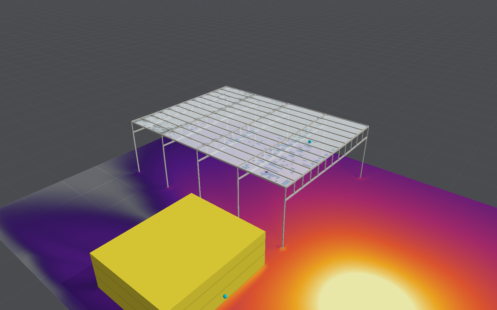

# Transport hub, long-span steel and glass roof

The third planned building type on the roadmap (Scale and import) is a station: a train shed with a
long-span steel and glass roof, beside a glazed concourse (`ScenarioPreset.transportHub`,
`TransportHubPreset.swift`). It brings together the three pieces built for it:

- [laminated glass](building-envelopes.md#laminated-glass), which holds together once cracked;
- [glass falling from overhead](building-envelopes.md#glass-falling-from-overhead) onto the floor
  below;
- [slender steel members buckling](shell-model.md#buckling) in the shed's frames.

## The layout

**The train shed** is built of shells and beams.

- **Size.** A 36 m clear span (two island platforms and four tracks) by 48 m, its roof 12 m up.
- **Columns.** 305 UC columns in frames at 12 m, clamped at their bases.
- **Trusses.** Across each frame is a Vierendeel truss 3 m deep. Its chords are 300 × 12.5 mm
  square hollow sections and its posts 200 × 10 mm, at 3 m. A Warren truss's diagonals would not
  lie along the axes, as the shells' lines must.
- **Purlins.** 356 UB purlins run at 3 m along the shed on the trusses' top chords.
- **Joints.** Since 18 October 2026 the trusses' chords are bolted to the columns, and the
  purlins to the end trusses, by extended end plates, as British portal frames are
  ([steel connections](shell-model.md#steel-connections)). Each takes 0.74 of its beam's plastic
  moment and fractures at 0.0122 rad, as Culache's broke when loaded in 40 ms. The posts and
  chords within a truss stay welded rigidly, as a Vierendeel truss's are.
- **Glazing.** 10 mm toughened glass covers the whole roof. As an option
  (`ScenarioPreset.transportHub(title:laminatedRoof:)`), it is laminated panes 3 m square between
  the purlins, 6 + 1.52 mm PVB + 6 mm ([laminated glass](shell-model.md#laminated-glass)), each
  fragmenting on its own; their edges along the shed are carried on the purlins, those across it
  run on into the next pane.
- **Openness.** Its ends and sides are open to the tracks.
- **Sizing.** The sections were sized here for the span and the glass's weight, not taken from a
  design. Under self-weight a truss's chords carry about 350 kN, under a tenth of their squash
  load.

**The concourse** stands 6 m to the side of the shed, as an envelope judged by
[envelope damage](building-envelopes.md#damage-for-envelope-buildings-built).

- **Size and walls.** 24 × 20 m and 8 m high, with 0.3 m concrete walls and roof.
- **Glazing.** Its front has sixteen 3 × 3 m panes, and its roof has twelve 3 × 2 m rooflights over
  the concourse floor. All are laminated: 6 + 1.52 mm PVB + 6 mm, in structural silicone with a
  20 mm bite (`LaminatedGlass.facade`).

**The charge** is 100 kg of TNT, a car's worth, in the forecourt 20 m in front of both buildings.

```sh
swift build -c release --product blastbench
.build/release/blastbench snapshot --preset hub --dx 0.5 --time 0.3 --envelope-damage --out hub.png
```

## What it shows



Run on 0.5 m air for 300 ms (1,417 steps, 30 s on the Studio), the run above:

- **The concourse's front** takes a reflected 59.5 kPa and 621 Pa s. Every one of its 28
  laminated panes cracks. 22 have left their frames by 100 ms and all 28 by 300 ms, so the windows are GSA 5. Pulled out of their silicone, the rooflights fall whole 8 m
  onto the concourse floor at 14 m/s: 3.0 kJ over each square metre, each pane far past 79 J.
  Through the gone panes, the one-way fill puts 0.9 kPa inside, the air having moved by then.
- **The shed** is open, so the blast reaches under its roof (15.7 kPa at the platforms) as well
  as over it (13.0 kPa). The roof glass is loaded on both faces and cracks in patches. The frames
  stand: 13 of 9,510 elements fail, and the largest deflection is 334 mm. With the members bowed, as
  they are by default since (below), the same 13 fail and the deflection is 325 mm. With the steel's strain-rate law, rerun on 18 October 2026:
  - **Rigid joints:** 11 fail, 325 mm, the members moving 270 mm at most.
  - **Welded flanges (WUF-B):** 13 fail, 368 mm, members 268 mm.
  - **Bolted extended end plates** (the default): 6 fail, 310 mm, members 272 mm.

  None of the 46 connections fractures. The largest turn, 0.002 rad, is a sixth of the end
  plates' fracture turn.
- **The concourse walls** are moderately damaged.

**The shed's roof glass, toughened or laminated** (`blastbench hubroof [--laminated]`, 0.5 m air,
300 ms), graded pane by pane as the envelope grades a rooflight (`RoofGlassHazard`, by
`OverheadGlassHazard`'s rules) falling 15 m onto the platforms:

| Roof | Panes | Cracked and held | Glass fallen | Hazardous |
|---|---|---|---|---|
| 10 mm toughened, one sheet | 1 | — | 6 kg (one element), 0.9 kJ striking | yes: shards past 15 cm would strike with 79 J |
| Laminated, 3 m panes | 192 | 55 | none | none |

The toughened roof loses one element's glass, which falls as shards; it is graded hazardous, as
a shard of its thickness big enough to strike with 79 J fits in it. The laminated roof's
cracked panes stay up on their interlayer.

## Limitations

- **The laminated roof's panes** are carried on the purlins along the shed and run on into each
  other across it: no glazing bars or silicone hold them, so none can pull out.
- **The trusses are Vierendeel frames.** A real long-span roof is more often a triangulated
  truss or arch, whose members carry axial force rather than bending. Members along the axes
  cannot be diagonal.
- **Members bowed by Eurocode 3's rule.** Since 17 October 2026 the steel is bowed so that it
  buckles at its design curve's resistance ([buckling](shell-model.md#buckling)): the hollow
  sections on curve a, the UC columns on c, the purlins on b. The image is of the run on straight
  members.
- **No falling test.** The concourse's falling glass is graded on the fragment criteria, with
  no falling test compared.
