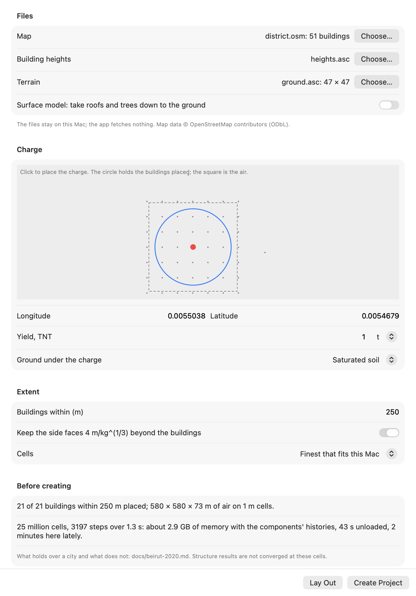

# Using the app

How to build BombCAD, drive the app, and run it from the command line. The
[README](../README.md) gives the overview; the model documents give the physics.

## Building

To build from source: macOS 15 or later, Swift 6.4 and a Metal GPU.

```bash
swift run -c release BombCAD
```

```bash
make app
```

The second command builds `dist/BombCAD.app`, which can be launched from Finder.
The first app build downloads a checksum-pinned native IFC converter into `.build/ifc-converter`
and bundles it with the app; later builds verify and reuse the cache. When using `swift run`,
run `python3 Scripts/prepare-ifc-converter.py` first to enable IFC import.
[Releasing](releasing.md) describes signed, notarized builds for other Macs.

## The view and the sidebar

In the view: drag or two-finger scroll to orbit, shift-drag or right-drag to pan, pinch or mouse
wheel to zoom (out to three times the domain's longest side). Space runs and pauses, ⌘R resets.

Structures are drawn in their materials' colours: concrete warm grey, steel blue-grey, profiled
sheeting light metallic, glass tinted and see-through, timber warm brown, brick red-brown, blockwork
buff; exposure-only buildings by their walls' construction, plain blocks neutral, terrain earth.
Damage shades every material alike, from amber through orange to dark red as an element nears
failure, and failed elements fall as dark grey rubble. The colours are chosen so that damage and
rubble stand apart from every material to people with each common colour deficiency.

The sidebar has two tabs. **Run** picks a built-in layout, the grid, the charge and the display.
The layouts are open ground, a single building, a street canyon and a courtyard (rigid blocks);
a cantilever wall, a single-storey building, the same building behind a blast wall, a two-storey
frame (bare, infilled with masonry, or glazed with glass panes), a three-storey clad building,
an eight-storey frame and a twelve-storey tower with a concrete core (both shells and beams,
for collapse over several seconds), a [twelve-storey office of steel and
glass](office-tower.md) with a curtain wall and two neighbours across the street, a
[portal-frame warehouse clad in profiled steel](profiled-sheeting.md#the-portal-frame-warehouse-sample)
with a sheeted neighbour, an
open-sided car park with a charge inside, three buildings across a street (each its own
structure, one sheltered behind another), an underpass, a column close to a charge, a
two-storey house of concrete blockwork meshed with shells, a blockwork boundary wall meshed
block by block with its mortar joints, and the internal-explosion test
(deformable); the car park with parked cars and a furnished room, whose objects slide and tip
([freestanding objects](freestanding-objects.md)); and two gas explosions, a vented room and a
[vapour cloud explosion at a process plant](process-plant-explosion.md) beside its buildings. The close-in column wants the fine grid: on coarser air it
is less than a cell or two across. The sidebar shows a structure's deflection now and the
largest it has reached.
**Edit layout** adds, moves, resizes and removes rigid blocks, deformable walls, openings and
pressure gauges, sets each wall's material and reinforcement, and has undo (⌘Z). **Add
Independent Structure** adds another structure, up to sixteen, each with its own materials,
supports, mesh and results (**Editing structure** picks which one the edits go to; imports make
one each); they share the air, and meet through contact if they come close. You can move
the charge, or the selected gauge, by clicking the ground. Save Project writes a `.bombcad`
document containing the scene, simulation settings, camera and embedded import sources. Projects
reopen without the original OBJ/STL files. Named projects autosave; each
project has its own window, and closing an edited untitled project asks whether to save.
BombCAD → Settings (⌘,) sets defaults for new projects and playback windows.

## Settings in the Run tab

The Run tab's sections, from the top: Scenario (the layout), Domain, Advisor, Imported geometry,
Source, Charge (or Gas cloud), Vent panels, Terrain, Map buildings, Fragments, Thermal radiation,
Rise and cloud, Ground shock, Building surface exposure, Envelope building damage, Structure,
Standing of results, Playback, Display and Solver. The settings added or changed since 0.3.0:

- **Charge ▸ Afterburning and hot air** is on by default since 15 October 2026: the recommended
  air, 1.3 to 1.85 times the cost of the ideal gas. Off, the incident impulse reads 13–22% low.
  Settings ▸ New project defaults sets it for new projects. The open faces are far-field either
  way. See [the air-blast model](air-blast-model.md#afterburning).
- **Charge ▸ Sharpen shocks ▸ Adaptive substeps** lets each refined level take only the substeps
  its own fastest wave needs. It is off by default, and the Advisor turns it on where it pays.
  Refined runs then go 1.19 to 1.33 times faster on open ground and 1.07 times in a street, and
  peaks move 1–2.5% up, towards Kingery–Bulmash. See
  [refining near the shock](air-blast-model.md#refining-near-the-shock).
- **Charge ▸ Outline structures by overlap**, shown when there is a structure, counts each element
  into the air's cells by its overlap, the default since 16 October 2026. Off counts each at its
  centre, as before; saved runs record which. See
  [coupling to the air](structural-model.md#coupling-to-the-air).
- **Terrain ▸ Cut cells along its slopes**, shown over terrain, cuts the surface through the air's
  cells so that a slope reflects as a slope. It is on by default, and under a gas deflagration too
  since 17 October 2026. See [cut cells](terrain.md#cut-cells).
- **Terrain ▸ Made of** is what the ground is:
  - rigid ground, the default;
  - **soil under debris only**, a bed of the **Soil stiffness** set below it (50 MN/m³ by
    default) for a structure's debris falling on earth
    ([on the ground](structural-model.md#on-the-ground));
  - one of eight earth and rock types. These also dig each charge a crater, estimated and drawn
    when the run ends, and leave the air 0.9 of a charge on the surface.

  Under earth or rock, **Water table near the surface** and its depth keep a crater shallow; it
  is on, at the surface, for saturated soil. See [choosing the ground](cratering.md#choosing-the-ground).
- **Fragments ▸ Cased charge** flies a casing's fragments and tracers through the blast.
  **Casing metal** (steel or cast iron) and **Casing dimensions** (wall thickness and inside
  diameter) make the fragments' masses follow Mott's scaling, and their standing an approximation
  rather than illustrative. See [fragments](fragments.md#in-the-app).
- **Envelope building damage** judges each exposure-only building's walls, roofs and panes as the
  run goes. Its list gives each building's level, panes broken, freestanding walls and the pressure
  let inside; **Show damage in the view** colours the buildings by it, and **Export damage…** writes
  it as JSON. See [one-way damage](building-envelopes.md#one-way-damage-single-degree-of-freedom).

In **Edit layout**, the **Exposure-only buildings** section sets each envelope's **Walls**:
reinforced concrete, unreinforced masonry or reinforced blockwork. Under **Construction** it sets
the wall's thickness, its bars each way and whether in both faces, their cover and yield, the
concrete's or masonry's strength, whether blockwork is fully grouted, and a freestanding wall's
cap. These are read from IFC material layers or OpenStreetMap's `building:material` where those
give them, and otherwise assumed.

## Large scenes and the advisor

**Large scenes.** The charge's slider runs from 1 kg to 10 kt. The **Grid** offers, beside the
0.5, 0.25 and 0.125 m presets, cells scaled to a large charge (0.2, 0.1 and 0.05 m/kg^(1/3)), and
**Cell size** takes any size from 0.01 to 200 m. **Domain** sets the air's extent from its origin,
keeping everything where it is; **Height for the far ground** raises the open top to what the
farthest ground needs (1.5 √(R W^(1/3))); and for an open scene, with nothing in it but the
charge, gauges and terrain, **Fit to the charge** makes a square domain reaching 10, 20 or 40
m/kg^(1/3), centres the charge in it and chooses a grid scaled to it. Under Gauges, **Add Gauge
Line** lays gauges outward from the charge at the Kingery–Bulmash scaled distances that fit; up to
64 gauges are recorded. The Thermal section sets how far apart its ground receivers stand, at
most 250,000 of them. See [Large scenes](large-scenes.md) for which grid to choose.
Under Sharpen shocks, **Follow the shock** sets how weak a shock the refined air still follows
(above 20, 5 or 1 kPa).

**Advisor.** In the Run tab, choose a target (peaks, impulse or deflection within a percentage,
or a run under so many minutes) and **Suggest**: the advisor weighs grids, refinement and
afterburning, reads each one's expected error from the standing's error bands and its cost from
the measured throughput, and offers the cheapest settings that meet the target, or the best within
the time, with what it could not meet; **Apply** takes them. `BombCAD run --advise peak:20%` does
the same from the command line. See [Performance](performance.md#choosing-settings).
The More menu offers Save As and Import Layout JSON. Export Layout JSON saves just the scene. See [Save files](save-files.md).

## A district from a map

**File ▸ New District…** (⌥⌘N) lays out a district from files you supply, as Beirut's was laid
out ([Beirut, 2020](beirut-2020.md)); the app fetches nothing.



- **Map**: an OpenStreetMap export (.osm, from openstreetmap.org's Export, or an extract) or GeoJSON
  of building footprints. Each building becomes an envelope with a construction (from its
  `building:material` tag, or assumed) and a glazing mix by its height and type.
- **Building heights** (optional): a raster such as GHSL's GHS-BUILT-H, for buildings whose tags
  give no height or levels. Without it they are taken as two storeys.
- **Terrain** (optional): a GeoTIFF or ESRI ASCII grid of elevations, as the Terrain section reads.
  **Surface model** takes a surface model's roofs and trees down to the ground (opened over 100 m)
  and puts what lies within a metre of sea level at it; turn it off for a bare-earth model.
- **Charge**: click the map (drawn from the file's footprints) or type a longitude and latitude,
  and give the TNT yield and the ground under it. The air is centred on the charge. A building
  whose footprint holds the charge is left out, as the charge would be buried in its solid block.
- **Extent**: the buildings whose footprint's centre lies within the radius are placed. The open
  faces are kept 4 m/kg^(1/3) from them: the sides beyond the outermost building (unless turned
  off), the top above the charge and at least half that above the highest roof or ground
  ([open faces](air-blast-model.md#open-faces-near-a-structure)). **Air** is uniform cells, or
  a coarser base refined once, to half its cells, where the shock is (at a jump of 0.005 of the
  pressure) and only near the ground: to the height of all but the tallest 2% of the buildings and
  four base cells over them, the footprints on the finer cells. The advisor's choice is the finest
  of each whose run fits this Mac's memory with the components' histories, by its cost model, and
  takes the refined air where that is both finer at the façades and no dearer; **Cells** sets a size
  instead (the refined air's base). Over Beirut, 8 m refined so to 4 m gave the glass and the
  arrivals of 4 m cells in 0.44 of their run time, the façades' peaks 2–12% lower; a tower above
  the ceiling takes its upper floors' load on the coarse cells. The refined air takes the ground as
  a staircase of whole cells for now: cut through the cells, a second refined level rang ahead of
  the shock over Beirut ([Beirut's page](beirut-2020.md#what-cell-size-the-glass-and-the-damage-need)).
- **Near field and far field** (on when the radius reaches 1.25 times the hand-over, drawn on the
  map at 12 m/kg^(1/3), to 50 m) runs the air only to the hand-over and its faces' clearance. The
  buildings beyond are kept beside the project, never voxelised, and judged in seconds when the run
  ends on the load carried from it: painted with their damage and listed under **Far field
  (estimate)** in Envelope damage, walls and roofs at the surrogate's standing, glass close to a
  full run's to about 1.5 km at Beirut's yields
  ([a city in minutes](hybrid-far-field.md#using-it)).
- **Lay Out** places the buildings and shows, before anything is created, how many were placed, the
  air's size and cells, the memory and the time unloaded and as this Mac's runs have gone, and
  the same for the other kind of air.
  **Create Project** opens it as a new project, the run long enough for the blast to reach the
  farthest building and load it for half a second; its components keep half a second of load from
  their arrival.

A worked example, Beirut at 0.5 kt: export the port's district from openstreetmap.org (or an
extract), take Copernicus GLO-30's tile N33 E035 and GHSL's height tile for it, choose the three,
type 35.519042 and 33.901425, 0.5 kt on saturated soil, and buildings within 2,500 m. The faces then
lie 317 m beyond them, so the air is about 5.6 km square: more than a project's 128 million cells
at 4 m, so its finest are 5 m cells (Beirut's page ran a 5 km square at 4 m under a 320 m top, its side
faces at the buildings and its outer bands less sure, through `scenebench district-scene`). Lay
Out shows what it costs before the project is made. What such a run gets right and what it does not, the glass beyond
1.5 km against the structure, is on [Beirut's page](beirut-2020.md#what-holds-and-what-does-not).
The made-up district in `Fixtures/SyntheticDistrict` (a map, heights and terrain) tries the window
in seconds.

## Importing models

**Import Model…** reads watertight OBJ/STL geometry and IFC buildings. Confirm source units, up axis and
placement, then prepare a preview of the actual occupied simulation volumes. Imports can be
rigid obstacles, or a new deformable solid body with a material preset and editable density,
stiffness and strength. Deformable imports require a layout without an existing structure,
use solid elements at the air cell size (IFC buildings: shells and beams), and start without reinforcement. Fixing the base
holds nodes at the imported body's lowest plane; review that assumption before running.

**Help → Importing models** provides an offline walkthrough of scale, placement, feature-size
warnings, material assignment, repair, and saving or reopening imported sources.

Repository-only [importer sample files](../Samples/Importer/README.md) cover named parts,
STL components, units, cavities, thin features, narrow gaps, and the repair workflow.
They are not bundled with the app. The [real CAD fixtures](../Samples/Importer/RealCAD/README.md)
add unchanged FreeCAD library exports, pinned provenance and current acceptance/resolution expectations;
their STEP counterparts are references for future support.

IFC imports use the bundled IfcOpenShell converter locally and create **rigid obstacles**, or,
with **Deformable shells and beams**, a structure of shells and beams whose materials,
connections and supports are read or inferred and listed (see
[structures from IFC](structural-editing.md#structures-from-ifc)).
Physical walls, slabs/roofs, columns, beams, members, plates, footings, stairs, railings, doors
and windows can be chosen; spaces, furnishings, proxy/site markers and other types are excluded.
Before geometry conversion, choose exact elements using building, storey, type and text filters
and inclusion checkboxes. Filters only change the list; Include/Exclude matching changes the
import. Up to 1,024 supported elements can be chosen from a 20,000-entry decomposition inventory.
Choose IFC elements in the preview or source inspector to revise choices from retained IFC bytes.
Changing the subset preserves surviving elements’ simulation positions using the retained IFC coordinate origin.
Newly included geometry outside the domain or below ground stays blocked until placement is adjusted explicitly.
An element whose geometry is all in its aggregated parts (a wall of blocks, a slab of precast
planks drawn as proxies) imports its parts, each named with its element. Products that no storey
contains are found in the IFC file itself and imported without a storey, and a note says so.
Where the converter cannot find the units, the length unit of the file's one project is applied,
and a note says so. An element whose mesh is several closed solids welded together (layers, a
frame and its sash) is remade as those solids, each a piece of the element, and the notes list
it and any pieces left out as open. A bad or repeated GlobalId leaves out its element, not the file.
The Parts browser retains element names, types, storey labels and GlobalIds, searchable by any
of these. Source units and world placements are converted to metres, Z up, then rebased from
large coordinates before Float conversion. The original coordinate origin remains recorded.

Each IFC element is validated independently. Existing segmented edge junctions are made
conforming without creating faces, and coordinates are canonicalised at 0.1 micrometre.
Touching and overlapping elements produce a union of occupied cells; overlaps count once and
use the first sorted GlobalId for selection. Cross-element gap checks union each product’s continuous solid intervals along X/Y/Z grid-centre
rays, warn below two cells, and identify both bounding products. Touches, overlaps and intervening
solids do not create a clearance. Off-ray and oblique gaps can still be missed; the checks are
approximate. The interval inventory is bounded at 500,000 records; incomplete checks are reported
without inferring gaps from partial data. Localized regions remain bounded at 128. Geometry omissions, converter diagnostics and unsupported material metadata
remain explicit import notes. IFC completeness and exported reports list intentional exclusions,
unsupported types, missing converted geometry, complete grid losses and overlapping cell ownership
separately. Inventory follows the decomposition tree; uncontained products may be absent. Invalid
selected solids are collected into one review with names, GlobalIds and repair reasons. Select
reviewed failures to exclude and retry, or export the complete geometry review. No partial geometry
result can be applied while invalid meshes remain. Exclusion is an explicit action.
Units that neither the converter nor the file's one project determines block import to prevent incorrect scale. Rigid imports infer no materials, supports or connections. The notes list the classes left out as unsupported, and a file with nothing supported says what it holds. [IFC import over a corpus](ifc-import-corpus.md) records what 385 open IFC files did.

An attached rigid import can become an **exposure-only envelope** (Run ▸ Imported geometry ▸ Use
as Exposure-only Envelope, or Use All for a group): its sampled boxes as walls and roofs, IFC windows
and doors as openings, including those left out as open meshes, read back from the retained IFC.
The import is replaced; Undo restores it. **Map buildings** in the Run tab reads building
footprints and heights from an OpenStreetMap extract (.osm) or GeoJSON you supply, and places them
as envelopes from a corner longitude and latitude, on the terrain if there is one; it credits
OpenStreetMap in the scene and its exports. See [building
envelopes](building-envelopes.md#envelopes-from-imports-and-map-data).

Projects retain original IFC bytes and converted sources; reopening and grid resampling need
neither the original file nor the converter. Attached older IFC previews refresh missing cross-element
gap diagnostics on their existing grid; detached scene geometry remains authoritative. Version 2 source assets hold IFC element metadata, inclusion choices and source inventories,
while OBJ/STL assets retain version 1. See the repository-only
[whole-building IFC fixture](../Samples/Importer/Buildings/README.md) for a small house, matching
raw OBJ reference, a two-storey duplex, structural beams, an imperial column, a unit-failure case,
expected behaviour and reproducible provenance. IFCZIP/IFCXML are not read.

The importer retains each source mesh, its units/orientation and placement in the saved layout.
**Inspect / edit source…** in Edit layout reopens an import without its original file. Changing
the air grid regenerates retained geometry in the background; the simulation pauses until the
new geometry is ready. Source edits replace that model rather than adding another copy.

Click an imported model in the main viewport to select it and open its source, placement and
material inspector. Selection follows occupied volumes, respects openings and nearer geometry,
and outlines the selected model. Turn off Place Charge to select models; charge/gauge placement
continues to take priority. Viewport selection uses the initial layout, so reset after running
the simulation before selecting a model. Detached geometry remains independently editable and
its retained source is accessible from the sidebar.

The import inspector keeps its 3D preview visible beside independently scrolling, collapsible
controls. Detailed material properties live under Advanced. Dimensions in metres remain visible
while units and placement change; unusually small or large models offer explicit unit corrections.
A labelled reference grid helps judge scale. Corrections are never applied automatically.

Drop one local OBJ/STL/IFC file into the viewport or use Import Model. Reading and geometry checking
run in the background with a Cancel checking action; cancelled or superseded work cannot open a
stale result. Rejected geometry opens a separate inspection view with red defect surfaces, source
triangle numbers, repair guidance, and a text repair report. Collapsed/non-finite triangles remain
blocked even when they cannot be drawn. Choose repaired file retries validation after the inspection
closes; invalid inspection data cannot enter the simulation. Syntax errors report OBJ line numbers.

The source inspector includes a searchable Parts browser. OBJ object and group names label
complete connected shells; STL components and unnamed sources receive stable component names.
Face groups within one shell do not define separate material volumes. Select a part to highlight
its source surface in green and focus the preview; the browser reports its sampled solid cells.
A shell with no cells may represent a cavity or a feature lost at the selected resolution.

Part checkboxes support multi-selection, Select matching, and bulk material assignment/reset.
Copy and paste a material between selections. Isolate selected parts and material colours affect
only the preview; every source part still imports. The model default remains linked to parts
without an override. Geometry warnings can be filtered by source part IDs, including cavity
boundaries; placement filtering uses overlapping sampled regions.

Compare grids samples coarse, medium and fine without changing the chosen grid or live layout.
The table shows cells, sampled volume changes, parts absent at one grid but present at a finer
one, and estimated air-memory cost. Measured thin features/gaps suggest a grid when two cells
fit across the smallest sampled dimension; unresolved finest-grid features are called out.
Stable volume or a suggested grid is not a completeness or convergence guarantee. Checks can
be cancelled, and changes to source placement/units invalidate comparisons. Apply is blocked
when estimated air memory or active material counts exceed their limits. Export import report
records all warnings and assignments, regardless of the current warning filter.

Reusable import profiles save units, up axis, behavior, base support choice, default material and
part overrides matched by name. Loading a profile is explicit, reports matched overrides, and
stages settings until Apply. Placement, domain and grid stay specific to the current import.
Existing imports retain their rigid/deformable behavior. Profiles can be updated or removed;
up to 20 are stored locally.

For deformable imports, each part can use the model's default material or a custom preset with
editable properties. Assignments are saved against source part IDs and survive grid, unit,
orientation and placement changes, including a thin part disappearing and later returning at a
finer grid. Sampling keeps different parts in separate generated regions even when a coarse grid
closes their gap. Cavity walls use the enclosing solid's material; a solid island within a cavity
uses its own. The solver supports eight distinct active materials, including the model default;
imports or refinements exceeding that limit fail before changing the layout. Rigid parts remain
obstacles and ignore structural materials. Material textures and external OBJ material files are
not imported.

Placement checks in the preview highlight overlaps with existing geometry (orange), charge
locations inside the candidate model (red), and floating or disconnected sampled components
(purple). Selecting a placement issue focuses the camera on its region, with surrounding volume
for a blocked charge and a ground reference for an elevated component. The Context layer shows
existing geometry and ground and can be toggled off. Checks exclude the
model being edited and subtract structural openings. Separate buildings and intentional joints
can produce advisory warnings; geometric contact does not establish a structural connection
or validate supports. Fixed-base explanations distinguish the lowest plane from elevated,
disconnected components. Checks use the sampled geometry of the rebuilt layout and do not
track moving debris. Work/highlight limits are explicitly reported when checks are incomplete.

The preview refreshes automatically after a short pause when units, orientation, position or
grid change. Pending updates keep the previous geometry dimmed and clearly marked; Apply is
disabled until the current preview is ready and its warnings have been reviewed. Previewing
does not change the simulation.

Placement shortcuts centre the footprint without changing its height, put the base on the
ground without moving X/Y, or expand the domain with clearance. Expansion preserves existing
domain extents and checks the estimated air-memory budget; it takes effect only on Apply and
can be undone in the sheet before applying.

The interactive 3D preview overlays the source wireframe (cyan) and sampled simulation volumes
(blue). Orange regions identify thin features or narrow gaps sampled along X, Y and Z; red
regions identify potentially missing surfaces. Toggle layers, orbit and zoom, or select a
region to focus the camera, or reset the view. Warnings group potentially missing surfaces
separately from resolution risks. **Preview finer grid** advances to the next available grid;
the finest grid is explicitly identified, since refinement does not guarantee resolution.
Region descriptions include approximate position, extent and the
minimum sampled feature dimension. Empty previews show geometry lost on a coarse grid, but
cannot be imported until a finer grid or larger scale produces occupied cells.

Warnings persist with retained models. Review them before applying an import, and compare
resolutions to assess accuracy: highlights are approximate sampling diagnostics, not a
convergence or completeness guarantee. Up to 128 affected regions are highlighted; the UI
reports when this limit is reached. Features not crossed by scanlines and missing surfaces
near other occupied geometry can escape detection.

Deformable regeneration preserves the body's main material and source part assignments. Changes to individual generated regions,
openings, reinforcement or supports block regeneration to avoid overwriting local edits.
**Detach geometry** keeps the current geometry and edits while stopping source regeneration.
The mesh remains saved and available for inspection; detached geometry is independent. Grid
changes cannot then restore lost features. Layouts saved by the earlier importer remain
readable, but their discarded sources cannot be recovered automatically.

Textures and OBJ visual materials are ignored; export triangulated faces or convex polygons.
Open/non-manifold meshes, self-intersections, overlapping solids and ambiguous contacts are
rejected before sampling, including defects smaller than a grid cell. Intersection errors
identify triangle numbers and an approximate region in source units. Boolean-union overlapping
solids or repair the indicated surfaces in your CAD tool before exporting again. Separate nested
shells are interpreted as cavities, with further nested shells becoming solid islands; a completely
contained part therefore needs a Boolean union if it is intended to fill material. Face winding
is normalized internally for sampling without rewriting the source. Rays on triangulation edges
use one face owner and tangent contacts cancel.

Limits are 20 MB, 100,000 triangles, 2 million sampled cells, and 2,048 coalesced regions; an
IFC building may be 100 MB and 400,000 triangles, with a note past 20 MB.
A spatial hierarchy limits intersection checking to overlapping triangle bounds, with a
2 million candidate-pair limit, a traversal budget and cancellation. Models that exceed
validation limits must be simplified; they are not imported with incomplete checks. A scanline-work budget also limits
expensive previews.

## From architectural plans

An architect's floor plan reaches BombCAD by one of two routes:

- **In BombCAD, from the DXF.** Quick, for plain buildings: square walls, flat floors, the same
  plan on every storey or one plan per storey's openings. It is described below.
- **Through a BIM program, as IFC.** For anything more: angled or curved walls, pitched roofs,
  storeys that differ, columns and beams. FreeCAD's BIM workbench (or Bonsai, Blender's IFC
  add-on) raises the plan into a model, and BombCAD imports the IFC. See
  [through FreeCAD](#through-freecad-as-ifc).

[Samples/Plans](../Samples/Plans/README.md) holds a worked example for both routes, a two-storey
house with cavity walls, and plans cut from two real buildings.

### In BombCAD, from the DXF

**Import Model…** (or drop the file) with a plan saved as **ASCII DXF**. A binary DXF, DWG or PDF
has to be saved as ASCII DXF first. BombCAD reads lines, polylines (with their arcs), arcs,
circles and blocks, on their layers. A sheet then asks what the plan means:

- **Units**: from the drawing's header where it gives them; otherwise BombCAD guesses from the
  plan's size (millimetres if it spans more than 200 units) and asks you to check.
- **Layers**: each layer is marked **Walls**, **Doors**, **Windows**, **Floor outline** or
  **Ignore**, guessed from its name ("WALL", "A-WALL", "DOOR", "GLAZ"…; a wall layer named for
  partitions or interior walls gets 100 mm block). A wall layer takes a
  construction, such as a cavity wall of brick and block, solid brick, block or concrete, and so
  the wall's layers and materials. Any layer may be put on one storey only, which is how a plan
  with each storey's windows on its own layer is read.
- **Storeys**: how many, floor to floor, the floor and roof slabs' thickness, a flat roof, and a
  ground-bearing slab.
- **Openings**: door head, window sill and head (each storey's own), and whether a gap in a wall
  with nothing drawn in it is a door or a window.

The preview shows the drawing with the walls found filled, windows blue and doors red, with notes
on what was read and what was assumed. **Preview building** raises it and opens the same review
as an IFC building ([structures from IFC](structural-editing.md#structures-from-ifc)): keep it as
rigid obstacles or turn on **Deformable shells and beams**. **Back to the plan…** returns to the
sheet.

How the plan is read:

- **Walls drawn by both faces**, as architects draw them, are read as the regions the wall
  layer's lines enclose: a region no wider than 0.6 m over most of it is wall, wider is a room.
  Overlapping outlines and the lines between a wall's leaves stay inside one wall. Each wall's
  thickness is the drawing's, its build-up the layer's construction.
- **Walls drawn by centrelines** (lines that enclose only rooms) take their construction's
  thickness. Where walls meet, they are carried to each other's far face at a corner, and to the
  midline at a T, so that they join.
- **Openings**: a block or a group of lines on a door or window layer names the opening it sits
  in, or in a wall drawn by its centreline, cuts one. A door or window drawn just past a wall's
  end, beside a pier or a corner, carries the wall across it. A gap of 0.3–6 m in a wall's line
  with nothing drawn in it is taken as the kind you chose in an outer wall and as a doorway in an
  inside one, and the notes say so.
- **Floors**: closed polylines on a floor-outline layer (square-cornered), else the walls' outer
  rectangle.
- Only walls square to the plan's axes are read. Angled and curved walls are left out, and the
  notes give their number and length; for them, take the IFC route.

How it does on real plans (`FloorPlanTests`, `PlanHouseStudyTests`):

- **The example house**, drawn by centrelines, gives the same building as the FreeCAD route:
  13 shells (8 cavity walls as their brick leaf carrying the block's mass, 2 block partitions,
  3 slabs), 5 panes of annealed glass and the door as a hole. Its members meet without the
  89 mm gaps FreeCAD leaves. Under the 20 kg charge described below, the front reads the same
  126 kPa; the front wall's brick leaf breaks at both storeys as it does from the IFC (274 of
  6,021 elements removed, against 179 of 5,597); the side and back walls move 7–43 mm (8–53 mm
  from the IFC), the partitions 25–33 mm (26–34 mm) and the roof 24 mm (11 mm). The plan's
  roof spans the whole outline over the walls, where FreeCAD's sits within them.
- **The Duplex Apartment** (buildingSMART's sample), its two floors cut from its IFC as an
  architect's plan is drawn, by both faces. The reader finds the four 417 mm outer walls whole
  and the 124 mm partitions. On the ground floor it places all 10 openings the cut crosses (the
  IFC's 4 windows and the 6 of its 8 doors that appear in the cut). The stair core reads
  as thick blocks of wall (520–740 mm), where the IFC has several walls overlapping. On the first
  floor, the dormers' angled lines are left out and the notes say so.
- **The small house** (buildingSMART's Building-Architecture): its three walls of 200 mm.
  A 24 mm wall is thinner than the thinnest a plan's lines are read as (50 mm).

These plans are drawn cleanly, as cuts from models. A drawing with hatching, dimensions or
furniture on its wall layer needs those layers set to **Ignore**, and walls that are not quite
closed at their ends can be lost; the preview shows what was found.

### Through FreeCAD, as IFC

BombCAD reads such a building as IFC. The steps below use FreeCAD's BIM workbench; Bonsai works
too. The worked example in Samples/Plans gives the DXF plan, the FreeCAD script that raises it, and
the IFC it writes.

1. **The plan.** Export it from the CAD program as DXF, in millimetres. It helps to put each kind
   of line on its own layer: the walls' centrelines (or one face), and the doors' and windows'
   widths along their walls. A scanned drawing has to be traced first; FreeCAD can trace over an
   image (BIM ▸ 2D drafting, with the image on a plane).
2. **FreeCAD** (freecad.org, `brew install --cask freecad`). Open the DXF (File ▸ Import), switch
   to the BIM workbench, and for each storey:
   - **Walls**: select a wall's lines, then BIM ▸ Wall. Give its height (floor to floor) and
     width, and its layers as a **multi-material** (BIM ▸ Multi-material). Name each layer's
     material by what it is, such as "Facing brick" or "Aggregate concrete block", since that name
     is what BombCAD reads (see below).
   - **Windows and doors**: BIM ▸ Window, choose a preset, give its size, and place it in its wall
     at its sill height. It cuts its own opening.
   - **Floors and roof**: draw a rectangle over the inside, then BIM ▸ Slab, with a thickness and
     a concrete material whose name gives its grade ("Concrete C30/37").
   - **Storeys**: select each storey's walls, openings and slab, then BIM ▸ Level; then BIM ▸
     Building and BIM ▸ Site over the levels.
3. **IFC**: select the site, then File ▸ Export ▸ Industry Foundation Classes (*.ifc), IFC 4.
   FreeCAD 1.1 leaves a wall's layers out of the file and calls every wall movable; its
   development branch does too. Run the example's `add_wall_layers` on the exported file in
   FreeCAD's Python console, or export from Bonsai, which writes the layers itself. Without them,
   BombCAD takes the walls as the default material (it says so).
4. **BombCAD**: **Import Model…**, choose the IFC, keep every element, and turn on **Deformable
   shells and beams** ([structures from IFC](structural-editing.md#structures-from-ifc)). Then
   place the charge and run.

What the importer makes of the example's house:

- **Walls**: each wall becomes a shell of its thickest load-bearing layer: the cavity walls as
  their 102.5 mm brick leaf, the partitions as block. The block leaf's stiffness is left out, but
  its mass is carried by the brick (its density 1.72 times its own), and the report says so. A
  layer's material is read by its material's name. The converter gives only the layer's own name
  ("Outer leaf"), which says nothing of what it is made of, so the name is found in the IFC itself.
- **Windows** become panes of annealed glass, 6 mm thick unless the IFC gives the glass's
  thickness, and the **door** an open hole. **Slabs** become shells of C30/37, unreinforced unless asked. The
  ground-bearing slab rests on the ground.
- **Connections**: walls are tied where they meet, and to the slabs, closing the gaps of up to
  89 mm that FreeCAD leaves between a slab's edge and a wall's midsurface. The walls stand on the
  ground on assumed starter bars.
- **Meshes**: FreeCAD's windows and openings give meshes that are not closed solids. The
  importer remakes them from their pieces and lists them.

**Under a blast** (`PlanHouseStudyTests`, with `BOMBCAD_PLAN_STUDY` set to a folder for its
report). Twenty kilograms of TNT on the ground 10 m before the front wall's middle, in air of 0.25 m
cells whose open faces keep the clearance rule ([open faces](air-blast-model.md#open-faces-near-a-structure)),
run for 0.15 s in about 30 s on an M4 Max:
- the front reads 126 kPa reflected;
- the front wall's brick leaf breaks at both storeys and is thrown into the house, its pieces 2.6–2.9 m in by the end, 179 of the 5,597 elements removed;
- the side and back walls move 8–53 mm, the partitions 26–34 mm, the roof 11 mm.

That is what an unreinforced leaf of brick would be expected to do under such a load. It is not
compared with a test, so it stands as an illustration of the route, not of the walls.

## Results, tests and the command line

Gauge and deflection histories export
as CSV from beside the chart.

```bash
swift test
```

```bash
swift run -c release blastbench throughput
```

```bash
swift run -c release blastbench slab --sensitivity
```

`blastbench` also has `structure`, `validate`, `gas`, `chamber` and `snapshot` commands; see
[Performance](performance.md) and [Validation](validation.md). `blastbench anchorage`
compares a freestanding wall on a clamped base with one on starter bars, a construction joint,
friction alone, soil or a footing on soil (see [base connections](structural-model.md#base-connections)
and [footings](structural-model.md#footings)).

`BombCAD run Example.bombcad --out Example-run.bombcad` runs a saved project without a window and
keeps the result as a saved run, for scripts and other Macs; see
[headless runs](run-comparison.md#headless-runs). Add `--usd Example.usda` and `--vdb Example.volumes` to
write the scene, the structure and the blast over time for rendering elsewhere
([USD export](usd-export.md)). Sweeps can share their cases with other Macs over SSH,
in the app or with `BombCAD sweep`; see
[sharing a sweep](run-comparison.md#sharing-a-sweep-with-another-mac). A Mac on the same network
can instead share its GPU from Settings and be paired with a code, without SSH; see
[Macs nearby](run-comparison.md#macs-nearby-without-ssh). With another Mac named in
`~/.config/bombcad/remote.json`, `BombCAD sweep` and `BombCAD ensemble` take it whenever it is
free, without `--worker`, and `make check-anywhere` runs the checks on whichever Mac is quieter;
see [checks on the mini](continuous-integration.md#checks-on-the-mini-instead-of-this-mac).

`BombCAD run`'s options, in brief ([headless runs](run-comparison.md#headless-runs) gives them in
full):

| Option | Does |
|---|---|
| `--name`, `--out <new.bombcad>`, `--csv <file>` | Names the kept run; writes a copy of the project with it, or its histories as CSV |
| `--resolution`, `--mass`, `--duration` | Changes the grid, the charge or the simulated time, as a sweep case would |
| `--ground rigid\|soil\|<MN/m³>\|<type>`, `--water-table <m>\|deep` | What the debris lands on; a ground type also digs the crater and takes energy from the air ([cratering](cratering.md)) |
| `--advise peak:20%\|…` | Prints the cheapest settings that meet a target, and does not run |
| `--usd`, `--vdb`, `--vdb-fields`, `--frame-interval` | The scene and the air over time for rendering ([USD export](usd-export.md)) |
| `--fragments [--casing]`, `--thermal`, `--cloud [--sounding]`, `--ground-shock` | The effects beside the blast, each with its own `--…-results` file; `--casing` gives the casing's dimensions and metal |
| `--envelope-results`, `--envelope-histories`, `--envelope-damage` | Envelope buildings' surface records, pressure histories and damage, as JSON |
| `--consumer`, `--worker` | Where the effects beside the blast run: here, on another Mac, or by cost |
| `--standing <file>` | Writes each result's standing as JSON |

A headless run takes the air's settings from the project, so afterburning, adaptive substeps, the
outline by overlap and cut cells have no options of their own: set them in the app and save.

## Research drivers

The rest of this page is for developers: the studies behind moving solids in the air, run from
`rigidboxdemo`. Nothing here is needed to use the app.

For the isolated rigid-object mechanics demo, run `swift run rigidboxdemo`, then open
`.build/rigid-box-demo.html` in a browser. The self-contained replay shows resting, friction
holding, sliding, lift-off, rocking and tipping, with playback and a time slider. It records
the Swift reference mechanics. The app's layout editor places freestanding boxes and cars and
computes their motion after the blast; see [freestanding objects](freestanding-objects.md).

`swift run -c release rigidboxdemo --blast` generates `.build/rigid-box-blast-demo.html`, a
slow-motion comparison of a held and free box under the same blast. This experimental path
uses one box on uniform ideal-gas air and reports reference timings. Chemistry and deformable
structures are unsupported; whole-cell boundary updates can introduce pressure
artefacts. It does not enable rigid-object simulation in the app.

`swift run -c release rigidboxdemo --convergence` writes `.build/rigid-box-convergence.json`
and prints resolution, timestep, impulse, motion, mass-conservation and timing comparisons.
It includes held/free uniform-grid references and factor-two adaptive held/free runs.
`swift run -c release rigidboxdemo --refined` generates `.build/rigid-box-refined-demo.html`,
showing held and moving boxes with fine masks and wall velocities. Translation, rotation and
ground-gap opening/closure use conservative fine-cell remapping. Free-motion results are
still sensitive to spatial resolution. The synchronous remapper operates within the swept
box bounds plus a donor margin; the convergence report includes remapping phase timings.
Add `--extended` to the convergence command for 0.025 m uniform grids at both timesteps
and adaptive comparisons with 0.05 m fine cells. This writes
`.build/rigid-box-convergence-extended.json`, including initial gas mass/energy and final
orientation/angular momentum; each completed case prints its timing.

`swift run -c release rigidboxdemo --diagnostics` writes `.build/rigid-box-diagnostics.json`:
prescribed remapping in ambient air without gas evolution, suspended-box loading in uniform
flow without gravity/contact, and contact-only mechanics under a known force pulse. These
separate boundary sensitivity from contact sensitivity; the remap-only pressure changes
are a numerical stress diagnostic, not a prediction of blast error.
Add `--transport` to compare an opt-in connected-path remapper, writing
`.build/rigid-box-diagnostics-transport.json`. It preserves uniform states for balanced
occupancy changes; unequal voxel volumes still use redistribution. The usual driver and
app keep their existing behaviour while this alternative is evaluated.
`--convergence --transport` applies the same alternative to the matched blast study and
writes `.build/rigid-box-convergence-transport.json` (add `--extended` for the longer study).
Reports record the remapper and separate air and ground impulses. Completed cases are saved
incrementally; a failed run can leave a partial report.
`swift run -c release rigidboxdemo --geometry` writes `.build/rigid-box-geometry.json`, a
CPU-only reference for fractional cell volumes and open face areas. It compares translation,
rotation and sub-cell ground gaps on three grids without changing air masks or simulation.
The report also measures clipped wall areas/centroids, uniform-pressure force/torque and
cell surface/volume balances. Ground cases use virtual cells below the plane to check the
complete box surface; those loads are geometry identities, not ground-pressure predictions.
`--motion-geometry` writes `.build/rigid-box-motion-geometry.json`, comparing endpoint cell
volume changes with temporally integrated wall motion and equal/opposite pressure work.
It includes cell crossings, rotation and thin-gap opening at three temporal resolutions.
It also compares event-split integration for constant translation of axis-aligned boxes,
recording the integration method and actual temporal evaluation count in each result.
All results also record the six open face areas integrated over time
(m² s). For axis-aligned constant translation, crossing events split the area into quadratic
pieces integrated exactly by the Gaussian reference. These areas still need a gas flux to
determine transported mass, momentum and energy. The adaptive rotated reference checks
coarse/fine Gaussian and endpoint-inclusive estimates of each face integral, with a separate
area-time tolerance and error indicator. These indicators are not certified error bounds.
Rotated translation and rotation use an adaptive reference checked against endpoint volume
changes and coarse/fine quadrature. The 48-case report includes volume tolerances and error
indicators. This reference does not certify force impulses or detect every brief grazing event.
`--grazing-geometry` writes `.build/rigid-box-grazing-geometry.json`, comparing analytical
cell-pressure impulses for 1 ms, 100 µs and 10 µs corner encounters against midpoint and
adaptive sampling. Adaptive refinement now also checks force/torque quadrature and uses
separation bounds to investigate intervals whose samples could miss a complete encounter.
`--fractional-gas` writes `.build/fractional-gas-compression.json`, checking ideal-gas pressure
work in prescribed fractional volumes. The CPU transport reference conserves extensive mass,
momentum and energy for supplied transfers; it does not yet derive face fluxes or choose a
stable timestep, and is separate from the air solver.
`--fractional-remap` writes `.build/fractional-remap.json`, deriving conservative adjacent
transfers from a translating box's fractional volumes and sampled face openings. The network
limits outgoing volume to each donor's old gas inventory. This is remapping, not physical
air fluxes; dry relays and insufficient transit capacity are rejected.
`--fractional-substeps` writes `.build/fractional-substeps.json`, automatically bisecting
prescribed motion intervals when the remap exceeds a cell's gas-volume capacity. Passing
0.02 m³ through transit cells of 0.004, 0.001 and 0.00025 m³ takes 8, 32 and 128 steps,
preserving mass, momentum, energy and uniform pressure to floating-point precision.
The controller has bounded refinement and returns a complete result only on success.
This capacity limit is separate from acoustic timestep stability; physical face fluxes still
need integration with the moving apertures before fractional blast coupling.
`--fractional-flux` writes `.build/fractional-flux.json`, a CPU-only periodic pressure-pulse
study using a first-order ideal-gas Rusanov flux in stationary positive gas volumes. Each
interface exchanges equal/opposite mass, momentum and total energy. The timestep is limited
by each cell's volume divided by its summed face acoustic rates; oversized steps and
nonphysical states are rejected. Smaller cells require 10, 35 and 138 steps over 0.5 ms
in this study. This periodic study uses stationary volumes; the wall and piston references
below add boundary impulse and pressure work.
`--fractional-walls` writes `.build/fractional-walls.json`, replacing the periodic endpoints
with reflecting stationary slip walls. The report includes accumulated wall impulse and
the gas-plus-wall momentum residual; no mass or energy crosses a fixed wall. Its three
pressure-pulse cases require 11, 38 and 141 steps over 0.5 ms. Wall pressure now uses the
exact planar ideal-gas shock/rarefaction relations, including zero load at vacuum onset.
Prescribed moving walls are exercised by the piston reference below.
`--wall-pressure` writes `.build/wall-pressure.json`, checking incident normal Mach numbers
from -6 to +3 against the wall law. Positive velocity points toward the wall. The acoustic
wall timestep rate includes the compressive shock speed.
`--piston` writes `.build/piston.json`, prescribing constant-speed planar motion at one
end of a closed four-cell tube. The same wall velocity changes gas volume and supplies
equal/opposite pressure work and impulse. Six cases compress or expand total volume by
10% at 0.25, 0.5 and 1 m/s, checking conservation and approach to the quasi-static
adiabatic pressure. This reference keeps constant wall area and fixed cell topology;
cell crossings and general time-varying apertures remain to be coupled.
`--piston-crossings` writes `.build/piston-crossings.json`, advancing a planar piston
through three or six grid boundaries on two grids. A quarter-volume end cell merges
with its neighbour before closure and splits during expansion. Piecewise-constant
repartitioning conserves extensive mass, momentum and energy. This bounds end-cell
stiffness but changes spatial diffusion; general box geometry and varying apertures
are not yet coupled to the physical flux reference.
`--piston-sensitivity` writes `.build/piston-sensitivity.json`, comparing matched 20 m/s
compression/expansion on two grids, two CFL limits and three merge fractions (24 cases).
It records wall work, conservation budgets and 64 pressure/velocity samples along the
final tube. Changing merge thresholds has a small effect on mean pressure in this study,
but local profiles and grid spacing still matter; the comparison is not blast validation.
`--piston-transients` writes `.build/piston-transients.json`, with profiles at 0.5, 2, 5
and 15 ms on 0.1, 0.05 and 0.025 m grids at two CFL limits. Complete cell profiles are
included alongside 64 samples. `python3 Scripts/summarize-piston-transients.py` compares
pressure by exact overlaps of the piecewise-constant profiles, using the finest run as a
numerical reference. Snapshot times split integration steps, and budgets are recorded at
every snapshot. Early wave profiles remain more grid-sensitive than final mean pressure.
`--piston-wave` writes `.build/piston-wave.json`, comparing numerical conserved cell averages
against an analytical initial piston shock or rarefaction at 0.5 and 0.8 ms, before wall
reflections. Four grids down to 0.0125 m and two CFL limits expose pressure, density,
momentum, energy and wall-work errors. Refinement reduces pressure error, but first-order
wave diffusion remains appreciable; conservation alone is not an accuracy validation.
Adding `--limited` to `--piston-wave` writes `.build/piston-wave-limited.json`, using
minmod primitive reconstruction on the nonuniform tube cells and a two-stage conservative
time update. It preserves gas/wall impulse and work accounting and records accepted steps
and retries. Finest-grid pressure errors roughly halve in the wave study, at extra cost;
the constant-state reference remains the default.
The reconstructed mode now takes a 1% margin below the first-stage limit and retries at
the reported second-stage limit, rather than always halving. `--piston-wave --limited
--halving` reproduces the previous controller in `.build/piston-wave-limited-halving.json`.
The report records which controller was used. Stage-limit selection substantially reduces
compression retries while retaining analytical accuracy and gas/wall budgets.
`--piston-wave --strong --merge-study` compares 100 m/s waves across three merge fractions;
adding `--limited` produces the reconstructed comparison. Each mode writes 48 cases with
analytical errors and gas/wall budgets. `python3 Scripts/summarize-piston-strong.py` reports
pressure accuracy, wall-work error and computational work at CFL 0.2. Refinement improves
the stronger waves, while merge thresholds have a larger effect than in the slow studies.
`--connected-gas` writes `.build/connected-gas.json`, grouping small fractional gas cells
through shared open faces around a static axis-aligned or rotated box. It checks surface
closure and centroid/volume identities before and after grouping, then verifies uniform
gas through a grouped flux update and conservative splitting. Rotated-box cases permit
128–162× larger acoustic timesteps; these are timestep limits, not measured speedups.
Moving geometry, nonuniform transport accuracy and angular-momentum transport remain open.
`--connected-loads` writes `.build/connected-loads.json`, evolving a smooth pressure pulse
around a held box for 0.5 ms. Boundary ownership keeps box loads separate from domain-wall
loads; the report records box impulse, centroid-based angular impulse and complete gas/wall
linear-momentum budgets. Fixed walls do no work. Load predictions remain grid-sensitive,
and gas angular momentum is not audited by this reference.
Adding `--convergence` compares 0.2, 0.1 and 0.05 m grids at CFL 0.2 and 0.1, normalizing
each pulse to 6400 J of excess energy. It writes `.build/connected-loads-convergence.json`;
`python3 Scripts/summarize-connected-loads.py` reports spatial and timestep load differences.
Peak amplitude is recorded because energy matching changes it. Finer-grid impulse differences
remain appreciable even though timestep differences and conservation residuals are small.

Adding `--volume-average` initializes pressure from positive quadrature over each cell's gas
volume. Full cells use tensor Gauss nodes; cut cells use degree-two tetrahedral quadrature
on disjoint convex gas pieces. This samples gas rather than a potentially solid cell centre.
Combined with `--convergence`, it writes `.build/connected-loads-convergence-volume-average.json`;
pass that path to the summary script to compare with the original point sampling. Energy
matching and gas-volume checks still apply; this changes initialization only.

Adding `--limited` to the held-box study enables weighted least-squares primitive
reconstruction with one-ring extrema limiting at face and wall centroids, and SSPRK2 time
integration. Reconstruction uses gas-volume centroids computed by the quadrature, even
when point pressure initialization is selected. Rank-deficient stencils retain constant
states; failed updates are retried at shorter steps without pressure or density floors.
`swift run -c release rigidboxdemo --connected-loads --convergence --volume-average --limited`
writes `.build/connected-loads-convergence-volume-average-limited.json`. Pass this file to
`Scripts/summarize-connected-loads.py` for the same grid/CFL comparisons.
`python3 Scripts/check-grouped-gas-reference.py` copies the bounded reference sources and
tests into a temporary CPU-only package and verifies them without application or Metal
imports. This is preparation for extraction, not a released ContinuumKit product check.

Adding `--surface-quadrature` samples each body-wall patch with positive degree-two triangle
quadrature. Sample locations enter the reconstruction limiter and CFL calculation; the
same sample impulses update gas momentum and integrate body torque. Domain walls continue
to use their centroids. With the flags above, the report name gains `-surface-quadrature`
before `.json`, and records the patch and evaluation-point counts. Affine pressure force
and torque are checked analytically; nonlinear wall-Riemann traction is still approximate.

`swift run -c release rigidboxdemo --wall-reflection` compares transient wall loads against
an independent normal-shock reflection reference; add `--limited` for grouped reconstruction
and SSPRK2. The reports are `.build/wall-reflection.json` and
`.build/wall-reflection-limited.json`. `python3 Scripts/summarize-wall-reflection.py` compares
both sixteen-case reports (four grids, two CFL settings and Mach 1.2/2 incident shocks).
The reference applies [normal-shock jump relations](https://www.grc.nasa.gov/WWW/k-12/airplane/normal.html)
to an incident and reflected shock, without calling the numerical wall solver. It records
pressure-history error and excess-impulse error at four times, and rejects times after the
opposite boundary can interact with the reflected shock. This planar slip-wall channel
checks transport and wall-load timing; it does not validate oblique cut cells or free bodies.

`--wall-reflection --limited --refined` adds 6.25 and 3.125 mm grids at CFL 0.2, writing
`.build/wall-reflection-limited-refined.json`. Regenerate the ordinary limited report with
the current driver, then run `python3 Scripts/summarize-wall-reflection.py --refined` to
compare all six grids. Reports now include first 10/50/90% pressure-rise times interpolated
from accepted-step mean tractions. Unreached thresholds remain absent; already-exceeded
initial thresholds are zero. These diagnostics distinguish load-arrival bias from numerical
shock smearing. Finer cases retain the original shock strengths and boundary-interaction cutoff.

`swift run -c release rigidboxdemo --moving-reflection` checks a translating planar piston
against a mirrored, Galilean-transformed shock reference. Unshocked gas initially moves
with the piston, avoiding an unrelated initial piston wave. Reports in
`.build/moving-reflection.json` cover four grids, two shock strengths, velocities −20/+20 m/s
and CFL 0.2/0.1. Add `--constant` for `.build/moving-reflection-constant.json`, then run
`python3 Scripts/summarize-moving-reflection.py` to compare pressure-history, impulse and
signed-work errors. The reference predicts `W = v I`. The numerical driver uses the existing
conservative end-cell merge/split tube, now with optional conservative initial profiles
and accepted-interval load observations. This verifies prescribed 1D motion; it does not
enable moving clipped boxes or independently moving objects in ordinary app simulations.

`swift run -c release rigidboxdemo --translating-box-geometry` writes
`.build/translating-box-geometry.json`: an aligned and rotated 0.8 m box translating
through 0.2/0.1 m grids. Plane-intersection events split motion into intervals on which
two-node time quadrature integrates open-face areas, first moments, wall loads and gas
volume. The study checks shared faces, local area/moment closure, swept-volume conservation
and whole-box pressure impulse/torque/work, including wet/dry and transient intersections.
An exact uniform Euler-trace probe supplies gas moving with the box and matching outer
inflow/outflow. It verifies conservation identities without evolving gas states or choosing
states for newly exposed cells. Near-parallel plane triples are rejected; contacts at the
geometry/time tolerances are not certified. Rotation during motion remains subsequent work.

`swift run -c release rigidboxdemo --moving-groups` writes `.build/moving-groups.json`.
Eight short intervals straddle cells becoming wet or dry on aligned/rotated 0.2/0.1 m
grids. Groups cover gas present at any time in the interval and must have at least
0.25 nominal cell volume at both endpoints. Existing gas inventories feed paired
Rusanov and moving-wall fluxes; accepted group packets scatter to final wet members,
with empty final members receiving zero. Prescribed outer reservoirs supply matching
comoving gas and report their inventory exchange. An excessive acoustic timestep is
rejected and the interval geometry rebuilt. Thin corner volumes and face measures
are integrated directly to avoid cancellation. This verifies a single numerical
interval; the sustained driver below extends the constant-state check over a trajectory.

`swift run -c release rigidboxdemo --moving-trajectory --halving` writes
`.build/moving-trajectory-halving.json`. Eight aligned/rotated, 0.2/0.1 m grid and
CFL 0.2/0.1 cases carry accepted gas inventories through a prescribed 0.24 m translation.
Gas and box move together at (300,100,-40) m/s for 0.8 ms, retaining ambient density
and pressure. This stresses repeated grid crossings; the trajectory is prescribed.
Add `--ambient-window` for repeated 64-microsecond crossing windows at the original
(3,1,-0.4) m/s, writing `.build/moving-trajectory-ambient-window-halving.json`.
`python3 Scripts/summarize-moving-trajectory.py` checks both complete matrices, matched
snapshot times, cumulative conservation/positivity, and wet/dry counts against an
independent corner-containment oracle. Rejected trials retain the accepted pose and gas;
roundoff contacts use consistent geometric volume/face predicates. Nonuniform moving-load
accuracy, free-body feedback, rotation and gas angular momentum remain subsequent work.

`swift run -c release rigidboxdemo --moving-entropy` writes `.build/moving-entropy.json`.
A quadratic density profile is advected with the prescribed box while pressure and velocity
remain constant. Degree-two gas quadrature gives exact clipped-cell reference averages,
and an independent whole-domain integral checks their mass. Spatial/time-averaged outer
states drive the numerical reservoirs. Twelve cases cover 0.4/0.2/0.1 m grids, aligned/rotated
boxes and CFL 0.2/0.1. `python3 Scripts/summarize-moving-entropy.py` checks the complete
matrix, budgets, reference integrals and spatial/CFL sensitivity. Density L1 error falls
from about 30% to 18% to 10%, normalized by the imposed excess density mass; CFL halving
changes it by less than 0.27% relative. This exposes first-order spatial diffusion and
group mixing. It tests nonuniform density transport; pressure-load accuracy remains a
separate benchmark.

Add `--limited` to the moving-entropy command for `.build/moving-entropy-limited.json`,
then run `python3 Scripts/summarize-moving-entropy.py --limited` to compare both methods.
Primitive face/wall reconstruction uses old gas-volume centroids and supplied exterior
stencil points. Conservative member reconstruction uses final gas centroids, bounds slopes
and checks Euler positivity while preserving group packets. Density L1 errors fall to
about 2.9%, 1.0–1.1% and 0.3–0.4% on the three grids, with fine-grid newly exposed-cell
density errors around 1%. This mode uses Euler time integration. The same `--limited`
flag applies to moving trajectories; `python3 Scripts/summarize-moving-trajectory.py --limited`
checks their fast and original-speed reports.

Add `--heun` to `--moving-entropy --limited` for a separate two-stage report, and
run `python3 Scripts/summarize-moving-entropy.py --heun` to compare its CFL sensitivity.
The update averages extensive gas inventories and paired wall/reservoir exchanges, checks
both stage limits and splits members only after acceptance. Old/final gas centroids and
exterior stencil states belong to their respective stages; prescribed flux reservoirs keep
the same interval-average states. `--heun` also applies to moving trajectories; run
`python3 Scripts/summarize-moving-trajectory.py --limited --heun` after generating both
halving reports. A local expanding-piston test checks second-order time convergence
independently of clipping and regrouping. Maximum relative L1 change under CFL halving
falls from 5.81% to 0.087% in the twelve density-advection cases. Moving pressure-load
accuracy remains a separate gate.

`swift run -c release rigidboxdemo --moving-pressure` writes `.build/moving-pressure.json`.
`python3 Scripts/summarize-moving-pressure.py` checks twelve known-pressure load cases against
independent box integrals. Positive surface/time quadrature follows the moving wall and
centre of mass through clipping events; it recovers impulse, torque and work to roundoff.
Centroid evaluation loses pressure/lever-arm covariance and temporal variance. This probe
prescribes affine pressure with a quadratic time envelope; it does not evolve gas or validate
a blast. Add `--surface-quadrature` to the moving-entropy or moving-trajectory commands to use
these wall samples in the numerical update. With `--heun`, each sample interpolates the
two stage pressure packets at its actual time; the same correction reaches gas momentum
and energy. Torque uses each sample's position relative to the translating centre of mass.
The corresponding summary scripts accept `--surface-quadrature` (and the trajectory summary
also needs `--limited --heun` for that report). A nonuniform-pressure interval test checks
paired loads.

`swift run -c release rigidboxdemo --moving-loads` writes `.build/moving-loads.json`;
`python3 Scripts/summarize-moving-loads.py` audits it and reports load changes under grid/CFL
refinement. A 6.4 kJ smooth pressure pulse evolves over 200 microseconds around a prescribed
translating box. Positive gas-volume averages and per-grid amplitude normalization match
the initial excess internal energy. Twelve cases cover 0.2/0.1/0.05 m cells, aligned/rotated
boxes and CFL 0.2/0.1. The study reports impulse and angular impulse at four matched times,
positive states and complete gas/reservoir/body budgets. Pressure and velocity departures
are physical responses, not errors against an exact solution. The finest grid is a numerical
comparison; this is not blast validation or free-body motion.

`swift run -c release rigidboxdemo --initial-wall-traces` writes `.build/initial-wall-traces.json`.
`python3 Scripts/summarize-initial-wall-traces.py` compares known supplied pressure, constant
traces and the actual limited traces against independent integrals over the uncut box faces.
The initial Gaussian load exposes substantial coarse-grid reconstruction error before any
gas update; supplied-pressure quadrature errors are much smaller. Tiny-duration halving
checks the instantaneous limit. This diagnoses initial traces, not the evolved load history.

Add `--decompose` to write `.build/initial-wall-traces-decomposition.json`, then run
`python3 Scripts/summarize-initial-wall-traces.py --decompose`. Nine diagnostic comparisons
retain or replace group averages, fitted gradients and bounds, including an analytic
Gaussian gradient. They identify gradient accuracy and unresolved local curvature as
further gates; removing the limiter or substituting centroid pressure worsens coarse loads.
These read-only comparisons do not change gas inventories or enable alternative transport
policies, and their differences are not an additive error budget.

`swift run -c release rigidboxdemo --initial-wall-traces --volume-fit` writes
`.build/initial-wall-traces-volume-fit.json`; audit it with
`python3 Scripts/summarize-initial-wall-traces.py --volume-fit`. Three raw diagnostic fits
share a two-ring stencil and distance weights: linear, quadratic treating averages as
centroid values, and quadratic using actual gas-volume second moments. Two further modes
bound the last polynomial at wall samples or at wall/face/volume control points by scaling
its deviation from the group average. Both retain that average, with direct volume-sample
audits. Bounds hold at the audited points; they do not establish bounds everywhere between
them. The study reports the resulting load errors and limiter factors. All five modes
remain outside gas evolution.

Add `--stencil-sweep` to `--initial-wall-traces` to write
`.build/initial-wall-traces-stencil-sweep.json`. Audit it with
`python3 Scripts/summarize-initial-wall-traces.py --stencil-sweep`. The 36 cases cover
one-, two- and three-ring connected group stencils, rotations 0/0.1/0.23/0.4 radians and
the same three grids. Reported rank fallbacks, local pressure errors and load errors
show sensitivity to stencil extent; matched initial packets and baseline loads stay fixed.

`swift run -c release rigidboxdemo --moving-loads --conserved-quadratic` runs the experimental
transport with quadratic fits of all five conserved densities and writes
`.build/moving-loads-conserved.json`. Audit the complete matrix with
`python3 Scripts/summarize-moving-loads.py --conserved-quadratic`. The fit retains group
averages, uses distinct old/final gas-volume moments, and applies a common component/EOS
bound at volume, face and wall samples. Accepted gas inventories are never floored.

The same fit is available in the independent stationary shock benchmark through
`swift run -c release rigidboxdemo --wall-reflection --conserved-quadratic`, producing
`.build/wall-reflection-conserved.json`.
`python3 Scripts/summarize-wall-reflection.py --conserved` compares it with the existing
constant and limited reports. These options
leave the existing transport defaults in place; the full load/shock audits determine
accuracy and cost before broader use.

