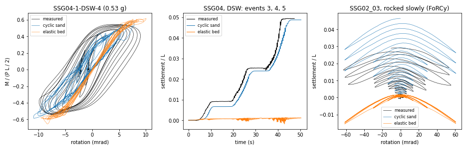
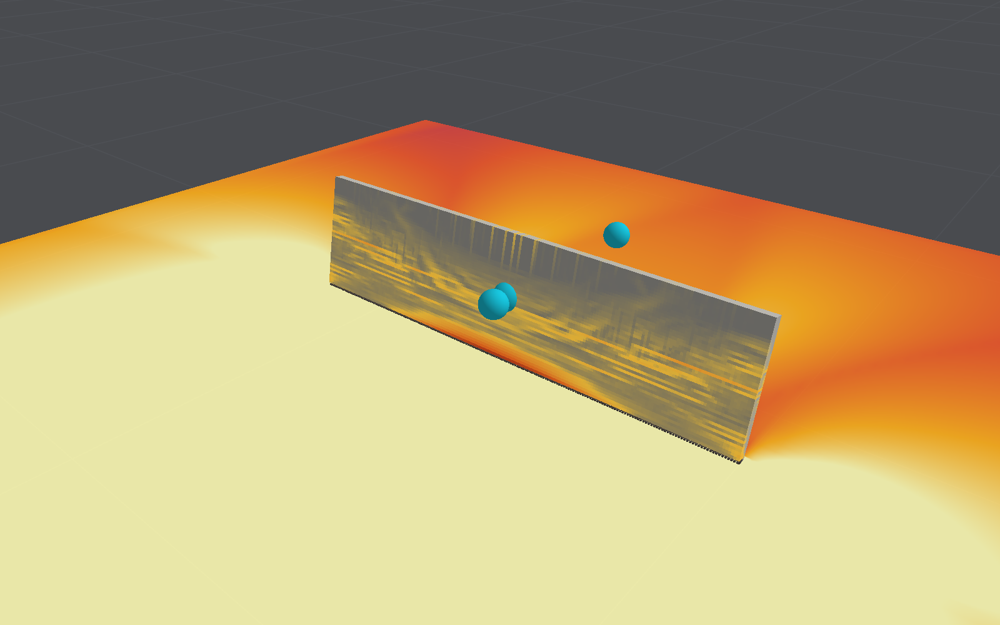

# Validation

What has been checked, against what, and how far the results can be trusted. "Verification"
here means agreement with theory (is the model solved correctly?); "validation" means agreement
with measurements (is it the right model?).

All of it can be reproduced:

```bash
swift test
```

```bash
swift run -c release blastbench slab --sensitivity
```

```bash
swift run -c release blastbench beam
```

```bash
swift run -c release blastbench shear --layers 24,36
```

```bash
swift run -c release blastbench pushoff
```

```bash
swift run -c release blastbench impact --layers 16
```

```bash
swift run -c release blastbench closein
```

```bash
swift run -c release blastbench contact
```

```bash
swift run -c release blastbench closeair --dx 0.01
```

```bash
swift run -c release blastbench validate
```

```bash
swift run -c release blastbench chamber
```

```bash
swift run -c release blastbench perimeter --study air
```

```bash
swift run -c release blastbench perimeter --study wall
```

## Summary

| Area                 | Evidence                                             | Confidence                         |
|----------------------|------------------------------------------------------|------------------------------------|
| Air solver numerics  | Exact solutions                                      | High                               |
| Blast loads          | Kingery–Bulmash curves from 0.75 to 6 m/kg^(1/3). On today's defaults, afterburning, hot air and far-field faces ([since 15 October](#the-defaults-since-15-october)): impulse on a wall 8–15% high on 0.25 m cells beyond 1.5 m/kg^(1/3), the incident impulse within 4% from 1 m/kg^(1/3) (fitted), the incident peak 78–86% and the reflected 38–87% on 0.25 m cells. On the ideal gas: impulse on a wall within 6% on 0.25 m cells beyond 1.5 m/kg^(1/3), the incident impulse 13–22% low. Refinement gives the next finer grid's peaks | Peaks read low, the unsafe side (under-resolved), refinement helping; impulse on walls 8–15% high on today's defaults (the safe side), within 6% on the ideal gas, good; incident impulse within 4% on today's defaults (fitted), 13–22% low on the ideal gas (the unsafe side for what the wave passes over) |
| Gas in a closed room | UFC 3-340-02's design curve (read off its chart by hand): 48% to 114% by default; 98% to 108% with afterburning and hot air; 90% of Cooper's closed vessel, burnt out | Either way within 8% with afterburning and hot air, good, the fitted burning time hardly mattering, against a design curve whose scatter is not given; by default low for light charges (half, the unsafe side) |
| Structural numerics  | Beam and wave theory                                 | High                               |
| Concrete material    | Its own curves; section analysis of a beam           | High that it does what is intended |
| Structural response  | One slab test: solid elements 113–125 mm (104–115%) on 4 to 32 elements through, rising with refinement and not converged, the same on 32 with half the step (on the earlier 50-step average of the strain rate it, and a strip of it, ran away there; 92–98% under the earlier strain-rate laws), shells 135 mm (124%), against 109 mm; the test's repeat peaked at 113 mm, a scatter of about ±2%; a 5% change in its hand-read load moves the peak 13–14%, and a source's 68 ksi yield for the bars, against the measured curve's 72, 9%. The contest's lower shot, run openly with a scaled record, reached about 80% of its peak. One beam bent to failure: peak moment 101% on 12 elements, failing at 44 mm against 42 mm, 100% on 24, holding to 60 mm, but breaking at 11 and 7 mm on 36 and 48, before the test's yield (12 October defaults; see [convergence](#convergence-on-todays-defaults)). One beam without stirrups failing in shear: 104–111% on 24 to 48 elements, 132% on 12, not converged, failing suddenly as the test did. Seven drop-weight impacts on beams: with stirrups within 12–23% under light drops and −5% to −1% under heavy ones on 16 elements (+2% to +18% and +17% to +28% on 24), struck about twice as hard as measured, the reactions up to 40% low under the heavy drops and 48% high under the light; the beam without stirrups broken by the heavy drop as in the test, and damaged by the light one it survived. Nineteen on beams without stirrups at rising speeds: within the 2 mm reading at 1 m/s and 15% at 3 m/s, 22% on average beyond on 16 elements (16% before the strain-rate window, the beams that broke moving by up to two thirds either way) and 53% on 24 on the earlier defaults, springing back too far, and decided by how the ends were held (clamped, stiffer than the test's static stiffness). Eighteen short beams struck to shear failure (Peterson et al., 2026): forces as measured at a shear span of one depth (the impact force set by a pad fitted to it), the deep beams too stiff; the beams with stirrups that crushed their strut in the tests hold | Unsafe side in shear: 4–11% too strong on 24 to 48 elements, 32% on 12, not converged, struck beams failing by the wrong mechanism and Peterson's struts holding where the tests crushed (low: one static test); 6 elements through 17% strong in bending. Bending of one slab either way by load: 4–15% high under the contest's load, rising towards 19% as the mesh is refined, 12–21% low (too stiff, the unsafe side) under its lower shot, not converged (moderate, on the meshes that agreed); impact either way on 16 elements but not on finer meshes, which settle 12–75% high, where the strain-rate laws, chosen among published laws on these tests, decide it (moderate on one mesh). Every structural figure here holds on the mesh it was found on ([convergence](#convergence-on-todays-defaults)) |
| Close-in charges     | Reflected impulse within 8% of Kingery–Bulmash from 0.3 m/kg^(1/3) on fine enough cells; full-scale slabs under 2–15 kg at 0.5 and 1 m: gauges beside the slab 75–80% of the paper's text (55–60% of its Figure 9), the impulse under the charge 84–95% of Kingery–Bulmash's, for charges given as TNT equivalents; the slab left a third to a half as far down as measured, spalled only under the charge (on fine air and 12 elements through), and not holed | Unsafe side for damage: the slab bends a third to a half as far, spalls too little and is never holed (low); the load either way within 8%, good |
| Steel in both faces | Wu et al. (2023): 2 m slabs, one layer or two, within −20% to +7% at the peak under 1.6 kg at 0.43 m/kg^(1/3), two shots on one mesh, 40–70% (too stiff) in the six under 0.2–0.8 kg where the tests spalled; contact charges hole them at a stable step to a half and a third of the measured size (the larger holes at the default step were the step running away). Wang et al. (2022): an aluminised charge's impulse 75–82% as its stated 10 kg of TNT, 81–86% with afterburning and hot air; the slabs several times too stiff as supported | Unsafe side under the small charges: 40–70%, too stiff (low); either way under the larger, −20% to +7% (moderate, two shots); holes a half and a third of the size; low for one layer against two and spall |
| Walls in the open    | Alsubaei (2015), ANFO before perimeter walls: column peaks with no wall within about 10% from 9 m out (a quarter to two thirds high at 8.2 m, where the measured are low); the wall's shielding bracketed, not tested, as the wing walls' length is unknown; walls crack where seen but more widely, rock or slide on their footings in sand; reinforced blockwork top 31 mm against 28 mm as one material, running away as units and joints | Moderate for peaks in the open; low for shielding and for the walls
| Internal explosion   | One full-scale chamber test: peak wall pressures 0.9 to 1.6 times those measured; the roof's edge is left 25 mm up against 95 mm measured, a quarter, and peaks at 48 mm against 87 mm in the paper's own model, with the confined regime's pressed interlock (15 and 38 mm without); on 25 mm elements the peak rises to 65 mm and the wall tops tear, so it has not converged | Unsafe side, too stiff: the roof's edge left a quarter as far up as measured (low); the joints' inclined cracking decides it, and the crack models disagree |
| Fireball radiation   | Two TNT shots by one group (DREO), with afterburning and hot air, today's air (copying faces, which leave the street's share unchanged): 100 t, whose total a 100 kg run scaled by the cube root exceeds three to five and a half times (afterburning alone radiates more, 29% against 21%); Dial Pack, 500 t, against which the pulse is a sixth as bright at its first maximum, dark from 40 to 350 ms and two to five times too bright after 1 s, 3.9% radiated by 2 s against 2.4%; with gravity it rises but stays as hot, with or without sub-grid mixing | Too bright in all (three to five and a half times), too faint early: illustrative; afterburning keeps the fireball near the flame temperature |
| Cloud               | Church's tops of 22 TNT clouds of 54 to 1,270 kg: within 4% on average for the first two minutes (a geometric spread of 21% shot by shot), falling behind later; with afterburning, whose burning time was fitted to the open blast, and an entrainment coefficient whose plausible range moves the tops by −9% to +13% | Either way, within 4% on average (21% shot by shot): illustrative; see [the fireball's rise](fireball-rise.md#against-churchs-measured-clouds) |
| Gas deflagrations    | A closed sphere against the thin-flame model: burns out at the fitted AICC pressure, conserving energy; laminar rise times within 1–3% at 48 cells across the radius (the default flame, cellular, 13–14% ahead); K_G 60 against 76 on 96 cells, unable to converge on a four-cell front. FM Global's six tests (digitised): lit at the back wall, 0.8–1.6 times the measured peaks; lit in the middle, about 0.4, the flame stalling towards the back wall. Vented rooms: a ninth to a twenty-fifth of Molkov's correlation, which those tests show conservative | Verified for a laminar flame in a closed vessel; illustrative for vented rooms |
| Foundations          | One footing rocked slowly on dry sand (centrifuge, FoRCy SSG02_03): moment within 11% to 14 mrad of rotation (against the larger of its two directions), 5–14% low beyond; settlement 1.3–1.7 times that measured. The same footing shaken (FoRDy, eight events on three structures): settlement 0.4–1.3 times (0.6–1.3 but for the embedded footing's first event), the surface footing's peak rotation within 10% where the test did not lurch one way (the embedded footing's first event a quarter); energy a cycle 0.5–1.2 times slowly and 0.3–1.2 times shaken, damping ratios 10–27% against 17–32%. Both on sand of 80 MPa, an estimate, twice the default's; the sand's heave set on the slow test | Rocking moment either way to 14 mrad and 5–14% low beyond (moderate); settlement within a factor of 1.7 (moderate); energy too little, a sixth to two thirds of a shaken event's (low), as for a footing that lurches; on a sand twice the default's |
| Held out (blind)     | Hrynyk's three plain slabs struck repeatedly by a falling weight, predicted on frozen defaults before the measurements were unsealed: first impacts 1.15–1.29 times the measured peak (too flexible, as the calibrated beams were); later impacts 0.56–0.83, residuals a seventh to a third, and none of the three slabs' punching failures predicted. Mendonça's seven slabs under an open-air charge: the two nearest the charge collapsed, the model leaving them standing; the declared peaks 0.31–1.23 of measured on the survivors, those near 1 made by an artefact of the sleeping air as the slabs landed after the blast threw them up; the blast's own peak a tenth to a quarter of the meters' | Hrynyk: between, by the protocol's rule, the calibrated error on undamaged slabs, much worse and on the unsafe side once they are damaged. Mendonça: worse, by the rule, far too stiff and too strong, the unsafe side |
| Collapse and debris  | Debris off six slabs under contact charges (Hupfauf, 2024): the far face thrown 1.1–1.7 times as fast as the debris at first, its cover cracked loose over about the spall crater on the thinner slabs, but the loose layer held back rather than thrown, and no slab holed where four of these were; the charge's impulse about twice the products' own. [Brick walls](#brick-walls-debris) (Keys, 2016): loads within 15%, but the walls break into too few pieces, falling at full length in the open (means of −2 to +2 m against +0.2 to +0.6 m) and thrown half as far as measured in a shock tube. Collapse once, blind: [Mendonça's slabs](#blind-test-2-mendonças-slabs-under-an-open-air-charge), the two that collapsed left standing | Unsafe side for debris: held back rather than thrown, slabs never holed, brick walls thrown short (low); collapse missed in both slabs that collapsed (blind) |
| Input uncertainty    | [Ensembles](#the-models-spread-from-uncertain-inputs) of nine cases over their uncertain inputs (strengths, bars, charge, standoff, unclear supports): loads spread 1–2%, structural responses 4–20%, residual deflections and failure 17–28%; the measurement within the model's 5th to 95th percentiles in 10 of 20 outputs; as wide as the tests' own scatter where they were repeated | How much of an error the inputs could explain: where the model misses, little |

No structural result has yet been shown to converge on today's defaults: the meshes quoted as
agreeing are the coarse end of each sequence, results that settle do so above the measurements,
and failures change with the mesh and the step (see [Convergence on today's
defaults](#convergence-on-todays-defaults)).

Read with the table:

- **The defaults were chosen with these tests in view.** The concrete's tensile strain-rate law
  was made the default because it brought Saatci's beams with stirrups closest, and the bars'
  law after Ando's beams (with independent support from tension tests of bars); the contest
  slab moved from 93–99% to 105–115% with them. Perfect bond over bars that slip, the removal
  rules and the interlock cap were likewise kept or set aside by these comparisons. The
  structural tests are a calibration set as much as a validation set. Two have since been run
  blind: [Hrynyk's slabs](#blind-test-1-hrynyks-slabs-struck-by-a-falling-weight) and
  [Mendonça's slabs](#blind-test-2-mendonças-slabs-under-an-open-air-charge), below.
- **Supports are assumed** in every structural test, the sources rarely describing them, and
  they move the results by 15–25% (the contest slab, Wu's slabs) or more (Ando's beams, Wang's
  slabs).
- **Most tests are single specimens.** Only Peterson's beams were tested in pairs.
- **Charges other than TNT** (PG2, dynamite, SEMTEX 10, an aluminised charge) are taken at the
  TNT equivalents their sources give, which are themselves uncertain.
- **Kingery–Bulmash and UFC 3-340-02 are fits and design curves** to many tests, not single
  measurements; their own scatter is not given here.
- **Where the model errs, it mostly errs towards too little damage**: shear too strong, the
  chamber's roof and the close-in slabs too stiff, the small charges' slabs and Peterson's struts
  too strong; and, blind, Hrynyk's slabs never punched and Mendonça's slabs a tenth to a quarter
  as far down under the blast, two collapses missed.

See the [independent review](validation-review.md) for the evidence behind these notes.

## Blind test 1: Hrynyk's slabs struck by a falling weight

**Blind.** The record's first held-out test, run under [the blind-test protocol](blind-tests.md):
the model's defaults frozen at commit `1c85774`, a predictor that had seen no measurement, its
assumptions committed before its first run, its predictions committed with their hashes
(`69d5352`) before the measurements were unsealed, and scored by a session that chose no default.
Nothing here may be tuned: any later change that moves these slabs is calibration, reported
beside this result, never in place of it.

**The test.** T. D. Hrynyk's slabs (PhD thesis, University of Toronto, 2013): 1.8 m square and
130 mm thick, steel in both faces both ways, held at their corners, struck at the centre by a
300 mm square steel weight at 8 m/s, again and again, the mass rising from 150 kg by 30 kg. The
three plain slabs with records: TH2 (0.42% steel each layer), TH6 (0.27%) and TH7 (0.59%). Inputs
as the predictor had them: [Samples/Hrynyk2013](../Samples/Hrynyk2013/README.md). Measured: the
thesis's Tables 4.5–4.8 and its account of each impact; impact forces from the records where the
weight's accelerometers did not saturate, processed by a script fixed before any prediction.

**The model** (the predictor's [assumptions](../Samples/Hrynyk2013/predictions/assumptions.md)): 16
solid elements through, defaults throughout, no air; the weight's steel face bonded to the slab for
the first impact, as the calibrated beams were struck; corners on single seats above and below;
each impact 200 ms, the slab brought to rest between them.

**The predictor's changes, judged.** Its log records four changes after runs, none after any
measurement was seen. Change 1 (the corner seats clamped the slab against its free rotation) and
change 4 (the bonded face tore off on impact 1, so impacts 2–4 struck a loose piece of concrete
wherever it lay, not the slab's centre) corrected set-ups that contradicted the inputs, found from
the model's own outputs; they are legitimate. But change 4's remedy, a fresh face set on the slab
and striking through the solver's contact, is itself a modelling choice: on 16 elements the weight
leaves after 3.5–4.6 ms instead of 10–13 ms on impact 1, and strikes impacts 2–4 with about 920 kN
against 1,310 kN. Impacts 2–4 are therefore scored as declared, with that caveat; impact 1, the
primary score, is untouched by it. Changes 2 and 3 concern the secondary runs only.

**Results**, predicted (16 elements through) against measured, as ratios:

| Impact | Peak displacement, mm | Residual, mm | Peak total reaction, kN | Peak impact force, kN | Punched? |
|---|---|---|---|---|---|
| TH2-1, 150 kg | 17.1 / 13.2 (**1.29**) | 2.6 / 2.7 (0.97) | 502 / 556 (0.90) | 1,312 / not measured | no / no |
| TH6-1, 150 kg | 21.0 / 18.3 (**1.15**) | 5.0 / 6.2 (0.81) | 397 / 483 (0.82) | 1,307 / not measured | no / no |
| TH7-1, 150 kg | 15.3 / 12.8 (**1.20**) | 2.5 / 2.6 (0.95) | 565 / 605 (0.93) | 1,328 / not measured | no / no |
| TH2-2, 180 kg | 15.5 / 18.7 (0.83) | 0.9 / 3.0 (0.31) | 358 / 676 (0.53) | 924 / 1,455 (0.63) | no / no |
| TH6-2, 180 kg | 19.1 / 27.7 (0.69) | 2.8 / 11.4 (0.25) | 280 / 458 (0.61) | 917 / 1,090 (0.84) | no / **yes** |
| TH7-2, 180 kg | 13.5 / 18.3 (0.74) | 0.6 / 3.3 (0.18) | 359 / 588 (0.61) | 926 / 1,547 (0.60) | no / **yes** |
| TH2-3, 210 kg | 18.7 / 26.6 (0.70) | 3.1 / 8.9 (0.34) | 341 / 580 (0.59) | 924 / 1,325 (0.70) | no / **yes** |
| TH7-3, 210 kg | 16.1 / 28.5 (0.56) | 1.7 / 11.5 (0.14) | 356 / 368 (0.97) | 929 / 726 (1.28) | no / yes, further |

(TH2 and TH7 were stopped after three impacts and TH6 after two, so the predictions for later
impacts are unscored. The measured TH2-2 force is from one accelerometer, which the thesis flags.)

Scored as the protocol fixed:

- **Primary:** the first impact on each undamaged slab peaked 1.15–1.29 times as far as measured:
  too flexible, the safe side for deflection, and about as the calibrated beams were under Saatci's
  light drops (12–24% too flexible). One of the three lies outside the protocol's 0.75–1.25.
- **Over all eight impacts:** peak displacement 0.56–1.29, geometric mean 0.86, mean absolute
  error 26%; residual a seventh to the full measured value, geometric mean 0.39; total reaction
  0.53–0.97, geometric mean 0.73; impact force, where measured, 0.60–1.28, geometric mean 0.78.
- **Punching:** all three slabs punched in the test, TH6 and TH7 on the second impact and TH2 on
  the third; the model punched none in four impacts, on either mesh. None of three first punching
  impacts predicted: **the unsafe side**.
- **Verdict, by the rule fixed beforehand:** *between* the calibrated record and worse. Not "as
  good", since one primary ratio exceeds 1.25 and punching is missed throughout; not "worse",
  since every primary ratio lies within 0.5–2 and the peaks' mean error is under 50%.

**Read against the calibrated record.** On the undamaged slab the blind error is the calibrated
error: 15–29% too flexible against 12–24% on Saatci's light drops. Once the slab is damaged the
model is too stiff and too elastic: later impacts peak 17–44% short, the slab springs back to a
seventh to a third of the measured residual, and the punching shear failure that ended every test
never forms. That is the record's known weakness, shear strength too high and broken concrete
kept, now seen blind. The calibrated comparisons had not shown how large it is on repeated impact.

**The secondary runs** (reported, not scored). On 8 elements through, the first impacts are within
5% of the 16-element ones (16.5, 19.9 and 15.1 mm), but impacts 2 and 3 come out much closer to
the test (21.4, 26.0, 26.5, 19.2 and 23.4 mm against 18.7, 26.6, 27.7, 18.3 and 28.5), with
reactions of 430–640 kN and impact forces of 1,550–1,670 kN. The weight's contact on the
re-seated face (change 4) evidently behaves differently on the two meshes, so the later impacts
depend on the mesh through the contact as much as through the slab. That is not a better
prediction, since the protocol scores the declared mesh; it says the repeated-impact results are
not converged. Neither mesh punches. The predictor's 4-sample input spread (on 8 elements) puts the
first impacts' peaks within about ±3–4% of its own centre, far narrower than the error.

Outputs and the scoring script: `/Volumes/StudioData/bombcad/blind-results/hrynyk/`.

### What holds the cone, traced

After the reveal, so calibration and not the blind result: `blastbench hrynyk --cone --work` follows
elements on a 45° line out from the face's edge, the concrete under the face, both faces' sag across
the cone, and the cone band's work by mechanism. TH6 and TH7, 8 elements through, on main with the
100 µs rate window (whose old 50-step average gives the same punching picture). On 8 elements the
re-seated face delivers the second blow (1,520–1,620 kN, peaks 25.8 and 18.9 mm against 27.7 and
18.3), so the load is there; neither slab punches.

- **The cone forms but does not move.** Cracks of 1 mm or more cross every layer within 450 mm, and
  at mid-depth the cone's crack lies about 25° from horizontal, a punching cone's angle. It opens to
  0.7 mm and stops, carrying under 1 MPa of shear against an interlock cap of 1.6. The plug never
  steps down: the top face drops 0.5–1 mm more inside the face than just outside it, against the
  measured 20 mm (TH6-2) and 10 mm (TH7-2). Instead the slab thickens under the face, the bottom
  sagging 4–9 mm more than the top, and the bottom face stays smooth across the cone, carried by
  the bottom bars: delamination, not a plug.
- **No one mechanism holds it.** In the cone band on TH6-2 the work is hourglass control 38%
  (mostly at its cap), aggregate interlock 29%, bars 16%, dowels 8%. Take one away and the next
  takes the shear: interlock at 0.2 doubles the dowels' work; hourglass control that softens with
  cracking moves its share into interlock (peak 30.8 mm, step 3.4 mm); all three together leave
  the first impact twice as flexible as measured (38.6 mm) and the bottom peels 26 mm off the top,
  held by its bars, still with a 4 mm step. None punches.
- **Confinement and rate do not decide, as in Peterson's beams.** The cone's confinement gain is
  about zero and its strain rate 1–25/s; confinement off moves TH6-2 by 1%, rate laws off by 10%,
  and neither punches. Under the face the concrete is pressed confined (gain 0.15–0.3, −55 to −80
  MPa), reaches 0.5% strain against the 15% that would crush it out, and never compacts: the face
  does not indent (0.1 mm against 3.5 measured after TH6-1).

**The lock, isolated.** `blastbench shearband` cuts a block in plane strain with a band that
cracks at once and carries no shear, opens it 0.2 mm and slides it 5 mm. Along the lattice it slides
for nothing (shear under 0.1 MPa after the first millimetre). At 45° across it, as a staircase, it
takes 7.5 MPa of shear and 15 MPa of compression, and crushes: 354 J against 3.5. Not dilatancy
(7.1 MPa without it), not the band's width (5.2 MPa three wide), not the element size (10.3 MPa on
8 mm elements), and hourglass control that softens with cracking leaves it (7.3 MPa). Each band
element fixes its crack axes from its own strain, at 14–38° rather than 45°, and sliding along the
band then shortens a misaligned axis until it crushes; a quarter of the band's work also goes into
hourglass control at its cap. Hrynyk's whole punching stress is about 5 MPa, so a 45° cone cannot
slide out however weak its concrete is made. That is the miss: the cone's kinematics, not any
mechanism's strength. An embedded crack whose jump takes each element's own motion across it was
then tried and not adopted: it freed the band by three-quarters but softened the slabs' first
impacts to 1.4–1.7 times the measured peaks
([record](concrete-model.md#embedded-cracks-tried-and-not-adopted)). Punching stays not predicted. Runs: `/Volumes/StudioData/bombcad/concrete-stages/hrynyk-runs/`.

## Blind test 2: Mendonça's slabs under an open-air charge

**Blind.** The record's second held-out test, under [the blind-test protocol](blind-tests.md):
defaults frozen at `047cee3`, after test 1's reveal. A fresh predictor that had seen no
measurement committed its assumptions (`efc6fc6`, rebased from `c298d6b`) before its first run,
and its predictions with their hashes (`96083e6`). The judge checked the SHA256SUMS, the harness
files' identity across the rebase (`git diff` of each old and new commit pair is empty over the
harness and the sample folder) and the sealed folder against its manifest, then unsealed it.
Nothing here may be tuned.

**The test.** F. B. Mendonça, G. S. Urgessa and colleagues (2018, 2020, 2021; records on the GMU
Dataverse, CC0). Field blasts at DCTA, Brazil: slabs 1.0 m square and 80 mm thick, with a light
mesh in the bottom face only. Each rested on timber trestles along two sides, 0.4 m above clay,
not tied down, with 2.6–2.8 kg TNT-equivalent of PBX hung above its centre. Slabs 1 and 10 had the
charge at 1.3 and 1.6 m (0.93 and 1.16 m/kg^(1/3)), and the two repeat groups at 2.0 m (about 1.44
m/kg^(1/3)): A (slabs 2 and 5, 53 MPa, two 10 mm bars added one way) and B (slabs 4, 7 and 9, 62 MPa,
a denser mesh). Inputs as the predictor had them: [Samples/Mendonca2020](../Samples/Mendonca2020/README.md).
Measured: each slab's outcome from the papers, and the two pull-wire meters at the centre and
eight pencil gauges, processed by a script fixed before any prediction
([reveal](../Samples/Mendonca2020/reveal/)).

**The model** (the predictor's [assumptions](../Samples/Mendonca2020/predictions/assumptions.md)):
defaults throughout, 8 solid elements through (10 mm), uniform 12.5 mm air, the charge a TNT
sphere with its centre at the stand-off, bearings 100 mm wide on rigid lines (clear span 0.8 m),
the slab free to lift off, each run 500 ms.

**The predictor's changes, judged.** Five changes, none after any measurement was seen:

- Change 1 makes the gauges follow the slab's face. Before it, the rotating edges swallowed the gauge
  cells, which then read frozen values. It corrects a harness error against the inputs, so it is
  legitimate.
- Change 2 lengthens the runs from 200 to 500 ms, before any primary run, because a slab thrown up
  had not come to rest. The protocol asks for that, so it is legitimate.
- Changes 3–5 concern the secondary runs only.

The primary prediction was run on the frozen model with the harness at `c5721b2` (`e512afb` on
main).

**Results**, predicted against measured (mm):

| Slab | Stand-off | Outcome | Declared peak (q. 2) | Blast's first peak | End (q. 3) |
|---|---|---|---|---|---|
| 1 | 1.3 m | survives / **collapsed** | 10.9 / — | 10.3 at 8 ms / — | 8.3 / — |
| 10 | 1.6 m | survives / **collapsed** | 14.7 / — | 5.9 / — (the meters ran out to 145 and 499 mm) | 14.1 / — |
| 2 | 2.0 m | survives / survived | 11.7 / 38.2 (**0.31**) | 3.8 at 4 ms / 38.2 at 15 ms (0.10) | 9.4 / 25.9 (0.36) |
| 5 | 2.0 m | survives / survived | 13.2 / 23.5 (**0.56**) | 3.6 / 23.5 at 45 ms (0.15) | 11.0 / 21.6 (0.51) |
| 4 | 2.0 m | survives / survived | 25.1 / 20.4 (**1.23**) | 4.3 / 16.9 at 39 ms (0.25) | 23.2 / 20.3 (1.14) |
| 7 | 2.0 m | survives / survived | 22.8 / 25.8 (**0.88**) | 4.1 / 22.3 at 43 ms (0.18) | 20.8 / 25.3 (0.82) |
| 9 | 2.0 m | survives / survived | 21.8 / 24.0 (**0.91**) | 4.4 / 22.1 at 44 ms (0.20) | 20.1 / 24.0 (0.84) |

The declared peak is the largest downward displacement in the run. The measured peak is the
meters' mean, read downward as the sealed rule fixed. The blast's first peak is the model's
`blast_peak_mm`, set against the meters' first downward peak, read by the judge after the reveal
([phases.json](../Samples/Mendonca2020/reveal/phases.json)).

Scored as the protocol fixed:

- **Primary:** outcomes 5 of 7. Slabs 1 and 10, nearest the charge, collapsed; the model left them
  standing, only cracked: **the unsafe side**. The declared peak on the survivors gives group A a
  mean ratio of **0.40** (0.31 and 0.56), below the group's measured range of 22–40 mm. Group B
  gives **0.99** (1.23, 0.88 and 0.91), inside its range of 19–26 mm.
- **Verdict, by the rule fixed beforehand: *worse* than the calibrated record**, since group A's
  ratio lies outside 0.5–2. Five right outcomes alone would have been *between*.
- **End displacement:** 0.36–1.14, the same pattern as the peak, for the reason below.
- **Pressures at the corners** (1, 3, 4 and 6, one dead channel left out), with the model's
  ratios to measured:
  - At 2.0 m, peaks have a median of 0.67 (0.30–1.67) and impulses 0.73 (0.29–1.89).
  - At 1.3 and 1.6 m, peaks have a median of 2.2 and impulses 2.1.
  - The measured corners of one slab differ by 1.7–4.5 times, where the model's agree within 3%.
  - Slab 1's measured corner pressures, under the nearest charge, are no higher than at 2.0 m,
    which a centred charge would not give.

  The gauges' scatter swamps the comparison. At 2.0 m the model's load may be a quarter to a third
  low.
- **Damage:** the tests show radial cracking on slab 5's bottom face and on slab 10, and concentric
  circles on slab 1's top face as it collapsed. Slab 5 also has a main crack right across the
  section with less steel, where the 2021 paper says it collapsed in that direction only, and slab 2
  was similar. The model shows cracks parallel to the supports, banded about mid-span, made mostly
  by its landing; no crushing or spall, of which the papers describe none on the survivors either.
  The radial pattern of a load concentrated at the centre is missing.
- **The predictor's uncertainty** brackets the measured peak on four survivors, slab 2 lying above
  its band, but on the 2.0 m slabs those bands measure the landing's sensitivity, not the blast's. No input sample collapses slab 1 or 10.

**The landing, judged.** The predictor warned that on every slab but slab 1 the declared peak and
end come from the slab landing, after the reflected wave beneath threw it off its trestles. It
blamed an artefact of the frozen air. Checked:

- **The throw-off is physical, and the test shows it.** After its first downward peak each 2.0 m
  slab's centre rose 15–45 mm over the next 60–110 ms. Slab 4 went 28 mm above where it started.
  The slabs settled 170–330 ms after onset, as the model's slabs leave their trestles and land at
  160–225 ms. The centre meters cannot tell whether the real slabs left the trestles.
- **The landing's depth is an artefact.** The predictor's diagnostic run of slab 4 falls at 1 g
  until 150 ms. Then, between 150 and 170 ms, it accelerates downward at about 11 g while both
  bearing lines are still 20–40 mm up, a push of 15–20 kPa that quiet air cannot give.
  - The cause is the frozen solver's sleeping air: while it sleeps the structure is still loaded
    from the frozen state and mask, without remasking.
  - With the air kept awake (a secondary run) the 2.0 m slabs land only 1.8–3.9 mm down.
  - The explanation holds.
- **So group B's 0.99 is not evidence of accuracy.** The model's 20–25 mm there is the frozen air
  driving the slab onto rigid supports; the measured 20–26 mm is the test slab's first peak and its settling after
  it landed. The agreement is a coincidence.
- **Fixed since (2026-10-15), not re-scored.** The solid outline now follows the structure while
  the air sleeps (see [freezing the air](air-blast-model.md#freezing-the-air)). On today's main,
  at the primary's settings, slabs 4, 5 and 7's largest downward displacement is the blast's own,
  4.3, 3.7 and 4.1 mm at 4 ms, where the landing gave 17.6, 15.0 and 18.0 mm. Thrown up 40–50 mm,
  they fall freely and are still bouncing on the rigid trestles at 500 ms. The blind record above
  stands as scored at its frozen commit.

**Secondary reading: the blast's first peak** (not a re-scoring). Against the meters' first
peaks the model's blast peak is a tenth to a quarter: 3.6–4.4 mm at 4 ms against 17–38 mm at
15–45 ms. The group means are A 0.12 and B 0.21; by the protocol's thresholds that too is *worse*,
and by far.

- **The meters may include the supports.** They measure the centre's absolute movement, so part of
  the measured peak may be the trestles pressed into the clay. The source's own pre-test check found
  the supports moving, and the authors put slab 2's 25 mm residual down to them.
- **The timing fits either cause.** The meters' first peaks come 40–45 ms after onset on four
  slabs, ten times the model's time to peak. That fits a slab far softer than the model's, or
  moving supports.
- **Either way the slabs bent and broke far more than the model's.** Each residual is within 4 mm
  of the first peak on slabs 4, 5, 7 and 9, after the slab had risen and landed again. No movement
  of the supports explains the two collapses.

**Read against the calibrated record.** The calibrated open-air slabs were 40–70% too stiff under
Wu's small charges and a third to a half as far down close in (Chiquito). Here the blast peak is
a tenth to a quarter of the meters' at 1.44 m/kg^(1/3). The two slabs at 0.93 and 1.16 m/kg^(1/3)
collapsed, where the model's are barely cracked. This was the record's first comparison of
collapse, and both collapses were missed. The standing's band for a slab's peak deflection under a
blast, 0.79–1.19 from the calibrated contest slab (0.79–1.17 at the frozen commit), does not carry over to these slabs. This is the
record's known direction of error, too stiff and too strong, the unsafe side, seen blind and
larger than any calibrated comparison showed. The candidate causes, for later work and not the
score, are:

- the cylindrical charge fired from its top, which throws more of the blast down;
- trestles that sink and timber that gives;
- the light mesh's bars and their bond;
- the load, a quarter to a third low at the 2.0 m gauges;
- the shear and tension strength kept in the cracked concrete.

**The secondary runs** (reported, not scored):

- The calibrated record's air, 16 elements, a higher charge, timber bearings and the other layout of
  slab A's bars each move the blast peak by at most a quarter.
- The 2021 paper's account reads as the 10 mm bars running across the span, the predictor's
  secondary layout, which gives 4.4 mm.
- On every setting every slab survives.

Outputs and the scoring scripts: `/Volumes/StudioData/bombcad/blind-results/mendonca/`.

**Diagnosis after the reveal** (calibration now, not a re-scoring). Why the model's slabs are several
times too stiff and too strong, candidate by candidate, on today's model (`8a44a1a`, the 100 µs
strain-rate window), the air kept awake so that the sleeping-air fault does not enter, slabs 4 and
2 (2.0 m) and slab 1 (1.3 m), 30–150 ms each, half on the CI mini; `blastbench mendonca` with the
switches named; outputs in `/Volumes/StudioData/bombcad/mendonca-diagnosis/`. The model's first
peak at 2.0 m is 3.8–4.3 mm at 4 ms against 17–38 mm at 15–45 ms measured:

| Candidate | Change | First peak, slabs 2 and 4 (mm) | Slab 1 at 1.3 m (mm) |
|---|---|---|---|
| None | | 3.8, 4.3 | 10.1, stands |
| The load | charge ×1.5 (the corners' median 0.67), the centre's impulse 477 → 637 Pa s | 5.4, 5.7 | 19.9, stands |
| | charge ×2 (impulse ×1.6) | 6.5, 7.0 | 30.7, stands |
| | afterburning (impulse +2%) | 3.7, 4.4 | 11.9 |
| The supports | timber rails | 4.4, 4.5 | 18.6 |
| | soft supports yielding at 131 kPa (assumed: trestle legs on clay) | 3.9, 3.9, left 2–3 mm down, no throw | |
| | the same, softer (60 kPa) | 4.3 at 18 ms, 4.4 at 14 ms | |
| The mesh and its bond | bars that slip (`--bond splitting`) | 3.7, 4.0 | 9.0 |
| | the bars' yield ×0.5 / ×2 | 4.3, 4.7 / 3.5, 3.8 | |
| Cracked concrete | tensile strength ×0.5 / ×0.25 | 3.8, 4.3 / 3.9, 4.5 | 11.4 / 13.2 |
| | fracture energy ×0.5 | 3.6, 4.0 | 10.1 |
| | the strain-rate laws off | 3.9, 4.4 | 12.1 |
| The air | a rigid block under the slab (the underside's impulse 435 → 161 Pa s) | 3.9, 4.7 | |
| | the domain 5 × 5 × 5 m instead of 3 × 3 × 3.2 | 3.8, 4.3 | |

- **The load** accounts for little. The centre's impulse, 477 Pa s at 2.0 m, is what a rigid-plastic
  slab of the light mesh's strength (about 40 kPa) needs to move about 25 mm. Raising it to the
  corner gauges' median moves the peak by 40%; reaching the measured peaks would take four to nine
  times the impulse. Afterburning adds 2%. At 1.3 m the model's corner pressures are already 2.2
  times the measured.
- **The supports** change the timing and the throw, not the size. Soft, yielding supports leave a
  2–3 mm permanent set and no rebound, and push the peak to 14–18 ms, as measured, but the centre
  still moves about 4 mm. The meters' absolute readings may include some sinking of the trestles,
  but nothing in the sources fixes how much.
- **The mesh and its bond** move the peak by under 15%.
- **The concrete's strengths** move it by under 7% at 2.0 m and a third at 1.3 m. With a quarter of
  the tensile strength the slab cracks over twice the area (618 surface elements on the bottom
  face against 340) and peaks at the same 4.5 mm: the cracked elements go on carrying the load.
- **The air beneath** pushes back from 3 ms (851 kPa under the centre), but cutting it to a third
  leaves the peak within 10%, and a larger domain changes nothing.

Taken as a rigid-plastic slab, the model's 4.3 mm implies a resistance of about 220 kPa; the light
mesh can give about 40 kPa, and the tests' 17–38 mm imply about that. The excess does not lie in
the load, the supports, the bars, the bond or the concrete's strengths: the cracked concrete keeps
its stiffness and strength across the cracks, so no hinge forms, and slabs 1 and 10 cannot fail by
the concentric, punching-like pattern their tests showed. **Proposal: none affordable now.** The
change that targets this is the embedded crack (E-FEM) the concrete session is building, which lets
a crack across an element soften without the element's other planes holding it; the cheap knobs
above cannot bring Mendonça within the bands without breaking the calibrated comparisons, and
supports soft enough to give the measured peaks would be a fit to unknown trestles. Rerun this
table when the embedded crack lands.

**Where the resistance lies at the first peak** (16 October 2026; calibration).
- **The method.** At the first peak, the work each mechanism has done, in elements that have
  cracked and in those that have not. Each is put as a uniform pressure: its work over the volume
  the bottom face has swept.
- **The cases.** Slabs 4 and 1, and Hrynyk's TH6-1, on 8 elements at the 100 µs window.
- **The diagnostic.** Hourglass stiffness scaled in cracked elements only, to ×0.5 and ×0.1.
- **The tools.** `blastbench mendonca|hrynyk --account [--cracked-hourglass 0.1]`, on branch
  `claude/hourglass-account`, not on main.
- **The check.** The rounding variant agrees within 2%.

| Case, first peak | Concrete, cracked / uncracked (kPa) | Bars | Hourglass, below / at its cap | Total | First peak, hourglass in cracked elements ×0.5 / ×0.1 |
|---|---|---|---|---|---|
| Slab 4, 4.30 mm | 36 / 11 (36%) | 62 (47%) | 8 / 15 (17%) | 131 | 4.31 / 4.32 mm |
| Slab 1, 10.07 mm | 104 / 10 (37%) | 120 (39%) | 16 / 58 (24%) | 307 | 9.63 / 10.25 mm |
| TH6-1, 20.3 mm | 114 / 0 (59%) | 38 (20%) | 18 / 20 (20%) | 193 | 21.1 / 22.0 mm |

**The excess is not mostly the hourglass control.** It does a fifth of the work at the first peak,
and cutting it to a tenth where the concrete has cracked moves the peaks by at most 8%.
- **The concrete in cracked elements.** Its largest parts are the concrete between cracks (the
  hairline channel, tension stiffening), aggregate interlock, and shear across and beside the
  cracks.
- **The bars.** At Mendonça they do 39–47% of the work. Halving their yield moves the first peaks by
  9–13% (the table above), so at the first peak they work mostly elastically.
- **Together.** The slab meets its first peak still largely elastic, cracked but stiffened across
  its cracks by the concrete between them and by elastic bars, where the tests' slabs yielded.
- **The embedded crack does not change this.** Tried since, to free cracks across the lattice, it
  softened cracked elements everywhere but left slab 4's first peak at 4.7–5.9 mm
  ([record](concrete-model.md#embedded-cracks-tried-and-not-adopted)).

**Cracked concrete's stiffness at blast rates, tried** (16 October 2026; calibration).
- **The variants:**
  1. the concrete between cracks without the rate's gain (it cracks at the raised strength, then
     carries tension from the static one);
  2. that tension fading as the bars crossing the crack yield, to nothing at a plastic strain of
     the yield strain (fib MC2010's loss of tension stiffening past yield);
  3. bond slip, already on record: Mendonça's first peaks fall to 3.7 and 4.0 mm, and elsewhere slip
     is too stiff ([bars that slip](#bars-that-slip-across-the-tests));
  4. a cracked plane's shear stiffness at 0.05 of the concrete's instead of 0.25;
  - and 1, 2 and 4 together.
- **The cases:** 8 elements, the 100 µs window, the air as on main at `c512c95` (no afterburning by
  default; Mendonça's air kept awake). Off, every variant is bit-identical.

| Variant | Mendonça 4 / 1, first peak | Schwer 1b, peak / residual | TH6-1 / TH6-2 | Wu S6 / S7 / D6 |
|---|---|---|---|---|
| Today | 4.30 / 10.07 mm | 59 / 30 mm | 20.3 / 25.8 mm | 3.9 / 7.4 / 3.9 mm |
| 1 | 4.21 / 10.18 | 59 / 31 | 21.2 / 26.3 | 4.0 / 7.6 / 4.1 |
| 2 | 4.31 / 9.92 | 59 / 31 | 20.2 / 25.8 | 3.9 / 7.4 / 3.9 |
| 4 | 4.28 / 10.28 | 60 / 29 | 22.5 / 28.4 | 4.0 / 7.7 / 4.0 |
| 1, 2 and 4 | 4.35 / 10.72 | 61 / 30 | 23.2 / 28.6 | 4.2 / 8.0 / 4.2 |
| Measured | 20.4 / collapsed | about 72 / 54 | 18.3 / 27.7 | 8.2 / 13.2 / 10.1 |

**None moves the targets by more than 8%,** where they stand at a fifth to four-fifths of the
measured values. Together they make Hrynyk's first impact, already too flexible, more so.
- **The bars' rate law** (`--static-steel`) moves Mendonça's first peaks by 2% and 8%.
- **So the stiffness lies elsewhere.** Neither the cracked concrete's stiffness nor its strength
  (the diagnosis above), the hourglass control, the bars' yield or their rate, nor bond slip holds
  Mendonça's slabs; one by one, each moves the first peak by under 10%.
- **The guard cases were not run,** there being no candidate to guard.
- **The options were not kept on main.** Under the [strategy's](concrete-strategy.md) rule for
  options that move nothing, they stay on branch `claude/stiffness-study`.

**Arching from the supports, ruled out by inspection** (16 October 2026). Compressive membrane
action needs a slab held in its plane at both supports. None of the too-stiff cases is.
- **Mendonça's trestles:** frictionless and one-sided, holding the slab in x along one line at one
  bearing only, and in y at two nodes.
- **Wu's beams:** frictionless, holding x at one edge (both edges only with `--held`, off by
  default).
- **The contest slab, Schwer's lower shot:** a pin and a roller.
- **Hrynyk's seats:** one corner pinned, two on rollers, one free.

Each is held in its plane only as far as it must be, so there is nothing to arch against. Releasing
the supports in-plane, the check proposed, is how they are already run. Chiquito's close-in slabs,
held along both edges, are the one benchmark that could arch, and they agree today.

**The stiffness line ends here.** The load, the supports, the bars, the bond, the cracked concrete's
strength and stiffness, the hourglass control and arching are each ruled out, by runs or by
construction, as what holds these slabs. What does is not found on these meshes.

**Nor is it the mesh** (16 October 2026). Slabs 4 and 1 were run to their first peaks on 8, 16 and
24 elements through, the elements kept cubic (10, 5 and 3.3 mm).
- **The air:** the harness's own (an ideal gas without afterburning, as in every Mendonça run so
  far), kept awake. The harness does not take the recommended air the benches now start from.
- **The step:** the structure's falls with the element, at about 1.2, 0.6 and 0.4 µs.
- **Rounding:** nothing failed before the first peaks, so no post-failure figure needed the
  rounding variant.

| Elements through | Elements | Slab 4, first peak | Slab 1, first peak and first 30 ms | Wall time (20 / 30 ms) |
|---|---|---|---|---|
| 8 | 80,000 | 4.30 mm at 4.0 ms | 10.07 mm, stands | 184 / 219 s |
| 16 | 640,000 | 4.19 mm at 3.9 ms | 9.17 mm, stands | 419 / 602 s |
| 24 | 2,160,000 | 4.32 mm at 3.9 ms | 10.02 mm, stands (702 elements removed) | 1,594 / 1,742 s |
| Measured | | 20.4 mm (meters 18.7, 22.2) | collapsed | |

- **No trend:** the first peaks move by under 10% with no direction, at a fifth and less of the
  measured, so nothing extrapolates towards the tests.
- **The bands stand:** Mendonça's bands, tied to their derived meshes, hold on any of these meshes.
- **Cost:** the 24-element runs cost nine and eight times the 8-element ones.

## Structural response against a real test

### The test

The normal-strength slab of the 2013 Blast Blind Simulation Contest, organised by the University
of Missouri–Kansas City with ACI Committees 447 and 370 and tested in the Blast Loading
Simulator of the US Army Engineer Research and Development Center, Vicksburg. The simulator is
a large shock tube that applies a uniform, measured pressure history to one face of a specimen.

| Property        | Value                                                                          |
|-----------------|--------------------------------------------------------------------------------|
| Slab            | 64 × 33.75 × 4 in (1626 × 857 × 102 mm)                                        |
| Supports        | Simple, 52 in (1321 mm) apart                                                  |
| Concrete        | 5,400 psi (37 MPa)                                                             |
| Main bars       | Nine No. 3 (9.5 mm) at 4 in, 1 in from the unloaded face                       |
| Cross bars      | No. 3 at 12 in                                                                 |
| Steel           | Yield 72 ksi (496 MPa), 118 ksi (814 MPa) at 8% strain, rupture near 15%       |
| Load            | Peak 50 psi (345 kPa), impulse 1,020 psi·ms (7.0 kPa·s), over 80 ms            |
| Measured        | Peak mid-span deflection 4.29 in (109 mm) at 29.94 ms, as stated (the plot reads about 4.25 in, 108 mm); about 3.55 in (90 mm) at 70 ms. A repeat, the same slab under the nominally same load, 4.45 in (113 mm) at 32.73 ms ([below](#the-contests-repeat-its-lower-shot-and-its-other-entries)) |

**Source of the data.** T. H. Kewaisy, A. A. Khalil and A. ElFouly, *Advanced Modeling of Blast
Response of Reinforced Concrete Walls with and without FRP Retrofit*, ACI Spring Convention,
2018, which reproduces the contest's specimen drawing, material curves, pressure record and
measured displacement history. The test programme itself is reported in G. Thiagarajan,
A. V. Kadambi, S. Robert and C. F. Johnson, "Experimental and finite element analysis of doubly
reinforced concrete slabs subjected to blast loads", *International Journal of Impact
Engineering* 75, 2015.

**How the data were taken.** The pressure record, the steel curve and the displacement history
were read off the published plots by hand. The pressure record was then scaled so that its
impulse equals the stated 1,020 psi·ms; the scaling was under 1%, and the scaled peak is
49.9 psi against the stated 50.

### The model

The slab is meshed with cubic elements, eight (12.7 mm) or four (25.4 mm) through its
thickness. It is supported on two lines of nodes on the unloaded face (a pin and a roller), and
the recorded pressure is applied to the other face. Gravity is ignored, since the slab stood
vertically.

Nothing was fitted to the test, though the concrete model was developed in steps each checked
against it (see [how the model got here](concrete-model.md#how-the-model-got-here)), so it is
not independent of the model's development. The concrete's stiffness, tensile strength and fracture energy
come from standard correlations with its compressive strength; the bars follow their published
curve; strengths rise with strain rate by published laws. Two inputs are assumptions: the crack
spacing (100 mm) and the aggregate size (16 mm).

### Results

| Case                             | Peak deflection | At    | At 70 ms | Elements failed |
|----------------------------------|-----------------|-------|----------|-----------------|
| **Measured**                     | **108 mm**      | 30 ms | 90 mm    |                 |
| Model, 32 elements through       | 124 mm (115%)   | 29 ms | 106 mm   | 60,152 of 4,423,680 |
| Model, 16 elements through       | 121 mm (112%)   | 28 ms | 98 mm    | 0 of 552,960    |
| Model, 8 elements through        | 113 mm (105%)   | 27 ms | 83 mm    | 0 of 68,608     |
| Model, 4 elements through        | 114 mm (105%)   | 27 ms | 88 mm    | 0 of 8,704      |
| With Malvar and Crawford's law for the bars: 16 through | 112 mm (103%) | 27 ms | 77 mm | 0 of 552,960 |
| 8 through                        | 104 mm (97%)    | 26 ms | 64 mm    | 0 of 68,608     |
| 4 through                        | 104 mm (96%)    | 26 ms | 84 mm    | 0 of 8,704      |
| With Malvar and Ross's tensile law: 32 through | 105 mm (98%) | 26 ms | 74 mm | 32 of 4,423,680 |
| 16 through                       | 107 mm (99%)    | 26 ms | 67 mm    | 0 of 552,960    |
| 8 through                        | 101 mm (93%)    | 26 ms | 66 mm    | 0 of 68,608     |
| 4 through                        | 100 mm (93%)    | 26 ms | 79 mm    | 0 of 8,704      |

The concrete's tensile strain-rate law is the fib Model Code 2010's by default, and the bars'
the CEB's (see the [concrete model](concrete-model.md#strain-rate-effects)); with them the peak
is 105–115% on 4 to 32 elements, rising with refinement from 8 elements on (113, 121 and 124 mm)
and not shown to converge (see the strip, below), and the record is followed more
closely on the coarser meshes, within 4.4, 7.6 and 8.3 mm root-mean-square on 4, 8 and 16
elements (14.7 mm on 32): the slab rebounds less (from 113 mm to 82 on 8 elements, against 108
to 95 measured). On 32 elements it loses 60,152 elements, 1.4% of them, where under the
earlier laws it lost 32: the row of elements just above the bottom bars, split along them for
about 0.45 m either side of mid-span (`blastbench slab --layers 32 --map`), and a band about
20 mm below the loaded face near mid-span, where the compression zone cracks along its length.
The split is the one that parts Saatci's beam without stirrups on fine meshes (below): the
bars, perfectly bonded and smeared through one row of elements, hand their changes of force
to the row of plain concrete above, which no bar crosses. Under Malvar and Crawford's steeper law for the bars
the peak was 96–103%. The tables below were made with Malvar and Ross's tensile law and Malvar
and Crawford's for the bars, the defaults until the drop-weight impacts and close-in slabs
below showed them too stiff.

Mid-span deflection through the record, with Malvar and Ross's tensile law, in millimetres:

| Time  | Measured | 32 through | 16 through | 8 through | 4 through |
|-------|----------|------------|------------|-----------|-----------|
| 5 ms  | 9        | 10         | 10         | 9         | 9         |
| 10 ms | 35       | 37         | 37         | 36        | 35        |
| 15 ms | 66       | 68         | 69         | 68        | 66        |
| 20 ms | 88       | 93         | 95         | 91        | 90        |
| 25 ms | 103      | 105        | 107        | 101       | 100       |
| 30 ms | 108      | 102        | 105        | 97        | 97        |
| 35 ms | 107      | 91         | 93         | 84        | 86        |
| 40 ms | 98       | 81         | 81         | 75        | 81        |
| 45 ms | 95       | 78         | 77         | 74        | 86        |
| 50 ms | 98       | 83         | 80         | 80        | 90        |
| 55 ms | 98       | 91         | 88         | 86        | 88        |
| 60 ms | 96       | 92         | 93         | 84        | 80        |
| 65 ms | 92       | 84         | 90         | 76        | 77        |
| 70 ms | 90       | 74         | 80         | 67        | 80        |

The root-mean-square difference over the record is 10.1 mm for 32 elements through the
thickness, 9.8 mm for 16, 14.4 mm for 8 and 10.5 mm for 4. **Under these earlier laws the peak
converged at 105 to 107 mm**, at most 3% below the measurement: 100, 101, 107 and 105 mm from 4 to 32 elements
through. (The 32-element run predates steps 22 to 24 of the
[concrete model](concrete-model.md#how-the-model-got-here), the residual opening kept where a
crack opened, a second crack, and splitting cracks softened over one element, which moved the
others by a millimetre or two at most. The 16-element history in the table predates step 24,
which left its peak at 107 mm and its end at 67 mm.)
The rise to the peak is reproduced within a few millimetres on every mesh. After the peak every
mesh rebounds further than the specimen did (about 30 mm against 13 mm) and settles lower, about
75 mm on the finer meshes against 90 mm. The rebound is set by a hinge at mid-span: once its
crushed compression zone unloads, the section cracks through its depth and the two halves
swing back about the bars. The [concrete model](concrete-model.md#how-the-model-got-here)
gives the evidence.

**Finer still, and the crack model.** A strip of the slab 25 mm wide bends as the slab does at
a thirtieth of the cost (`blastbench slab --strip 25 --layers 8,16,32`): 121, 127 and 131 mm
with the present laws on 8 October, still rising by about 5 mm a halving; rerun on the
defaults of 10 October (here and in [bars that slip, across the tests](#bars-that-slip-across-the-tests)),
121, 127 and 278 mm, the 32-element hinge running away (233 elements failed, still going at
80 ms; outputs in `/Volumes/StudioData/bombcad/review/`). So under the default laws the slab's
bending has not converged, and the finest mesh fails. Before the bars took their strain rate over their debonded length (see
the [concrete model](concrete-model.md#strain-rate-effects)), the CEB's law for the bars let
the strip's mid-span hinge run away on 16 and 32 elements (180 mm and 153 mm, still going at
80 ms) and the full slab fall apart on 32: the rate of the one element a crack ran through,
growing as the mesh was refined, had kept the hinge whole under Malvar and Crawford's steeper
law (109, 118 and 120 mm). Under the earlier laws the 32-layer run (4.4 million elements of
3.2 mm, 36 minutes) lost 32 elements, cover below a wide flexural crack, and the strip gave
105, 113 and 112 mm. The strip cracks square to the lattice, and gives the same
whichever [crack model](concrete-model.md#cracking) is used; the full slab, whose cracks
incline towards its corners and supports, does not. With cracks on the lattice planes, which
mishandle inclined cracks, the full slab gave 101, 105, 112 and 112 mm from 4 to 32 elements
through, with histories within 7 to 10 mm and less rebound. The measurement lies between the
two models' converged peaks.

Getting there took one more change: bars now rupture when their plastic strain averaged over
a debonded length (the crack spacing) passes the rupture strain, not their strain in the one
element a crack runs through. Before that, the 32-layer slab's mid-span crack gathered into a
single column of 3.2 mm elements, whose bars ruptured at a 0.5 mm opening, and it collapsed.

Two errors had to be found before the fine mesh behaved: compressed concrete's sideways
swelling was counted as cracking, and the compressive strain-rate law lost 97% of the
strength above 30 per second. Before they were fixed the 16-layer slab sat on a knife edge
between 110 mm and collapse, decided by a 0.1% change in the load or by round-off. Earlier
figures reported here (108 mm on 8 elements, then 102 mm) came from versions with one or
both errors.

**With shells.** The same slab meshed with [shell elements](shell-model.md) peaks at 135 mm
(125%) on 2 and 1 in elements with the CEB's law for the bars. Under Malvar and Crawford's it
peaked at 124 mm (115%) on 2, 1 and 0.5 in elements and with 8 to 32 layers through the
thickness, so the shells have converged too, 18% above the solid elements under that law
(9–19% above them under the defaults). They rebound about as little as the specimen
did: 94–97 mm at the end of the record against 91 mm measured, with a root-mean-square
difference over the record of 10 mm. A run takes a second or two. The
[shell model](shell-model.md#validation) has the details.

For comparison, the source reports these peaks from other tools on the same slab and load:

| Tool                                                       | Peak            |
|------------------------------------------------------------|-----------------|
| Extreme Loading for Structures (applied element method)    | 107 mm (99%)    |
| RCBlast (single degree of freedom)                         | 117 mm (108%)   |
| SBEDS (single degree of freedom, flexure)                  | 239 mm (221%)   |

The percentages in this section's tables are of 108 mm, the peak as read off the plot; against
the 109 mm the contest states, each is about one point lower (113–124 mm is 104–114%).

### Sensitivity

Eight elements through the thickness, strain-rate laws, one thing changed at a time:

| Change                                       | Peak            | Elements failed |
|----------------------------------------------|-----------------|-----------------|
| None                                         | 101 mm (94%)    | 0               |
| Load 5% lower                                | 88 mm (81%)     | 0               |
| Load 5% higher                               | 115 mm (107%)   | 0               |
| Aggregate 10 mm instead of 16 mm             | 101 mm (93%)    | 0               |
| Crack spacing 50 mm instead of 100 mm        | 98 mm (91%)     | 0               |
| Crack spacing 200 mm                         | 101 mm (94%)    | 0               |
| Fracture energy halved                       | 101 mm (94%)    | 0               |
| Tensile strength 20% lower                   | 103 mm (96%)    | 0               |
| Cracks close fully (no residual opening)     | 101 mm (94%)    | 0               |
| Residual crack opening 30% instead of 10%    | 101 mm (94%)    | 0               |
| Residual crack opening 50%                   | 101 mm (94%)    | 0               |
| Crushing spread over at least 50 mm          | 102 mm (94%)    | 0               |
| Crushing averaged over 48 mm (nonlocal)      | 101 mm (94%)    | 0               |
| Supports as 1 in bearings, held down         | 79 mm (73%)     | 0               |
| Supports as 1 in bearings, free to lift      | 87 mm (81%)     | 0               |
| 16 elements through the thickness            | 107 mm (99%)    | 0               |
| Fixed UFC 3-340-02 factors, no rate laws     | 121 mm (112%)   | 0               |
| Static strengths                             | 143 mm (133%)   | 0               |

Reading this table:

- **The rate treatment matters most.** The load is well above the slab's static capacity, so
  how much stronger steel and concrete are when loaded quickly sets the peak. With static
  strengths the model predicts 143 mm, a third more than was measured (it broke apart until
  splitting cracks were softened over one element; see step 24 of the
  [concrete model](concrete-model.md#how-the-model-got-here)). With the fixed design factors of
  UFC 3-340-02, which are deliberately conservative, it predicts 121 mm, 12% more than was
  measured: conservative, as intended. (Before bar
  rupture was judged over a debonded length, these factors gave a collapse.) The test is
  therefore a sharp check on the rate treatment, and a poor check on anything else.
- **A 5% change in load moves the peak by 13–14%.** The hand-read pressure record could
  easily be 5% out in its shape, though its impulse is pinned.
- **No material assumption tips the slab into failure any more.** Earlier versions sat near a
  shear failure, which one assumption or another (a lower load, smaller aggregate, a wider
  crack spacing, 5% more load) would trigger, never the same one twice. Those failures went
  when the hourglass control was fixed, which suggests they were the zigzag modes, not shear.
- **The concrete's tensile properties barely matter** here, as expected for a slab whose
  resistance comes from its bars.
- **The supports matter by 15–25%.** The default is a pin and a roller on single lines of
  nodes. Bearings one inch wide lower the peak to 79–87 mm. The source does not
  describe the rig; [Data wanted](data-wanted.md) lists it.

### The contest's repeat, its lower shot and its other entries

*Open, calibrated evidence.* L. E. Schwer, "Blind blast simulation: a validation effort
assessment", *Transactions of SMiRT-23*, Manchester, 2015, Division III, paper 015 (supplied by
the user), looks back at the contest and reproduces its measured histories and its comparison
plot. It was considered as a blind test and set aside, since this slab is the model's
development benchmark; what follows was read with the model already calibrated against the slab.

**The repeat.** The contest shot the same slab design twice under the nominally same load:
its slabs 2 (load 1a, the record used here) and 4 (load 1aa). The contest's plot states
4.29 in (109 mm) at 29.94 ms and 4.45 in (113 mm) at 32.73 ms, residuals 3.36 and 3.32 in (85
and 84 mm). So the test's own scatter at the peak is 4 mm on a mean of 111, about ±2% (a
coefficient of variation of about 3% from the range of two). The model's 113–124 mm on 4 to 32
elements runs from the repeat's upper value to 12% above the two shots' mean: 2–12% beyond it,
one to six times the tests' scatter. (The plot's slab 2 record drops out over 33–35,
43–46 and 57–61 ms, bridged by straight lines; the stated residuals sit below the record's
90 mm at 70 ms, so they are taken later or another way.)

**The inputs, checked against Schwer's drawing and text.**

| Input | This record | Schwer 2015 | Effect |
|---|---|---|---|
| Width | 33.75 in (Kewaisy et al.'s drawing) | 33.75 in in his Figure 2; 958.85 mm (37.75 in) in his text | none: the text is a slip against its own figure |
| Main bars | Nine No. 3 at 4 in, 1 in from the unloaded face | Nine No. 3: from one edge 2.8, 2, six at 4, 2 and 2.875 in; ½ in cover with the cross bars outermost, so the main bars' centres about 1.06 in from the face | none for the full slab, which smears the same steel over its width |
| Bars' yield | 72 ksi, the measured curve | 68 ksi (469 MPa), "Grade 60" | the sources disagree; the whole curve scaled to 68 ksi takes the peak from 113 to 123 mm on 8 elements and 114 to 124 on 4, **+9%**, about four times the tests' scatter. The measured curve is kept |
| Concrete | 5,400 psi measured | 5 ksi nominal | not a disagreement |
| Load | 50 psi and 1,020 psi·ms stated; Shetye's thesis gives slab 2's as 53.1 psi and 976 psi·ms | about 7.04 MPa·ms (1,021 psi·ms) | the thesis's 4% lower impulse is inside the ensemble's 3% load spread; a 5% load change moves the peak 13–14% ([sensitivity](#sensitivity)) |
| Span | 52 in between supports (Kewaisy et al.'s drawing) | not given; his photographs show the slab's ends held by the frame | Shetye's thesis gives the clear span as 58 in; on 58 in the model's slab collapses under load 1a ([below](#the-contests-repeat-its-lower-shot-and-its-other-entries)), and the photographs support 52 |

**The span** (`blastbench slab --span 58`). The record's 52 in between supports (centre to
centre, from Kewaisy et al.'s reproduction of the contest's drawing) and Shetye's 58 in clear span
cannot both hold. On 58 in centre to centre, with everything else as before:

| Span | Load 1a, 4 / 8 elements through | The lower shot (0.764), 4 / 8 | Measured |
|---|---|---|---|
| 52 in | 114 / 113 mm, standing | 57 / 59 mm | 109 and 113 mm; about 72 |
| 58 in | 675 / 675 mm at 80 ms and still going, 149 / 591 elements failed: the slab breaks at mid-span and falls through | 112 / 113 mm, left 82 / 86 | |

The 16-element runs on 58 in were stopped, the machine being loaded and 4 and 8 elements agreeing.
A 58 in clear span would put the supports' centres further apart still. Which the sources support:
Schwer's photograph of the slab in its frame after the shot (his Figure 3, left), scaled by the
slab's 33.75 in width, shows a clear window of about 47–48 in between the frame's end members, and
the crack positions marked on the rear face in his other photograph (20¼ in, a crushed band of
about 4½ in, and 21¾ in) add up to about 46½ in. Both fit supports 52 in apart on bearings about
4–5 in wide; neither fits a 58 in clear span. So the drawing's 52 in stands, and Shetye's figure is
probably of something else (his own panels or model). The window also says the bearings are
several inches wide, not the model's single lines of nodes: 1 in bearings already lowered the peak
15–25% ([sensitivity](#sensitivity)), and wider ones would lower it further, which the record's
agreement under load 1a does not allow for. The case matrix's support input (lines or 1 in
bearings) covers part of this.

**The lower shot** (`blastbench slab --load-scale 0.764`). The contest's slab 6 is the same design
under its load 1b, of impulse about 5.38 MPa·ms against load 1a's 7.04. Its pressure record is not
published there, so the model takes load 1a's record scaled to that impulse (0.764), an
assumption about the pulse's shape; a lower driver pressure in the simulator need not give a
scaled copy. Measured (Schwer's Figure 4, read by hand): about 72 mm at 21–29 ms, with spikes to
80 mm that look like the laser's noise, and about 54 mm by 65 ms. Model, at 22 ms:

| Load | 4 elements through | 8 | 16 | Measured |
|---|---|---|---|---|
| 0.726 (5% less) | | 52 mm | | |
| 0.764 | 57 mm, left 42 | 59 mm, left 30 | 63 mm, left 30 | about 72 mm, left about 54 |
| 0.802 (5% more) | | 66 mm | | |

So at the lower shot the model reaches 79–88% of the measured peak on 4 to 16 elements, rising
with the mesh as under load 1a (72–92% across ±5% of the load on 8), and keeps 55–80% of the
residual: too stiff, where under load 1a it is too flexible. Its
response rises more steeply with the load than the slab's did: 76% of the impulse gives 52% of
the peak in the model (59 of 113 mm on 8 elements) and 65% in the tests (72 of 111).

**The whole histories.** Schwer's Figure 4, digitised (`Fixtures/Schwer2015`, within 1% of the
peaks he states), gives all three shots' records: load 1a (slab 2, the record above), its repeat
1aa (slab 4) and the lower shot 1b (slab 6). Re-run on 4, 8 and 16 elements through with today's
defaults (the 100 µs strain-rate window included) and scored over each record from 5 ms
(`blastbench slab --history-csv`, `Scripts/comparisons/slab_histories.py`); the bands are derived
on 8:

| Elements through | Load 1a: RMS, mean | Against 1aa | Lower shot against 1b: RMS, mean | Lower shot at the record's end |
|---|---|---|---|---|
| 4 | 4.5 mm, +0.9 | 6.3 mm, −1.2 | 13.4 mm, −11.7 | 44 mm (measured 54) |
| 8 | 7.4 mm, −1.8 | 10.1 mm, −4.1 | 14.7 mm, −12.6 | 32 mm |
| 16 | 8.5 mm, +3.4 | 9.2 mm, +0.6 | 11.7 mm, −9.7 | 36 mm |

The two measured shots under load 1a differ from each other by 3.9 mm RMS (2.4 mm on average): the
model's histories under that load lie 1.2 to 2.6 times as far from either. Under the lower shot
they lie 3 to 4 times as far, short throughout (by 10–13 mm on average), and settle 10–22 mm
below the record's 54 mm: too stiff over the whole history, not only at the peak. The rate
window moves none of this: before it, every figure was within 0.3 mm RMS and 0.6 mm in the mean
of the table's, and the lower shot ended at the same depths, so its shortfall is not the
step-dependent rate. The digitised
lower shot reads 70.7 mm over 21–29 ms (its median) and 54.1 mm at the end, within 2% of the hand
reading above, so the peaks' figures stand.

**The contest's other entries.** Schwer reports that the blind finite-element predictions of the
repeated shot ranged from 38% short to 99% beyond the measured peaks, and suspects that the
better ones were tuned to their authors' single-degree-of-freedom results. BombCAD's 104–114%
would sit among the better entries, but it is not comparable with them: they were blind, and this
model has been developed against this very slab.

### Its cracks

A photograph of the test slab's unloaded face after the shot is in G. A. Shetye's thesis
(*FE analysis and experimental validation of RC single-mat slabs subjected to blast loads*,
MS, University of Missouri–Kansas City, 2013, open access on MOspace; Fig. 6-60b, p. 121): its
slab 2, RSC-R1-4in, 53.1 psi and 976 psi·ms, 4.29 in at 29.94 ms, the contest's record. The
cracks were marked up after the test. About ten main cracks run straight across the width,
wavy and branching but not fanning towards the corners, about 2–4 in (50–100 mm) apart,
65–75 mm on average, in a band about 22–24 in (560–600 mm) long about mid-span, with nothing
near the supports. One crack near mid-span is wider than the rest, spalled at the edge. That is
a reading of a small photograph; no widths are given. (The thesis gives the panels' clear
span as 58 in, where the contest's drawing, as Kewaisy et al. reproduce it, puts the supports
52 in apart; the photographs support 52, and on 58 the model's slab collapses: see
[the span](#the-contests-repeat-its-lower-shot-and-its-other-entries).)

`blastbench slab --plan` draws the model's unloaded face at 80 ms in plan, marking cracks wider
than 0.1 mm, read over each crack's band (the crack spacing with perfect bond, the element with
bars that slip), and finds the lines of cracking across the width. On 8 elements through:

| Model | Peak | Main cracks | Nine tenths of the face's opening within | Widest |
|---|---|---|---|---|
| **Test** | **108 mm** | **about 10, 65–75 mm apart** | **about 600 mm** | **one, near mid-span** |
| Perfect bond (the default) | 113 mm | one smeared field from support to support | 650 mm | — |
| Bars that slip (`--bond pullout`) | 95 mm | 11 over 1 mm wide, 19 over 0.1 mm, 50–55 mm apart | 570 mm | 2.7 mm, 30 mm from mid-span |
| The same, 16 elements through | 96 mm | 9 over 1 mm wide, 60 mm apart; 19 over 0.1 mm | 530 mm | 6.0 and 5.1 mm, either side of mid-span |

Perfectly bonded, every element between the supports cracks past 0.1 mm over the 100 mm
spacing, so the cracks cannot be compared one by one, but the opening gathers in about the
same length as the test's cracks. With slip the face cracks much as the photograph shows:
separate cracks across the width, about as far apart as the test's, over about the same length,
the widest at mid-span, and the same on 8 and 16 elements through. So the slab's stiffness with slip (88%) does not come from cracks too
few or over too short a zone, as was suspected from the slice through its thickness: there are
as many as the test had, where they were. It must come from what lies between and under them:
the concrete between cracks still carrying tension, the bars' bond, or the compression zone.
Keeping a crack's slide out of its opening (`--slide-apart`, since retired; see
[one crack sheared along its measured path](#one-crack-sheared-along-its-measured-path))
changes neither.

**Traced by mechanism.** `blastbench slab --work` adds up, element by element, the work each
mechanism does as the slab goes down (`StructureSolver.tracesWork`; the stresses split in each
element's crack axes, so a plane's tension, compression and shear are told apart; on the
shear beam below the parts add up to the load's work within 0.2%). By 80 mm, on 8 elements
through, in joules:

| Mechanism | Perfect bond | Bars that slip |
|---|---|---|
| Bars, and the bond on their slip | 7,716 | 7,355 + 305 = 7,660 |
| Concrete in compression; of it, crushed past its peak | 516; 1 | 937; 289 |
| Concrete in tension: uncracked / cracked under 0.1 mm / wider | 37 / 116 / 4 | 33 / 421 / 14 |
| Shear across cracks; of it, on cracks pressed shut | 174; 0.1 | 154; 1 |
| Shear on uncracked planes | 20 | 22 |
| Hourglass control | 683 | 718 |
| Total | 9,264 | 9,958 |

The bars and their bond do the same work either way. What slip adds is the concrete between
its cracks, cracked by under 0.1 mm but still carrying tension, which does three and a half
times the work it does perfectly bonded, and the compression zone that balances it, which
crushes from 40–60 mm on instead of from 90. Shear across cracks is 1–2% of the work, and
almost none of it on cracks pressed shut, so interlock under pressure (below) has nothing to
act on here. Turned down one at a time with slip (`--interlock`, `--dowel`, `--confinement`,
`--fracture-energy`, `--tensile-strength`, `--hourglass`), only the concrete's tension moves the
peak much:

| Change, 8 elements through | Perfect bond | Bars that slip |
|---|---|---|
| None | 113 mm | 95 mm |
| Tensile strength 20% lower | 115 mm | 100 mm |
| Tensile strength halved | | 105 mm |
| Fracture energy halved | 114 mm | 100 mm |
| Both of the first and third | | 103 mm |
| No interlock; a fifth of it | falls apart (615, 630 mm) | 99, 97 mm |
| No dowel action | 113 mm | 95 mm |
| No confinement | 114 mm | 97 mm |
| Hourglass control halved | 116 mm | 97 mm |

So the slab's stiffness with slip is tension stiffening: the concrete between its cracks
carrying tension at blast rates, which the bonded slab, its cracks smeared, lacks.

**Where that tension comes from** (`blastbench slab --stiffening`). By 80 mm, over the 600 mm
about mid-span, in kN:

| Carried by | Perfect bond | Bars that slip |
|---|---|---|
| Bars | 484 | 477 |
| Concrete never cracked | 1 | 2 |
| Concrete cracked under 0.02 mm | 9 | 54 |
| Concrete cracked 0.02–0.1 mm | 2 | 23 |
| Concrete cracked wider | 20 | 17 |

With slip, the concrete across a crack's own plane carries next to nothing. Between cracks it
has been loaded through the bond to its tensile strength, raised by its strain rate, and holds
it at the start of its softening. Nothing is counted twice: with slip there is no
tension-stiffening branch, only plain concrete's softening over each element. A tie with the
same law carries what the Model Code's tension stiffening gives at the raised strength, on two
meshes (see [the concrete model](concrete-model.md#bars-that-slip-an-option)). The bond law
hardly matters (95–96 mm with pull-out, splitting or confined splitting bond); a tenth of the
fracture energy takes the slab with slip to 107 mm. Softening that would bring the slab to the
test spoils the tie's crack spacing and tension stiffening, and leaves OA1 40% strong.

### What this does and does not show

It shows that the model reproduces the flexural response of a lightly reinforced one-way slab
under a uniform dynamic load, including the influence of strain rate: 5–15% beyond the
measured peak under the default strain-rate laws on meshes of 4 to 32 elements through the
thickness, rising with refinement, and 1–7% short under the earlier laws, where it converged
at 3% below the measurement. Which published law is used moves the peak by as much as that
agreement. The rebound after the peak is too large on every mesh.

It does not show that the model predicts shear failure, breach, spalling, fragmentation or
collapse correctly; that walls loaded by the air solver respond correctly (the air solver's
loads have their own error, below); or that a second slab would agree as well. Agreement within
a few per cent on one test with this much sensitivity is partly luck.

The air solver's loads on a wall are close to the reference (next section), so a wall loaded by
the air solver starts from about the right impulse. The combination is compared with tests in
the close-in slabs, the slabs with steel in both faces and the chamber, below.

## A reinforced beam bent to failure

A second structural test, slow and in bending, chosen because it isolates what the slab
leaves mixed with strain rate: whether the concrete and its bars hold together as a beam
yields and deflects to failure.

### The test

One of the conventionally reinforced beams of J. R. Janney, E. Hognestad and D. McHenry,
"Ultimate flexural strength of prestressed and conventionally reinforced concrete beams",
*Journal of the American Concrete Institute* 52(1), 1956, as described and modelled by J. Xu
and Y. Lu, "Numerical modelling for reinforced concrete response to blast load: understanding
the demands on material models", ACI SP-306, 2016, whose figures supply the data used here.

| Property  | Value                                                                       |
|-----------|-----------------------------------------------------------------------------|
| Beam      | 6 × 12 in (152 × 305 mm), 120 in (3,048 mm) long                            |
| Supports  | Simple, 108 in (2,743 mm) apart                                             |
| Load      | Four-point bending: two loads at the third points, 36 in (914 mm) apart      |
| Concrete  | 5,250 psi (36.2 MPa)                                                        |
| Bars      | Three No. 5, 8.3 in (211 mm) below the top (1.87%); no stirrups              |
| Steel     | Yield 48.3 ksi (333 MPa), no hardening reported                             |
| Measured  | Yield near 37 kN m at 11 mm; 41.5 kN m when it failed in flexure at about 42 mm |

The beam has no stirrups, so shear and the bond of its bars are carried by the concrete
alone; Xu and Lu chose it because one widely used concrete model in LS-DYNA, run with its
default settings, has the concrete around the bars give way and the beam fail abruptly at
18 mm. The measured curve was read off their plot by hand.

### The model

`BeamBenchmark.swift`: solid elements 6, 12 or 24 through the depth (51, 25 and 12.7 mm), the
bars smeared through a band one element deep. The supports are a pin and a roller on lines
of nodes at the bottom; the loads are applied through plates 2 in wide on rollers, moved down
at 0.1 m/s, slow against the beam's 16 ms period, with light damping. The moment between the
loads is half the reactions times the shear span. Nothing is fitted: the concrete's other
properties come from the standard correlations, the steel is elastic–perfectly plastic as
reported, and strain rate is off. `blastbench beam` runs it.

### Results

| Case                        | Peak moment         | Fails at  | RMS from the measured curve | Elements removed |
|-----------------------------|---------------------|-----------|-----------------------------|------------------|
| **Measured**                | **41.5 kN m**       | **42 mm** |                             |                  |
| Section analysis, at yield  | 37.9 kN m           |           |                             |                  |
| 24 elements through         | 40.5 kN m (98%)     | holds to 60 mm | 1.3 kN m               | 32 of 69,120     |
| 12 elements through         | 41.0 kN m (99%)     | 57 mm     | 2.3 kN m                    | 30 of 8,640      |
| 12, plates at half the speed | 41.7 kN m (101%)   | holds to 60 mm | 2.3 kN m               | 0 of 8,640       |
| 6 elements through          | 48.5 kN m (117%)    | 45 mm     | 5.2 kN m                    | 18 of 1,080      |
| Quasi-static regime's defaults (11 October 2026): 24 through | 39.4 kN m (95%) | holds to 60 mm | | |
| 12 through                   | 43.0 kN m (104%)    | 40 mm     |                             |                  |

The last two rows are the bench as it runs now: pushed slowly, a cracked element's hourglass
control softens with its cracking by the quasi-static regime's defaults (see the
[concrete model](concrete-model.md#defaults-by-regime)); the rows above are without it, as in any
blast scene.

"Fails at" is where the moment first falls below 85% of its peak; the RMS is taken every
millimetre up to 42 mm. (On 12 elements the reaction spikes to 48 kN m for an instant at 41 mm,
as elements go; `blastbench beam` reports that as the peak, and the failure there.)

Mid-span moment against central deflection, in kN m:

| Deflection | Measured | 12 through | 24 through |
|------------|----------|------------|------------|
| 2 mm       | 9.3      | 11.2       | 12.3       |
| 5 mm       | 19.0     | 22.5       | 18.6       |
| 10 mm      | 34.0     | 36.2       | 34.6       |
| 12 mm      | 37.1     | 39.1       | 38.3       |
| 20 mm      | 38.8     | 40.5       | 39.7       |
| 30 mm      | 40.3     | 40.2       | 39.8       |
| 40 mm      | 41.3     | 39.0       | 39.5       |
| 50 mm      | failed   | 40.3       | 39.0       |

The stiffness, yield and plateau are within a few per cent on 12 and 24 elements. The model
does not show the slight hardening of the test (its steel has none), and the failure
deflection, which depends on how the compression zone between the loads crushes, moves with
the mesh and the loading rate: 57 mm on 12 elements, and none by 60 mm on 24 or at half the
speed, against 42 mm measured (38 and 52 mm before crack widths were read over each crack's own
band, below; rerun on the defaults of 10 October, the beam peaks at 42.0 and 41.2 kN m, 101% and
99%, failing at 53 mm on 12 elements and holding on 24: see the tables under
[one crack sheared](#one-crack-sheared-along-its-measured-path) and
[bars that slip](#bars-that-slip-across-the-tests)). Six elements through the depth are 17%
strong, the unsafe direction, as expected where the
compression zone (about 40 mm) is thinner than an element (see
[limitation 2](concrete-model.md#limitations)).

**What the test found.** On 24 elements the first version split the beam along its bars at
13 mm and lost a thousand elements: the cracks along the bars, which no bar crosses, were
softened over the 100 mm crack spacing as if bars held them, so each released several
elements' worth of fracture energy too little. They now soften over one element (step 24 of
the [concrete model](concrete-model.md#how-the-model-got-here)), and since step 26 their width,
which sets the shear they carry, is read over it too. This is the same weakness Xu
and Lu found in the LS-DYNA model, in the opposite direction: there the concrete around the
bars lost all its strength too soon; here it lost too little energy in doing so.

### What this does and does not show

It shows that a beam with no stirrups yields and carries its plastic moment through large
deflections in the model, with its concrete and bars holding together, on two meshes, with
nothing fitted. It does not test strain rate, shear failure (the beam failed in flexure), or
anything dynamic, and its failure deflection is not pinned down.

## A beam failing in shear

The third structural test, and the first in which the concrete, not the bars, gives way: a
beam without stirrups that fails suddenly in diagonal tension, the hardest common case for a
smeared-crack model.

### The test

Beam OA1 of F. J. Vecchio and W. Shim, "Experimental and analytical reexamination of classic
concrete beam tests", *Journal of Structural Engineering* 130(3), 2004, their repeat of
Bresler and Scordelis's beam of the same name (1963). The geometry, concrete strength and
measured load against deflection are taken from P. Bernardi, R. Cerioni, E. Michelini and
A. Sirico, "A non-linear procedure for the numerical analysis of crack development in beams
failing in shear", *Frattura ed Integrità Strutturale* 35, 2016, 98–107, which is open access.

| Property  | Value                                                                        |
|-----------|------------------------------------------------------------------------------|
| Beam      | 305 × 552 mm, 4,100 mm long                                                  |
| Supports  | Simple, 3,660 mm apart                                                       |
| Load      | A point load at mid-span                                                     |
| Concrete  | 22.6 MPa                                                                     |
| Bars      | Two M30 64 mm above the bottom, two M25 64 mm above them (2,400 mm²); no stirrups, no top bars |
| Measured  | Diagonal-tension failure at about 332 kN and 9.2 mm, the load falling to 250 kN within 0.2 mm |

The measured curve was read off the source's plot by hand. The bars' properties are not in it:
a 440 MPa yield (from a secondary summary) and 200 GPa are assumed, and matter little, since
the bars stay elastic to the measured failure load (about 315 MPa). The width of the bearing
and loading plates, also not given, is taken as 100 mm.

### The model

`ShearBeamBenchmark.swift`: solid elements 12, 24 or 36 through the depth, each row of bars
smeared through a band one element deep, bearings and a loading plate as lines of nodes a
plate's width along the beam, the plate pushed down at 50 mm/s with light damping. Nothing is
fitted. `blastbench shear` runs it; `--slice 92` models a 92 mm slice of the width, which bends
and cracks the same way, for fine meshes.

### Results

| Case                          | Peak            | At      | Then                                 |
|-------------------------------|-----------------|---------|--------------------------------------|
| **Measured**                  | **332 kN**      | 9.2 mm  | Falls to 250 kN within 0.2 mm         |
| 12 elements through           | 456 kN (137%)   | 10.4 mm | Falls to 120 kN by 11 mm             |
| 24 elements through           | 368 kN (111%)   | 8.8 mm  | Falls to 39 kN by 10 mm              |
| 36 elements through           | 383 kN (115%)   | 8.5 mm  | Falls                                |
| 92 mm slice, 24 / 36 through  | 383 / 354 kN    | 8.9 / 8.2 mm |                                 |
| Quasi-static regime's defaults (11 October 2026): 12 / 24 through | 437 / 344 kN (132% / 104%) | 9.6 / 11.8 mm | |

The last row is the bench as it runs now: pushed slowly, a cracked element's hourglass control
softens with its cracking by the quasi-static regime's defaults (see the
[concrete model](concrete-model.md#defaults-by-regime)); the rows above are without it, as in
any blast scene, whose shear strength they bound.

Load against mid-span deflection, in kN:

| Deflection | Measured | 12 through | 24 through |
|------------|----------|------------|------------|
| 1 mm       | 93       | 97         | 90         |
| 2 mm       | 118      | 158        | 136        |
| 4 mm       | 195      | 238        | 215        |
| 6 mm       | 259      | 315        | 287        |
| 8 mm       | 307      | 388        | 353        |
| 9 mm       | 330      | 417        | 319        |

On 24 and 36 elements the beam fails as the test did: suddenly, in shear, with the bars well
below yield (about 350 MPa at the peak), at a load 11–15% above the measurement and a little
earlier. Where on 36 elements the brittle failure comes moves with small changes to the model:
347–372 kN in recent versions, 383 kN since confinement was taken from the stresses carried. It is 10–15% stiffer than the test after cracking. On 12
elements (46 mm) the diagonal crack cannot form in a narrow enough band, and the beam carries
37% more, nearly to the bars' yield. Neither the crack model nor dowel action explains the
excess: cracks on the lattice planes give 526 kN on 12 elements and cracks fixed at first
cracking 464 kN, and with no dowel action at all the beam carries the same 457 kN, since no
bar but the bottom ones crosses the diagonal crack. The load rate does not matter either
(457 kN at half the speed).

**Traced by mechanism** (`blastbench shear --work`; see [its cracks](#its-cracks)). At the
peak, perfectly bonded, the bars take 50% and 45% of the work on 12 and 24 elements through,
the compression zone 25%, the concrete in tension 13%, the shear across cracks 6% and 10% (at
the interlock cap 2% and 7%), dowel action nothing and hourglass control 4%. The failure is a
crack sliding at its cap: the work at the cap jumps from 135 J to 465 J between 8.8 and 9 mm
on 24 elements. With bars that slip the beam reaches its bending strength, 489 kN at 13 mm on
24 elements, with 3% of the work at the cap and 2% below it; and of that a ninth is on cracks
pressed shut, so interlock that grows with pressure would not take its excess away. Turned
down one at a time, on 12 elements through:

| Change | Perfect bond | Bars that slip |
|---|---|---|
| None | 456 kN | 472 kN |
| A fifth of the interlock; none | 201; 163 kN | 400; 332 kN |
| No dowel action | 458 kN | 468 kN |
| Hourglass control halved; quartered | 431; 397 kN | 482; 465 kN |
| No confinement | 455 kN | 456 kN |
| Fracture energy halved | 372 kN | 451 kN |
| Both halved | 290 kN | 350 kN |

Without any interlock, with slip, the beam still carries the measured 332 kN: across the web,
concrete cracked by under 0.1 mm still carries tension (167 J of the 1,186 done by the peak,
against 39 J of shear on uncracked planes and 3 J of dowel action). Perfectly bonded on the
coarse mesh, the excess depends on the hourglass control and the fracture energy, both of
which set how readily a smeared diagonal band softens.

**With shells and beams.** Built from beam elements, the beam carried 470 kN, its bending
strength, and did not fail. Beams now check each section's shear against the simplified
modified compression field theory (see the [shell model](shell-model.md#materials)): the
beam then fails suddenly at 328 and 343 kN with beams of 100 and 50 mm (99% and 103%). Shells
can do the same (298 and 319 kN for a 1 m strip with the same bars per metre), but by default
do not, since under the contest slab's blast the check broke the slab where it held.

### What this does and does not show

It shows that the model can predict a brittle shear failure of a beam without stirrups, at a
load 11–15% high on fine enough meshes, without anything fitted; and that on coarse meshes
(about a twelfth of the depth) it overestimates such a member's shear strength by a third or
more. Solid elements need about 24 through a member's depth to fail it in shear where 8 are
enough for bending. Beams, checked by sections, get within 3% at both sizes tried.
It is one test, statically loaded, of one beam; the strength at blast rates, and members
with stirrups, are not tested.

## One crack sheared along its measured path

Not a member but one crack: the shear a crack carries as it slides, which decides the beam
above, checked directly.

### The test

J. C. Walraven and H. W. Reinhardt, "Theory and experiments on the mechanical behaviour of
cracks in plain and reinforced concrete subjected to shear loading", *HERON* 26(1A), 1981,
open access from the TU Delft repository. Push-off specimens with a 300 × 120 mm shear plane
were cracked through it by splitting, to an initial width, then sheared along the crack while
four bars outside the concrete, bolted to plates on its ends, held its faces together: as
the crack slid it opened, and the bars, stretched, pressed it shut. With no bar across the
crack there is no dowel action, and the stress across the crack is the bars' force over the
plane. For each specimen the paper plots the opening against the slip (its Fig. 16a), the
shear against the slip (16b) and the stress across the crack against the opening (16c).

The seven specimens of its mix 1 (gravel to 16 mm; cube strength 36.7 and 38.5 N/mm²), coded
mix / initial width (mm) / stress across the crack at 0.6 mm open (N/mm²): 1/.0/6.8 and
1/.0/3.6, cracked to 0.01–0.03 mm and held hard; 1/.2/1.6, 1/.2/1.4 and 1/.2/.4, cracked to
0.2 mm; 1/.4/1.0 and 1/.4/.3, cracked to 0.4 mm. All slid by 2.1–2.3 mm and opened to 0.8–1.2 mm.
The curves were read off the figures by hand, to about 0.02 mm and 0.2 N/mm²; where two cross
or run together they could be mixed up, and the stress across the crack could be read for only
part of most paths. The paper's own fit to all its tests (eqs. 1a and 1b) gives the shear and
the stress across from the opening and slip; at the readings it is within about a third of
them.

### The model

`PushOffTest.swift`: one cubic element of plain concrete of 0.8 times the cube strength,
50 mm on a side (25 and 100 mm give the same), its crack opened to the initial width and
then driven along the measured path, opening across it and sliding along it at once; the
shear along the crack and the stress across it are read from the element. `blastbench
pushoff` runs it.

### Results

Along every path the model carries the interlock cap of an unpressed crack and nothing more,
and nothing presses its crack shut: its stress across the crack stays at zero where the
specimens' restraint pressed theirs by 1 to 8 N/mm².

| Specimen | Slip  | Open    | Shear measured | Model | Model, slide kept apart | Across, measured | Model |
|----------|-------|---------|----------------|-------|-------------------------|------------------|-------|
| 1/.0/6.8 | 2 mm  | 0.76 mm | 9.9 MPa        | 0.58  | 1.09                    | 8.0              | 0     |
| 1/.0/3.6 | 1.2 mm | 0.63 mm | 7.1           | 0.78  | 1.22                    | 3.9              | 0     |
| 1/.2/1.6 | 2 mm  | 0.88 mm | 5.5            | 0.55  | 0.99                    | (3.4 at 0.8 mm)  | 0     |
| 1/.4/1.0 | 1.2 mm | 0.87 mm | 5.6           | 0.71  | 1.02                    | 2.9              | 0     |
| 1/.2/1.4 | 2 mm  | 1.12 mm | 4.6            | 0.50  | 0.82                    | 3.6              | 0     |
| 1/.2/.4  | 2 mm  | 1.05 mm | 4.0            | 0.51  | 0.86                    | 2.3              | 0     |
| 1/.4/.3  | 2 mm  | 1.18 mm | 2.6            | 0.50  | 0.81                    | 2.0              | 0     |

So, at these points, the model carries a twentieth to a fifth of what the specimens carried by default, and a
tenth to a third with the slide kept out of the crack's opening (below). The missing shear is
the pressure's: the modified compression field theory's own limit on the shear across a crack
(Vecchio and Collins, 1986), v = 0.18 v_max + 1.64 f − 0.82 f² / v_max with f the stress
across it, whose first term alone is the model's cap, gives the three least restrained
specimens 0.9 to 1.3 times their measured shear from their measured pressure (it caps the
pressure at v_max, and falls short of the two held hardest, 6.3 and 5.8 against 9.9 and 7.1).
Earlier, the same cap was checked against the paper's fit where the stress across the crack
vanishes, and found 3% to 24% above it (see the
[concrete model](concrete-model.md#shear-across-cracks)); here, on the paths the cracks really
took, it is the pressure that matters.

**Tracing the element** found a second, smaller error. Sliding along the crack also opened
it: the crack's opening is read from the principal strains of the element's whole strain, of
which the slide stored by `crackSlip` is part, so a crack 1.05 mm open and slid by 2 mm on
50 mm elements read as about 1.9 mm open, and carried 57% of its cap at the measured width; it
also opened the plane across the slide, a crack across the crack. Taking the stored slide out,
as a second crack's opening already is (`StructureModel.slipWidensCracks`, `--slide-apart`, since retired),
gives the cap at the measured width within 5%.

It is an option, not the default, because every test it moves it moves the wrong way. Kept
apart, cracks that slide carry more, and the members that depend on them get stronger:

| Test | Default | Slide kept apart | Measured |
|---|---|---|---|
| Vecchio and Shim's OA1, 12 / 24 through | 456 / 368 kN | 464 / 399 kN | 332 kN |
| The same, bars that slip | 471 / 490 kN | 486 / 524 kN | |
| Janney's beam, 12 / 24 through | 48.1 (an instant's spike) / 40.5 kN m | 44.1 / 42.7 kN m | 41.5 kN m |
| The contest slab, 4 / 8 through; 8 with slip | 114 / 113; 95 mm | the same | 108 mm |
| Saatci's heavy drops with stirrups, 16 through | 39.4, 37.4, 33.2 mm | 36.9, 34.9, 32.2 mm | 39.5, 37.9, 35.3 mm |
| Saatci's SS0a-1, light drop, no stirrups | 16.8 mm, 279 elements removed | 15.8 mm, 45 removed | 9.3 mm, whole |
| Saatci's SS0b-1, heavy drop, no stirrups | 72.2 mm, broken | 43.8 mm, broken | broken |
| Ando's A24 at 3 / 4 / 5 / 6 m/s | 11.8 / 22.6 / 27.8 / 67.5 mm | 7.9 / 13.0 / 19.8 / 34.1 mm | 11 / 16 / 29 / 54 mm |
| Ando's A36 at 3 / 4 / 5 m/s | 12.5 / 24.0 / 49.6 mm | 10.2 / 16.4 / 24.9 mm | 13.5 / 28 / 66 mm |
| The chamber's roof edge, peak / left | 38 / 15 mm | 38 / 15 mm | 95 mm left |

So the error has been taking some of the excess shear strength off beams without stirrups;
put right on its own, it leaves them far too stiff. The excess has to be found first.

Pushed back shut, the model's crack carries no more: closed to 0.05 mm with the slide held, and
slid 0.5 mm further under 9–12 MPa of pressure, it carries 0.03–0.3 MPa, where the theory's
limit is several MPa. Its cap is read from the widest opening the crack has had, not the
present one, and nothing in it grows with pressure.

**Pressed cracks (an option).** `StructureModel.pressedInterlock` (`--pressed-interlock`) gives
the crack both halves of what it lacks, from Walraven and Reinhardt's own relations (eqs. 1a
and 1b, which give the shear and the stress across a crack from its opening w and slip δ):
sliding, an open crack's faces press on whatever holds it, by σ = C_σ(w) δ − f_cc/20; and
pressed by σ, from that or from anything else, it carries C_τ(w)/C_σ(w) σ more shear, a ratio
of 1 to 2, up to half the concrete's compressive strength (the theory's v_max held the most
restrained specimen to 6.3 MPa where it carried 9.9). Along the same paths:

| Specimen | Shear measured | Pressed | Across, measured | Pressed |
|---|---|---|---|---|
| 1/.0/6.8 | 9.9 MPa | 7.9 | 8.0 | 6.3 |
| 1/.0/3.6 | 7.1 | 6.5 | 3.9 | 4.4 |
| 1/.2/1.6 | 5.5 | 5.6 | (3.4 at 0.8 mm) | 4.8 |
| 1/.4/1.0 | 5.6 | 3.3 | 2.9 | 2.3 |
| 1/.2/1.4 | 4.6 | 2.6 | 3.6 | 2.5 |
| 1/.2/.4 | 4.0 | 3.4 | 2.3 | 3.1 |
| 1/.4/.3 | 2.6 | 2.0 | 2.0 | 2.0 |

That is 0.57 to 1.03 of the shear the specimens carried, where without it the model carried
a twentieth to a fifth, and the stress across the crack within 0.85–0.93 of the paper's fit;
the fit itself gives 0.68 to 1.29 of the shear at the same points. Closed after sliding, the
crack now jams: pushed back to 0.05 mm and slid on it carries 14 MPa.

But every member it moves it moves the wrong way, except the chamber, so it stays an option:

| Test | Default | Pressed cracks | Measured |
|---|---|---|---|
| The contest slab, 4 / 8 through; left at 80 ms on 8 | 114 / 113 mm; 76 mm | 114 / 114 mm; 78 mm | 108 mm; 90 mm |
| The same with slip | 95 mm | 95 mm | |
| Janney's beam, 12 / 24 through | 42.0 / 41.2 kN m, failing at 53 mm / holding | 43.2 / 43.1 kN m, failing at 40 mm | 41.5 kN m, failing at 42 mm |
| Vecchio and Shim's OA1, 12 / 24 through | 456 / 368 kN | 623 / 419 kN | 332 kN |
| The same with slip | 472 / 489 kN | 524 / 504 kN | |
| Saatci's light drops, 16 through | 17.0, 13.6, 12.4 mm; SS0a-1 losing 246 elements | 81, 308, 15.3 mm; SS0a-1 and SS1a-1 broken | 9.3, 12.1, 10.0 mm, whole |
| Saatci's heavy drops with stirrups | 40.5, 37.1, 33.6 mm | 45.0, 39.5, 33.2 mm | 39.5, 37.9, 35.3 mm |
| Ando's A24 at 4 / 5 / 6 m/s, 16 through | 22.9 / 30.6 / 78.8 mm | 139 / 813 / 455 mm, some 7,000 elements removed | 16 / 29 / 54 mm |
| The chamber's roof edge, peak / left | 38 / 16 mm | 49 / 25 mm | 95 mm left (paper's model 87 / 62) |
| The close-in slabs P7 / P2, left (peak) | 113 (161) / 210 (262) mm | 110 (155) / 222 (265) mm, the loaded face spalled over 2.3% / 0.6% | 340 / 510 mm |

Under impact the beams lose thousands of elements, and OA1, whose diagonal crack presses on
the concrete round it as it slides, holds more; neither has been traced further. With the pressure on the cap
alone, from what presses a crack and not from its own sliding (tried, not kept), OA1 is
unchanged (456 / 370 kN), as the trace above says it should be, the push-off paths carry what
they did without it, since only their sliding pressed them, and Saatci's heavy drops go
9–12% short and are left 12–13 mm down against 18.

### What this does and does not show

It shows that the interlock cap is not too generous: on the paths real cracks took, the model
carries far less than they did, because a restrained crack is pressed shut by what restrains
it and the model's crack cannot be. With Walraven and Reinhardt's relations for the pressure
(an option) it carries about what they did, but the members tested then go wrong, most of
all under impact. So a fifth of the cap, which brought Vecchio and Shim's
beam to its measured strength with bars that slip, has nothing measured behind it, and the
beam's excess strength must come from elsewhere. Where cracks are crossed by bars that their
opening stretches, stirrups above all, the model will underestimate what the cracks carry;
where nothing crosses them, as in the beam's diagonal crack, the cap is about right. It does
not test the model's own crack path: the path is imposed, and the model's crack, given only a
slide, would not open by itself (its dilatancy only stops it closing).

## Beams struck by a falling weight

The fourth structural test, and the first loaded by an impact: eight beams differing only in
their stirrups, each struck at mid-span by a weight falling 3.26 m. It tests the response
over milliseconds, where the beam's own inertia carries much of the load, and whether a beam
that needs its stirrups to survive breaks without them.

### The test

S. Saatci, *Behaviour and modelling of reinforced concrete structures subjected to impact
loads*, PhD thesis, University of Toronto, 2007, open access (published with F. J. Vecchio in
the *ACI Structural Journal* 106(5), 2009). Only the first impact on each beam is used: later
ones struck a beam already damaged.

| Property  | Value                                                                        |
|-----------|------------------------------------------------------------------------------|
| Beams     | 250 × 410 mm, 4,880 mm long                                                  |
| Supports  | 3,000 mm apart: rollers below, and hinges above held down by pre-tensioned bars, so the beam can rotate and slide but not lift |
| Bars      | Two No. 30 (700 mm² each) top and bottom, 38 mm cover; 464 MPa yield, 630 MPa ultimate |
| Stirrups  | Closed D-6 wire (38.7 mm², 605 MPa): none (SS0), at 300 mm (SS1), 200 mm (SS2) or 100 mm (SS3) |
| Concrete  | 44.7–50.1 MPa at the time of the tests; 10 mm aggregate                      |
| Impact    | 211 kg (a-series) or 600 kg (b-series) at 8.0 m/s, onto a 50 mm steel plate 300 mm square |

| Test   | Weight | Measured peak / residual | Largest reaction at a support | Observed                    |
|--------|--------|--------------------------|-------------------------------|-----------------------------|
| SS0a-1 | 211 kg | 9.3 / 1.6 mm             | 305 kN                        | Diagonal cracks up to 0.5 mm |
| SS1a-1 | 211 kg | 12.1 / 0.9 mm            | 356 kN                        |                             |
| SS2a-1 | 211 kg | 10.0 / 0.5 mm            | 327 kN                        |                             |
| SS0b-1 | 600 kg | Failed                   | 399 kN                        | A shear plug punched through under the plate |
| SS1b-1 | 600 kg | 39.5 / 17.7 mm           | 625 kN                        |                             |
| SS2b-1 | 600 kg | 37.9 / 18.5 mm           | 592 kN                        |                             |
| SS3b-1 | 600 kg | 35.3 / 17.7 mm           | 682 kN                        |                             |

The thesis gives everything the model needs except the bearing plates' length, taken as
100 mm. Its own static analyses put the beams' strengths at 120 kN (SS0, shear), 159 kN (SS1,
shear) and 178–184 kN (SS2, SS3, bending), as reactions: every impact loaded the beams to two
to four times their static strength.

### The model

`ImpactBenchmark.swift`: solid elements 12, 16 or 24 through the depth, the plate as steel
elements, each pair of bars smeared through a band one element deep and the stirrups smeared
through the beam. The weight is added to the plate's top nodes, which start down at the speed
that conserves momentum with them (7.5–7.7 m/s for 211 kg, depending on how much of the
plate they carry); it leaves the plate once the plate turns back up, as the real one bounced
off (until it did, the 300 kg of Ando's tests below pulled the concrete under the plate off on
the rebound). The bearings are 100 mm of the bottom face, which may lift off, and 100 mm of
the top face, which may fall away but not rise: hung from its bottom face by a two-way
restraint, the concrete under the supports tore away on the rebound. Gravity is on and the
strain-rate laws are used; nothing is fitted to these beams but the choice of those laws, which
was made on them (below). The residual is the mean of the last 30 ms of a
200 ms record, during which the beam is still swinging by a few millimetres; the reaction is averaged over 0.5 ms, about what the load cells, read 2,400 times
a second, would see.

`blastbench impact` runs it; `--beams 0.1` meshes the beam with beam elements of that size
instead, the stirrups as their ties.

### Results

Peak / residual mid-span displacement in mm, and elements failed, with the default strain-rate
laws (the fib Model Code 2010's for the concrete in tension, the CEB's for the bars) and, for
comparison, Malvar and Ross's for the concrete in tension:

| Test   | Measured     | 16 through        | 24 through          | 16, Malvar–Ross    | 24, Malvar–Ross    |
|--------|--------------|-------------------|---------------------|--------------------|--------------------|
| SS0a-1 | 9.3 / 1.6    | 17.0 / 2.4 (246)  | 19.7 / 6.4, split along its bars (1,935) | 10.2 / 0.7 | 9.3 / 0.5   |
| SS1a-1 | 12.1 / 0.9   | 13.6 / 1.7        | 14.0 / 2.2          | 9.7 / 0.4          | 9.5 / 0.4          |
| SS2a-1 | 10.0 / 0.5   | 12.4 / 1.3        | 12.7 / 1.6          | 9.5 / 0.4          | 9.4 / 0.4          |
| SS0b-1 | Failed       | Broken (2,359)    | Broken (4,676)      | Broken (1,215)     | Broken (3,231)     |
| SS1b-1 | 39.5 / 17.7  | 40.5 / 20.9       | 46.8 / 31.0         | 28.7 / 2.9         | 29.2 / 6.2         |
| SS2b-1 | 37.9 / 18.5  | 37.1 / 17.5       | 42.0 / 27.5         | 27.9 / 5.6         | 28.5 / 6.1         |
| SS3b-1 | 35.3 / 17.7  | 33.6 / 14.8       | 35.9 / 17.9         | 26.8 / 7.2         | 27.1 / 5.6         |

(Elements removed or left as bare bars in brackets. The Malvar–Ross columns predate cracks that
slide for good, the weight's bounce, crack widths read over each crack's own band and the
CEB's law for the bars, which leave the peaks within a few per cent and raise the residuals.
The 24-element columns here and below predate confinement taken from the stresses carried
(step 29 of the [concrete model](concrete-model.md#how-the-model-got-here)), which moved the
16-element ones by up to a fifth, mostly a few per cent.
Under Malvar and Crawford's law for the bars, the heavy drops on 16 elements peaked at
31.5–37.5 mm and were left 11.6–14.6 mm down.)

With the default laws the beams with stirrups come within 12–24% of the measured peaks under
the light drops, and under the heavy ones within −5% to +3% on 16 elements and +2% to +18% on
24, and survive both; the
beam without stirrups is broken by the heavy drop along diagonal cracks running from the plate
towards the supports, as the test beam was. Their residuals are 15–21 mm on 16 elements and 18–31 mm on 24 against 18 mm measured (6–7 mm before cracks slid
for good and rode up on their aggregate; see the
[concrete model](concrete-model.md#shear-across-cracks)). The largest reactions at a support are 350–650 kN under the heavy drops the
beams survive, against 592–682 kN measured, and 400–450 kN under the light ones, against
305–356 kN.

Under the light drop the beam without stirrups comes through on 16 elements, 17.0 mm down at
its peak against 9.3 mm and left 2.4 mm down against 1.6, but with 246 elements removed under
the plate and where its diagonal cracks cross the bottom bars; on 24 it splits along its length
just above the bottom bars, though it is left only 6.4 mm down. The test beam survived with
diagonal cracks up to 0.5 mm. The peak comes within 5 ms, before any element goes; they go as
the beam swings after it. Until each crack's width was read over the length its own opening
is smeared over (see the [concrete model](concrete-model.md#cracking)), it broke on every mesh,
22.4 / 8.2 mm with 793 elements removed on 16 and 31.5 / 16.4 mm with 3,005 on 24: a split
along the bars, which no bar crosses and which gathers in one row of elements, was taken to be
as wide as its opening over the 100 mm crack spacing, four to six times too wide, and held by
that much less interlock. The beams with stirrups, whose stirrups cross such a split, did not
change.

**With bars that slip** (`--bond splitting`; see the
[concrete model](concrete-model.md#bars-that-slip-an-option)) the split goes. SS0a-1 survives
the light drop on both meshes with nothing removed, 12.0 / 2.5 mm on 16 elements and 11.0 /
1.7 mm on 24, and SS0b-1 still breaks under the heavy one (886 and 1,111 elements removed).
Perfectly bonded, the bars hand their changes of force to the row of concrete just above them,
which is where the beam splits. But slip stiffens the beams with stirrups: the light drops
11.0 and 10.6 mm (SS1a-1 and SS2a-1, against 12.1 and 10.0), the heavy ones 30–32 mm against
35–40, and left 9–11 mm down against 18, on 16 elements; and the reactions rise to 560–700 kN.
With the contest slab at 82% and OA1 at 142–147% with slip, it stays an option.

**The blow itself.** The weight's momentum goes into the plate's top nodes at once, and the
plate is bonded to the beam, so the contact is infinitely stiff. Measured as the tests did, as
the weight's mass times its deceleration over the 0.42 ms between their readings
(`blastbench impact --force`), the model's light drop strikes with about 3,200 kN and the heavy
one 4,800 kN, where the paper gives 1,421 kN for SS3a-1 under the light drop. On 24 elements
that blow parts the beam without stirrups at mid-depth under the plate within 3 ms, the stress
wave reflected from the bottom face as tension (the beams with stirrups crack there too, but
their stirrups cross the crack and hold it). An elastic pad between weight and plate of
2.3 GPa per metre (`--pad 2.3`) brings the light drop's force to 1,420 kN and its peaks to
11.3–12.3 mm (measured 9.3–12.1), but leaves those beams 1–2 mm above where they started, the
heavy drops 8–12% short and left 9–12 mm down against 18, and SS0a-1 still losing 368 elements
on 16 elements and 1,369 on 24. So it is not the default; the records of the impact force (see
[Data wanted](data-wanted.md)) would say what the contact should be.

How much aggregate interlock strengthens with strain rate, which the model takes to be as much
as the tensile strength, remains open: with interlock doubled, about what Malvar and Ross's
factor gave it at these rates, SS0a-1 survived even before the crack widths were corrected.

**Beams without stirrups at increasing speeds.** T. Ando, N. Kishi, H. Mikami and K. G.
Matsuoka, "Weight falling impact tests on shear-failure type RC beams without stirrups",
*Structures under Shock and Impact VI*, WIT Press, 2000 (open access), with the fuller
Japanese paper, *Structural Engineering* 46A (2000) 1809–1818 (Muroran Institute of
Technology's repository), struck 27 beams of 150 × 250 mm without stirrups once each with
300 kg, at 1 m/s and then from 2 or 3 m/s up in steps of 1 m/s until they broke: two bottom
bars 40 mm up (2 D19 in series A, 2 D13 in B), spans of 1.0, 1.5 and 2.0 m (shear spans of
2.4, 3.6 and 4.8 depths), clamped top and bottom 200 mm in from each end in a jig the paper
describes as letting them turn and nothing else. The materials are as measured: 33 MPa concrete
of modulus 23.3 GPa, D19 bars yielding at 385 MPa and D13 at 400. `blastbench impact --ando`
runs the nineteen tests whose peak or residual displacement the papers give: the 1.5 m beams'
displacement histories, and the loops of load against displacement for the 1.0 m beams with
D19 bars and the 2.0 m beams with D13, whose ends give the peak and where they come back to no
load the residual, read to about 2 mm. Assumed: the weight's face as a 100 mm steel plate, the
clamps as 50 mm of each face held, 20 mm aggregate. The weight leaves the plate once the plate
turns back up, as a real one does; left on, it pulled the concrete under the plate off on the
rebound.

| Test | Speed | Measured (peak / residual) | 16 through | 24 through |
|------|-------|----------------------------|------------|------------|
| A24 | 1 m/s | 2 / 0 | 1.4 / −0.5 | 1.5 / −1.2 |
| A24 | 3 m/s | 11 / 8 | 11.2 / 6.5 (106) | 13.8 / 9.3 (536) |
| A24 | 4 m/s | 16 / 11 | 22.9 / 14.5 (440) | 21.9 / 18.4 (1,474) |
| A24 | 5 m/s | 29 / 25, broken | 30.6 / 19.8 (604) | 63.0 / 40.1 (3,184) |
| A24 | 6 m/s | 54 / 48, broken | 78.8 / 52.0 (1,655) | 125 / 95.7 (3,875) |
| A36 | 1 m/s | 1.5 / 0, flexural cracks only | 2.2 / −0.9 | 2.5 / −1.9 |
| A36 | 3 m/s | 13.5 / 9.5, a severe diagonal crack | 11.7 / 6.7 (11) | 13.7 / 8.1 (432) |
| A36 | 4 m/s | 28 / 24 | 25.8 / 15.2 (441) | 56.8 / 29.2 (2,454) |
| A36 | 5 m/s | 66 / 53, split into three | 55.9 / 46.1, broken (493) | 76.4 / 41.6, broken (2,605) |
| A48 | 4 m/s | – / 10.7, bent | 36.7 / 20.1 (213) | 49.9 / 26.6 (2,160) |
| B36 | 1 m/s | 2.7 / 0, flexural cracks only | 2.6 / −0.5 | 3.1 / −2.3 |
| B36 | 3 m/s | 16 / 11.4 | 15.6 / 5.7 | 17.1 / 3.0 |
| B36 | 4 m/s | 26 / 22.6, bent | 27.2 / 12.5 (12) | 30.2 / 12.5 (100) |
| B36 | 5 m/s | 105 / 88, broken by a diagonal crack | 41.8 / 27.4 (91) | 55.3 / 36.1 (404) |
| B48 | 1 m/s | 4 / 0 | 3.9 / −0.9 | 4.4 / −1.5 |
| B48 | 3 m/s | 21 / 19, bent | 20.6 / 2.9 | 22.8 / 10.8 (423) |
| B48 | 4 m/s | 36 / 30 | 36.0 / 18.2 (104) | 41.5 / 15.3 (435) |
| B48 | 5 m/s | 55 / 47 | 54.0 / 35.6 (59) | 64.8 / 41.2 (1,008) |
| B48 | 6 m/s | 73 / 70 | 72.7 / 43.4 (143) | 219 / 214 (2,177) |

(Peak / residual mid-span displacement in mm; elements removed or left as bare bars in
brackets.) At 1 m/s the peaks are within the 2 mm the records were read to, and at 3 m/s
within 15% on 16 elements, with the diagonal cracking the tests show. Faster, on 16 elements the peaks are within 15% of the tests' on average over the
fourteen from 3 m/s up (a mean absolute error of 15%, a median of 5%), from 46% too far (A24 at 6 m/s) to two fifths as far
(B36 at 5 m/s, which broke in the test). They were 18% off with Malvar and Crawford's strain-rate
law for the bars, and 44% too far before each crack's width was read over its own band (see
the [concrete model](concrete-model.md#cracking)), the 2.0 m beams two to three times. But the
beams spring back further than the tests', keeping about three quarters of the residual
measured (B36 at 4 m/s is left 12 mm down against 22.6). On 24 elements they go further, 53%
too far on average, and some far further: A24 at 5 and 6 m/s, A36 at 4 m/s and B48 at 6 m/s
twice to three times. A36 breaks at 5 m/s as its test beam did, cut through by removed
elements beside the plate and at a support; B36, which its test beam also broke at 5 m/s,
bends but holds.

**Pushed slowly instead** (`blastbench impact --ando --push 0.026`), B36 is left 22.9 mm down
from 26 mm, as the test beam was after the blow: statically the model keeps its deflection.
Struck, under Malvar and Crawford's law, it had yielded its bars 6.4 mm where pushed it yields
them 11 mm: the bars, made 1.4 times as strong at the rate, held it elastic, and it sprang
back. That led to the CEB's law for the bars (see the
[concrete model](concrete-model.md#strain-rate-effects)). Pushed, the clamped beam carries
112 kN, almost what fully fixed ends would give, against 68 kN measured and about 53 kN for a
simply supported beam; on plates that turn freely (`--plates 0.02`), 92 kN, or 74 kN without
the strain-rate laws.

**Bars spread through the concrete about them** (`blastbench impact --spread`, since retired). Smeared, each
bar's steel sits in the one row of elements at its height, so the row that carries it, and the
row of plain concrete above that splits, thin as the mesh is refined. Spread instead from the
bar's nearest face to as far the other side (106 mm for Saatci's bars, 80 mm for Ando's, much
as Eurocode 2's effective tension area), the steel no longer depends on the mesh, and nor do
the beams: over the fourteen faster tests the peaks are 24% off on 16 elements and 25% on 24,
where they were 18% and 58% (both with Malvar and Crawford's law for the bars, as was this), and Saatci's beams with stirrups come within 3–8% on 24
elements. But the beams are too stiff: Ando's go 24% short on average (A24 at 6 m/s 28 mm
against 54), Saatci's heavy drops 13–18% short on 16 elements, and they spring back too far,
keeping a third of the deflection the tests kept (two thirds with the bars in one row, on 16
elements). SS0a-1 still loses 430–890 elements, now along the top of the spread steel. So the
one-row bars' agreement on 16 elements owes something to the split along the bars, which
softens a beam and holds its deflection; without it the beams spring back. Either way the
shear such a beam carries across its cracks, and what keeps a struck beam bent, are not yet
right, and the spread is not the default. Rerun on the present defaults (the CEB's law for the bars, over their debonded
length), the spread still trades one for the other: Ando's fourteen faster peaks are 20% off on
16 elements and 26% on 24 (15% and 53% with the bars in one row), but nearly all short, the
heavily reinforced 1.0 m beams by half (A24 at 6 m/s 31 mm against 54), keeping half the
residuals measured; Saatci's heavy drops with stirrups come within 6% on 16 elements, their
residuals within 27% (41.7 / 22.5, 38.1 / 19.8 and 34.5 / 16.7 mm), and within −5% to −12% on
24; and SS0a-1 still loses 520–640 elements.

How the jig held the beams decides much of this. Held as pins at both ends (the paper's "turning
and nothing else"), the 1.0 m beams came within 15% at every speed and B36 broke at 5 m/s, but
the 2.0 m beams went twice as far; on steel plates turning freely about their centres, every
beam went two to five times too far. The paper's static tests carried more than a simply
supported beam would (68 kN against about 53 for B36), so the jig restrained the beams'
ends; how much, it does not say. The clamps the model keeps are the stiffest of the three
idealisations, and stiffer than that (112 kN pushed); they were kept because they agree best. Averaged over the fourteen peaks it reports, the clamps were
50% off and the pins 59% before crack widths were read over each crack's own band; the clamps
are now 18% off, and the pins and plates have not been run again. (Before the measured
material properties were used, the usual correlations made the model somewhat stiffer.)

**The tensile strain-rate law decides it.** Turning the laws off one at a time on SS2b-1 (16
through) shows that the concrete's tensile law is the one that matters. Under Malvar and Ross's
law (1998), which raises the tensile strength 2.7 times at the 7.3 per second the bars' gauges
recorded, the beams with stirrups are a quarter too stiff on every mesh, and the beam without
stirrups survives the light drop. The fib Model Code 2010's law, the same for every strength
and much milder above 1 per second (1.3 at 5 per second), brings the beams with stirrups
closest (Saatci tested one beam of each kind, so there is no scatter to be within), and was
made the default for that; Malvar and Ross's remains as `tensionRateLaw = .malvarRoss`.
Without any rate laws (16 through) the heavy drops peak at 35–43 mm and SS0a-1 breaks. The
factor, frozen as each element cracks, raises aggregate interlock across the crack with the
strength, and so the shear a beam without stirrups can carry; that is what Malvar and Ross's
steeper law buys SS0a-1. Three other changes made no difference: taking the tensile rate from
the largest principal stretching rather than the effective rate, keeping the fracture energy
fixed as the strength rises, and leaving interlock without the factor (which broke SS0a-1).
These comparisons were made before crack widths were read over each crack's own band.

**With beam elements.** Without the sectional shear check, beam elements give 12.7 mm for all
the light drops and about 38 mm for the heavy ones (36.7 / 17.2 mm for SS2b-1 with 50 mm
beams, against 37.9 / 18.5 mm), close to the measurements, but cannot tell the beam without
stirrups from the others: SS0b-1 survives. With the check, every beam fails within half a
millisecond under every drop: the impact's shear passes the beams beside the plate at two to
four times their static strength, and the check, averaged over 0.66 ms (four crossings of the
depth by a shear wave), takes it for a failure of the section. Averaging over four times as
long still broke all the heavy drops, the beams with stirrups too; ten times as long broke
none, SS0b-1 included. The static strengths of SS0 and SS1 differ by 30%, while the demand
is two to four times either: a check of each section's shear strength cannot tell which beam
the stirrups save, which is a matter of whether they hold a shear plug in. So under impulsive
loading the regime's defaults now leave the check off (see the
[concrete model](concrete-model.md#defaults-by-regime)): on 0.1 m beams the light drops peak at
13.6–13.8 mm and the heavy ones at 41 mm, with reactions of 970–1,140 kN against 305–682 kN
measured, and SS0b-1 survives (`--section-shear` puts the check back).

### What this does and does not show

It shows that solid elements on 16 elements through the depth predict the peak response of
beams with stirrups to an impact within 12–24% under the light drops and 5% under the heavy
ones, once the tensile strength rises with strain rate as the fib Model Code 2010 has it, a
law chosen among published ones on these beams. On 24 elements they go further (up to 18% and
28%, in columns that predate step 29), the blow is about twice as hard as measured, and the
reactions are up to 40% low under the heavy drops and 48% high under the light. It also shows that the result depends most
on that law, which is uncertain at these rates: under Malvar and Ross's steeper law the beams
were a quarter too stiff, and under the Model Code's the beam without stirrups is too weak in
shear, broken by a drop it survived. One beam geometry, one drop height, and only first
impacts.

Beam elements with the sectional shear check are not usable under impacts: the check is
static and breaks every beam. They are usable without it, for bending, where they come within
a few per cent of the heavy drops.

## Short beams struck to a shear failure

V. Peterson, J. Magnusson, M. Hallgren and A. Ansell, "Shear-type failure of deep, short and
slender impact-loaded RC beams", *International Journal of Impact Engineering* 208, 105539
(2026), with Peterson's KTH thesis (2026) and the records on Mendeley Data
(doi:10.17632/kn28g6dbj5.3, CC BY 4.0; described in *Data in Brief* 65, 112487). Eighteen beams
0.80 m long and 150 × 150 mm on supports 0.70 m apart, three 8 mm K500C bars in the face away
from the load and two in the face struck, 26 mm cover; no stirrups, or 6 mm stirrups at 90 or
45 mm; struck once each by 70 kg dropped 2.4 m (6.86 m/s) through a fibreboard, 48, 120 or
240 mm from one support (shear spans of 0.4, 1 and 2 effective depths), two beams of each kind.
Concrete 44 MPa on cubes; the 8 mm bars yield at 511 MPa and the 6 mm at 609. Load cells under
both supports and an accelerometer on the striker were read at 19.2 kHz. Every beam struck
failed in shear but the slender ones with stirrups, which bent: the deep and short beams by
crushing of the strut (at the support for most deep ones), the slender ones without stirrups by
flexural-shear in the long span.

**The records.** Sixteen beams have them. Read with numpy alone (`Scripts/peterson2026`, which
says how; scipy and h5py were not available), the impact force is the striker's mass times its
deceleration over 0.42 ms, as `blastbench impact --force` reads the model's, and the reactions
are over 0.5 ms. The two records filed under beams the dataset says have none are taken as named;
one striker trace, implying five times the striker's momentum, is set aside.

**The model** (`blastbench impact --peterson`). Assumed: concrete of 36 MPa on cylinders, 16 mm
aggregate, the 8 mm bars' steel for the stirrups too, a striker face 100 mm long across the
beam, supports 30 mm wide that bear the beam without holding it down, and the fibreboard as a
pad of 2 GPa per metre (`--pad`), set so that the struck beams' impact forces come out about as
measured (on one beam of shear span d it gives 274 kN against 227, on one of 2d 202 against
263). Everything else is the present defaults.

Largest forces (kN, the measured range over the beams of each kind, then the model's), 16
elements through the depth:

| Shear span | Stirrups | Impact | Near support | Far support | Measured damage | Model |
|---|---|---|---|---|---|---|
| 0.4 d | none | 195–260 / 382 | 206–220 / 335 | 20–29 / 28 | strut crushing | 221 elements lost, crushed under the load |
| 0.4 d | 90 or 45 mm | 211 / 381 | 192–217 / 335 | 12–13 / 44–51 | strut crushing at the support | holds (30 lost) |
| 1 d | none | 282–296 / 269 | 161–179 / 171 | 44–49 / 61 | strut crushing | fails, split along its bars (1,224 lost) |
| 1 d | 90 or 45 mm | 207–246 / 274–275 | 157–196 / 176–181 | 54–78 / 56 | strut crushing | holds, 9 mm down |
| 2 d | none | 210–298 / 200 | 107–140 / 80 | 81–84 / 62 | flexural-shear | fails, split along its bars (1,289 lost) |
| 2 d | 90 or 45 mm | 208–263 / 202–203 | 110–121 / 72 | 76–86 / 56–58 | flexure | bends, 15–16 mm |

At a shear span of one depth the forces come out as measured: impact within the scatter (as the
pad was set to give), the near support's reaction within 10%, the far one's within a fifth, the near reaction peaking at
1.2–1.3 ms against 0.9–1.6. The deep beams take half as much again to twice the impact, and half
as much again at the near support, as the tests (382 and 335 kN against 195–260 and 192–220): with the load 48 mm
from the support the strut is so short that the pad is the only give, and the model's is too
stiff there. The slender beams' reactions are a third low at the near support and a quarter at
the far one, though their impact force is within the scatter; their inertia carries more of the
blow in the model.

The failures are half right. Without stirrups the model's beams fail where the tests' did,
but by splitting along their bottom bars, the fault of the beams without stirrups on fine
meshes (above), where the tests' crushed or split their strut or failed in flexural-shear;
crushing under the load joins it in the deep and short ones. With stirrups the slender beams
bend as the tests' did, but the deep and short ones, all of which failed by crushing of the
strut, hold. So the model's concrete strut is too strong under impact, or its stirrups too
effective: the strut's crushing at these rates, and its splitting, are not what the beams
without stirrups test elsewhere. With bars that slip (`--bond splitting`) the forces move by
under 6%, but four of the six kinds fail wrongly: the beams of shear span d and 2d without
stirrups hold, and those with stirrups at 45 mm fail, where their companions at 90 mm hold.

### Read from the high-speed images

Peterson's high-speed frames (6,000 a second, 1024 × 512 px, about 0.53 mm a pixel, the side of
each beam's shear span painted with a speckle pattern) were read for all eighteen beams but two:
D-2d-S90-1 has no frames, and D-2d-NoS-2's end about 1 ms after the impact. Dense optical flow
(OpenCV's Farnebäck, with numpy, scipy, scikit-image and Pillow) from the frame before impact gives
the displacement field, and its major principal strain the cracks: regions strained 3% or more
(the noise is under 1%), 15 mm long or more, their angle by principal axes. Pairs of points either
side of the main crack, 6 mm off it, give its opening and slip. Times are from the first frame in
which the top of the beam under the load moves (±0.25 ms); angles within about 5° (by hand,
where the automatic reading cannot follow the deep beams' short steep cracks and broken ends,
about 8°). Crushing was sought both as spalling (the frame no longer matching the reference) and
as compressive strain, but the strain at this resolution cannot tell crushing from the noise
under the loading cylinder and beside cracks, so only visible spalling or bursting is reported.
The values are in `Samples/Peterson2026Images` (CC BY 4.0), the scripts in
`Scripts/peterson2026/images`. The model's cracks through the middle of its width are read the same
way (`blastbench impact --peterson --crack-trace`): elements cracked open by 1% or more, the
first inclined crack (20–75°, three elements), and the longest run of inclined cracks in the
short span.

| Beams | First inclined crack, test / model | Main crack's inclination, test / model (2–5 ms) | Spalled or burst, test | Model |
|---|---|---|---|---|
| 0.4 d, none | 1.0, 1.5 / 1.3 ms | 78°, 76° / 80–83° | not within 25 ms | removed under the load and at the support from 2.2 ms |
| 0.4 d, 90 mm | 0.7, 0.8 / 1.3 ms | 75°, 57° / 83° | support 3.8, 4.3 ms; load 5.8 | holds |
| 0.4 d, 45 mm | 2.0, 1.0 / 1.3 ms | 80°, 77° / 84–85° | not within 25 ms | holds |
| 1 d, none | 1.0, 1.3 / 1.1 ms | 50°, 51° / 52–56° | not within 25 ms | split along its bars, removed under the load at 4.8 ms |
| 1 d, 90 mm | 1.7, 1.3 / 1.2 ms | 61°, 74° / 35–41° | load 5.7 ms (one) | holds |
| 1 d, 45 mm | 1.2, 1.0 / 1.2 ms | 54°, 57° / 33–35° | not within 25 ms | holds |
| 2 d, none | 1.0 / 0.9 ms | 37° in the long span, curving / 9–25° in the short | not within 25 ms | split along its bars |
| 2 d, 90 mm | 0.8 / 1.3 ms | 58° / 23° | load 6.2 ms | bends |
| 2 d, 45 mm | 1.5, 2.0 / 1.2 ms | flexural, 77° / 47–49° | not within 25 ms | bends |

The first inclined crack comes in the model when it came in the tests: 0.7–2.0 ms after impact in
the tests, 0.9–1.3 in the model. And where the model forms the deep and short beams' diagonal crack without
stirrups its angle is the tests': 52–56° against 50–51° at a shear span of one depth, 80–83°
against 76–78° at 0.4. In the tests every main crack ran from the support to the load: steeply
in the deep beams (75–80°, along the direct strut), at 50–60° in the short ones, from beside the
load into the long span in the slender beam without stirrups. The model differs in three ways.
Its main crack in the short beams with stirrups lies 20–35° flatter than the tests'. Its slender
and short beams without stirrups fail by a split along the bottom bars: the crack map shows the
row of elements just above them removed along most of the beam, which no test image shows (with
discrete bars, `--discrete`, the slender beam's split remains, 7–12° and 240 mm long at 5 ms). And
its struts do not fail where the tests' were seen to burst at the support or spall under the load,
3.8–6.2 ms after impact.

The tests' shear cracks open far more than they slide. At a shear span of one depth they opened
0.4–3.4 mm by 2 ms and 1.6–7 mm by 5 ms, sliding 0.1–0.7 and 0.2–1.0 mm: a tenth to a third
of the opening. The deep beams' end blocks slide along the crack as a plug instead, by 1–3 mm.

**The split, traced** (`--removal-trace`, 11 October 2026). On the beams of shear span d and 2d
without stirrups, the first plain row above the bottom bars goes along the whole shear span
within 0.3 ms, 2.6–2.9 ms after impact: every element of it cracked at about 45° (its crack's
normal 37–44° from vertical) and open 5 mm, crushed under 0.1%. It is a shear band: with the bars
perfectly bonded, the beam's longitudinal shear between the stiff row of bars and the plain
concrete above gathers in one row, and with no stirrup in the section to hold its cracks, the
removal width takes it. Holding those cracks by the longitudinal bars as well (bars along any
axis within 60° of a crack's normal) only delays it by a millisecond, at 15 mm. With bars that
slip by the Model Code's splitting law (`--bond splitting`) there is no split, and the main
cracks come out at the tests' angles (54–55° against 50–74° at d, 46–50° against 37–58° at
2d): the bars slipping lets the load go to the support as a tied arch. But then the beams
without stirrups hold, where the tests' failed.

**The struts, traced** (`--strut-trace`). The model's struts crush, in that they pass the peak
strain, 0.6–1.6 ms after impact under the load and at the support, earlier than the tests' were
seen to spall (3.8–6.2 ms). They are not removed: crushing removes concrete only far down its
softening, which on 9.4 mm elements runs to about 27% strain (36 N/mm of crushing energy, 250
times the fracture energy, in the range Nakamura and Higai's 8.8 √f_c gives), and the most
crushed reach 0.3–2%. Through the middle of the width they bear 1.3–3.3 f_c, held by
confinement (up to 3.2 times the strength) from the stresses the other two axes carry, at strain
rates of 3–20 per second, where the rate factor is only 1.3–1.45; on the side face, which the
images show, they bear 0.2–0.6 f_c with no confinement, crushed 1–1.7% but not removed. A tenth
of the crushing energy removes the deep beam's strut at the support at 1.9 ms and the slender
beam's under the load at 4.5 ms, as in the tests if early, but leaves the beam of span d whole;
it is not a fix, the energy being in range. What the images saw, spalling, is concrete on the
face leaving once crushed, which nothing in the model does before it is crushed 27%.

Letting concrete on a free face spall once crushed to Mander, Priestley and Park's spalling
strain (0.005; tried, not kept) takes the faces under the load and at the supports 0.6–1.3 ms
after impact in every beam, including those that showed no spalling within 25 ms; it brings the
deep beams' near reaction to the measured (199–214 kN against 206, from 335), but their strain is
read over a column's hinge, and over one 9.4 mm element it is 0.05 mm of shortening. Neither bond
that slips nor any removal of crushed concrete tried here gives all six kinds their failures:
splitting bond gives the cracks' angles but no failures, perfect bond fails the beams without
stirrups by the wrong mode, and none fails the beam of span d with stirrups.

Two more were tried, with bond that slips, and not kept (branch `claude/crush-zone`). Crushing
that softens over a zone of its own length (0.05, 0.1 and 0.15 m), its crushing past the peak
summed along the zone, leaves every kind within a fraction of a millimetre of bond that slips
alone, and within a millimetre with confinement off too: with 36 N/mm of crushing energy a strut
must shorten about 2.5 mm to crush through, and these struts shorten about 0.3 mm, so how far its
softening is spread hardly matters. Concrete weaker in compression where it is stretched across,
by the modified compression field theory's 1 / (0.8 + 170 ε₁) (Vecchio and Collins, 1986),
brings the deep beam's near reaction from 342 to 305 kN (206 measured) and fails nothing more;
with perfect bond it ran away on the beam of span d without stirrups. The struts the tests saw
crush are, in this model, strong and tough enough not to.

**What makes the struts strong, traced** (12 October 2026). Under the load and at the support the
most compressed concrete through the middle of the width bears 1.3–3.3 times the cylinder
strength. Of that, the strain rate gives 1.3–1.45 (3 to 20 per second, the CEB's law) and
confinement the rest: the bearings and the struck pad load short strips, and the concrete either
side holds the loaded concrete in, along the beam and across its width, so that it carries 0.4–0.8
f_c across while it is crushed. That is a real effect, the bearing strength of a partly loaded
area, which Eurocode 2 (6.7) allows up to three times over and which a strip this short on this
section allows nearer 1.7; the model's, up to 3.3, is more. Crushed free of anything holding
its sides (`blastbench prism`), the same concrete shows neither lateral stress nor gain and peaks
at the rate law's 1.41 f_c, so the confinement is the stresses', not an artefact. Confined
concrete in the model also gets Mander, Priestley and Park's ductility, its strain at peak growing
five times as fast as its strength, which they found for concrete held by hoops that go on
holding it as it dilates; concrete held only by its neighbours loses that as they split. And
crushing spread evenly over many elements, as in a strut, softens over each element's own size:
the free prism, crushed evenly through its twelve elements, still carries 1.27 f_c at 3% strain,
where crushing through a zone of 0.1 m would leave it 0.6.

None of the three decides the beams. Without the confined ductility, with or without a crushing
zone and with either bond, every kind fails or holds as before, within a millimetre; without
confinement, the beams of span d without stirrups still hold at 10 mm and the deep beams' struts
still stand. The struts reach their peak and crush on the face, 1–1.7% (the face the images show,
which the tests saw spall), but the beams never ask more of them: the load goes to the supports
the same way, at about the measured force for the beams of span d. So the tests' spalling is the
face's crushed concrete coming away, which the model keeps; whether the beams then failed in the
tests because of it, or it was the visible sign of a failure the model does not reach by another
route, these beams cannot say.

Nor is it a common cause of the model's strength elsewhere. Without confinement, OA1 carries 417
kN on 12 elements and 334 on 24 (437 and 344 with it, 332 measured): a sixth of the coarse mesh's
excess, which is the diagonal crack unable to cut the compression zone. Chiquito's P7 and P2 are
left 112 and 213 mm down without it (113 and 210 with it; 340 and 510 measured), and lose no
element either way.

## Slabs under close-in charges

The first structural test in the open air with the air solver loading the
structure: full-scale slabs under charges hung 0.5 m and 1 m above them, where the concrete
spalls and is punched through.

### The test

M. Chiquito, L. M. López, R. Castedo, A. P. Santos and A. Pérez-Caldentey, "Full-scale field
tests on concrete slabs subjected to close-in blast loads", *Buildings* 13, 2068 (2023), with
the second campaign's damage on each face from S. Martínez-Almajano et al., *International
Journal of Computational Methods and Experimental Measurements* 9(3), 201–212 (2021). Both are
open access. Only the slabs without added protection are used.

| Property  | Value                                                                        |
|-----------|------------------------------------------------------------------------------|
| Slabs     | 4.40 × 1.46 × 0.15 m, C25/30 (25 MPa, 20 mm aggregate), 2,300 kg/m³          |
| Bars      | B500; first campaign (S) 12 mm at 150 mm both faces both ways; second (P) 10 mm at 300 mm towards the charge, 12 mm at 150 mm away from it; about 30 mm cover |
| Supports  | Laid across concrete blocks 0.9 m high, clamped by steel bars bolted through the slab 0.2 m from each end, 4.00 m apart |
| Charges   | PG2 (S) or dynamite (P), given as TNT equivalents, hung above the slab's centre |
| Gauges    | Flush in the tops of blocks beside the slab, level with its top face, 1 m and 2 m from its centre |

| Test  | Charge   | Height | Measured                                                       |
|-------|----------|--------|----------------------------------------------------------------|
| S1–S3 | 2 kg     | 1 m    | Minor cracks; 2.5 MPa at 1 m and 0.5 MPa at 2 m (text), peaks of 3.3–3.6 and 0.47–0.58 MPa (its Figure 9) |
| P1    | 1.74 kg  | 1 m    | Minor cracks; 2.01 MPa at 1 m                                   |
| P7    | 13.05 kg | 1 m    | Bent at mid-span, left 340 mm down; spalled 3.4% of the top face, 10.3% of the bottom |
| S4    | 15 kg    | 1 m    | Bent; 3% of the face damaged                                    |
| P2    | 13.05 kg | 0.5 m  | Punched through under the charge, the bars left across the hole; 510 mm down; spalled 8.2% and 18.6% |
| S5    | 15 kg    | 0.5 m  | Punched through; 7% damaged                                     |

Assumed: the bars rupture at 15% (B500 must stretch 7.5% at its peak stress and breaks well
after it; at 10% P2's mid-span bars broke on every mesh); the height is to the charge's centre
(the charges were spheres and rounded cubes);
the clamps are hinges that hold the slab down, and lengthwise at mid-depth, on the bolt lines,
its ends resting on the blocks behind them; the gauges' blocks are 0.55 m long, read off a
figure. The concrete's strength is the class's minimum, as the papers give it.

### The model

`CloseInSlabTest.swift`: air cells of 50 mm over the whole set-up (6.8 × 6.45 × 3 m, the
ground reflecting), the blocks rigid, the charge started from the one-dimensional solution
(see the [air-blast model](air-blast-model.md)), and the slab of solid elements 6, 8 or 12
through its thickness, its two mats smeared through bands, run for 300 ms with gravity. The
spalled area is the fraction of each face whose surface element has been removed or cracked
open past the width at which an unreinforced one would be. `blastbench closein` runs it;
`--dx 0.025 --refine 2` gives the fine air, `--h 0.0125` 12 elements through the slab, and
`--trace`, `--faces`, `--energy` and `--under` the probes used below.

### Results

**The load.** Kingery and Bulmash's curves are for a surface burst; for a burst in the air
they are used with the charge's mass divided by 1.8.

| Quantity, 2 kg at 1 m              | Reference                     | 50 mm cells | 25 mm cells |
|------------------------------------|-------------------------------|-------------|-------------|
| Gauge 1 m from the centre          | 2.5 MPa (text), 3.3–3.6 (figure) | 1.48 MPa | 1.98 MPa    |
| Gauge 2 m from the centre          | 0.5 MPa, 0.47–0.58            | 0.36 MPa    | 0.41 MPa    |
| In the open, as far as the 1 m gauge | 0.68 MPa (K–B)              | 0.48 MPa    | 0.58 MPa    |
| Impulse under the charge           | 961 Pa s (K–B, reflected)     | 819 Pa s    | 886 Pa s    |

Under the 13 kg charges the impulse under the charge is 78% of Kingery and Bulmash's on 50 mm
cells and 84–95% on 25 mm cells or 50 mm refined by 2 (3.7 kPa s against 4.4 at 1 m, 12.4
against 13.1 at 0.5 m), as [close in](#close-in) above. The slab's momentum after 5 ms, about
the impulse it received, is 8.4–8.7 kN s at 1 m and 10.9–11.4 kN s at 0.5 m, changing by under
5% between those grids: the load has converged. Afterburning changes it by under 3%. The gauges
read 75–80% of the text's values, as reflected peaks do on these cells, and 55–60% of the peaks
in the paper's Figure 9.

**The slab.** Permanent mid-span deflection (mm), peak in brackets, read as the median across
the slab's width of its mid-depth nodes at mid-span, which a spall or crater under the charge
leaves out:

| Test  | Measured   | 6 through, 50 mm air | 8 through, 50 mm air | 6 through, 25 mm air refined by 2 |
|-------|------------|----------------------|----------------------|-----------------------------------|
| P1    | 0          | 3 (12)               |                      |                                   |
| S1–S3 | cracks     | 3 (14)               |                      |                                   |
| P7    | 340        | 113 (161)            | 79 (206)             | 124 (170)                         |
| S5    | punched through | 206 (262), whole | broken at mid-span, 789 (819) | 229 (286), 109 elements removed under the charge, no hole |
| P2    | 510, punched through, hanging | 210 (262), whole | broken at mid-span, fell | 228 (283), 28 elements removed under the charge, no hole |

(The 8-element column predates cracks that slide for good, which moved the 6-element column by
7–17 mm, and the CEB's strain-rate law for the bars, which moved it by 5–14 mm.)

With Malvar and Ross's tensile law instead, P7 was left 51, 103 and 91 mm down on the three
grids, and P2 and S5 156–173 mm, spalling 1% of the far face on the fine air.

No light shot damages the slab, as in the tests. At 1 m the slab bends at mid-span, as the
test's did, but goes a third as far, and neither face spalls (the test's spalled 3.4% and
10.3%). At 0.5 m the model punches no hole under the charge on any mesh. On 8 elements through
the slab its mid-span hinge breaks, the bars ruptured, and it falls or nearly; on 6 it holds.
Only on air fine enough for the peak (110–119 MPa under the charge, against 124 MPa from the
curves) does the reflected wave crack the far face, and only on 12 elements through does the
layer come away, under the charge alone (below). Under Malvar and Ross's tensile law the spall
had to overcome 17–21 MPa (its factor of 6.5–8 at 50–100 per second, frozen as each element
cracks), against the 10–15 MPa that spalling tests of such concrete find, from memory; and
until the fracture energy was made to grow more slowly than the strength (see the
[concrete model](concrete-model.md#strain-rate-effects)), the layer, held on by eight times the
static fracture energy, never flew at all. With the bars taken to rupture at 10%, P2's mid-span
hinge tore through on every mesh; and before bare bars (see the
[concrete model](concrete-model.md#removal)), concrete removed took its smeared bars with it,
so that a slab holed through would have fallen apart in any case.

**What moves P7** (6 through; permanent, peak):

| Change                                  | mm         |
|-----------------------------------------|------------|
| As above, with Malvar and Ross's tensile law (before the deflection was read at mid-depth) | 54 (140) |
| Without the strain-rate laws            | 120 (173)  |
| The ends free to slide lengthwise       | 92 (155)   |
| Both                                    | 128 (228)  |
| The charge 1.5 times heavier            | 147 (214)  |

Not all of the impulse stays in the slab. The wave runs round the slab's long edges, reflects
from the ground 0.9 m below and pushes up on its underside: gauges 0.1 m under it (`--under`)
read 300–400 Pa s by 5 ms, about 2.3 kN s over the slab, which is what its downward momentum
loses meanwhile (P7, 50 mm air: 8.1 kN s at 1 ms, 5.8 at 5 ms, with the supports' push about
nothing on average), and its kinetic energy halves, 22.7 to 11.0 kJ (`--energy`). A
rigid-plastic estimate (two halves turning about the supports, a hinge of 54 kN m) from that
point reaches about 250 mm, near the 228 mm the model gives without rate laws or end
restraint; from the full impulse it would be about 400 mm. Closing the space under the slab
with walls along its edges (`--skirts`) traps the air there, which cushions the slab (a 126 mm
peak, springing back), so how much of the push the test slab had is not known. With the load
within about a tenth, the rest of the shortfall is the slab's: stiffened by the rate laws and
by arching against held ends, and springing back from its peak too far, here as in the other
slab and the chamber.

#### What stops the spall and the breach

Elements were followed through P2 and P7 (`--trace` writes, every step, each element through
the thickness under the charge and 0.1–1 m along the span) to find what holds the damage back.

**The air's cells.** On 50 mm cells the pressure under the charge does not arrive as a shock:
it rises over 130 µs to 49 MPa, where the wave takes 45 µs to cross the slab. The column under
the charge is pushed as a block, its vertical stress falling evenly from the loaded face to
the free one, and no tension ever reaches the far face. On 25 mm cells refined by 2 (about
0.005 of the charge's cube root) it rises in 30 µs to 110 MPa (Kingery and Bulmash give 124),
and a compressive wave of about 115 MPa runs through the slab and reflects from the far face
as tension.

**The elements.** On 6 elements through (25 mm), the reflected tension cracks the bottom
element across its depth, 0.5–2 mm open out to 0.2 m from under the charge, but the plane the
layer would part on lies inside it. The face leaves at about 28 m/s; the slab behind, still
pushed (the pressure stays near 70 MPa for another 0.1 ms), reaches 30–35 m/s and catches it,
and the layer stays on. On 12 elements through (12.5 mm) a crack forms 12–25 mm above the
face, and by 2.3 ms the layer below it moves at 25 m/s while the slab has slowed to 14: it
spalls, as it should. But only under the charge: over 0.4% of P2's bottom face at 40 ms,
against 18.6% measured. (On that mesh the slab tears after 20 ms along the single row of nodes
that holds it lengthwise at each bolt, a limit of the supports as modelled.)

**The concrete under the charge.** The shock squeezes it nearly equally every way, 117 MPa
down and 99 MPa across at the face, a mean of four times its strength, compacting it 1.3%; the
difference between its stresses stays under 40 MPa, far below its strength. So the strength's
growth with pressure (limitation 8 in the [roadmap](roadmap.md)) is not what decides it. Its
confinement, though, was wrong: estimated from strain, it counted the face's own permanent
shortening as support, and the face held 55–80 MPa across the slab for 5 ms with nothing
pressing on it. It now comes from the stresses carried (see the
[concrete model](concrete-model.md#compression-and-confinement)), which moves these slabs by
under 1%.

**The breach.** While the shock compresses the concrete, it carries shear of up to 17 MPa and
the momentum under the charge spreads outward: the column peaks at 30 m/s, 0.3 m away 20 m/s,
0.5 m away 13. Afterwards the lower half under the charge is cracked open across all three
planes, 0.5–2.5 mm (rubble), and the upper half is crushed by about 1%, neither of which any
removal rule touches, so nothing leaves and no hole opens. Cracks that press as they slide, and
carry more shear pressed (`--pressed-interlock`; see
[one crack sheared](#one-crack-sheared-along-its-measured-path)), leave P7 110 mm and P2 222 mm
down on 50 mm air, spall 2.3% and 0.6% of the loaded face, and hole neither. The test authors' own model
(LS-DYNA, its continuous surface cap model on 18 mm elements, loads from Kingery and Bulmash)
removed elements once fully damaged and stretched 5%, and holed the slab (S. Martínez-Almajano
et al., 2021). Removing concrete here once cracked open every way, until no plane carried 1%
of its strength, took the lower half of the slab over a circle 1.8 m across within 12 ms, made
no hole, and did not move the slab; it was set aside.

**The tests' damage.** The damaged areas are the eroded areas of each face, and the papers'
photographs show where: at 1 m (P7) a band right across the slab along its mid-span hinge, on
both faces; at 0.5 m (P2) the hole and the concrete broken out around it, again along the
hinge. They follow the slab's bending, which the model gets a third to a half of, more than
the stress wave. Each element's tensile rate factor is frozen when it first cracks, from a
running average over 50 steps (about 0.2 ms here): the face under the charge cracks at 1.3
times its static strength, before the average has caught the wave's rate, where spalling
tests find several times. That errs towards damage, so it does not explain the shortfall.

### What this does and does not show

It shows that the coupled model loads a slab close to a charge within about a tenth of the
empirical impulse and leaves it undamaged where the tests did. It does not reproduce close-in
damage: the slab is left a third to a half as far down as the test's, spalls a fraction as
much, is not punched through under the charge, and, broken, falls where the test's hung on its
bars. A spall needs the air fine enough to keep the shock a shock and 12 elements through the
slab, and then comes off under the charge only; the concrete beneath is broken but never
removed; and the tests' damage follows bending the model falls short of, after a quarter of
the impulse is taken back by the wave wrapping under the slab. The supports' lengthwise
restraint, the space under the slab and the charges' shapes are assumptions that matter, and
the charges are taken at the TNT equivalents the papers give for PG2 and dynamite.

## Slabs with steel in both faces

Two more structural tests: slabs reinforced in one face or both, under TNT in
contact, close in and in the open air, the air solver loading them. Neither paper had been
used before; both are open (CC BY 4.0), and the values used are in `Fixtures/TwoFaceSlabs`,
transcribed from their tables, text and drawings with nothing digitised from plots.
`blastbench twoface --wu S5,D5` and `--wang A,B` run them (`TwoFaceSlabTests.swift`).

### The tests

**Wu et al.** (Y. Wu et al., *Materials* 16, 4068, 2023): sixteen slabs 2 × 2 m and 100 mm
thick, the same steel in each, 8 mm bars either at 100 mm both ways in one layer near the
underside (S) or at 200 mm in a layer in each face (D); concrete of 47.0 MPa (the mean of six
150 mm cubes), bars of 455 MPa yield and 587.5 MPa ultimate; spanning one way on a steel frame,
held down by two bolted clamps a side; one shot each. In contact (S1–S4, D1–D4) 0.2 to 1.6 kg of
TNT holed every slab, 14 to 27.5 cm across; hung 0.25 to 0.50 m above (S5–S8, D5–D8, all at
0.43 m/kg^(1/3)) it bent them, the undersides of S6, S7 and D6 spalling over about 0.1 m² and
4 cm deep. A gauge 300 mm from the centre of the underside recorded each non-contact shot; the
paper tabulates its peak, its rebound and the residual. Its records (Fig. 8) peak within 5–10
ms and then swing upward 2–18 mm, past where they started, over some 60 ms, much more slowly
than the slab's own period (about 20 ms by hand): something in the rig moved, and only the
peak and the residual are used here.

**Wang et al.** (W. Wang et al., *Materials* 15, 6449, 2022): two slabs 1,200 × 500 × 100 mm
with bars both ways in both faces at 100 mm, 8 mm (A) and 12 mm (B), standing upright, their
centres 0.7 m above the ground, clamped at the corners with plates welded between, "fixed on
four sides"; one shot of a 10 kg sphere of TNT, RDX and aluminium, which the paper gives as
10 kg of TNT, 1.2 m from each. Reflected pressures were recorded on a steel plate placed as
the slabs were, and displacements at five points down each slab's back: A peaked at 19.7 mm and
kept it, its back cracked and its bars exposed; B peaked at 14.1 mm and was left 5.8 mm down,
finely cracked.

### The model

Solid elements 12.5 mm (8 through the thickness), each mat smeared through a band at its
depth, the air in 25 mm cells refined by 2 near the shock, the charge started from the
one-dimensional solution, the strain-rate laws on; nothing fitted. Assumed for Wu: the cube
strength's 0.8 for the cylinder's; the layers centred 20 mm from the faces, as the drawing
dimensions them (the text prints the two layers 600 mm apart, a misprint); the slab bearing on
100 mm of each supported edge, held down along the clamps' line and lengthwise at one edge
only, the frame's beams under those edges; the blast distance to the charge's centre, and a
contact charge as a sphere of TNT touching the slab. For Wang: 30 MPa, the grade's value its
own model used; HRB400 at 400 and 540 MPa; the layers 20 mm from the faces (the drawing marks
13 mm of cover where the text prints 50 mm, and the printed steel ratios put the bars 80 mm from
the far face); every node within 50 mm of an edge fixed; a steel frame 0.1 m wide about the slab
and a shield 0.3 m behind it; the displacement gauges 0.2 and 0.4 m above and below the centre;
and the aluminised charge as 10 kg of TNT, as the paper states, with no allowance for its
aluminium beyond what afterburning gives.

### Results

**Wu's slabs, charges hung above.** Peak, rebound and residual 300 mm from the centre of the
underside, in mm, measured / model:

| Slab | Charge | Peak | Rebound past the start | Residual | Underside spalled |
|---|---|---|---|---|---|
| S5 | 0.2 kg at 0.25 m | 4.0 / 2.1 | 1.9 / none | 0.7 / 0.1 | no / no |
| D5 | | 4.1 / 2.8 | none / none | 2.0 / −0.3 | no / no |
| S6 | 0.4 kg at 0.32 m | 8.2 / 3.9 | 5.9 / none | 2.0 / 1.3 | 0.11 m² / no |
| D6 | | 10.1 / 3.9 | 4.3 / none | 4.1 / 1.5 | 0.14 m² / no |
| S7 | 0.8 kg at 0.40 m | 13.2 / 7.4 | 11.6 / none | 4.3 / 2.7 | 0.10 m² / no |
| D7 | | 12.0 / 7.5 | 9.6 / none | 4.4 / 0.6 | cracks / no |
| S8 | 1.6 kg at 0.50 m | 18.0 / 14.4 | 18.4 / none | 5.6 / 5.9 | cracks / no |
| D8 | | 13.9 / 14.9 | 13.1 / none | 6.9 / 5.3 | cracks / no |

The largest charges come within −20% and +7% at the peak, at the time the tests peaked (about
6 ms), and within a quarter at the residual (the model still swinging by ±3 mm at 50 ms). The
smaller the charge, the further the model falls short: 53–68% at 0.2 kg, 39–48% at 0.4 kg, 56–62%
at 0.8 kg. Air refined by 4 instead of 2 (6 mm cells, under 0.01 of the charge's cube root)
leaves S6 and D6 at 3.8 mm, so the load is not what is missing; the tests' undersides spalled
4 cm deep within a few hundred millimetres of the gauge, and the model's do not spall at all,
where spalling needs 12 elements through (see [what stops the spall](#what-stops-the-spall-and-the-breach)).
With 12 elements through as well, S6 reaches 4.1 mm and still does not spall, so the shortfall
under the small charges is not the mesh either, and is left open. The model never springs up past where it started: the tests' upward swing is
the rig's, or the slab lifting in its clamps, which the model holds down.

On today's air (afterburning, hot air and far-field faces, the defaults since 15 October 2026;
rerun 16 October), S8 peaks at 16.3–16.4 mm against 18.0 and D8 at 16.4–16.5 against 13.9
across the three roundings, left 8.2–8.9 mm down: 0.91 and 1.18–1.19 times the measured peak. The air is not what moved
them: on the ideal gas the same build gives 16.1 and 16.3 mm. The change from the 14.4 and
14.9 mm above comes from changes to the structural model since, not traced here.

One layer or two: the tests' single layer near the underside did better under the small
charges and worse under the large (18.0 mm against 13.9 at 1.6 kg). The model hardly tells
them apart (14.4 against 14.9 mm). Traced by mechanism (`--work`), at the peak under 1.6 kg the
bars do only 22% and 28% of the work, hourglass control 18% in both, and the concrete the rest,
in tension (uncracked or cracked under 0.1 mm, 20%), in compression (13–17%) and in shear on
uncracked and cracked planes (20–22%): at 14 mm on a 1.9 m span the slab is barely cracked
through, so where its steel lies matters little to it, and an eighth of a 100 mm slab is a
coarse element for its bending. Held lengthwise at both edges instead of one, both peak at
11 mm, a quarter stiffer.

**In contact.** Charges as spheres of TNT touching the slab, 1.6 kg (20 ms):

| Slab | Hole, measured / model | Top face damaged | Underside damaged |
|---|---|---|---|
| S4, one layer | 27.5 / 18.9 cm | 0.13 / 0.15 m² | 0.29 / 0.10 m² |
| D4, two layers | 23.5 / 50.5 cm | 0.11 / 0.42 m² | 0.21 / 0.41 m² |

These holes were mostly the step running away, a numerical failure, not a prediction (see
[holes](#holes-under-close-in-and-contact-charges)):
concrete compacted under a contact charge is several times stiffer than the step allows, and
at a quarter of it (`--step-divisor 4`) the holes are 14.0 and 8.3 cm, both too small, with a
fifth to a half as many elements removed. The holes counted here are now the columns whose
concrete is gone through the thickness, removed or left as its bars, as the tests' holes had
bars across them. Under the contact charges of the
[next section](#slabs-under-contact-charges), on slabs two to three times as thick, the model
holes none, and there a charge in contact was found to load the slab with about twice the
impulse a proper equation of state for its products gives.

**Wang's slabs.** Reflected pressure on the slab's face where the plate's gauges were, measured
/ model:

| Gauge | Peak (MPa) | Arrival (ms) | Impulse (MPa ms) | Today's defaults: peak, impulse |
|---|---|---|---|---|
| P1, facing the charge | 32.3 / 19.2 | 0.36 / 0.42 | 3.35 / 2.51 | 16.6, 2.85 |
| P2, 0.16 m across | 26.5 / 19.3 | 0.36 / 0.42 | 3.02 / 2.49 | 15.0, 2.61 |
| P3, 0.3 m up | 23.6 / 18.2 | 0.38 / 0.44 | 2.93 / 2.21 | 13.9, 2.36 |

As 10 kg of TNT the charge gives three quarters of the measured impulse, arriving a sixth late, and
three fifths of the peak. With afterburning and hot air, the defaults since 15 October, and
far-field faces, it gives 81–86% of the impulse and half the peak, the domain four times as wide
agreeing within 4%: an aluminised charge worth more than its stated equivalent. (A figure of
94–104% with afterburning was recorded here before: it does not reproduce, and in this domain,
2.5 m across with the charge 0.4 m from a face, copying faces trapped the burning products and
read 2.5 times the measured impulse.) The paper's
own ConWep curve peaks near 24 MPa. Deflection at the centre of the back, mm, measured / model:

| Slab | Measured, peak / left | Edges fixed | Edges free to slide in their plane | With slip |
|---|---|---|---|---|
| A, 8 mm bars | 19.7 / 19.7 | 3.1 / 0.9 | 6.3 / 1.5 | 2.7 |
| B, 12 mm bars | 14.1 / 5.8 | 2.8 / 0.5 | 5.7 / 4.1 | 2.3 |

The model's slabs barely move: fixed all round, a slab 0.4 m across between its clamps and 0.1 m
thick arches against them and peaks within a millisecond, where the tests' peaked at 5–8 ms and
kept most of it. Freed to slide in their plane they go twice as far, still a third of the
tests'. Held on hinge lines instead, they tear along them (on single lines of nodes, as the
close-in slabs did at their bolts). Afterburning, which brings the impulse in, leaves the peak
at 2.9 mm. So the tests' slabs were held far less stiffly than "fixed on four sides", or their
gauges moved with the frame; the paper does not say which, and the comparison tests the load
far better than the slab.

**With bars that slip** (`--bond pullout`) every slab is stiffer: Wu's S8 and D8 peak at 11.5
and 11.9 mm and are left 2.7 and 3.4 mm down (5.6 and 6.9 measured), Wang's A and B at 2.7 and
2.3 mm. That is the contest slab's direction too ([its cracks](#its-cracks)).

### What this does and does not show

It shows that the coupled model bends a 2 m slab under the larger of these charges about as far
as the tests did, at the right time, with nothing fitted, in two shots on one mesh with the
slab held lengthwise at one edge (at both, a quarter stiffer); and that at a stable step it
holes slabs under contact charges to a half and a third of the measured size. It does not
separate one layer of steel from two
as the tests did; it falls well short under the smaller charges, where the tests' slabs
spalled and the model's do not; and Wang's slabs, as supported in the model, are several times
too stiff, a matter of supports the paper leaves unclear. Wang's pressures check the load from
an aluminised charge, and say its TNT equivalence is low for impulse.

## Slabs under contact charges

The first comparison of debris: the speed of the concrete thrown off the far face of slabs
under charges laid on them, the spall crater it leaves, and whether the slab is holed.

### The test

M. A. Hupfauf, *Secondary debris resulting from concrete slabs subjected to contact
detonations*, PhD thesis, Universität der Bundeswehr München, 2024, with the first results in
M. Hupfauf and N. Gebbeken, *Advances in Structural Engineering* 25(7) (2022) 1373–1385. Both
CC BY 4.0; the data used are in `Fixtures/Hupfauf/slabs.json`, read off the thesis's figures
where it gives no table (see its README).

| Property  | Value                                                                        |
|-----------|------------------------------------------------------------------------------|
| Slabs     | 2.0 × 2.0 m, 20, 25 and 30 cm thick, fifteen without steel fibres; 42.7 MPa on cubes, 2,220 kg/m³, 8 mm aggregate |
| Bars      | B500B, 10 mm at 150 mm both ways in both faces, 35 mm cover                   |
| Supports  | Stood upright between steel beams 20 cm wide on both faces at two opposite edges, 1.6 m clear |
| Charges   | Cylinders of 1000, 1500 and 2000 g of SEMTEX 10, 103 mm across, one end flush with the slab's centre; 1,550, 1,841 and 2,058 g of TNT as spheres of the same energy-equivalent impulse (the thesis's own factors) |
| Measured  | High-speed video of the far face: the debris's velocities, its fastest (the tip of the cloud) within ±25%; 3D scans of the craters; the debris's mass from the scanned volume |

The thesis fits its tip velocities as 292 / T_W − 98 m/s over the scaled thickness
T_W = T / W^(1/3) (cm g^(−1/3)), within a few m/s of every slab, and the debris's velocity over
the radius as a bell of width σ = 57 + 45 T_W mm; the slabs are holed below T_W = 2.1.

### The model

`ContactSlabTest.swift`: the slab horizontal, the charge a sphere of hot gas at its TNT mass
touching the loaded face (no room to start it from the one-dimensional solution), air cells of
20 mm refined twice by 2 to 5 mm near the shock, and 12 elements through the slab (17 to 25
mm), as the [close-in trace](#what-stops-the-spall-and-the-breach) found a spall needs; the
beams hold both faces still along two edges. The structure's step is a quarter of its elastic
limit: at the limit, the column under the charge, compacted past the Holmquist–Johnson–Cook
curve's locking point where it is three to twenty times stiffer than elastic, ran away within
50 µs, to 3.7 TPa. The far face's velocity is taken as the median of its nodes in rings about
the axis. `blastbench contact` runs one slab of each of the eight kinds, about five minutes each
for 3 ms.

### Results

**The load.** The thesis simulated 1500 g of SEMTEX 10 (a cylinder 100 mm across, L/D 1.2) on a
rigid wall with the detonation products' own equation of state, on cells down to 0.6 mm: 951
N s by 0.1 ms, and nothing more after 0.05 ms. A sphere of the same total impulse by its
factors, 1.43 kg of TNT, gives the slab 1,231 N s by 0.1 ms here (1,162 on air twice as fine),
and goes on pushing to about 1,900 N s by 0.5 ms: a ball of air expanding from the charge's
density loses its pressure far more slowly than detonation products do (γ = 1.4 against about
3 for the products while dense), so in contact it delivers about twice the impulse. From 0.3
m/kg^(1/3) out ([close in](#close-in)) the products' own equation of state did not matter; in
contact it does.

**The debris.** Downward velocity of the far face (m/s) at 0.5 ms, under the charge and 14 cm
out (16 cm on the 30 cm slabs), against the thesis's fit, with the charges at their energy-equivalent mass; the spall
crater's diameter (cm), measured against the model's cover cracked loose (a crack within 45° of
the face's plane, between the face and the bars, opened past 0.5 mm); and the breach:

| Slab  | T_W  | Under the charge | Fit | 14–16 cm out | Fit | Spall crater | Cracked loose | Breach (test / model) |
|-------|------|------------------|-----|--------------|-----|--------------|---------------|-----------------------|
| SN174 | 1.63 | 94–138           | 81  | 26           | 37  | 68–70        | 78            | yes / no              |
| SN142 | 1.73 | 131              | 71  | 21           | 34  | 62.5–66      | 71            | yes / no              |
| SN144 | 1.97 | 92               | 50  | 24           | 27  | 81–88        | 69            | yes / no              |
| SN128 | 2.04 | 64               | 45  | 21           | 25  | 63–74        | 63            | yes / no              |
| SN147 | 2.36 | 33               | 26  | 16           | 13  | 82–96        | 54            | no / no               |
| SN131 | 2.59 | 22               | 15  | 12           | 8   | 83–85        | 24            | no / no               |

(The measured tip velocities are within a few m/s of the fit: 76–84, 69–72.5, 46–55.5, 41.5–46,
23.4–25 and 14.7–15 m/s.)

On today's air (afterburning, hot air and far-field faces, the defaults since 15 October 2026;
rerun 16 October, the three roundings), the far face on the axis at 0.5 ms against the fit,
all eight slabs:

| Slab | T_W | On the axis, m/s | Fit | Model / fit |
|------|-----|------------------|-----|-------------|
| SN174 | 1.63 | 74–79 (to 86 at 4 cm) | 81 | 0.92–0.98 |
| SN142 | 1.73 | 63–84 | 71 | 0.88–1.18 |
| SN144 | 1.97 | 65–66 | 51 | 1.28–1.30 |
| SN128 | 2.04 | 68–82 | 45 | 1.50–1.82 |
| SN175 | 2.16 | 68–79 | 37 | 1.82–2.12 |
| SN147 | 2.36 | 26–27 | 26 | 1.02–1.04 |
| SN145 | 2.45 | 31–32 | 21 | 1.45–1.49 |
| SN131 | 2.59 | 23–24 | 15 | 1.60–1.63 |

The burning products load the slab more slowly, and the 20 cm slabs' far faces now move at
about the measured tips' speed (0.9–1.2 times the fit) where on the ideal gas they moved 1.2 to
1.9 times; the 25 and 30 cm slabs are left 1.0 to 2.1 times. On the six slabs of the table
above, the far face on the axis is 0.88–1.82 times the fit on today's air. As before, nothing is
holed, and the face 14–16 cm out moves at 12–30 m/s at 0.5 ms. Across the roundings, as in
[the convergence section](#convergence-on-todays-defaults), on today's air:

| Case, after failure, on today's air | Default | No fused multiply-adds | Relaxed math |
|-------------------------------------|---------|------------------------|--------------|
| Hupfauf SN142 on today's air: far face (m/s), elements failed | 62.9, 2,478 | 106.3, 2,773 | 61.5, 2,272 |
| Hupfauf SN131 on today's air | 22.4, 824 | 27.7, 881 | 22.6, 786 |

At first, then, the far face under the charge moves 1.2 to 1.9 times as fast as the debris did,
its profile narrower than the measured on the thinner slabs and about as wide on the thicker,
and on the 20 and 25 cm slabs its cover cracks loose over about the measured spall crater. But
the debris does not leave. Outside a central cap a few element widths across, the loose layer
is held at its rim and pulled back to the slab's own motion: by 3 ms the face 14 to 16 cm out
moves at −0.4 to 21 m/s, against the 8 to 37 m/s the thesis's fragments kept in flight. No slab
is holed, where every 20 and 25 cm slab was; the concrete removed or left as bare bars in the
slab's far half is 15 to 30 kg on those slabs and SN147 (the measured debris 37 to 70 kg), and
under 1 kg on SN131. On the loaded face, the region removed or crushed past 1% is 22 to 30 cm across and
15 to 19 cm deep, where the crushing craters measured 44 to 54 cm across and 6.5 cm deep to the
breach (8 to 10 cm without).

**With the load matched instead.** Charges cut to give the thesis's total impulse in this model
(0.68 to 0.84 kg) leave the face too slow: under the charge 59 m/s on SN174 against 81, and 17
on SN147 against 26, and almost nothing cracks loose. The measured debris lies between the two
loads, so the load's error and the slab's cannot be told apart here.

**What holds the debris back,** for the work on removal under close-in charges:

- A layer cracked loose parallel to the face is removed only once its crack is 5 mm open. Until
  then it is a plate held at its rim by the uncracked face around it, and is pulled back; the
  tests' layer broke up along radial cracks and flew. The thesis also found, with two
  established concrete models, that the energy a spall dissipates is spread over its fracture
  zone rather than one layer of elements, where this model softens a crack no bar crosses over
  one element.
- Nodes freed under the charge leave at 400 to 800 m/s and pass through the intact slab:
  contact checks no node whose eight elements are whole, and changes a node's speed by at most
  2 m/s a step, so a loose node from the crater reached the far face in 0.75 ms and knocked a
  node of it away at 180 m/s.
- Removal by strain alone would not help: in the thesis's own models, eroding elements at 0.4 to
  1.1% principal strain took 46 to 67% of the charge's energy out of the concrete within 0.02
  ms, during the detonation itself, and the author advises against erosion for contact charges.
- Compacted concrete is several times stiffer than the step allows (above); a contact charge in
  the app, at the default step, would run away.

### What this does and does not show

It shows that the model, given the charge's mass, throws the far face of a slab under a contact
charge at about the measured speed to within a factor of two, and cracks its cover loose over
about the measured spall crater on the thinner slabs. It does not reproduce the debris: the
loose layer is held back rather than thrown, so the velocities the fragments kept and their
mass are a fraction of those measured, and no slab is holed where most were. The charge's load
is the first error, about twice the impulse of a proper equation of state for the products;
removal of loose and broken concrete is the second. The thesis's own simulations did not
reproduce the debris's velocity either. Nothing here touches collapse.

## Holes under close-in and contact charges

Where the tests were holed the model was not: Chiquito's slabs at 0.5 m, Hupfauf's 20 and 25 cm
slabs and, at a stable step, Wu's to only half the measured size. Each element under the
charges was traced to see why its concrete stays (`--report` prints the column under the
charge, `--census` the hole each candidate rule would leave), and one rule was tried in full.

**Why the broken concrete stays.** On Wu's D4 (1.6 kg on 100 mm, two layers) at a stable step,
the concrete within the measured hole's radius is cracked 2 to 7 mm across vertical planes
(normal to the slab's faces), crushed by 1 to 8%, and in one element in five nearly whole.
None of it meets a removal rule:

- a crack across a vertical plane is crossed by the mats' bars somewhere in the section, so it
  is bridged and the element stays until the crack is 15 mm open (three times the removal width);
- crushing removes concrete only past the end of its softening by as much again, about 34% on
  12.5 mm elements;
- cracks parallel to the faces, which no bar crosses, are removed at 5 mm, and are;
- neither confinement nor compaction holds it: taken from the stresses carried, the confinement
  is gone once the shock has passed (the gain is zero), and compaction is under 1% at the rim
  (11 to 18% only on the axis, where the concrete is removed in any case).

**Rules tried after the fact.** The hole (cm) each rule would leave at the end, measured in
brackets; Hupfauf's run 3 ms, Wu's 20 ms at a quarter step, Chiquito's 40 ms:

| Rule | Wu S4 (27.5) | Wu D4 (23.5) | Wu S1, D1 (15, 14) | SN142, SN174 (holed) | SN147, SN131 (not) | P2 (holed), P7 (not) |
|---|---|---|---|---|---|---|
| As now | 14.0 | 8.3 | 0, 0 | 0, 0 | 0, 0 | 0, 0 |
| Two planes open 1 mm | 21.7 | 11.9 | 0, 0 | 4.6, 16.2 | 6.9, 0 | 0, 0 |
| Three planes open 0.5 mm | 17.4 | 10.8 | 0, 0 | 0, 10.5 | 0, 0 | 0, 0 |
| A plane open 5% of the element | 35.0 | 18.6 | 0, 0 | 18.4, 24.4 | 8.0, 6.3 | 17.8, 0 |
| That, with two planes open 0.5 mm | 28.3 | 13.7 | 0, 0 | 17.2, 23.4 | 8.0, 6.3 | 0, 0 |
| Compacted, two planes open 1 mm | 17.5 | 11.8 | 0, 0 | 0, 0 | 0, 0 | 0, 0 |

Every rule that holes Hupfauf's 20 cm slabs holes his 30 cm ones, which held, and none holes
Wu's slabs under 0.2 kg, which the model barely damages: 3 elements fail on 12.5 mm air, 290 on
6.25 mm air, against holes 14 and 15 cm across, so a charge 31 mm in radius is under-resolved
there before any rule applies. A plane open 5% alone also removes 140 to 2,000 elements far from
the charge, in hinges.

**The rule tried in full** (`StructureModel.removesFragments`, `--fragments`): concrete cracked
open across at least two planes by 0.5 mm, and across one by 5% of its size, is removed, left as
its bars where they are intact, whatever bars cross it. It stands for the erosion of the
continuous surface cap model that M. Martínez-Almajano et al. (2021) used to hole slabs of
Chiquito's campaign (damage near one and principal strain past 5%), with "damaged" read as
cracked open in two directions, so that a hinge's one crack is not removed. Shells' layers judge
it the same way.

| Case | Measured | As now | With the rule |
|---|---|---|---|
| Wu S4 (contact, 1.6 kg, one layer) | holed 27.5 cm | 14.0 cm | 43.2 cm, 12,800 elements removed |
| Wu D4 (two layers) | holed 23.5 cm | 8.3 cm | 15.5 cm |
| Wu S1, D1 (0.2 kg) | holed 15, 14 cm | none | none |
| Hupfauf SN142, SN174 (20 cm) | holed | not | holed |
| Hupfauf SN147, SN131 (30 cm) | not holed | not | holed |
| Chiquito P1, P7 (1 m) | not holed | not | not |
| Chiquito S5, P2 (0.5 m) | holed | not | not, on 50 mm and fine air |
| Contest slab | | | unchanged |
| Saatci's beams (16 elements) | | | the heavy drop with stirrups 25% further (49.4 mm against 39.5), the beam without stirrups losing five times the elements under the light drop |

It holes slabs both where the tests did and where they did not, overshoots the slab with one
layer and undershoots the slab with two, and damages struck beams; so it stays an option, and the
default is unchanged. Removed concrete keeps its mass on its nodes, as bare bars or as loose
debris, so momentum is kept and only the element's strain energy is lost; Hupfauf found the
opposite failing in erosion by strain alone, which removed half the charge's energy during the
detonation, and this rule, needing open cracks, acts only after the shock.

What decides the holes is not removal alone. A charge in contact loads the slab with about
twice the impulse of a proper equation of state for its products
([contact charges](#slabs-under-contact-charges)), which holes the thick slabs that held; small
charges are under-resolved on practical cells; and at 0.5 m Chiquito's slabs are neither
crushed through nor spalled through by the model, whatever removes them.

### Rubble kept as particles (stage 3)

The concrete strategy's stage 3: concrete that fails becomes a particle that keeps its mass and
pushes on the rest in contact only (`StructureModel.rubbleParticles`, `--rubble`; see the
[concrete model](concrete-model.md#removal)), instead of leaving its mass on the nodes of what is
left. Judged on the same three sets, alone and with fragments removed (`--fragments`), every
removal rule otherwise as it is. Wu's in contact at a quarter step for 20 ms, Hupfauf's for 3 ms,
Chiquito's for 300 ms; holes in cm, measured in brackets:

| Case | Today | Rubble | Rubble and fragments |
|---|---|---|---|
| Wu S4 (27.5) | 14.0 | 10.6 | 37.5 |
| Wu D4 (23.5) | 8.3 | 7.5 | 27.7 |
| Wu S1, D1 (15, 14) | 0, 0 | 0, 0 | 0, 0 |
| Hupfauf, the four that holed (20 and 25 cm) | none | none | SN142 and SN128 holed |
| Hupfauf, the four that held (25 and 30 cm) | none | none | SN175 and SN147 holed too |
| Chiquito P2, S5 (holed) | not | not (nothing fails) | not (about 320 elements fail, under the charge's face) |

**Alone, rubble holes less**, not more: it carries compression where removed concrete carried
nothing, so less of the slab around it fails. What it changes is the debris. The far face's
fastest speed on Hupfauf's slabs against the thesis's fit (m/s):

| Slab | Fit | Today | Rubble |
|---|---|---|---|
| SN174 | 81 | 101 | 76 |
| SN142 | 71 | 145 | 56 |
| SN144 | 51 | 70 | 70 |
| SN128 | 45 | 61 | 66 |
| SN175 | 37 | 54 | 46 |
| SN147 | 26 | 27 | 32 |
| SN145 | 21 | 34 | 16 |
| SN131 | 15 | 22 | 18 |

about 22% off on average against 45%: the loose layer, its mass no longer on the nodes held at its
rim, is thrown instead of pulled back. The mass thrown off the far half hardly moves (2 to 31 kg,
the tests' 39 to 70), and no slab holes.

**With fragments removed,** the holes run away instead. On Wu's slabs the rule's two openings
decide the size and nothing between them holds it: concrete open two ways by 0.5 mm (the rule's
own) holes S4 and D4 at 37.5 and 27.7 cm and leaves them sagging 40–80 mm, damage over 1.5–2
times the measured areas, and S4's gauge goes to NaN late in the run; before the fix below, at
40 and 42 cm; by 0.7 mm, S4 at 37.8 and D4 at 11.5; by 1 mm, 13.6 and 9.6 (these two before the
fix, which on Wu's slabs, their particles smaller than the air's cells, moved rubble's own holes
by under a centimetre). Any threshold matching one slab would be fitted to it, and none matches
both. Rubble with fragments removed is also not robust: a node of S4 went to NaN. On Hupfauf's slabs the rule holes every slab tried, the 30 cm one
that held as well, and throws 1.4 to 2.5 times the measured mass at 1.6 to 3 times the speed.

**A fix found on the way.** The air pushed each particle by the pressure gradient over its whole
volume and took the same momentum from its one air cell, as it does for loose nodes. Rubble
packed into a cell, or a particle larger than the cell (Hupfauf's 30 cm slabs: 25 mm elements in
20 mm air), took more than the pressure gave that cell's air, reversing its flow: SN147 and
SN131 went to NaN within 2 ms. Rubble's pressure push is limited to its share of half the cell's
volume; with it SN147 runs clean and holds, as the test did.

**Cost.** Rubble adds no measurable GPU time until particles exist (S1 for 4 ms: 11–13 s of GPU
time with it, 13–18 without, on a shared machine), and about a fifth of the wall time from its
extra dispatches; the particles then cost as many nodes in contact. The runs above made up to
3,700 particles with rubble alone and 23,000 with fragments.

So rubble stays an option: it throws Hupfauf's debris at nearer the measured speed, but holes no
slab the tests holed, and the only rule that makes it hole does so where the tests held as well,
at sizes set by its threshold. Chiquito's slabs at 0.5 m lose no element at all, so no treatment
of failed concrete reaches them. The holes need concrete to fail where it failed, which is the
strategy's stage 4.

## Perimeter walls under field blasts

The first walls in the open air: reinforced concrete and blockwork perimeter walls on their
footings, ANFO charges a few metres in front of them, and pressure gauges on columns standing for
a building behind. The air is checked first with the wall rigid, which tests how the wave
diffracts over a wall and how much the wall shields what is behind it; then the walls themselves.
`blastbench perimeter --study air` and `--study wall` run them (`PerimeterWallTests.swift`).

### The tests

F. C. F. Alsubaei, *Performance of protective perimeter walls subjected to explosions in reducing
the blast resultants on buildings*, Master's thesis, Western University, 2015
(hdl:20.500.14721/35930), fired at the SSF range in Riyadh. The repository states no terms, so
only derived numbers are kept, in `Fixtures/Alsubaei2015` (see its README for what each comes
from and what is not known).

| Property | Value |
|----------|-------|
| Charges | ANFO in cubic wooden boxes on a table, 0.82 of TNT (the thesis's factor); over a concrete slab with a steel plate under the charge |
| Half-scale wall (chapters 4–6) | 2 m long, 1 m high, 0.2 m thick, 40 MPa, 10 mm bars at 200 mm in both faces; cast on starter bars from a footing set in a backfilled trench, which a photograph shows about 1 m across and half a metre deep with the wall at one edge; charge 2 m (chapter 6: 3 m) in front at 0.5 m up; twelve shots on each wall, rising from 0.45 to 14 kg |
| Full-scale wall with a canopy (chapter 7) | 4 m long, a stem 2 m high and 0.4 m thick under a flange 1.2 m wide and 0.4 m deep, 20 mm bars at 200 mm in both faces, on a footing 2.2 m wide and 0.6 m deep in backfill; 125 kg at 4 m, 1 m up, one shot on each wall; three of the four walls faced with aluminium foam |
| Full-scale blockwork (chapter 8) | 4 m long, 2 m high, two leaves of 200 mm hollow blocks (0.4 m), a 20 mm bar in every cell and the cells filled with polyurethane foam; base not described; 25 kg and 125 kg at 4 m, 1 m up |
| Either side | Wing walls "to prevent the air blast pressure from wrapping around the wall", of unstated length |
| Measured | Peak pressure on steel pipe columns 4.2 to 16.4 m from the charge, four gauges up each, with and without the wall; damage seen; deflections double-integrated from accelerometers (the foam-faced canopied walls, the blockwork at 25 kg) |

The gauges face the charge on narrow pipes, so the reflection clears within about a millisecond:
the peaks can be compared, the impulses (a quarter to a half of a building face's) cannot. The
thesis gives the peaks behind the half-scale wall as a factor on those without it (its Tables
5.8–5.10), and those behind the canopied wall in a figure, read here to about 2 kPa.

### The model

The air in 50 mm cells (100 mm for the full-scale air, where 50 mm gave the same factors within
0.01), the charge started from the one-dimensional solution, the wall a rigid block across the
whole domain unless said otherwise, nothing fitted. The gauges are in the open where the columns'
faces would be, and their peak is reflected square-on by the Rankine–Hugoniot relations (with
rigid columns 0.2 m square in the air instead, the no-wall peaks are 15–20% lower and the wall's
factors within 0.08 of these). Refining the air by 2 near the shock raises the no-wall
peaks by 5–7% more at 8.2 m and less further out, and moves the wall's factors by 0.04 at most.

For the walls themselves, the wall is deformable (solid elements of 50 mm; the concrete at 40
MPa with Grade 60 bars smeared at their depths, the strain-rate laws on), the wing walls rigid
beyond its ends with a 50 mm gap, and the air in 50 mm cells reaching three wall heights behind
and above it (six gave the same sway within 0.4 mm). The concrete walls stand on the thesis's
footing (the half-scale wall's taken as half the full-scale's, then as the photograph's 1.0 ×
0.5 m), cast on starter bars as many as the wall's vertical bars, set flush in medium dense sand
that bears on its base and sides (`Footing`, `Embedment`); or clamped, or on the starter bars
over ground that does not move, as brackets. The canopied walls' foam is left out.

### Results

**No wall.** The columns' peaks against those measured, kPa, model / measured, gauges from the
lowest up:

| Charge, column | Model | Measured | Model / measured |
|---|---|---|---|
| 2.44 kg at 8.2 m | 54, 51, 46, 41 | 35, 30, 28, 37 | 1.11–1.68 |
| 6.46 kg at 8.2 m | 103, 96, 86, 75 | 69, 68, 64, 70 | 1.07–1.49 |
| 14 kg at 8.2 m | 187, 173, 151, 129 | 149, 131, 120, 124 | 1.04–1.32 |
| 7.25 kg at 9.2 m | 89, 85, 77, 69 | 77, 71, 71, 73 | 0.94–1.19 |
| 15.05 kg at 9.2 m | 153, 143, 129, 114 | 141, 131, 125, 131 | 0.87–1.10 |
| 2.44 kg at 11.85 m | 29, 29, 28, 26 | 29, 31, 17, 26 | 0.94–1.64 |
| 6.46 kg at 11.85 m | 52, 51, 48, 45 | 50, 54, 36, 46 | 0.94–1.32 |
| 14 kg at 11.85 m | 85, 83, 78, 73 | 82, 83, 66, 90 | 0.81–1.19 |
| 7.25 kg at 12.85 m | 48, 47, 46, 43 | 53, 51, 43, 58 | 0.74–1.06 |
| 15.05 kg at 12.85 m | 77, 75, 71, 67 | 82, 78, 73, 89 | 0.75–0.98 |
| 125 kg at 16.4 m | 221, 203, 176, 149 | 233, 150, 141, 159 | 0.94–1.35 |

From 9 m out the model is within about 10% of most gauges; the outliers are single gauges that
read low (the third gauge at 11.85 m on every shot) or high (the top gauge at 12.85 m). At 8.2
m it is a quarter to two thirds high, but the measured peaks there are themselves low: 6.46 kg
at 8.2 m read 64 to 70 kPa where 7.25 kg at 9.2 m, a larger scaled distance, read 71 to 77. The
measured peaks fall less with height than the model's, as a narrow pipe's would.

**Behind the wall.** The wall's factor on the peaks, behind it over without it, model (the wall
across the domain) / measured, gauges from the lowest up, the two charges together:

| Wall, column | Model, endless wall | Model, 3–4 m in all | Measured |
|---|---|---|---|
| Half scale, 4.2 m | 0.19–0.22, 0.51–0.54, 0.79–0.82, 0.92–0.95 | the same, the lowest 0.25–0.30 at 3 m | –, 0.43–0.48, 0.57–0.80, – |
| Half scale, 8.2 m | 0.56–0.58, 0.46–0.47, 0.56–0.58, 0.66–0.67 | 0.78–0.84, 0.47–0.59, 0.56–0.62, 0.66–0.69 | –, 0.59–0.61, 0.66–0.67, 0.80–0.81 |
| Half scale, 11.85 m | 0.78–0.79, 0.56–0.57, 0.55, 0.61 | 0.97–1.06, 0.77–1.00, 0.57–0.76, 0.72–0.79 | 0.83–0.89, 0.66–0.67, 0.77, 0.68–0.88 |
| Half scale, charge 3 m in front, 9.2 m | 0.65–0.68 | 0.88–0.91 (4 m) | 0.48–0.50 |
| Half scale, charge 3 m in front, 12.85 m | 0.84–0.86 | 1.05–1.07 (4 m) | 0.73–0.87 |

(The last two rows are the lowest gauge only, the only one the thesis gives.) Behind the
canopied wall at 16.4 m, kPa:

| | 1.5 m | 4.5 m | 7.5 m | 10.5 m |
|---|---|---|---|---|
| Model, endless wall (factor) | 79 (0.38) | 66 (0.34) | 73 (0.43) | 74 (0.52) |
| Model, 10 m in all | 91 (0.44) | 81 (0.42) | 73 (0.43) | 74 (0.52) |
| Model, 8 m in all | 179 (0.86) | 86 (0.45) | 73 (0.43) | 74 (0.52) |
| Model, 6 m in all | 195 (0.93) | 122 (0.63) | 100 (0.60) | 88 (0.62) |
| Measured, three foam-faced walls (factor) | 127–169 (0.55–0.73) | 116–125 (0.78–0.84) | 102–126 (0.72–0.89) | 99–120 (0.62–0.76) |

The model's shielding by a wall without ends is converged on the grid, and it shields more than
chapters 5 and 7 measured: the factors are 0.05 to 0.3 lower, and behind the canopied wall about
half the measured peaks. A wall 6 m long behaves as an endless one at the half-scale columns,
but shorter walls let the wave round their ends along the ground, which arrives first at the
lower gauges further back and raises them to and past the measured. The measured factors lie
within the range the unknown length of the wing walls spans, so they neither confirm nor refute
the diffraction over the top. Chapter 6's single gauge, behind the same wall with the charge 3 m
in front, goes the other way: it shields more than even the endless wall (0.48–0.50 against
0.65–0.68 at 9.2 m). The measurements disagree among themselves by more than the model's spread.
Without the wing walls' length nothing firmer can be drawn; a test with the wall's whole length
known would settle it.

**The walls' load.** On the face at mid-height the model gives the half-scale wall 10.3 MPa and
2,563 Pa s under 14 kg (Kingery–Bulmash's surface burst at that distance: 11.2 MPa and 2,351
Pa s), and the canopied wall 12.8 MPa and 6,046 Pa s under 125 kg (12.2 MPa and 5,128 Pa s):
within a tenth to a fifth of the design curves, which are for TNT, where ANFO this close in may
well give less.

**The half-scale wall,** 14 kg at 2 m (its twelfth shot; the model takes it alone):

| Base | Top, peak / left | Crack at the foot of the front face | Back face |
|---|---|---|---|
| Footing 1.0 × 0.5 m in sand (the photograph's) | 196 mm / −44 mm at 0.6 s, still rocking; the footing turned 121 mrad and slid 15 mm | 0.2 mm along the length | horizontal cracks 0.2–0.3 mm across it at 0.45–0.7 m |
| Footing 1.1 × 0.3 m in sand | 200 mm at 0.15 s and going on; turned 79 mrad, slid 94 mm | 0.2 mm | 0.2–0.4 mm at 0.4–0.7 m |
| Starter bars on rigid ground | 67 mm / 46 mm; the joint opened 12 mm | 0.7 mm | 0.3–0.4 mm at 0.4–0.7 m |
| Clamped | 37 mm / 25 mm | 2.2 mm, horizontal cracks up to 0.5 m | 0.2–0.5 mm at 0.5–0.65 m |

Seen: after the twelve shots, light cracking at the foot of the front face and no significant
deformation; nothing measured. Clamped or on starter bars over rigid ground, the wall is left
25–45 mm out at the top with a crack 0.7–2 mm wide at its foot, more than "light". On the
footing, the wall and footing rock together on the sand: the wall itself barely cracks, as seen,
but the footing turns by 0.08 to 0.12 rad (the top moves 0.2 m), which would hardly have gone
unremarked over twelve shots. In the test a concrete slab was cast against the wall's front (the
"street" under the charge), and the backfill was compacted; neither is in the model, and either
would hold the footing.

**The canopied wall,** 125 kg at 4 m:

| Base | Mid-height, peak / left | Top, peak / left | Cracks |
|---|---|---|---|
| Footing 2.2 × 0.6 m in sand (the thesis's) | 249 mm / 249 mm at 0.3 s, nearly at rest | 320 mm / 320 mm; turned 69 mrad, slid 133 mm | front 0.1 mm at the foot, 0.4 mm under the canopy; back 0.1–0.4 mm across most of the length at all heights |
| Clamped | 25 mm / 10 mm | 54 mm / 17 mm | front 1.5 mm at the foot, horizontal cracks up its whole height; back 0.2–0.5 mm across most of it |

Seen on the unfaced wall: a crack along the foot of the front face, three flexural cracks across
the back at mid-height, no significant deformation; on the three foam-faced walls, 7.3, 12.3 and
34.8 mm at mid-height (double-integrated, the records' velocities of 6–12 m/s implausibly high).
Clamped, the stem's 25 mm lies within the foam-faced walls' range, and its cracks are where the
test's were, at the foot of the front face and across the back, though spread over the whole
face rather than three. On its footing the wall and its 13 t footing are pushed back as one:
the momentum the face gives the wall, some 38 kN s on 25 t, would slide it about 0.2 m against
friction alone, so the model's 133 mm and 69 mrad follow from the load, and either the load in
the test was well below the design curves' or the movement was not reported.

**The blockwork,** 25 and 125 kg at 4 m, on starter bars as many as its vertical bars (its base
is not described) or on a mortar joint, the model's concrete blockwork in the thesis's 400 × 200
mm units:

| Blockwork | 25 kg | 125 kg |
|---|---|---|
| Units and joints, bars bonded, on the starter bars | top 37 mm, left 21 mm; mid-height 27 mm; every bed joint open 0.14–0.22 mm along the whole back, and on the front at courses 2–6, 9 and 10 (0.12–0.25 mm) and 0.65 mm at the foot; 1.7% removed, nothing faster than 0.4 m/s | collapses: the top 3.3 m out at 1 s, 23% removed, nothing faster than 11 m/s |
| Units and joints, bars bonded, on a mortar joint | its bars not anchored, it rocks off its base: 399 mm at the top and still going at 0.3 s, 67% of the base's ties broken | thrown off its base, every tie broken, nothing faster than 22 m/s |
| Units and joints, no bars | punched through at mid-height: 338 mm out and still going at 0.3 s, 14% removed | blown apart: 49% removed, nothing faster than 21 m/s |
| One material, bars bonded | top 32 mm, left 6 mm; mid-height 16 mm; cracked 0.2–1.2 mm across most of the front's lower 1.4 m and 0.2–0.3 mm across the back, mostly on horizontal planes but in every row of elements rather than at the bed joints; 7% of the front removed under the charge | breached at mid-height: 73% removed, nothing faster than 24 m/s |
| Seen | top 28 mm (double-integrated); bed joints cracked on the front at courses 1, 4–6 and 10 and on the back at 4–6, the top course slid; no spalling | collapsed, debris about 15 m away |

The face's load at 25 kg is 2.5 MPa and 1,614 Pa s (Kingery–Bulmash: 2.7 MPa and 1,473 Pa s).
Meshed as units and joints with its bars bonded, the blockwork used to run away: its base course,
squeezed from every side, followed the concrete compaction curve, whose constants (0.8 GPa at
10% compaction, 85 GPa once dense) made it five to fifty times stiffer than the hollow block itself
and outran the time step; at 125 kg, elements left as bare bars were flattened across the wall,
where no bars run, and blocks crushed from one side then pressed from all sides took the curve's
pressure at once, both flinging nodes at hundreds of metres a second. With those fixed (see
concrete-model.md, "Compaction" and "Bare bars"; they apply to materials softer than structural
concrete only), the wall on starter bars peaks 9 mm (a third) above the measured 28 mm at the
top, and cracks where the test's did, along the bed joints, front and back, though at more
courses than were seen. (Run on today's 100 µs strain-rate window.) On a mortar joint its unanchored bars let it rock off its base, which
the test's wall, with the base not described, evidently did not; starter bars are the likelier
base. Treated as one material it peaks within 4 mm of the measured top but cracks in every row
of elements rather than at the bed joints, and loses more of its front. Without bars it is punched through, which the test's wall, with bars
in foam-filled cells, was not. At 125 kg every version comes apart, as the test's did, and no
node of it moves faster than 11–24 m/s, where nodes of the reinforced units and joints had left
at 500–800 m/s; how far its pieces go, against the 15 m reported, has not been measured.

### What this does and does not show

It shows that the air solver's peaks on the columns are within about 10% of most measured ones
from 9 m out with nothing fitted, and that the loads on the walls are those of the design curves.
It does not test the shielding: the model's endless wall shields more than chapters 5 and 7
measured and less than chapter 6, and the wing walls' unknown length moves the model's factors
by as much as the gap. Of the walls, the concrete ones crack where the tests' did, but more
widely; clamped, the canopied wall's deflection lies within the foam-faced walls' range, while
the half-scale wall is left more damaged than seen. On the footings in sand the walls rock or
slide as bodies by amounts the thesis does not mention: either the model's sand is too soft and
weak, the slab cast against the walls held them, or the test's load was lower. Blockwork with
bars, as units and joints on starter bars, peaks a third above the measured deflection at 25 kg
and cracks along its bed joints as the test's did; treated as one material it is within 4 mm
but cracks between them as much as at them. Either way it comes apart at 125 kg, as the test's did.

For later, without changing the concrete model now: reinforced blockwork meshed as units and
joints running away within 30 ms (`blastbench perimeter --study wall --wall masonry --charges
25`), bars smeared through elements that hold a joint being the difference from the stable runs;
nodes of broken blockwork leaving at 10³ m/s; cracks smeared over a whole face where the tests
showed a few; and a footing that cannot be held by a slab cast against it.

## Brick walls' debris

Where a brick wall's debris lands: single-leaf brick walls broken by a blast, every brick
numbered and the debris weighed where it lay. The model's first comparison of debris on the
ground, and of masonry breaking up. `blastbench keys` runs them (`MasonryDebrisTest.swift`).

### The tests

R. A. Keys, *Experimental & computational structural analysis of masonry panels subject to long
duration blast loading*, PhD thesis, University of Southampton, 2016 (eprint 413951), and R. Keys
and S. K. Clubley, *Engineering Structures* 130 (2017) 229–241. The trials were at MoD
Shoeburyness, and their data remain the Ministry of Defence's; the debris here is read off the
thesis's and the paper's published figures (`Fixtures/Keys2016`, where the reading and its checks
are described), and the logged data have been asked for (see [Data requests](data-requests.md)).

| Property | Value |
|----------|-------|
| Walls ("A panels") | Solid frogged London brick in running bond, one brick (102.5 mm) thick, 1 m long, 2 m (26 courses) high, class (ii) mortar of 8–10 MPa; BWL3B two panels side by side; stood free on the ground, the tunnel's mortared to its floor |
| Windrush Arena (WR1A, WR1B, WR2C) | 41 kg TNT on the ground, the walls side-on to it at 10.6, 13 and 15 m: 115, 73 and 53 kPa, 263, 241 and 234 kPa ms recorded beside them, positive phases of 10–12 ms |
| Air Blast Tunnel (BWL2C, BWL3B) | A shock tube; in its 10.2 m section 60 and 57 kPa for 179 and 152 ms, 3,952 and 3,362 kPa ms, dynamic pressure 24 kPa |
| Measured | Debris mass in 0.5 m bins along the radial or the tunnel; cracks from high-speed film (WR1A: along bed joints at 0.5 m within 5 ms and at mid-height by 20 ms, three pieces by 100 ms; BWL2C: at 0.5 and 1.5 m by 50 ms) |

Not compared: WR1C (rebuilt in weaker mortar a week before, repeated as WR2C); MW1 (unmortared)
and MW2, BWL1A, in the tunnel's 4.9 m section, thrown 20–50 m (a tunnel of over 50 m to model);
the corner panels. Camera lights about 7 m behind BWL2C and BWL3B, and columns 30 m behind
BWL1A, piled debris against them; the authors expect BWL2C's spread over 6–12 m without them.

### The model

The wall is the model's own brickwork (`StructureMaterial.masonry`, its bricks and mortar joints
meshed on 37.5 mm elements: two to a course, six to a brick), three elements (112.5 mm) thick,
its density cut to keep the wall's 390 kg; on a mortar bed of its joints' own bond, cohesion and
friction (how the Windrush walls were based is not described). Nothing is fitted. The debris's
mass is binned by where each node of the mesh lies at the end (3 s, or 2 s in the tunnel),
broken off or not. Three things had to be put right first, each found by these walls:

- **The air must reach well beyond the wall.** With 1.5 m of air behind the charge, 3.5 m either
  side and 5 m above, the air drained out through its open faces and stayed 15–20 kPa below
  ambient for as long as it was run, a few kPa lower before the wall than behind it, which
  pushed the wall over towards the charge (1,300 N s, 3.4 m/s for the wall). The air here
  reaches 6 m beyond the charge, the wall and either side, and 8 m up; it still settles about
  5 kPa below ambient, the same on both faces. The tunnel's floor, roof and sides reflect.
- **Debris on the ground must stop.** With the ground's default friction, a decay of the
  sliding speed at 8/s while a node is pressed into the ground, the toppled walls crept on at
  0.3–0.7 m/s for seconds: debris lying on the ground rings, and its lowest nodes are pressed in
  only now and then. These walls are run with Coulomb friction, μ = 0.6
  (`StructureSolver.groundFrictionCoefficient`, an option; see
  [On the ground](structural-model.md#on-the-ground)).
- **The tunnel's air must load the debris all the way down it.** Debris was loaded only within
  4 m of the structure's starting bounds; `SolverConfiguration.debrisReach` now sets it, here
  to the whole tunnel. The tunnel is a box 8 m wide and 6 m high, the measured wave driven in at
  its inlet (its Friedlander curve fitted to the measured peak, positive phase and impulse, the
  gas behind the shock by Rankine–Hugoniot, a simple wave behind that), 14 m of tunnel behind
  the wall, air in 100 mm cells. The driver is the close-in breach session's draft.

### Results

Rerun 15 October 2026 on the day's defaults (the debris had been 1.9 m out for WR1A before; a
build of 11 October, 66ffaee, gives 2.06 m, so nothing in between moved it). The blast beside
the walls, model / measured: 97.5 / 115 kPa and 278 / 263 kPa ms at 10.6 m, 64.5 / 73 and
236 / 241 at 13 m, 49.1 / 53 and 206 / 234 at 15 m; in the tunnel, an impulse of 4,171 / 3,952
kPa ms at BWL2C's inlet and a face peak of 149 / 131 kPa (the inlet gauge's peak, 80 kPa against
60, catches the wall's reflection).

The debris, distances along the radial or tunnel from the wall's upstream face, mass-weighted
(the 90% figure is the bin by which nine tenths of the mass has been counted), on the hard
ground and, for the walls in the open, on soft ground (below):

| Wall | Mean, model / measured | 90% within | Furthest | Soft ground: mean, 90% within |
|------|------------------------|------------|----------|-------------------------------|
| WR1A, 10.6 m | 2.10 / 0.23 m | 4.75 / 1.25 m | 7.5 / 3.0 m | 1.36 m, 3.25 m |
| WR1B, 13 m | 2.15 / 0.64 m | 4.25 / 2.25 m | 6.0 / 6.0 m | 1.36 m, 2.75 m |
| WR2C, 15 m | −1.14 / 0.42 m | −0.25 / 1.75 m | 0.5 / 3.5 m | −1.05 m, −0.25 m |
| BWL2C, tunnel | 3.47 / 6.34 m | 6.75 / 8.25 m | 9.0 / 13 m | |
| BWL3B, tunnel | 3.27 / 5.99 m | 6.75 / 9.75 m | 9.5 / 15 m | |

**In the open the walls crack in the right places but do not fold.** WR1A cracked along bed
joints at 0.5 m within 5 ms and at mid-height by 20 ms, and folded into three pieces about the
base and the upper crack, landing mostly within a metre of where it stood. The model's WR1A
opens bed joints at 0.47, 0.69 and 0.92 m by 20 ms (none by 10 ms), WR1B at 0.54 and 0.77 m,
WR2C at 0.69 and 0.84 m by 50 ms: the heights are right. But the courses between the cracks do
not move apart. The wall is left leaning by centimetres at 1 m/s at most, rocks on its cracked
joints as one column and topples over 1.1–1.2 s, gaining 2–3 kJ as it falls, then shatters as
it strikes the ground: about two fifths of its elements are removed within 0.1 s of landing,
and the pieces skid out to 7.5 m. WR1A and WR1B fall away from the charge (WR1B fell towards
it in the earlier run), WR2C stands still until 1.3 s and then falls towards it. The spread
beyond the wall's own length is the landing's, not the blast's.

Two changes were tried for this, each as an option, on WR1A with the model's rounding
scatter for scale (the default, unfused and relaxed roundings give means of 1.99–2.32 m):

- **Soft ground** (`StructureSolver.groundStiffness`, a Winkler bed; see
  [On the ground](structural-model.md#on-the-ground)). At 5×10⁷ Pa/m, firm soil, the falling
  wall is no longer stopped dead: WR1A loses 799 elements rather than 1,747, lands in 20 pieces
  over 1 kg rather than 37, and its debris comes 0.7 m nearer (1.36 m, 90% within 3.25 m,
  nothing past 3.5 m). WR1B likewise; WR2C, which hardly breaks, is unchanged. The breakup
  before landing is the same.
- **Bed joints that part sooner** (a cracked joint's tension cut once it had opened 2 or 5 mm,
  so a cracked stack could separate). No change on either ground (2.17–2.30 m hard, 1.20–1.59 m
  soft): the cracked joints rock, opening on one face while the other stays in compression,
  and never open across. Withdrawn.

**In the tunnel the walls are thrown 55% as far.** BWL2C is pushed downstream at up to 8 m/s,
opens bed joints at 0.47–0.69 m by 50 ms (measured 0.5 and 1.5 m), falls flat by 0.55 s,
shatters as it lands and spreads from 0 to 9 m, where the measured debris lay mostly from 4.5
to 8 m (and would have gone further but for the lights). BWL3B, twice as wide, likewise. The
loads match within 6–14%, so the shortfall is in what the debris feels in flight or how it
breaks: the model's debris is a whole wall loaded on its face until it lands, while 80% of the
measured bricks stayed whole in pieces the wind carried on. The tunnel's floor is concrete,
so soft ground is not for it.

### What this does and does not show

It shows the loads are right beside these walls and in the tunnel (peaks within 15%, impulses
within 12%), and that the model's brickwork cracks at the right heights but does not come
apart there: the cracked joints rock, and the wall falls as one column. In the open the debris
then lies 1.5–2 m too far out, mostly because the falling wall shatters on a rigid ground;
in the tunnel it goes about half as far, being one large body rather than bricks in the wind.
Faults in general use found by these walls, each with an option or fix: open faces near a
structure drain the air (keep them several metres away), debris did not come to rest on the
ground (Coulomb friction), debris was loaded only within 4 m of where its structure stood
(`debrisReach`), and debris landing on earth is smashed by a rigid ground (soft ground). The
toppled walls still ring on the ground with 50–100 J that nothing damps. Single tests of each
wall; which way the open-air walls fall is decided by centimetres of lean, and has turned
between runs.

Proposal: soft ground as the setting for debris landing on soil, not a default (it narrows
WR1A's and WR1B's spread by a third but not to the measured, and it is wrong on paving or a
slab). The breakup itself, three pieces by 100 ms in the test against one rocking column, is
not answered by the joints' strength or by letting cracked joints part, and is left: what
separates the courses in the test (the pieces' own momentum through an open joint, sliding on
it, or the brick-mortar interface's dynamic strength) needs the high-speed film's motion, not
only its cracks. Also for later: the tunnel walls of the 4.9 m section, thrown 20–50 m, and the
drag on broken pieces in flight.

## Blast loads against empirical references

`blastbench validate` puts a 100 kg charge on rigid ground and compares the air solver with two
references.

### Kingery–Bulmash, the design-practice standard

Kingery and Bulmash fitted polynomials to a large body of test data for a hemispherical surface
burst of TNT; they underlie ConWep and UFC 3-340-02. The curves used here are Swisdak's
simplified form of them (1994), which the test suite checks against five rows of Swisdak's own
table (within 1%) and against the three independent worked examples of the United Nations'
*International Ammunition Technical Guidelines*, IATG 01.80 (within 6%). The comparison runs
from 0.75 to 6 m/kg^(1/3), which for 100 kg is 3.5 m to 28 m.

Incident (side-on) wave over open ground:

| Range  | Z    | Reference peak | 0.5 m cells | 0.25 m cells | 0.125 m cells |
|--------|------|----------------|-------------|--------------|---------------|
| 3.5 m  | 0.75 | 2,411 kPa      | 59%         | 77%          | 97%           |
| 4.6 m  | 1    | 1,354 kPa      | 57%         | 77%          | 94%           |
| 7.0 m  | 1.5  | 551 kPa        | 66%         | 82%          | 94%           |
| 9.3 m  | 2    | 284 kPa        | 62%         | 76%          | 86%           |
| 13.9 m | 3    | 116 kPa        | 67%         | 80%          | 87%           |
| 18.6 m | 4    | 65 kPa         | 66%         | 79%          | 89%           |
| 23.2 m | 5    | 43 kPa         | 68%         | 81%          | 90%           |
| 27.8 m | 6    | 32 kPa         | 69%         | 80%          | 90%           |

| Range  | Reference impulse | 0.5 m cells | 0.25 m cells | 0.125 m cells |
|--------|-------------------|-------------|--------------|---------------|
| 3.5 m  | 890 Pa·s          | 116%        | 103%         | 106%          |
| 4.6 m  | 1,097 Pa·s        | 82%         | 80%          | 84%           |
| 7.0 m  | 824 Pa·s          | 81%         | 78%          | 78%           |
| 9.3 m  | 625 Pa·s          | 81%         | 80%          | 80%           |
| 13.9 m | 430 Pa·s          | 86%         | 86%          | 86%           |
| 18.6 m | 336 Pa·s          | 84%         | 86%          | 87%           |
| 23.2 m | 275 Pa·s          | 85%         | 86%          | 86%           |
| 27.8 m | 233 Pa·s          | 85%         | 85%          | 86%           |

| Range  | Reference arrival | 0.5 m cells | 0.25 m cells | 0.125 m cells |
|--------|-------------------|-------------|--------------|---------------|
| 3.5 m  | 1.3 ms            | 81%         | 94%          | 95%           |
| 4.6 m  | 2.2 ms            | 98%         | 92%          | 93%           |
| 7.0 m  | 4.6 ms            | 87%         | 90%          | 90%           |
| 9.3 m  | 7.9 ms            | 90%         | 94%          | 93%           |
| 13.9 m | 16.5 ms           | 92%         | 95%          | 96%           |
| 18.6 m | 26.9 ms           | 98%         | 97%          | 97%           |
| 23.2 m | 38.3 ms           | 97%         | 97%          | 98%           |
| 27.8 m | 50.2 ms           | 97%         | 98%          | 98%           |

On a rigid wall facing the charge (the far face of the domain is made reflecting, with the
charge at each stand-off in turn):

| Stand-off | Reference peak | 0.5 m cells | 0.25 m cells | 0.125 m cells |
|-----------|----------------|-------------|--------------|---------------|
| 3.5 m     | 16,763 kPa     | 20%         | 37%          | 67%           |
| 4.6 m     | 8,152 kPa      | 25%         | 44%          | 68%           |
| 7.0 m     | 2,511 kPa      | 35%         | 58%          | 83%           |
| 9.3 m     | 1,058 kPa      | 45%         | 65%          | 83%           |
| 13.9 m    | 331 kPa        | 57%         | 76%          | 88%           |
| 18.6 m    | 163 kPa        | 63%         | 80%          | 91%           |
| 23.2 m    | 101 kPa        | 68%         | 80%          | 92%           |
| 27.8 m    | 71 kPa         | 69%         | 82%          | 91%           |

| Stand-off | Reference impulse | 0.5 m cells | 0.25 m cells | 0.125 m cells |
|-----------|-------------------|-------------|--------------|---------------|
| 3.5 m     | 6,102 Pa·s        | 73%         | 84%          | 96%           |
| 4.6 m     | 4,107 Pa·s        | 77%         | 91%          | 102%          |
| 7.0 m     | 2,417 Pa·s        | 88%         | 97%          | 102%          |
| 9.3 m     | 1,689 Pa·s        | 95%         | 101%         | 105%          |
| 13.9 m    | 1,041 Pa·s        | 99%         | 102%         | 104%          |
| 18.6 m    | 748 Pa·s          | 94%         | 97%          | 98%           |
| 23.2 m    | 583 Pa·s          | 94%         | 94%          | 95%           |
| 27.8 m    | 477 Pa·s          | 93%         | 94%          | 94%           |

Reading these:

- **Reflected impulse, the load a wall actually feels, is within 6%** from 1.5 m/kg^(1/3)
  outwards on cells of 0.25 m or finer, and within 6% everywhere on 0.125 m cells. Closer in it
  needs finer cells: at 0.75 m/kg^(1/3) it is 84% on 0.25 m cells. This is the quantity that
  governs the response of most structures.
- **Peak pressures read low** because a captured shock is smeared over two or three cells. They
  improve steadily with resolution and are worst close in, where the reflected peak is a third
  low even on 0.125 m cells.
- **Incident impulse is 13% to 22% low** from 1 m/kg^(1/3) outwards, on every grid, so the
  shortfall is in the source model, not the resolution. The likeliest cause is the missing
  afterburning of the detonation products, which adds energy behind the shock (see the
  [air-blast model](air-blast-model.md#limitations)). It matters for objects the wave passes
  over, less for surfaces it strikes.
- **Arrival times are 2% to 10% early** on 0.25 m cells and finer, up to 19% on 0.5 m cells
  close in.

`blastbench validate` prints these tables; `--z` chooses other scaled distances.

**Against the reference's own scatter.** Kingery–Bulmash is a fit, so agreement with it is
worth only as much as the fit's own scatter about the tests behind it. For the hemispherical
burst those tests are four Canadian TNT shots of 5 to 500 tons, 1959 to 1964; two-thirds of
their points lie within ±1.8% of the fitted arrival time, ±6.4% of the peak overpressure, ±6.7%
of the positive impulse and ±9.6% of the duration (Kingery, BRL Report 1344, 1966, as Swisdak
1994 tabulates it in his Chart 2), roughly one standard deviation, pooled over all distances.
Kingery and Bulmash (1984) refitted the same data without adding any, and their reflected
pressure and reflected impulse are calculated, not fitted to measurements (Swisdak's Chart 3),
so the wall's curves carry no measured scatter of their own. Swisdak's polynomials, used here,
reproduce Kingery and Bulmash's curves to better than 1% on average. Later tests:

- S. E. Rigby et al. (6th International Conference on Protection of Structures against
  Hazards, 2014): 180 to 350 g hemispheres of PE4 at 5.4 to 10 m/kg^(1/3), normally reflected,
  within 7% of ConWep (Kingery–Bulmash), the mean ratio 1.00 for the peak and 1.01 for the
  impulse, taking PE4 as 1.2 times TNT.
- D. G. Farrimond et al., *International Journal of Protective Structures* 15(1) (2024)
  141–165: 61 shots of 250 g hemispheres of PE4, PE8 and PE10 at 3 to 12 m/kg^(1/3),
  reflected. Repeats lie within ±6–8% of their mean for the peak, the impulse and the
  duration, and arrival times within ±2% beyond 3 m/kg^(1/3); the spread grows inside it.
  Against Kingery–Bulmash, with TNT equivalences of 1.22 to 1.24, they agree closely, but the
  durations run up to 15% short.
- Close in, P. J. Rae and J. M. McAfee, *Propellants, Explosives, Pyrotechnics* 43(7) (2018):
  45 kg hemispheres of C-4 at 0.53 to 1.78 m/kg^(1/3) against Kinney and Graham's table. Gauges
  at the same distance in one shot differed by up to 40% in peak pressure and 6% in arrival
  time, worst where the fireball reaches, 0.7 to 1.5 m/kg^(1/3).
- Taken more widely, D. Bogosian, J. Ferritto and Y. Shi (DoD Explosives Safety Seminar, 2002)
  found 70% to 150% of Kingery–Bulmash's peak and 50% to 130% of its impulse over 303
  measurements of mixed explosives and shapes at 1 to 40 m/kg^(1/3), as Farrimond et al. quote
  them; the later work above puts most of that down to mixing charges and reading the records,
  not to the explosions.

So the reflected impulse's agreement within 6% from 1.5 m/kg^(1/3) outwards is about one
standard deviation of the reference's own scatter (±6.7% in Kingery's impulses, ±6–8% between
repeats now), and cannot be told from agreement with the tests themselves; closer in, where the
scatter grows, it says less. The incident impulse 13% to 22% low, the arrival times 2% to 10%
early against a band of about ±2%, and the peaks are outside it: those differences are the
model's.

### With refinement

With the air [refined near the shock](air-blast-model.md#refining-near-the-shock) by 2
(`--refine 2`), each grid gives about the peaks and impulses of the uniform grid twice as fine:

| Range  | Incident peak: 0.5 m refined | 0.25 m | 0.25 m refined | 0.125 m | Reflected peak: 0.5 m refined | 0.25 m | 0.25 m refined | 0.125 m |
|--------|------|------|------|------|------|------|------|------|
| 3.5 m | 77% | 77% | 97% | 97% | 38% | 37% | 67% | 67% |
| 4.6 m | 77% | 77% | 93% | 94% | 43% | 44% | 68% | 68% |
| 7.0 m | 81% | 82% | 93% | 94% | 57% | 58% | 82% | 83% |
| 9.3 m | 76% | 76% | 86% | 86% | 65% | 65% | 83% | 83% |
| 13.9 m | 80% | 80% | 87% | 87% | 76% | 76% | 88% | 88% |
| 18.6 m | 79% | 79% | 89% | 89% | 80% | 80% | 91% | 91% |
| 23.2 m | 81% | 81% | 90% | 90% | 77% | 80% | 88% | 92% |
| 27.8 m | 80% | 80% | 90% | 90% | 79% | 82% | 88% | 91% |

| Stand-off | Reflected impulse: 0.5 m refined | 0.25 m | 0.25 m refined | 0.125 m |
|-----------|------|------|------|------|
| 3.5 m | 85% | 84% | 96% | 96% |
| 4.6 m | 91% | 91% | 103% | 102% |
| 7.0 m | 97% | 97% | 102% | 102% |
| 9.3 m | 101% | 101% | 104% | 105% |
| 13.9 m | 102% | 102% | 104% | 104% |
| 18.6 m | 97% | 97% | 98% | 98% |
| 23.2 m | 95% | 94% | 95% | 95% |
| 27.8 m | 95% | 94% | 94% | 94% |

Arrival times are as on the coarse grid, within 2%; the incident impulse is within 3% of the
coarse grid's from 7 m out and up to 6% higher closer in. `blastbench validate` takes 13 s on
0.5 m cells refined against 21 s on 0.25 m cells, and 104 s on 0.25 m cells refined against
about 290 s on 0.125 m cells. Refined by 4, 0.5 m cells give the 0.125 m grid's peaks and
impulses, within 5% (incident peaks 85% to 97%, reflected 66% to 93%), in 116 s, about as long
as 0.25 m cells refined by 2.

In two levels by 2 (`--refine 2 --refine-levels 2`), 0.5 m cells give the 0.125 m grid's peaks
and impulses too: incident peaks 85% to 97% (on 0.125 m cells, 86% to 97%), reflected peaks 66% to
91% (67% to 92%) and reflected impulses 94% to 104% (94% to 105%), with arrival times within 2%
of the 0.125 m grid's; refined by 4 in one level, the same cells agree with these within 3%. Their
incident impulse reads 2% to 4% above the 0.125 m grid's from 4.6 m out, as refined by 4: a coarse
cell's impulse is the largest its finest cells have gathered. `blastbench validate` takes 80 s
so, against 111 s refined by 4, 104 s on 0.25 m cells refined by 2 and 302 s on 0.125 m cells.
The charge is laid on the fine cells (see the
[air-blast model](air-blast-model.md#refining-near-the-shock)); laid on the coarse ones, its
blocky sphere ran the peaks close to the charge up to 30% above those of the finer grid.

### Close in

Below 0.75 m/kg^(1/3) the curves come from few tests and their incident impulse does not even
fall steadily with distance; their reflected values are the better check, and are what loads a
structure. `blastbench closeair` bursts 1 kg in the air at each scaled distance above rigid
ground and records the reflection square on below it, against the surface-burst curves at the
mass divided by 1.8, which stands for a burst in the air:

| Z (free air) | Reference peak | 40 mm | 20 mm | 10 mm | 5 mm | Reference impulse | 40 mm | 20 mm | 10 mm | 5 mm |
|--------------|----------------|-------|-------|-------|------|-------------------|-------|-------|-------|------|
| 0.3          | 70.0 MPa       | 25%   | 45%   | 78%   | 92%  | 3,168 Pa s        | 65%   | 79%   | 93%   | 99%  |
| 0.5          | 26.6 MPa       | 30%   | 62%   | 83%   | 93%  | 1,459 Pa s        | 75%   | 86%   | 98%   | 103% |
| 0.75         | 10.4 MPa       | 40%   | 66%   | 98%   | 100% | 824 Pa s          | 83%   | 93%   | 106%  | 97%  |
| 1            | 4.7 MPa        | 49%   | 72%   | 91%   | 104% | 561 Pa s          | 89%   | 94%   | 92%   | 94%  |

The 5 mm column is 20 mm cells refined in two levels by 2, which are 5 mm across near the shock;
40 mm cells refined so give the 10 mm column, the impulse within 1% and the peaks within 3%.
The impulse converges to the curves' within 8% as the cells shrink, from 0.3 m/kg^(1/3) out
(within 6% on the finest cells),
with the charge started as a ball of hot air: the detonation products' own equation of state
(JWL), which differs from air's only while they are dense, is not needed for the load. Cells of
about a hundredth of the charge's cube root are needed close in; refined by 2, cells twice
that size give the same answers to within 1%. The gauge must be in the cell against the
surface: close in, much of the load arrives as momentum, which becomes pressure only where the
gas is brought to rest, so that two cells out the record is a third of the surface's
(`blastbench closeair` puts it a quarter of the finest cell up; a quarter of a coarse cell up,
40 mm cells refined to 10 mm read a third low).

On today's air (afterburning, hot air and far-field faces, the defaults since 15 October 2026;
rerun 16 October), the same bursts, the 10 mm column on uniform 10 mm cells:

| Z (free air) | Reference peak | 40 mm | 20 mm | 10 mm | 5 mm | Reference impulse | 40 mm | 20 mm | 10 mm | 5 mm |
|--------------|----------------|-------|-------|-------|------|-------------------|-------|-------|-------|------|
| 0.3          | 70.0 MPa       | 20%   | 36%   | 64%   | 107% | 3,168 Pa s        | 66%   | 84%   | 99%   | 103% |
| 0.5          | 26.6 MPa       | 25%   | 54%   | 83%   | 101% | 1,459 Pa s        | 77%   | 85%   | 96%   | 104% |
| 0.75         | 10.4 MPa       | 36%   | 61%   | 90%   | 98%  | 824 Pa s          | 88%   | 100%  | 111%  | 105% |
| 1            | 4.7 MPa        | 46%   | 69%   | 88%   | 104% | 561 Pa s          | 99%   | 103%  | 102%  | 104% |

On the finest air the peaks are within 7% and the impulses 3–5% high, against 92–104% and
94–103% on the ideal gas; on coarser cells the peaks are lower than the ideal gas's (the hot
air's shock is smeared over more cells) and the impulses about the same. 40 mm cells refined
twice give the 10 mm column within 2% (64, 81, 89 and 88% of the peaks; 99, 97, 110 and 102%
of the impulses).

### Afterburning

With [afterburning](air-blast-model.md#afterburning) on (`--afterburn`), and with it and
[hot air](air-blast-model.md#hot-air) together (`--afterburn --air thermal`), on 0.25 m cells:

| Range  | Z    | Incident peak | Incident impulse | Reflected impulse | With hot air: incident peak | incident impulse | reflected impulse |
|--------|------|---------------|------------------|-------------------|------|------|------|
| 3.5 m  | 0.75 | 78%           | 122%             | 90%               | 72%  | 116% | 85%  |
| 4.6 m  | 1    | 80%           | 96%              | 98%               | 74%  | 94%  | 93%  |
| 7.0 m  | 1.5  | 86%           | 97%              | 110%              | 82%  | 95%  | 106% |
| 9.3 m  | 2    | 80%           | 96%              | 113%              | 78%  | 94%  | 110% |
| 13.9 m | 3    | 84%           | 101%             | 115%              | 83%  | 99%  | 113% |
| 18.6 m | 4    | 84%           | 100%             | 113%              | 82%  | 98%  | 110% |
| 23.2 m | 5    | 85%           | 100%             | 110%              | 84%  | 98%  | 107% |
| 27.8 m | 6    | 85%           | 98%              | 108%              | 83%  | 96%  | 106% |

The incident impulse, 13% to 22% low without afterburning, is within 4% beyond 1 m/kg^(1/3)
with it, and within 6% with hot air too. That is by construction: the burning time was chosen
to match it (with the ideal gas), and burning everything at once instead gave 108% to 122%,
with arrival times 10% to 25% early. The reflected impulse, which was not fitted, rises with it
and is 6% to 15% high in the middle ranges: the model's ratio of reflected to incident impulse
there is about 10% above Kingery–Bulmash's, with or without afterburning. Hot air on its own,
without afterburning, lowers incident peaks and impulses by 1% to 6%.

With afterburning and hot air, refining the air by 2 gives the uniform grid twice as fine, as
it does without them (incident peak and reflected impulse):

| Range  | 0.5 m refined | 0.25 m | 0.25 m refined | 0.125 m | Reflected impulse: 0.5 m refined | 0.25 m | 0.25 m refined | 0.125 m |
|--------|------|------|------|------|------|------|------|------|
| 3.5 m  | 72%  | 72%  | 90%  | 90%  | 85%  | 85%  | 94%  | 94%  |
| 4.6 m  | 74%  | 74%  | 89%  | 89%  | 93%  | 93%  | 103% | 103% |
| 7.0 m  | 81%  | 82%  | 93%  | 93%  | 106% | 106% | 113% | 114% |
| 9.3 m  | 77%  | 78%  | 87%  | 87%  | 110% | 110% | 112% | 113% |
| 13.9 m | 83%  | 83%  | 88%  | 88%  | 113% | 113% | 111% | 112% |
| 18.6 m | 82%  | 82%  | 91%  | 91%  | 109% | 110% | 106% | 107% |
| 23.2 m | 84%  | 84%  | 92%  | 92%  | 106% | 107% | 104% | 104% |
| 27.8 m | 84%  | 83%  | 92%  | 92%  | 105% | 106% | 102% | 103% |

The reflected peaks and the incident impulses agree as closely (within 3 points and 4%).
`blastbench validate --afterburn --air thermal` takes 18 s on 0.5 m cells refined against 28 s on
0.25 m cells, and 146 s on 0.25 m cells refined against 419 s on 0.125 m cells.

#### Afterburning by default: what it would cost and move

Measured on 15 October to decide whether afterburning should be on by default
(limitation 3 in the [roadmap](roadmap.md#limitations-most-important-first)); nothing here changes a
default. Each case was run off and on with the same binary (branch
`claude/afterburn-default-study`, whose benches gained `--afterburn` where they lacked it), on
each comparison's own mesh and the 100 µs rate window; outputs on StudioData under
`bombcad/afterburn-study`.

**The cost**, on the Mac Studio shared with other sessions, so as ratios of runs back to back:
the street's event 1.3 to 2.0 times as long on 0.25 m cells (four pairs, 1.85 the median), 1.2 to
1.6 on 0.5 m, 1.10 to 1.14 refined twice on 0.5 m, and the validation's three grids 1.3; memory a
quarter more (0.61 GB against 0.48 on 0.25 m). Hot air with it costs no more (14–17 s against
15–18 s for afterburning alone, 10–11 s off): its extra work a cell is repaid by the longer step
in cooler gas. The inferred 1.6 above stands as the middle of that range.

**A condition.** Burning products need room: in a domain hardly bigger than the fireball the open
faces cannot let them out, and the late gas presses on whatever is near like a vented room's.
Wang's slab sits in 2.5 × 2.3 × 2.0 m with the 10 kg charge 0.4 m from a face; with afterburning
its gauges' impulse over 100 ms came to 2.1–2.5 times the measured (8.5 MPa ms at P1), nearly all
after 20 ms, at 70–80 kPa held for tens of milliseconds, where in 6.5 × 6.3 × 4 m it is 3.98, 119%
(off, 2.58 in either). Chiquito's slab centre (6.8 × 6.45 × 3 m, 15 kg) read 20.5 kPa s against 4.1
off, and Alsubaei's blockwork face under 125 kg 38.7 against 13.7, while neither structure moved
more. The benchmarks' domains were sized for the default gas; with afterburning a scene needs its
open faces several fireball radii away, which in Wang's case cost seven times the run, or faces
that let the products out: the [far-field faces](air-blast-model.md#open-faces) adopted with the
default, with which Wang's own box gives 2.85 MPa ms, within 4% of a box four times as wide. The
figure of 94–104% for Wang with afterburning recorded above did not reproduce in either domain;
it now reads 81–86%.

**What moves**, on/off:

| Comparison | Off | With afterburning |
|---|---|---|
| Open-air loads, 0.25 m (`validate`), from 1 m/kg^(1/3) | Incident peak 76–82%, impulse 78–86%, reflected impulse 91–102% | Peak +3–6%, impulse +15–24% (96–101%), reflected impulse +7–16% (98–115%), arrival up to 2% earlier |
| Ground shock (from the ground's peak and impulse; not run) | | Soil velocity, which follows the peak, +3–6%; displacement, which follows the impulse, +15–24% |
| Contest slab | Prescribed load | Not affected |
| Wu S5, D5, 0.2 kg at 0.25 m | Peak 2.0, 2.8 mm (measured 4.0, 4.1) | 2.4, 2.9 mm |
| Wang A, B | 1.3 mm at D1, several times too stiff | 5–15% less; the gauges as above |
| Chiquito, 2 and 1.74 kg at 1 m | Peak 14, 12 mm; left 3, 3 (P1 measured 0) | 17, 15 mm; 5, 4 |
| Chiquito, 13–15 kg at 1 and 0.5 m | Left 112–214 mm (P7, P2 measured 340, 510) | 5–10% less; the slab's momentum at 5 ms 1–3% less |
| Hupfauf, eight contact charges | Tip velocities, craters | Within 5% on most; three slabs near the threshold of spalling move either way (one crater 92 to 28 cm), as chaotic debris does; momentum within 1% |
| Alsubaei, the air | Reflected peaks 0.8–1.7 of measured | +3–5%; impulses +6% to +59%, +18% the median |
| Alsubaei, RC walls on footings | Top 204, 315 mm (tests: no significant deformation) | 222, 350 mm |
| Alsubaei, blockwork, 25 kg | Top 37 mm (measured 28) | 49 mm; 125 kg collapses either way, as in the test |
| Keys, free field | Impulse 98–106% of measured | 110–119%; peaks +3%; debris spread much as before |
| Rooms (`gas`) | 48–114% of UFC 2-152 | Alone 124–131%; with hot air 98–108% |
| Fireball radiation, the street, 170 ms | Under 0.1% radiated, luminous to 44 ms | Alone 29%, peak 8.4 MW/m², surfaces to 994 K; with hot air 21%, 3.2 MW/m², 774 K (TNT 3.8–6.6%) |
| The cloud, the street's hand-over, still air | Top 307 m | Alone 468 m; with hot air 455 m (Church: 0.68 of his tops off, 1.04 with both at 2 min) |
| The negative phase, Z = 2–6 | 83–90% of UFC | 95–108% |

**So:** afterburning brings the open air's incident and suction impulses within a few per cent,
the rooms within 8% with hot air, and the cloud to Church's tops; it moves the structures it was
checked on by under a fifth either way, towards the tests for Wu's slabs and away from them for
Chiquito's heavy charges, Wang's slabs and Alsubaei's walls (close in, part of that is the mapped
charge, which needs the ideal gas, being given up: the slab's early momentum falls 1–3%), and
pushes the loads that were already high
(Alsubaei's near gauges, Keys' free field, the reflected impulse in the middle ranges) higher.
Alone it overshoots rooms by a quarter and makes the fireball brighter still, so if it becomes the
default it should be with hot air, the app's existing "Afterburning and hot air", for every scene
rather than only scenes in the open: rooms need it most, a scene with walls is partly open, and a
result should not jump when a wall is added. Its costs are 1.3–2 times the air's time, a quarter
more memory, larger domains for close-in charges, and illustrative radiation 3–5 times too bright
instead of almost none, until the gas cools. The bands derived without it (Keys, Alsubaei, the
close-in slabs) would need deriving again. That decision is the user's.

#### The defaults since 15 October

Afterburning and hot air were made the default on 15 October, with [far-field open
faces](air-blast-model.md#open-faces), which the trapped products above called for. Every
comparison that takes its load from the air was run again on its own mesh with the 100 µs rate
window (outputs on StudioData under `bombcad/afterburn-study/flip`); the far-field faces alone
change the Kingery–Bulmash gauges by under 1% and the street's impulses by under 4%, with the
same peaks:

| Comparison | Before (ideal gas, copying faces) | Today's defaults |
|---|---|---|
| Open-air loads, 0.25 m, from 1 m/kg^(1/3) | Incident peak 76–82%, impulse 78–86%, reflected impulse 91–102% | 80–86%, 96–101%, 98–115% |
| Rooms (UFC 2-152) | 48–114% | 98–108% |
| Wu S5, D5, 0.2 kg at 0.25 m: peak | 2.0, 2.8 mm (measured 4.0, 4.1) | 2.3, 2.3 mm |
| Wang: gauges' impulse | 75–82% | 81–86% |
| Chiquito, 2 and 1.74 kg at 1 m | Peak 14, 12 mm; left 3, 3 (P1 measured 0) | 17, 15 mm; 4, 4 |
| Chiquito, 13–15 kg at 1 and 0.5 m: left | 112–214 mm (P7, P2 measured 340, 510) | 110–196 mm |
| Hupfauf, 20 cm slabs: far face's tip | 114–118 m/s (measured 69–84) | 63–78 m/s |
| Hupfauf, 25 and 30 cm slabs: tip | 16–52 m/s (measured 15–56) | 22–54 m/s, a third faster under the 1 and 1.5 kg charges on SN131, SN145 and SN175 |
| Alsubaei, the air: reflected peaks | 0.8–1.7 of measured | 3–5% higher |
| Alsubaei, RC walls on footings: top | 204, 315 mm (tests: no significant deformation) | 228, 352 mm |
| Alsubaei, blockwork, 25 kg: top | 37 mm (measured 28) | 48 mm; 125 kg collapses either way, as in the test |
| Keys, free field: positive phase | 98–106% | 92–111%, peaks 86–94% |
| Keys, debris: mean throw | 2.1 m (measured 0.2–0.6) | 1.6–1.7 m |

Against Kingery–Bulmash on these defaults, a 100 kg surface burst on uniform grids (`blastbench
validate`), as a percentage of the reference (the bands' tables since 15 October):

| Range | Z | Incident peak: 0.5 m | 0.25 m | 0.125 m | Incident impulse: 0.5 m | 0.25 m | 0.125 m | Reflected peak: 0.5 m | 0.25 m | 0.125 m | Reflected impulse: 0.5 m | 0.25 m | 0.125 m |
|---|---|---|---|---|---|---|---|---|---|---|---|---|---|
| 3.5 m | 0.75 | 60% | 78% | 98% | 138% | 122% | 121% | 20% | 38% | 67% | 80% | 90% | 100% |
| 4.6 m | 1 | 60% | 80% | 95% | 102% | 96% | 96% | 26% | 45% | 69% | 86% | 98% | 107% |
| 7.0 m | 1.5 | 71% | 86% | 96% | 104% | 97% | 90% | 38% | 61% | 85% | 100% | 110% | 115% |
| 9.3 m | 2 | 68% | 80% | 89% | 99% | 96% | 92% | 49% | 70% | 86% | 106% | 113% | 114% |
| 13.9 m | 3 | 73% | 84% | 90% | 103% | 101% | 97% | 63% | 81% | 92% | 113% | 115% | 113% |
| 18.6 m | 4 | 71% | 84% | 92% | 102% | 100% | 97% | 69% | 85% | 95% | 114% | 113% | 109% |
| 23.2 m | 5 | 73% | 85% | 93% | 103% | 100% | 96% | 74% | 85% | 95% | 113% | 110% | 106% |
| 27.8 m | 6 | 75% | 85% | 93% | 103% | 98% | 94% | 75% | 87% | 95% | 112% | 108% | 104% |

The arrival on 0.25 m cells comes at 92, 91, 89, 92, 93, 96, 96 and 97% of the reference's time.

Two faults were found and fixed on the way. The far-field ghost first let hot air's
temperature go to NaN beside contact charges, where air drawn back hard into the rarefaction gave
the acoustic linearisation a negative pressure (Hupfauf's craters came out 2.7 m across); its
pressure is now held within a factor of two of the two sides'. And Keys' free-field impulse was
summed over the whole 3 s record, which the copying faces' draining had hidden; it is now the
positive phase's, as the test's gauges give it.

### Kinney–Graham

The same burst against the Kinney–Graham free-air formulae for 200 kg (a charge on perfectly
rigid ground is equivalent to one of twice the mass in free air):

| Range | Reference peak | 0.5 m cells | 0.25 m cells | 0.125 m cells |
|-------|----------------|-------------|--------------|---------------|
| 5 m   | 1,408 kPa      | 45%         | 60%          | 76%           |
| 10 m  | 300 kPa        | 47%         | 61%          | 68%           |
| 15 m  | 117 kPa        | 54%         | 66%          | 74%           |
| 20 m  | 62 kPa         | 60%         | 72%          | 81%           |
| 25 m  | 39 kPa         | 65%         | 77%          | 86%           |

| Range | Reference impulse | 0.5 m cells | 0.25 m cells | 0.125 m cells |
|-------|-------------------|-------------|--------------|---------------|
| 5 m   | 705 Pa·s          | 117%        | 116%         | 124%          |
| 10 m  | 558 Pa·s          | 84%         | 85%          | 84%           |
| 15 m  | 419 Pa·s          | 81%         | 82%          | 83%           |
| 20 m  | 326 Pa·s          | 81%         | 83%          | 83%           |
| 25 m  | 264 Pa·s          | 82%         | 83%          | 84%           |

This comparison is harsher than the first, and less fair. Real ground is not perfectly rigid:
test data for surface bursts, which Kingery–Bulmash fits, correspond to about 1.8 times the mass
in free air rather than 2. At 10 m the Kinney–Graham peak is about a quarter higher than the
Kingery–Bulmash one. Both formulae (the book's equations 6-2 and 6-12) have been checked
against the book.

Kinney and Graham give no scatter for either formula (*Explosive Shocks in Air*, 2nd ed., 1985,
chapter 6). Their peak overpressure is a computed curve (Brode's calculations, and Shear and
Wright's), which they describe as verified against measurements, among them Kingery's (1966);
equation 6-2 is a network-type fit to that curve. Their impulse, equation 6-12, is an
empirical fit to independent data for chemical explosions, with no stated scatter either. So
the band for Kinney–Graham can be no narrower than Kingery's. The one open comparison of their
table with tests near a charge, Rae and McAfee's (above), found it broadly
right for 45 kg of C-4 at 0.53 to 1.78 m/kg^(1/3), with neighbouring gauges differing by up to
40% where the fireball reaches.

### The negative phase, against UFC 3-340-02

The air's negative phase had not been compared with anything. UFC 3-340-02's Figure 2-16 gives
it for a hemispherical TNT surface burst against scaled distance: the underpressure, its impulse
and its duration (digitised, `Fixtures/UFC-3-340-02`, about ±1.5%). `blastbench validate
--histories DIR --until s [--domain-scale k] [--tag name]` re-runs the 100 kg surface burst above
and keeps each gauge's history; `Scripts/comparisons/negative_phase.py` scores them. The
underpressure impulse is summed over the whole record after the peak, which needs no judgement
of where the phase ends; the phase's depth and duration run from the first fall below ambient to
the last rise above it, a rise shorter than 5 ms (the second shock, close in) not ending it.

**What it shows**, on a domain twice the validation's (128 m across, its open faces 36–64 m from
the gauges), recorded to 450 ms; model / chart:

| Z (m/kg^(1/3)) | 0.75 | 1 | 1.5 | 2 | 3 | 4 | 5 | 6 |
|---|---|---|---|---|---|---|---|---|
| Underpressure impulse, 0.5 m cells | 43% | 46% | 69% | 83% | 84% | 84% | 87% | 90% |
| The same, 0.25 m cells | 47% | 47% | 69% | 82% | 85% | 86% | 88% | 90% |
| With afterburning, 0.5 m | 43% | 47% | 75% | 95% | 102% | 103% | 105% | 108% |
| Duration, 0.5 m | 156% | 151% | 154% | 118% | 121% | 120% | 119% | 119% |

The impulse is converged and, by default, 10–17% short from Z = 2 to 6; afterburning brings it to
95–108%. Close in it is under half the chart's whatever is changed: those gauges stand inside
the fireball, where the products are treated as air and the chart is least sure. The depth of the
underpressure is not a usable figure: it is a sharp minimum that deepens with every halving of the
cells, from 85–114% of the chart's on 0.5 m to 120–143% on 0.125 m, refining at the shock doing
the same as halving the whole grid. The duration runs about a fifth long beyond Z = 2.

**What explains how much** (the trace; each against the default on 0.5 m cells):

| Cause | Effect on the underpressure impulse | |
|---|---|---|
| Numerics: cells halved twice (0.125 m), refinement at the shock, the limiter (θ = 1 and 2), HLL for HLLC | 0–5%, converged | Not the cause |
| The default gas: afterburning | +12 to +18 points from Z = 2 to 6, and +12–22% on the positive impulse | Most of the shortfall |
| Hot air (vibrational energy) | −1 to −2 points | Small |
| The validation's 64 m domain | +8 to +21 points at Z = 4–6, its gauges 4–14 m inside open faces (twice and three times the domain agree exactly) | Hid part of the shortfall at range |
| The record's length | 240 ms misses 3–5 points of slow tail; 450 ms is enough | Small |

So the model's negative phase is right in kind and, by default, about a seventh short at the
ranges of most structures, for the same reason its positive impulse is 13–22% short: the default
gas does not burn its products. No numerical default needs changing.

**Proposal.** Afterburning on by default, with hot air (which moves the suction by only 1–2
points, but keeps rooms within 8% where afterburning alone overshoots them by a quarter), for
every scene. It brings the underpressure impulse to 95–108% from Z = 2 to 6 and the positive
impulse within 4–6%, at 1.3 to 2 times the air's time, measured with what else it moves in
[Afterburning by default](#afterburning-by-default-what-it-would-cost-and-move). Left off, the default stays on the unsafe
side for anything loaded outward, and the standing should say so. For glazing and façades that
means: the suction a recorded envelope sums (signed impulse, [Building
envelopes](building-envelopes.md)) reads about a seventh low, so panes that survive the positive
phase and are drawn out of their frames, and cladding fixings in pull-out, are judged against too
little outward load, and a flexible pane's rebound is underdriven. The reach of this comparison is
Z = 6, and most glazing breaks farther out, where the negative phase is a larger share of the
load and the shortfall was narrowing (90% at Z = 6); farther out is not compared. Separately,
for any suction or rebound result, keep the open faces at least 36 m from the receivers: the
validation's 64 m domain overstated far gauges by 8–21 points. Whether to change the default is
the user's decision (limitation 3 in the [roadmap](roadmap.md#limitations-most-important-first)).
Not compared: a free-air burst (Figure 2-8).

### Gas pressure in a closed room

A charge fired in a closed room leaves, once the shocks have died down, hot gas at a steady
pressure. UFC 3-340-02 (Figure 2-152) gives that pressure against the charge per unit of room
volume, from tests. `blastbench gas` fires a charge in the middle of a closed 6 m cube and
reads the pressure at 80 ms:

| Charge per volume | Model    | UFC 3-340-02 | Model / UFC |
|-------------------|----------|--------------|-------------|
| 0.25 kg/m³        | 0.42 MPa | 0.88 MPa     | 48%         |
| 0.5 kg/m³         | 0.84 MPa | 1.48 MPa     | 57%         |
| 1 kg/m³           | 1.67 MPa | 2.16 MPa     | 77%         |
| 2 kg/m³           | 3.35 MPa | 3.50 MPa     | 96%         |
| 4 kg/m³           | 6.69 MPa | 5.88 MPa     | 114%        |

The model's pressure is exactly (γ − 1)E/V, the TNT energy of 4.184 MJ/kg shared through the
room as an ideal gas, as it should be for the source it uses. The tests give up to twice that
for light charges, most likely because the detonation products burn in the room's oxygen
(afterburning; TNT's heat of combustion is about three times its heat of detonation). In heavy
charges there is too little oxygen for that, and the products' lower γ brings the pressure
below the ideal gas's. Afterburning is the
likeliest cause of the incident impulse's shortfall in the open, too (see
[Afterburning](#afterburning)). The digitised curve is in `UFC340.swift`, read off the chart by
hand.

With afterburning (`blastbench gas --afterburn`):

| Charge per volume | Model    | UFC 3-340-02 | Model / UFC | Products burnt by 80 ms |
|-------------------|----------|--------------|-------------|-------------------------|
| 0.25 kg/m³        | 1.15 MPa | 0.88 MPa     | 131%        | 73%                     |
| 0.5 kg/m³         | 1.93 MPa | 1.48 MPa     | 131%        | 55%                     |
| 1 kg/m³           | 2.79 MPa | 2.16 MPa     | 129%        | 28%                     |
| 2 kg/m³           | 4.34 MPa | 3.50 MPa     | 124%        | 12%                     |
| 4 kg/m³           | 7.56 MPa | 5.88 MPa     | 129%        | 5%                      |

The shape of the design curve is now right: the ratio to it is nearly the same at every
density, where without afterburning it ran from 48% to 114%, and the heavier charges burn
less for lack of oxygen. The level is about 30% high, about what treating gas at 2000 to
3000 K as cold air should cost. With [hot air](air-blast-model.md#hot-air) as well
(`--afterburn --air thermal`), nothing else changed:

| Charge per volume | Model    | UFC 3-340-02 | Model / UFC | Products burnt by 80 ms |
|-------------------|----------|--------------|-------------|-------------------------|
| 0.25 kg/m³        | 0.95 MPa | 0.88 MPa     | 108%        | 74%                     |
| 0.5 kg/m³         | 1.54 MPa | 1.48 MPa     | 105%        | 55%                     |
| 1 kg/m³           | 2.21 MPa | 2.16 MPa     | 102%        | 28%                     |
| 2 kg/m³           | 3.43 MPa | 3.50 MPa     | 98%         | 12%                     |
| 4 kg/m³           | 5.96 MPa | 5.88 MPa     | 101%        | 5%                      |

Within 8% of the design curve at every density, from the energies of detonation and
combustion, the oxygen in air and the vibration of its molecules, with nothing fitted to it
(the burning time hardly matters in a closed room). Hot air without afterburning gives 43% to
91%.

**Against the curve's own scatter.** UFC 3-340-02 calls Figure 2-152 a curve fitted to tests of
partly vented chambers with A/V^(2/3) up to 0.022, and gives no scatter. C. Oswald, "An improved
method to calculate the gas pressure history from partially confined detonations" (NDIA, 2018),
gathered over 100 confined and partly confined tests for the DoD Explosives Safety Board: the
peak gas pressure read at different gauges in one test varied with a coefficient of variation of
5% to 20%, 12% on average, over four series; and a method that takes its peak from Figure 2-152
(with a TNT equivalence and a term for afterburning) came within 1.7% on average of the peaks
measured in nearly closed rooms (scaled vent area under 0.015), with a standard deviation of
11%. The model's 98% to 108% with afterburning and hot air is inside that scatter, so it agrees
with the curve about as well as the tests do; the default's 48% at the lightest charge is far
outside it. The tests behind the curve are still wanted
([Data wanted](data-wanted.md#3g-the-reference-curves-own-scatter)).

Cooper (*Explosives Engineering*, pp. 153–158) works a closed vessel through by hand: 2 kg of
TNT burnt completely in 14.1 m³ of air (0.14 kg/m³) leaves 7.35 atm of overpressure, 0.745 MPa.
At that density (`blastbench gas --per-volume 0.1415 --afterburn --air thermal --time 0.5`)
the products have all burnt by 0.5 s and the model gives 0.67 MPa, 90% of it. Most of the
difference is energy: Cooper burns 14.7 MJ/kg (his heat of combustion, less the latent heat of
the water), the model 14.18 (4.184 for the detonation and 10 for the afterburn), and the rest
his rough allowance for hot gas (a mean γ, with the gas's temperature taken as γ times that of
constant pressure). The design curve gives 0.53 MPa there, where at 80 ms 82% has burnt and the
model gives 0.60 MPa.

## An internal explosion in a reinforced concrete chamber

A full-scale test of a real charge inside a real structure, and the only one with joints
between members.

### The test

H. Shang, W. Guo, Y. Li, W. Pang and H. Liu, "Experimental Study on the Damage Mechanism of
Reinforced Concrete Shear Walls Under Internal Explosion", *Applied Sciences* 16, 48 (2026).
Two full-scale reinforced concrete chambers stand either side of a 1 m partition. Their walls,
roofs and foundation are 0.8 m of C40 concrete with 16 mm bars at 150 mm in both faces both
ways and 8 mm ties at 450 mm; the inside corners are chamfered, with diagonal bars; the end
walls are 1.8 m thick. Each roof stops 1.2 m short of the partition, leaving a vent open to
the sky. Four 50 kg TNT charges, in open steel sleeves through the partition, were fired
together.

| Measured                                     | Value                                 |
|----------------------------------------------|---------------------------------------|
| Peak reflected pressure, six wall sensors    | 3.2 to 4.4 MPa                        |
| Residual deflection of chamber A's roof edge | 95 mm, read off the paper's Figure 21 |
| Chamber B                                    | Roof edge fractured at the walls, left hanging on a few bars |

Chamber B had been cast in two stages, and failed along the cold joint. The paper's own
LS-DYNA model gives 61 mm for chamber A, and its parametric study (Table 7) gives a second
reference for how the roof responds to the charge: 22, 87 and 251 mm peak for 100, 200 and
300 kg, and the roof thrown off at 400 kg.

### The model

One chamber, with the partition's mid-plane as a mirror, so that each sleeve's charge counts
as 25 kg on the mirror. Air cells and solid elements are 0.1 m (116,760 elements). The
partition and the foundation are rigid; of the 1.8 m end wall, the inner 0.6 m is modelled,
held at its outer face, so that the bars of the roof and walls run on into it. The chamfers
are steps of elements with their diagonal bars as [inclined bars](concrete-model.md#reinforcement),
taken as the mats' (16 mm at 150 mm), 50 mm in from the sloped face and anchored 0.6 m into
each member; the paper gives neither their size nor the down-stand's detailing, which is
taken as the walls': mats on both faces and ties through its width, standing for its
stirrups. The other assumptions, and the geometry read off the paper's drawings, are listed
in `ChamberTest.swift`. `blastbench chamber` runs 300 ms in about 17 s; `--charge-scale`
scales the charges, `--pressures` fills the closed chamber with a steady overpressure instead
(below), and `--progress` reports every 10 ms of a long run.

### Results

Since these runs, cracks slide for good and ride up when they do (see the
[concrete model](concrete-model.md#shear-across-cracks)): the roof's edge is left 15 mm up,
where the runs below leave it 7 mm, with its peak unchanged at 38 mm. And the chamber is now a
confined regime, whose defaults press cracks as they slide (see the
[concrete model](concrete-model.md#defaults-by-regime)): the edge rises 49 mm and is left 25 mm
up, with 9 of 116,760 elements removed.

**Pressures.** At gauges placed near the sensors the model gives 4.2 and 6.8 MPa on the side
walls and 3.2 MPa on the roof, against 3.2 to 4.4 MPa measured. The gauge positions are
approximate, and peaks this close to a charge change sharply with position, so this check is
loose: the model is between 0.9 and 1.6 times the measured range.

**On today's air** (afterburning, hot air and far-field faces, the defaults since 15 October
2026; rerun 16 October): 6.9 and 4.3 MPa on the side walls and 3.4 MPa on the roof, so the peak
wall pressures are 1.0 to 1.6 times those measured on today's air. The roof is another matter:
its free edge rises 83–85 mm and is left 55–57 mm up across the three roundings (73–78
elements removed),
against 48 and 25 mm on the ideal gas with today's other defaults, 33 and 15 mm with hot air
alone and the same 83 and 55 mm with the old open faces. Afterburning, in a chamber whose vent
keeps the burning products in, now nearly doubles the roof's rise, where before the confined
regime's defaults it made no difference (below), and brings it close to the paper's model's 87
and 62 mm and the measured 95 mm residual.

**The roof.** At the test's charge the roof's free edge rises 38 mm and settles back to 7 mm
with the default gas (ideal, no afterburning), and rises 37 mm and settles to 8 mm with
afterburning and hot air, which bring the gas pressure within 8% of what UFC 3-340-02 gives
for a closed room. The paper's own model gave 87 mm and 62 mm; 95 mm was measured. The model's
roof is about twice as stiff as the paper's model's, and springs back much further. Across the
charge it holds up to about a third more than the paper's model:

| Charge, as a fraction of the test's | Default gas: peak / end of run | Afterburning and hot air | Paper's model (Table 7): peak / residual |
|-------------------------------------|--------------------------------|--------------------------|------------------------------------------|
| 0.5 (100 kg)                        | 8 / 1 mm                       | 8 / 1 mm                 | 22 / 17 mm                               |
| 1 (200 kg)                          | 38 / 7 mm                      | 37 / 8 mm                | 87 / 62 mm; measured residual 95 mm      |
| 1.25                                | 72 / 16 mm                     |                          |                                          |
| 1.5                                 | 141 / 40 mm                    | 145 / 35 mm              | 251 / 168 mm                             |
| 2                                   | 641 / 230 mm                   | 520 / 130 mm             | Roof thrown                              |
| 2.5                                 | Roof thrown                    |                          |                                          |

**The mesh.** On 50 mm elements (942,643) the roof rises 40 mm and is left 7 mm up with 0.1 m
air cells, and 42 and 7 mm with 50 mm air cells, in 2.6 and 3.5 minutes: the same, within
the model's own spread, as on 0.1 m elements. On 25 mm elements (7.5 million) it rises 65 mm
by 30 ms, so the peak has not converged there; and after 50 ms those runs come apart at the
roof's joints with the side walls, where the chamfers' diagonal bars anchor among the mats:
70,000 elements removed between 50 and 60 ms with contact between pieces off, and far more
with it on (an open problem; see below).

**What the detailing did.** Until the chamfers' diagonal bars and the down-stand's
reinforcement were added, the roof rose 73 mm and was left 12 mm up on 0.1 m elements, close
to the paper's model's peak, and the response did not converge with the mesh: 85 to 98 mm on
50 mm elements and 123 mm on 25 mm, with the unreinforced chamfers and down-stand losing tens
of thousands of elements. The down-stand had in fact had no bars at all: a slip in
`ChamberTest.swift` gave its mats to the last chamfer step instead. With its mats the roof
peaks at 46 to 48 mm; the diagonal bars take it to 37 mm; the ties make no difference on
0.1 m elements.

**The crack model, the residual opening and the air grid matter little now.** Cracks on the
lattice planes (`--cracks lattice`, since retired), which mishandle an inclined crack (see the
[concrete model](concrete-model.md#cracking)), give 59 mm and 10 mm; cracks fixed at first
cracking 39 and 7 mm; turning cracks without the second crack 36 and 6 mm. A residual crack
opening of 0, 0.3 and 0.5 of the opening (`--crack-residual`) leaves the edge 5, 13 and 19 mm
up. With the air [refined](air-blast-model.md#refining-near-the-shock) by 2 (`--refine 2`) it
rises 40 mm and is left 8 mm up, in 35 s. The side walls bow out 5 mm, and one element fails.

**What brings the roof back down.** Traced through the run before the detailing was added
(`StructureSolver.barPlasticStrain`): the free edge works as a deep beam spanning between the
side walls, the roof slab its flange and the down-stand its web. By the peak both of the
slab's mats at mid-span had yielded in tension, and between 40 and 70 ms, while the gas beneath
still pushed up at 100 to 300 kPa, every hinge closed again. What pushes it down is arching.
Cracking lengthens the beam, the walls restrain it, and it carries 2 to 4 MN of thrust, high in
the slab at the walls and low in the down-stand at mid-span: an inverted arch, which resists
the upward load. The thrust outlasts the load, and with nothing left to oppose it, it pushes
the mid-span back down. Ruled out: the gas above the roof, the elements' hourglass stiffness,
the bars' Bauschinger softening and the side walls' own recovery. In the test the joints were
cut through by oblique shear cracks within a few milliseconds and became hinges held only by
their bars, their cores fragmented, which would have released much of that thrust; the
model's joints crack across a band but no crack runs through the section. Softening the
compression of concrete cracked the other way, by 1 / (0.8 + 170 ε₁) as in the modified
compression field theory, did not cure it and made other cases fail (the slab held down at its
supports came apart, and the two-storey frame fell at 1,000 kg).

**How the model got here.** The first version threw the roof at 0.875 of the test's charge and
beyond. What was found on the way:

- **The gas is not what throws the roof.** With the vent closed and the chamber filled with a
  steady overpressure, applied all at once, the roof deflects 8 mm at 600 kPa and is thrown at
  800 kPa (before the detailing was added). The gas behind the shocks in the real event, 200
  to 500 kPa, is below that. So the shocks of the first few milliseconds were destroying the
  supports.
- **Shear across cracked supports was the weakness.** With aggregate interlock five times
  stronger, the roof peaked at 50 mm and nothing ran away. So the model had too little shear
  transfer across sections cracked through at their supports: interlock fades as a crack
  opens, and the bars crossing it added nothing. The paper found the joints' bars "twisted but
  did not break", holding the shattered concrete in place. The model now has the bars'
  dowel action and kinking across a sliding crack (see the
  [concrete model](concrete-model.md#shear-across-cracks)).
- **Removing the cores of cracked hinges.** An element was removed when its crack passed 5 mm
  and no bar of its own crossed it, so the core of an 0.8 m section at a hinge, between the
  mats, went at 5 mm and took the hinge's interlock and compression with it. A crack crossed
  by intact bars anywhere in the section now counts as bridged (see
  [Removal](concrete-model.md#removal)).
- **Inclined cracks.** The lattice planes mishandled the joints' 45° cracks; cracks now turn
  with the stress until they open, with a second crack where the tension turns further.
- **Contact, the time step and the detailing**, found when the mesh was refined: contact
  between pieces fed energy to crowded debris, dense bars outran the time step, and the
  down-stand had no bars (see the [structural model](structural-model.md#limitations)).
- **Not the end wall's rigidity.** Modelling the inner 0.6 m of the end wall instead of a
  rigid face changed little.

What remains, in rough order:

1. **The joints.** In the test they were cut through within milliseconds and the roof was left
   95 mm up; the model's stay whole enough to carry the arching thrust, and the roof is left
   7 mm up.
2. **The 25 mm mesh.** Its peak (65 mm) is well above the coarser meshes' (38 to 42 mm), and
   on the rebound, as the edge falls from 22 to 9 mm between 50 and 60 ms, the tops of the side
   walls and the roof over them tear and crush: 61,000 elements removed in 10 ms, by every
   rule (cracks past the removal width unbridged, cracks past the hard limit, crushing, and
   collapsed volume), then little more (88,600 by 110 ms with contact off). Elements holding
   the diagonal bars hardly fail (700); their neighbours do. Without the diagonal bars the
   25 mm run holds together (14,000 by 60 ms) but peaks at 107 mm. It looks like the stiffer
   corners pushing the arching thrust into the wall tops, which tear on the finest mesh and not
   on 50 mm elements: failure that depends on the element size. Until it is understood the
   chamber's converged answer is not known.
3. **The detailing the paper does not give**: the diagonal bars' size and anchorage and the
   down-stand's reinforcement are assumptions, and they decide the roof's stiffness (73 mm
   without them, 38 with them).
4. **What the model leaves out of the load path**: the steel sleeves, which take some of the
   charges' energy and were modelled by the paper.

### What this does and does not show

The model reproduces the kind of damage seen (cracking concentrated at the joints and
supports, held together by the bars, and a roof left deflected upwards), and it exposed
missing mechanisms in the concrete model, errors in it and in the contact and time step, and
an error in the test's own set-up, all now dealt with. With the structure as built (so far as
the paper says), its roof peaks at under half the paper's model's deflection and is left at a
sixth of the measured residual (15 mm against 95), springing back far further: too stiff, on
the unsafe side, and not converged on the finest mesh; its peak wall pressures are within the loose check that
the gauge positions allow. One test, one measured residual, and two pieces of detailing that
had to be assumed: the chamber shows how the model behaves at a full-scale joint, not that it
is right there.

## The fireball's radiation against Dial Pack

Dial Pack, 500 tons of TNT on the ground at Suffield in 1970, measured at 600 and 1,700 m from
1 ms to 15 s (Pattman, DREO Report 642), radiated 7.0% to 7.4% of 10⁹ cal a ton, a third of it by
2 s. The model's fireball, run at full size on 2 to 8 m cells (`blastbench dialpack`), is a sixth
as bright as measured at the pulse's first maximum, too cool at the start for want of a thin,
very hot shock layer. It has no luminous gas from 40 to 350 ms on 4 and 2 m cells, and after a
second it is two to five times too bright and still brightening, its products burning in a
fireball that neither rises nor draws in cold air. By 2 s it has radiated 3.9% (3.3% with the gas
losing its radiated heat) against 2.4%. With gravity in the air the fireball rises, as the
cloud's integral model has it to a tenth to a fifth, but stays 600 to 900 K too hot, so by 3 s it
has radiated 8.6% against 3.2%, and by 6 s 32% against 5.1%. Sub-grid mixing changes that
by under a fifth, and an extinction limit for afterburning not at all, while costing the open
blast 8–9% of its incident impulse; how fast the products burn changes it by a factor of two. On
these cells the grid burns the fireball through its whole volume near the flame temperature. Details, the opaque shapes' answers, the resolution's
effect and the assumptions:
[thermal radiation](thermal-radiation.md#against-dial-pack).

## Gas deflagrations

A premixed methane or propane cloud lit at a point (see [Gas deflagrations](deflagration.md#checks)):

- **A closed sphere** of stoichiometric methane, against the thin-flame model with the same
  burning velocity: the peak is the AICC pressure the heat was fitted to, and the energy is
  conserved to 10⁻⁵. A laminar flame's rise times pass through the model's at 48 cells across the
  radius (within 1% and 3%) and run 9–13% ahead on 96, where the front corrugates on the grid. The
  deflagration index rises about 9 bar m/s a doubling (35 to 60 on 12 to 96 cells, against 76):
  the last tenth of the mixture burns in a layer under 1% of the radius thick, which a front four
  cells thick cannot resolve on any grid run here. The peak is the AICC pressure the heat was
  fitted to, so neither tests the flame's physics against a measurement.
- **A tube**: a flame lit at the closed end runs at the expansion ratio times the burning
  velocity to within 10%, laminar or turbulent.
- **The default flame** is wrinkled by sub-grid turbulence after Bauwens et al.'s LES (Bradley's
  correlation fed by the air's σ-model eddy viscosity) and by its cellular instability, from the
  onset radius Bauwens et al. (2015) measured in FM Global's chamber, held beyond four onset radii
  where their measurements end. In the closed sphere it runs 13–14% ahead of the thin-flame model.
- **Vented rooms**, traced (`deflagration.md`, "Where a vented room's pressure was lost"): early
  pressure goes as the flame's speed to about the sixth power, and the young flame was the
  shortfall, mostly its missing instability. Against Bauwens et al.'s six tests in that chamber,
  digitised from the paper's plots:
  - Lit at the back wall, the model reaches 0.8–1.6 times the measured peaks (their LES 0.26–0.62),
    with the measured flame speeds to 2 m and a third fast beyond. The sub-grid wrinkling's one
    constant was fitted by Bauwens et al. in this chamber, and the instability's onset measured
    there.
  - Lit in the middle it reaches about 0.4 (their LES within a third), the back of its flame stalling
    where the tests' ran at 3 m/s, and without the acoustically driven peaks.
  - The model-to-measured ratio's geometric mean is 0.65, against 0.30 before the instability.

  Against the correlations it is a ninth to a twenty-fifth of Molkov's and below NFPA 68's, which
  are conservative for this room (the tests measured a tenth to a quarter of Molkov's). Obstacles
  the grid resolves speed the flame (posts in the room: 0.55 kPa against 0.30 with sub-grid
  turbulence alone). Test 1's peak is 1.91, 0.89 and 0.75 kPa on 0.2, 0.1 and 0.05 m cells, its
  flame speeds converging. A young flame burns short of its speed until it is about seventeen
  cells across. Illustrative.

## A footing rocked on dry sand

S. Gajan and B. L. Kutter's centrifuge test SSG02_03, from the FoRCy database: a 29 Mg shear
wall on a 2.8 × 0.65 m surface footing on dry Nevada sand at 80% relative density, pushed
slowly to and fro through five packets of rising amplitude. On sand of 80 MPa the footing's
moment follows the test within 11% to 14 mrad and levels off near the rigid footing's capacity,
5–14% below the test's at 30 to 60 mrad. On the sand that settles under cycles (the default since
the shaken tests below, with its heave since 2026-10-11) it settles 1.3 to 1.7 times as much as
the test did (1.7 to 2.3 before the heave); on the bed elastic up to its capacity, a tenth as
much. It dissipates 0.5 to 1.2 times the test's energy a cycle, falling with amplitude (below).
Details: [footings](structural-model.md#footings) (`blastbench rocking`, `--elastic` for the
elastic bed).

## A footing shaken on dry sand

FoRDy, FoRCy's dynamic sister: the same footing on the same sand in S. Gajan's centrifuge tests
SSG04 (on the surface) and SSG03 (its base 0.7 m down), carrying a 33.6 Mg aluminium wall
(DSW, static pressure 198 kPa, factor of safety 4) or a 54.8 Mg steel one (SHW, 313 kPa, 2.6),
each shaken at its container's base by a tapered 1.2 Hz sine at two or three levels in turn
(`blastbench shaking`, data in [Samples/FoRDy](../Samples/FoRDy/README.md)). The model drives
the wall and footing with the measured base acceleration, every node and the footing pulled by
−m a in the ground's frame, on the 80 MPa sand of the slow test with its 814 kPa bearing
capacity. Nothing was fitted to these tests; the cyclic sand's one fitted number, its heave,
was set on the slow test's settlement. 2026-10-11:

| Event | Peak base | Rotation (mrad), measured / model | Settlement / L, measured / model / elastic bed | ∫ M dθ / (P L / 2), measured / model / elastic bed |
|---|---|---|---|---|
| SSG04 DSW 3 | 0.13 g | +3.6 −4.8 / +5.2 −5.0 | 0.0091 / 0.0066 / 0.0007 | 0.010 / 0.007 / 0.002 |
| SSG04 DSW 4 | 0.53 g | +9.0 −9.9 / +7.8 −10.9 | 0.0162 / 0.0173 / 0.0003 | 0.062 / 0.025 / 0.002 |
| SSG04 DSW 5 | 0.73 g | +9.0 −20.8 / +11.0 −15.0 | 0.0240 / 0.0248 / 0.0001 | 0.104 / 0.041 / 0.003 |
| SSG04 SHW 3 | 0.12 g | +3.2 −2.5 / +3.4 −3.1 | 0.0083 / 0.0082 / 0.0010 | 0.008 / 0.005 / 0.001 |
| SSG04 SHW 4 | 0.60 g | +15.0 −5.4 / +9.3 −7.3 | 0.0284 / 0.0182 / 0.0007 | 0.049 / 0.015 / 0.003 |
| SSG03 DSW 3 (embedded) | 0.13 g | +5.1 −3.7 / +1.4 −1.1 | 0.0047 / 0.0019 / 0.0010 | 0.011 / 0.002 / 0.006 |
| SSG03 DSW 4 | 0.49 g | +21.6 −7.1 / +11.3 −11.6 | 0.0186 / 0.0199 / 0.0000 | 0.119 / 0.058 / 0.015 |
| SSG03 DSW 5 | 0.97 g | +49.5 +2.8 / +15.3 −14.7 | 0.0190 / 0.0239 / 0.0001 | 0.175 / 0.077 / 0.019 |



On the bed elastic up to its bearing capacity, the footing settled a tenth to a two-hundredth
of what the sand did, and its moment–rotation loops were thin: it went on rocking for seconds
after each shake had stopped, where the test's footing came to rest. The sand that settles
under cycles (see [footings](structural-model.md#footings)) settles 0.4 to 1.3 times as much
as measured, 0.6 to 1.3 times leaving out the embedded footing's first event (0.6 to 1.5 times
before its heave), and follows the measured settlement through each shake, building while the
shaking is strong and stopping with it. Its rules are Gajan's contact interface model's and its
share given back his vertical push on the same sand; its heave, a part of each contact's
crushing given back as the point lifts clear, was set on the slow test. The peak rotation of the
surface footing is within 10% where the test rocked both ways; where it lurched one way
(SSG04 DSW 5, SHW 4 and SSG03 DSW 4 and 5, left leaning by 8 to 27 mrad) the model rocks
symmetrically and does not lurch. The peak moment is up to 0.14 of P L / 2 above the test's on
the lighter wall. The embedded footing's first event is the worst: it rocks a quarter as far
as the test did, its sides as stiff as Gazetas's formulas say.

**Energy, cycle by cycle** (the cycles of the moment past 1 mrad: their mean half-range of
rotation, the mean ∮ M dθ a cycle in 10⁻³ of P L / 2, and the median equivalent damping ratio
W / (4π × ½ M₀ θ₀); printed by `blastbench shaking`):

| Event | Measured | Elastic bed | Cyclic sand, no heave | Cyclic sand (default) |
|---|---|---|---|---|
| SSG04 DSW 3 | 2.8 mrad, 1.38, 25% | 3.9 mrad, 0.12, 0% | 3.6 mrad, 1.19, 12% | 3.4 mrad, 1.60, 16% |
| SSG04 DSW 4 | 6.3 mrad, 5.57, 24% | 5.9 mrad, 0.11, 0% | 5.5 mrad, 1.70, 11% | 5.4 mrad, 2.04, 13% |
| SSG04 DSW 5 | 8.7 mrad, 9.41, 28% | 7.6 mrad, 0.14, 0% | 7.0 mrad, 2.58, 11% | 7.2 mrad, 3.16, 13% |
| SSG04 SHW 3 | 2.0 mrad, 1.01, 30% | 2.5 mrad, 0.05, 1% | 2.5 mrad, 0.60, 14% | 2.5 mrad, 0.80, 18% |
| SSG04 SHW 4 | 4.9 mrad, 4.39, 32% | 5.2 mrad, 0.13, 1% | 4.3 mrad, 1.00, 12% | 4.5 mrad, 1.27, 13% |
| SSG03 DSW 3 | 2.6 mrad, 1.90, 23% | 4.2 mrad, 0.72, 5% | 1.6 mrad, 0.78, 19% | 1.1 mrad, 0.80, 27% |
| SSG03 DSW 4 | 8.0 mrad, 10.81, 29% | 7.6 mrad, 0.99, 3% | 6.4 mrad, 3.39, 14% | 7.3 mrad, 5.21, 15% |
| SSG03 DSW 5 | 11.0 mrad, 15.87, 31% | 9.2 mrad, 1.28, 3% | 8.2 mrad, 3.72, 14% | 9.2 mrad, 6.39, 15% |
| SSG02_03 a–e (slow) | 3–60 mrad: 1.3, 4.1, 10.9, 24.5, 61.1; 17–21% | 0.2, 0.3, 0.9, 1.9, 7.4; 0–2% | 1.1, 2.6, 6.3, 13.6, 26.2; 9–12% | 1.6, 3.5, 7.8, 15.1, 30.6; 10–17% |

**Where the model's energy goes.** Run without the soil's mass and its cones, SSG04's lighter
wall dissipates 5–10% more, not less, as contacts' damping replaces the radiation: at 1.2 Hz,
rocking radiates next to nothing into the soil, as Wolf's rocking cone says it should at low
frequency. Without the body's mass-proportional damping (0.2/s) it dissipates the same within
8%. Sliding is a few millimetres and does no work on the moment. What is left is the sand
yielding under the toe. The test's sand dissipated 17–21% of critical a cycle rocked slowly
and 23–32% shaken, all but flat with amplitude; the elastic bed, almost nothing; the cyclic
sand, 9–12% without its heave and 10–18% with it. The heave brings the settlement down and
the energy up together: the sand crushed under the toe, then partly pushed back under the
lifting heel, is crushed again in the next half-cycle (Gajan's rebounding, §6.5.2.2 of his
dissertation). It is not enough. The test's loops cross zero moment with the footing still
leaning a third of its amplitude towards the side just crushed, so the sand under the toe was
crushed several millimetres a half-cycle over the whole contact, rounding the surface under
the footing; the model crushes the outer few points of the bed as deep but leaves the middle
flat, and its loops cross near upright. The bed's points do not interact, so the crushing of
the toe cannot spread inwards as the sand's did. Points that also dissipate below their past
force by friction on it, as sand's own damping (15–25% at these strains, H. B. Seed and I. M.
Idriss, 1970) would, barely widen the footing's loops: most of its moment–rotation path is
the heel lifting, which stores energy and gives it back. And in the shaken tests the sand
itself was shaken, which the model's sand, moving rigidly with the base, is not: the shaken
tests dissipated about ten points of damping more than the slow one, for the same model. All these
were tried on a quasi-static replica of the bed driven by the slow test's measured rotation
(within 2% of the model's moment and 4% of its settlement there) before the shaken runs.

## Hourglass control

Not a test but a numerical check across the tests: how much of the work done on a structure
goes into the hourglass control of its one-point elements (see the
[structural model](structural-model.md#elements)), traced by the work trace with
`--work --breakdown` (on `slab`, `shear`, `beam` and `twoface`: hourglass work held below its
cap and at it, by layer through the depth, by fifth of the length, by the elements' cracking,
crushing and bars, and near a charge).

**How much, and where.** In pure elastic bending an element's own bending, which the hourglass
control carries, is 1/(n² − 1) of the whole for n elements through the depth: 1.6% on 8. Before
anything fails, the share is several times that:

| Case | Through the depth | Hourglass share | Where |
|---|---|---|---|
| Contest slab, at its peak | 4 / 8 / 16 | 15.5 / 7.1 / 3.7% | Three quarters at the cap, two thirds in the cracked elements carrying bars |
| Wu's S8 and D8, at their peak | 4 / 8 | 28 / 18% | Spread evenly through the layers and along the span, not near the charge or the bars; 60% below the cap |
| The same, the tensile strength 100 times | 8 | 13% at 6 ms (4% at 0.5 ms, 8% at 3 ms) | The same |
| OA1, at 8 mm | 12 / 24 | 3.4 / 3.8% | 61% in the cover below the bars, cracked, at the cap; a third of the work once the beam has failed |
| Janney's beam, at 5 mm | 12 | 6.2% | Most in the top layer, under the loading plates |

So it halves as the mesh is refined, not falling as 1/n², and it is of two kinds. In the slab
it is mostly dissipated at the cap in cracked elements, whose cap counts the bars' strength as
if they were spread through the element's depth and could bend it, and whose stiffness below
the cap is an uncracked element's whatever its cracking. In Wu's slabs it is mostly stored,
gathering over the first milliseconds even when the slab barely cracks, and decides little:
halved or doubled, the hourglass stiffness moves S8's peak by 2–3% (14.7 and 14.1 mm against
14.4) while its share goes from 15.5 to 21%.

**One layer of steel or two.** At Wu's peak under 1.6 kg the bars do 22% of the work in S8 and
28% in D8. D8's layer near the loaded face is fully engaged in compression, perfectly bonded
and unbuckled: it does 362 J against the bottom layer's 459, and the bars together 821 J against
S8's 612. With the slab barely cracked through at 14 mm on a 1.9 m span, the concrete carries
three quarters of the work, and what D8 loses in tension steel its compression steel wins
back, so the model finds the two alike where the tests did not (18.0 against 13.9 mm). Nothing
here is mis-embedded: each mat sits at its depth, strained with its element's centre.

**Options tried** (`--hourglass-secant`, `--hourglass-no-steel`; `StructureModel.hourglassFollowsCracking`
and `hourglassCapsSteel`). The cap without the bars' strength halves the slab's hourglass work
(3.1%), and leaves OA1 (452 and 376 kN) and Wu's slabs as they were. A cracked element's
hourglass stiffness taking its cracks' secant share of the elastic, as its Poisson coupling
already does, was tried two ways: by its most opened crack for every mode (isotropic), and by
each axis's cracks for the modes that stretch it (directional, kept as the option):

| Test | Default | Secant, isotropic | Secant, directional | Measured |
|---|---|---|---|---|
| Contest slab, 4 / 8 / 16 through: peak | 114 / 113 / 121 mm | 131 / 125 / 126 mm | 129 / 123 / – mm | 108 mm |
| The same, left at 80 ms | 91 / 76 / 90 mm | 98 / 93 / 97 mm | 95 / 90 / – mm | 90 mm |
| Hourglass share at the slab's peak, 8 through | 7.1% | 2.9% | | |
| OA1, 12 / 24 through | 456 / 368 kN | 385 / 332 kN | 437 / 344 kN | 332 kN |
| Janney's beam, 12 / 24 through | 101 / 99%, failing at 53 mm / holding | 102 / 98%, failing at 41 / 51 mm | 104 / 95%, failing at 40 mm / holding | 41.5 kN m, failing at 42 mm |
| Saatci's heavy drops | 40.5, 37.1, 33.6 mm | 50.6, 42.3, 36.4 mm | 44.9, 40.7, 35.7 mm | 39.5, 37.9, 35.3 mm |
| Saatci's SS0a-1, light drop | 17.0 mm, 246 removed | 22.7 mm, 584 removed | 21.4 mm, 640 removed | 9.3 mm, whole |
| Ando's A24 at 4 m/s; B48 at 5 m/s | 22.9; 54.0 mm | 50.3; 151 mm | 38.5; 160 mm | 16; 55 mm |
| Peterson's beams, near reaction at 0.4 / 1 / 2 depths (no stirrups) | 335 / 171 / 80 kN | | 330 / 170 / 70 kN | 206–220 / 161–179 / 107–140 kN |
| Wu's S8 / D8, peak | 14.4 / 14.9 mm | 15.0 / 15.6 mm | 14.7 / 15.2 mm | 18.0 / 13.9 mm |
| Wu's S4 in contact, hole | 27 cm | the whole slab torn up | the whole slab torn up | 27.5 cm |
| Hupfauf's SN174, tip velocity; breach | 101 m/s; none | 155 m/s; holed | | 81–84 m/s; holed |
| The chamber's roof edge, peak / left | 38 / 16 mm | 55 / 27 mm | 47 / 19 mm | 95 mm left |
| Chiquito's P7 / P2, left (peak) | 113 (161) / 210 (262) mm | 121 (172) / 222 (278) mm | 116 (169) / 221 (274) mm | 340 / 510 mm |
| Wang's A / B, centre | 3.1 / 2.8 mm | 3.5 / 3.3 mm | 3.4 / 3.2 mm | 19.7 / 14.1 mm |

Softened with cracking, the hourglass control takes most of its work out of cracked members:
the shear beam then fails within 4% of its measured load on the fine mesh (16–32% strong on the
coarse), Janney's beam fails near where the test did on 12 elements, the slab's peak comes out
within a few per cent on every mesh, near where the default converges on 32 elements, and is
left where the test was left; the chamber and the close-in slabs go a little further, the right
way. But the beams struck by a falling weight fold, and Wu's slab in contact is torn up: under impact their cracked elements have been held
together by hourglass control as stiff as uncracked concrete, and the struck beams' present
agreement leans on it. Neither form is the default. A remedy needs an element that feels the
strain gradient through its own depth in cracked concrete (selective full integration of
cracked elements, or an assumed-strain element of Belytschko and Bindeman's kind), so that the
struck beams' resistance comes from the concrete and not from the stabilisation. Peterson et
al.'s short struck beams, whose reactions peak within the first 1.5 ms, barely move with it.

## Bars that slip, across the tests

Bars that slip (`StructureModel.bondSlip`; see the
[concrete model](concrete-model.md#bars-that-slip-an-option)) were run on every structural
test, with the splitting bond of bars without enough cover to be confined unless noted
(`--bond splitting`; `pullout` and `confined` for comparison), on the present defaults,
2026-10-10:

| Test | Measured | Perfect bond (the default) | Bars that slip |
|---|---|---|---|
| Contest slab, 4 / 8 / 16 through | 108 mm | 114 / 113 / 121 mm | 102 / 96 / 96 mm (pull-out bond 101 / 95 / 95) |
| The same, a 25 mm strip, 16 / 32 through | 108 mm | 127 mm / 278 mm, 233 removed | 100 mm / 147 mm, 104 removed |
| Janney's beam, 12 / 24 through | 41.5 kN m, failing at 42 mm | 42.0 / 41.2 kN m, failing at 53 mm / holding | 41.5 / 67.8 kN m, failing at 47 / 32 mm (pull-out 44.4 / 44.1, at 42 / 34 mm) |
| OA1, 12 / 24 / 36 through | 332 kN | 456 / 368 / 384 kN | 491 / 487 / 501 kN (pull-out 472 / 489) |
| Saatci's light drops SS0a / SS1a / SS2a, 16 through | 9.3 / 12.1 / 10.0 mm | 17.0 (246 removed) / 13.6 / 12.4 mm | 11.9 / 11.1 / 10.7 mm |
| The same, 24 through | | 16.5 (763 removed) / 14.1 / 12.8 mm | 11.8 / 10.5 / 10.4 mm |
| Saatci's heavy drops with stirrups SS1b / SS2b / SS3b, 16 through | 39.5 / 37.9 / 35.3 mm, left 18 | 40.5 / 37.1 / 33.6 mm, left 15–21 | 34.6 / 33.5 / 32.3 mm, left 12–14 (confined bond 34.2 / 33.0 / 31.4) |
| The same, 24 through | | 46.4 / 42.5 / 35.0 mm, left 16–30 | 34.1 / 33.3 / 32.5 mm, left 13 |
| SS0b-1, heavy drop, no stirrups | broken | broken (2,359 and 5,156 removed on 16 and 24) | broken (1,159 and 1,921) |
| Ando's 19 beams without stirrups, 16 through | | within 16% on average, 0% mean | within 29% on average, 25% short; left a fraction as far down |
| Chamber roof's edge | 87 mm in the paper's model; left 95 mm up | 38 mm, left 16 | 40 mm, left 16 (confined 39) |
| Close-in P7 / P2, left down | 340 / 510 mm | 113 / 210 mm | 97 / 216 mm; far face spalled 1.4% (measured 18.6%) |

Two more benchmarks point the same way. On Wu's slabs under 1.6 kg at 0.5 m
([slabs with steel in both faces](#slabs-with-steel-in-both-faces), `blastbench twoface
--bond pullout`), slip takes a fifth off the peak and half off the residual: 11.5 and 11.9 mm
against 14.4 and 14.9 mm perfectly bonded, 18.0 and 13.9 measured. On Peterson et al.'s (2026)
drop-weight beams (`blastbench impact --peterson`, run in another session and not yet in this
document), slip misclassifies four of the six failure groups that perfect bond gets right:
beams without stirrups that failed come through whole, and beams with close stirrups that held
fail.

So slip is mesh-independent where perfect bond is not: the slab is the same on 8 and 16
elements, OA1 on all three meshes, Saatci's beams on 16 and 24. And it is right where perfect
bond splits a beam along its bars under a light drop. But it is too stiff nearly everywhere
else: the slab 11% short, OA1 half as strong again, the heavy drops 8–14% short, Ando's beams a
quarter short, the close-in slab P7 further from the test, and Janney's beam broken at 163% on
24 elements. Perfect bond remains the default; slip remains an option.

## The model's spread from uncertain inputs

Most of the tests above were one shot a specimen, so there is no measured scatter to set the
model's error against, only what the model itself does when its inputs move within what is
known of them. `BombCAD ensemble` reruns the cases with their uncertain inputs sampled from stated
distributions (a Latin hypercube, seeded, so the same seed gives the same samples), once with
every input at its middle value and once a sample, sharing the runs among Macs as a sweep does
(see [Distributed computing](distributed-computing.md#better-first)):

```bash
swift run -c release BombCAD ensemble contest-slab,janney,oa1,saatci,peterson-d-1d-nos,peterson-d-2d-s90,wu-s8,chiquito-s1,kb-wall --samples 16 --worker <ssh host> --out ensemble
```

`BombCAD ensemble --list` gives each case's inputs and where their spread comes from. In short:

| Input | Spread | Source |
|---|---|---|
| Concrete strength, stated as a class or one value | normal, 4.9 MPa | fib Model Code 2010 (fcm − fck = 8 MPa) |
| Concrete strength measured on the cast's cylinders | normal, 5% | assumed, typical within a batch; Wu's six cubes: 1.9%, and 0.75–0.85 of them on cylinders |
| Tensile strength, on its correlation with strength | log-normal, 18% | fib Model Code 2010 (0.7 to 1.3 times the mean at 5% and 95%); Saatci's measured 3.1–3.4 MPa |
| Fracture energy, on its correlation | log-normal, 30% | assumed |
| Bars' yield and ultimate | normal, 3% from the specimens' coupons, 6% nominal | JCSS Probabilistic Model Code; assumed |
| Charge mass with its TNT equivalence; standoff | 2% for TNT, 8% for Chiquito's PG2 and dynamite; 5 to 50 mm | assumed |
| The contest slab's pressure record | normal, 3% | two readings of it differ by 4% in impulse |
| Supports and contact where the papers leave them unclear | the contest slab on lines of nodes or on bearings free to lift, equally likely; Peterson's fibreboard, log-normal 50% on its fitted stiffness | assumed |
| Drop speed | 1–2% | assumed |

The stiffness, tensile strength and fracture energy follow a sampled strength by the model's own
correlations before their own factors apply, so that a case's measured tensile strength moves
with it. Chiquito's concrete is sampled about 33 MPa, a C25/30's mean, rather than the 25 MPa
the model takes elsewhere, which leaves its gauges, all that is compared there, as they were.

Sixteen samples a case, October 2026, 153 runs in 1 h 55 min on the Studio and the CI mini
together (the mini ran 53), against 4.5 hours of runs: the 5th to 95th percentiles of the
samples, against the measurement; the tests' scatter where repeats give one (from their range,
so roughly); and the inputs the output follows, by rank correlation (with sixteen samples, below
about 0.5 it is chance).

| Case, output | Measured | Middle inputs | Samples: mean, spread | 5–95% | Measured within? | Tests' scatter | Follows |
|---|---|---|---|---|---|---|---|
| Contest slab, peak (mm) | 108 | 113 | 107, 12% | 89–126 | yes | one test | yield, load, ultimate; supports 115 on lines against 98 on bearings |
| Janney, peak moment (kN m) | 41.5 | 42.0 | 43.9, 7% | 39.7–48.3 | yes | one test | yield |
| Janney, deflection at failure (mm) | 42 | 53 | 42.6, 20% | 30–54 | yes, 14 of 16 failed | one test | |
| OA1, peak load (kN) | 332 | 380 | 371, 7% | 338–408 | no, below | one test | fracture energy |
| OA1, deflection at peak (mm) | 9.2 | 8.9 | 8.5, 7% | 7.6–9.1 | no, just above | one test | |
| Saatci SS2b-1, peak (mm) | 37.9 | 36.6 | 37.6, 6% | 35.7–41.8 | yes | none | fracture energy |
| Saatci SS2b-1, residual (mm) | 18.5 | 16.5 | 17.7, 28% | 13–26 | yes | none | fracture energy |
| Saatci SS2b-1, reaction (kN) | 592 | 559 | 504, 10% | 415–557 | no, above | none | |
| Peterson D-1d-NoS, impact (kN) | 289 | 269 | 264, 15% | 185–315 | yes | 4% | fibreboard |
| Peterson D-1d-NoS, near reaction (kN) | 170 | 171 | 166, 14% | 122–190 | yes | 9% | fibreboard |
| Peterson D-1d-NoS, far reaction (kN) | 46.5 | 60.9 | 62, 14% | 51–72 | no, below | 10% | fibreboard, speed |
| Peterson D-2d-S90, impact (kN) | 238 | 202 | 206, 14% | 168–250 | yes | 18% | fibreboard |
| Peterson D-2d-S90, near reaction (kN) | 116 | 72 | 71, 3% | 67–75 | no, above | 8% | speed, fibreboard |
| Peterson D-2d-S90, far reaction (kN) | 83.5 | 56 | 60, 19% | 51–80 | no, above | 5% | fibreboard |
| Wu S8, peak (mm) | 18.0 | 14.4 | 14.3, 4% | 13.6–15.2 | no, above | one test | standoff, tensile strength |
| Wu S8, residual (mm) | 5.6 | 6.7 | 6.2, 17% | 4.5–7.4 | yes | one test | |
| Chiquito S1–S3, gauge at 1 m (MPa) | 2.5 | 1.48 | 1.48, 8% | 1.32–1.66 | no, above | 5% | charge, yield |
| Chiquito S1–S3, gauge at 2 m (MPa) | 0.5 | 0.36 | 0.36, 7% | 0.32–0.39 | no, above | 12% | charge |
| Kingery–Bulmash wall, reflected peak (kPa) | 1,060 (K–B) | 691 | 697, 2% | 672–715 | no, above | | charge, standoff |
| Kingery–Bulmash wall, reflected impulse (Pa s) | 1,690 (K–B) | 1,710 | 1,710, 1% | 1,670–1,740 | yes | | charge |

(Since this run, the contest slab's measured peak is taken as the stated 109 mm, and its repeat
gives the tests' scatter, about 3%; see [the contest's repeat](#the-contests-repeat-its-lower-shot-and-its-other-entries).)

The Kingery–Bulmash curves themselves, for the same inputs (`kb-curve`, 200 samples, no solver),
spread 2% in both: the solver adds nothing to that spread.

Reading this table:

- **The measurement falls within the model's spread in 10 of 20 outputs.** Where it does not,
  the gap is the model's, not its inputs': the loads near a close-in charge and the reflected
  peak are the grid's under-resolution ([Close in](#close-in)), OA1 the coarse shear
  ([A beam failing in shear](#a-beam-failing-in-shear)), and the short beams' reactions and
  Saatci's the supports and the beams' stiffness ([Beams struck by a falling
  weight](#beams-struck-by-a-falling-weight)). An error band for these should add the validation
  error to this spread, not replace it.
- **Where the tests were repeated, the model's spread is comparable with theirs**: wider in five
  of eight outputs (Peterson's D-1d-NoS 14–15% against 4–10%, mostly the fibreboard's unknown
  stiffness), narrower in three. Two or three repeats give a poor estimate of the tests' own
  scatter, so neither is clearly wider.
- **Input uncertainty is 1–2% of a load and 4–20% of a structural response**, more for a
  residual deflection (17–28%) and for where a member fails (20%). The middle inputs and the
  samples' median can differ by more than that (Janney's failure at 53 against 45 mm, Saatci's
  reaction at 559 against 514 kN): the responses are not linear in their inputs.
- **What decides it varies by case**: the bars' strength and the load for the contest slab, the
  fracture energy for OA1 and Saatci's beam, the contact's stiffness for Peterson's, the charge
  for the gauges. The supports, where unknown, move the contest slab's peak by 17 mm, as much as
  everything else together.

The samples and results are kept as JSON (`--out`), each result as it arrives, so an ensemble
cut short carries on from where it was.

**The spread from rounding.** `--rounding-ensemble` runs each case's middle inputs three times
instead: with the kernels' default rounding, without fused multiply-adds and with relaxed math.
It prints each output's lowest to highest, with each rounding's value and the default's marked:

```bash
swift run -c release BombCAD ensemble janney,saatci --rounding-ensemble
```

Before failure the three agree to about 1%; after it they spread as any two builds whose
arithmetic rounds differently would ([results after failure](#convergence-on-todays-defaults)).
Most of the ensemble's outputs are peaks. For the post-failure quantities of the case matrix,
`Scripts/concrete-matrix.py --rounding-ensemble` runs each blastbench command with
`--rounding default`, `unfused` and `relaxed`, and gives each row as the default's value with
the lowest and highest after it. Each costs about three runs (relaxed math and no fused
multiply-adds cost 0–10% more than the default; [performance](performance.md#fast-math-and-the-build)).

## Consistency across air grids

The 3 m reinforced cantilever wall, 6 m from the charge, coupled to the air solver:

| Charge | 0.5 m cells                | 0.25 m cells       | 0.125 m cells      |
|--------|----------------------------|--------------------|--------------------|
| 50 kg  | Top swings 40 mm, back to 4 mm by 0.1 s | 51 mm, 3 mm | 54 mm, 8 mm |
| 200 kg | Hinged at its base, top 280 mm over, 270 mm by 0.1 s | 326 mm | 353 mm |



The qualitative outcome is the same on every grid. At 200 kg the wall cracks at its base and
swings over on its bars, then back: 202 mm at the top after 1 s on 0.25 m cells. Before the
second crack (see the [concrete model](concrete-model.md#cracking)) it stayed hinged over,
608 mm at 1 s, losing 278 elements at its base by 0.1 s; the second crack takes the inclined
tension there that the cracked planes' shear used to carry, and no element is now removed on
any grid. Before bars
resisted sliding across cracks and cracks were bridged across the section (see the
[concrete model](concrete-model.md#shear-across-cracks)), the wall sheared off at its base on
every grid and toppled. At 50 kg the wall cracks and swings back: 40, 51 and 54 mm at the top
on the three grids, converging. (These were once given as the deflection at 0.1 s, 3 to 8 mm,
which the snapshot command had called the peak; it now reports both.) With the air [refined](air-blast-model.md#refining-near-the-shock) by 2 and the
wall loaded by the fine cells beside it and outlined at their resolution, 0.5 m cells give
323 mm at 200 kg, as 0.25 m cells do (325 mm), and 0.25 m cells give 349 mm, as 0.125 m cells
do (352 mm). With cracks on the lattice planes it gave 15, 25 and 32 mm at 50 kg, growing
with resolution as the peak pressure does, and 315, 437 and 657 mm at 200 kg; that model
mishandled inclined cracks (see the [concrete model](concrete-model.md#cracking)). There is
no test to compare these with.

## Verification against theory

The physical checks in the test suite are:

**Air solver**

| Problem                                         | Check                                          |
|-------------------------------------------------|------------------------------------------------|
| Sod's shock tube, HLLC and HLL                  | Mean density error below 0.004 on 400 cells    |
| The same along x, y and z                       | Profiles agree within 0.002                    |
| Normal shock reflecting off a wall              | Reflected pressure within 2% of theory         |
| Sedov–Taylor point blast                        | Shock radius within 4% along an axis and a diagonal |
| Closed box with an obstacle                     | Mass and energy conserved to 1 part in 10⁴     |
| Centred burst in a cube                         | Mirror-symmetric to 1 part in 10³              |
| Still air around obstacles                      | Stays still                                    |
| Street blast and coupled wall, still air skipped | Identical to sweeping everything, cell for cell |
| Charge burning in a closed room                  | Fuel and oxygen used at 0.74, energy released, mass kept, within 1% |
| A charge burnt out in a closed vessel            | Within 15% of Cooper's worked example (90%)    |
| Heavy charge in a small room                    | Burns no more than the oxygen allows             |
| Hot air: energy and pressure both ways          | Within 0.01% from 250 K to 6000 K; γ = 1.4 cold   |
| Shock tube in cold units, hot air               | Same densities as the ideal gas within 10⁻⁴      |
| Closed room, afterburning and hot air           | Within 15% of UFC 3-340-02 at 0.25 and 1 kg/m³   |
| Cantilever strip, first quarter solid elements, rest shells | Sags within 3% of beam theory (1.3%)     |
| Wall in a blast, solid base, shell top          | Bends between the all-solid and all-shell walls  |
| Concrete and masonry elements pulled apart, joint bonded | Separate at the bond, 0.2 MPa, within 5%   |
| Glass pane, 1 kg at 3 m and 0.5 g at 3 m        | Breaks, and survives                             |
| Blockwork meshed as units and joints            | Joints in running bond; none on coarse elements  |
| Blockwork pulled across and along its bed joints | Parts at the bond within 5%; stronger along, below the units' strength |
| A bed joint pushed sideways, free and pressed   | Slides at cohesion, and cohesion plus friction, within 10% |
| Blockwork wall cracked by a push, left alone    | Kinetic energy never rises; comes to rest        |
| One-dimensional blast, point source             | Energy within 1%; Sedov–Taylor radius within 8%  |
| Charge mapped onto the grid                     | Same energy as the balloon within 3%; gauges passed keep their record |

**Structural solver**

| Problem                                         | Check                                          |
|-------------------------------------------------|------------------------------------------------|
| Bar striking a rigid wall                       | Wave speed and stress ρcv within 5%            |
| Cantilever under its own weight                 | Tip deflection within 5% of beam theory        |
| Cantilever released from rest                   | First natural period within 5%                 |
| Spinning body                                   | Energy within 1%, angular momentum within 0.5% |
| Two blocks colliding                            | No overlap; momentum conserved to 1%           |
| Block dropped onto another                      | Comes to rest on it                            |
| Bar of two materials pulled from one end        | Each half stretches by its own modulus, within 5%; mass and time step per material |
| Masonry panel set into a reinforced wall        | Panel gets no steel; the later piece's material wins |
| Node resting on a support                       | Held up, not held down; lifts off in free flight |
| Two-storey frame under gravity                  | Stands; bridges a removed column               |

**Concrete and reinforcement**

| Problem                                         | Check                                          |
|-------------------------------------------------|------------------------------------------------|
| Tension on two mesh sizes                       | Peak at f_t within 3%; fracture energy within 5% |
| Compression                                     | Peak at f_c within 2%; parabola; 20% residual  |
| Compression released and reapplied              | Permanent strain within 3% of Karsan–Jirsa     |
| Reinforcement stretched, then shortened         | Follows the Menegotto–Pinto curve within 3% of yield |
| Fully restrained compression                    | Passes 5.1 f_c (confinement), never softens; then follows the compaction curve, 3 GPa at 12% |
| Crack opened then closed                        | Closes at its residual opening; then full compressive stiffness |
| Reinforced element in tension                   | Yield, hardening and rupture within 3%         |
| Reinforced tie with one weak slice, two meshes  | Bars break at the same crack opening (13 and 11 mm) |
| Shear across an open crack, two widths          | Interlock law within 5%                        |
| Tension at 0.1 per second                       | Rate law within 6%                             |
| Compression at 100 per second (1 mm cube)       | CEB-FIP rate law above 30 per second within 6% |
| Reinforced beam in three-point bending          | Capacity 11–14% above section analysis on 6 and 12 elements deep; the two agree within 3% |

**Coupling**

| Problem                                         | Check                                          |
|-------------------------------------------------|------------------------------------------------|
| Block immersed in pressurised air               | Hydrostatic stress within 3%; no net force     |
| Free wall closing a shock tube                  | Gains the air's impulse within 1%              |
| Intact wall across a shock tube                 | Far side hears only the flexing wall (50–2000 Pa) |
| The same wall with moving walls switched off    | Far side stays at ambient pressure             |
| Hole knocked in that wall                       | Mask opens; blast passes through               |
| Wall pushed along the tube                      | Mask travels with it; air beyond compressed adiabatically within 5% |
| Wall driven at 100 m/s into still air           | Piston shock and rarefaction within 2% of theory |
| Wall driven 1.1 m at 10, 50 and 150 m/s         | Gas mass conserved within 0.5% of the true volume |
| Sparse loose debris in a steady 100 m/s wind    | Gains the momentum of its drag within 3%; none with the option off |
| Sparse loose debris in a 1 kPa/m pressure gradient | Gains the gradient's push, plus drag, within 2% |
| Debris packed into an air cell in a 300 m/s wind | Air and debris momentum conserved within 1%; the air slowed but never reversed |
| After the blast has gone                        | Air freezes; structure carries on              |
| A wall broken by a 500 kg charge, run twice     | Identical to the last bit                      |

The shell elements have their own checks against plate and beam theory and the same coupling
checks; see the [shell model](shell-model.md#verification).

These establish that the equations are solved as intended. They say nothing about whether the
equations are the right ones.

## Convergence on today's defaults

The independent review's larger issue 2 ([validation-review.md](validation-review.md)): no
structural result had been shown to converge on today's defaults. Each case is run here on a
sequence of meshes, three levels or more, with the structure's time step halved on the finest
(or, where that would take half a day, on the next), all on one commit: origin/main at
`e4b43dc` (11 October 2026), plus a harness-only change that lets `--step-divisor` reach the
impact, close-in and chamber benches (`54dff3e`; no model code or default touched). The case
matrix's commands are used (`Scripts/concrete-matrix.py`), with `--layers` or `--h` for the
mesh; outputs are in `/Volumes/StudioData/bombcad/convergence/`. Where three meshes change
monotonically, the observed order and a Richardson estimate follow I. B. Celik et al.'s
procedure for unequal refinement ratios (*J. Fluids Eng.* 130, 078001, 2008;
`convergence/richardson.py`). None of these tests was repeated, so the measured scatter is not
known; a change with the mesh is set against the gap to the measurement instead.

| Case | Quantity (measured) | Coarse → fine | Step halved on the finest | Trend |
|---|---|---|---|---|
| Contest slab | peak (108 mm) and residual (91 mm) | 4: 114 / 91; 8: 113 / 76; 16: 121 / 90; 32: 124 / 98 mm, 15,067 of 4.4 million elements failed on 32 | 32: 312 mm and 294 left, 110,214 failed: runs away | peak rising more slowly with each halving from 8 (order 1.4, extrapolated 126 mm, 117%), but the finest mesh fails with half the step; residual not monotonic |
| Janney's beam | peak moment (41.5 kN m), and where it fails (42 mm) | 12: 43.0, fails at 40 mm; 24: 39.4, holds to 60 mm; 36: 34.2, fails at 11 mm; 48: 24.3, fails at 7 mm | 36: 33.8 kN m, fails at 11 mm (48 halved would take half a day) | flips: the finer meshes break before the test's yield |
| OA1 | peak load (332 kN) | 12: 437; 24: 344; 36: 348; 48: 369 kN | 379 kN | falls to 24, then rises again: not converged |
| Saatci, light drops | peak (9.3, 12.1, 10.0 mm) | SS0a-1 17.0, 16.5, 16.3; SS1a-1 13.6, 14.1, 14.0; SS2a-1 12.4, 12.8, 12.8 (16, 24, 32) | SS0a-1 15.4 | settled within 2–5% by 24 (SS0a-1 order 1.6, extrapolated 16.0) |
| Saatci, heavy drops | peak (39.5, 37.9, 35.3 mm) | SS1b-1 40.5, 46.4, 47.6; SS2b-1 37.1, 42.5, 42.6; SS3b-1 33.6, 35.0, 37.0 | SS1b-1 48.1 | rise 15–18% from 16 to 32; SS1b-1 and SS2b-1 settle (extrapolated 48.3 and 42.6), SS3b-1 still rising |
| Saatci SS0b-1 | failed in the test | 66.5, 108.7, 87.3 mm; 2,359, 5,156, 8,749 elements removed | | fails on every mesh; its deflection does not converge |
| Ando A24-3 | peak (11 mm) | 11.2, 14.5, 9.7 mm (16, 24, 32) | 9.5 mm | oscillates |
| Ando A36-5 | peak (66 mm, broken) | 55.9, 65.0, 137.9 mm; 493, 2,122, 8,451 removed | | breaks apart on 32 |
| Ando B48-5 | peak (55 mm) | 54.0, 71.9, 70.5 mm | | settles near 71 mm, 29% high |
| Chiquito P7 | left down (340 mm), not holed | 6: 120 (peak 169); 8: 135 (240); 12: 130 (182); 16: holed, peak 247 (fine air) | 16: holed, peak 243 | flips: holed on 16 only |
| The chamber | roof edge, peak (paper's model 87 mm) and left (95 mm measured) | 0.1 m: 49 / 25 mm, 9 elements failed; 50 mm: 56 / 39 mm, 61,094 failed; 25 mm: 74 mm at 20 ms and rising, then the solution fails (not a number) by 31 ms with 491,071 of 7.5 million elements failed | 50 mm: 56 / 47 mm, 43,189 failed | peak rising; damage grows with refinement and changes with the step; the finest mesh breaks down |

(The meshes are elements through the depth or thickness; for the chamber, the element size,
the air at 0.1 m throughout. Chiquito's slab is on 25 mm air refined by 2. The chamber cannot
be meshed at 0.2 m. Ando's beams are three of the nineteen, the case matrix's quick set.)

**What converges.** Saatci's light drops settle within a few per cent by 24 elements, 16 to 75%
above the measured peaks. The contest slab's peak rises more slowly with each halving from 8
elements (by 8 mm, then 3), towards about 126 mm, 17% above the measurement. Saatci's heavy
drops SS1b-1 and SS2b-1 settle by 32 elements, 12 to 20% high, and Ando's B48-5 near 71 mm, 29%
high. In each, the mesh that agreed with the test (16 elements for the struck beams, 8 for the
slab) is the coarse end of the sequence: its agreement is partly the mesh's.

**What does not.** Janney's beam holds on 12 and 24 elements and breaks on 36 and 48, at 11 and
7 mm, before the test's beam had yielded; halving the step on 36 changes nothing, so it is the
mesh. OA1's peak falls from 12 to 24 elements and rises again by 48, 7% above the 24-element
value that agreed. Chiquito's P7 is left 120 to 135 mm down on 6 to 12 elements and holed
through on 16, with half the step as well. Ando's A24-3 oscillates, and A36-5 (broken in the
test) breaks apart on 32. On the chamber the roof's peak rises with refinement, the elements
lost grow from a handful to tens of thousands, and on 25 mm elements the solution breaks down
within 31 ms. And the contest slab's 32-element run, which holds
at the default step, runs away with half of it, as the review's strip did on 32 elements.

**The step.** Halving the structure's step leaves most results within a few per cent (OA1 +3%,
Saatci's SS0a-1 −6% and SS1b-1 +1%, A24-3 −2%, the chamber's peak unchanged) but not the failures:
the chamber's damage and residual move by a quarter, and the slab on 32 elements fails. One lead
for later, not shown here: the strain rate the rate laws see is a running average over 50 steps
(`StructureSolver`'s rate filter), so its window, and the strength it gives, changes with the
step.

**A strain-rate window in time.** The lead above was then tested: the
[option](concrete-model.md#the-strain-rate-window) that averages the strain rate
over a fixed time instead of 50 steps, at 100 µs, between the 50-step windows of the meshes the
defaults were chosen on (80 µs for the slab on 8 elements, 107 µs for Saatci's beams on 16, 131
and 53 µs for Janney's on 12 and 24). The same pinned base plus the option (`fdf920e`), the same
benches with `--rate-window 100`; outputs in `convergence/window/`:

| Case | Default (from the table) | 100 µs window | Step halved on the finest |
|---|---|---|---|
| Contest slab, peak / left (108 / 91 mm) | 114/91, 113/76, 121/90, 124/98 on 4–32; 15,067 failed on 32 | 113/90, 113/76, 121/91, 125/91; none failed | 124/91, none failed (default: 312 mm, runs away) |
| Janney's beam (41.5 kN m, 42 mm) | 43.0 at 40 mm, 39.4 holds, 34.2 at 11 mm, 24.3 at 7 mm | 41.7 at 44 mm, 41.5 holds, 34.4 at 11 mm, 23.8 at 7 mm | |
| Saatci SS0a-1, SS1b-1, SS3b-1 (9.3, 39.5, 35.3 mm) | 17.0/16.5/16.3, 40.5/46.4/47.6, 33.6/35.0/37.0 | 16.8/17.4/21.1 (3,974 removed on 32), 39.3/45.3/47.6, 33.5/35.3/36.4 | |
| Chiquito P7, left (340 mm) | 135, 130, holed (8, 12, 16) | 146, 131, holed (the same 1,085 elements failed) | |
| The chamber, roof edge on 50 mm | 56 / 39 mm, 61,094 failed (47 mm and 43,189 with half the step) | 57 / 39 mm, 44,869 failed | |
| The chamber on 25 mm | breaks down by 31 ms | breaks down by 30 ms | |

The window takes away the slab's dependence on the step: on 32 elements it gives the same
answer on half the step, where the default ran away, its peak now rising by 8 then 4 mm a halving
(order 1.0, extrapolated 129 mm, 119%) and its residual settled at 91 mm, the measured value. It
leaves the meshes that agreed nearly as they were (the slab on 8 the same; Saatci's beams on 16
within 0.1–1.2 mm; Janney's within 1% of the measured moment on 12 and 24, against 4–5% at default), and the chamber's damage on 50 mm near the default's on
half the step. It does not make refinement converge where a failure decides the answer: Janney
still breaks on 36 and 48 elements, P7 is still holed on 16, the chamber still breaks down on
25 mm, and Saatci's SS0a-1, which settled at default, now grows on 32 elements as its concrete is
removed. Those failures come from elsewhere, the crack and removal laws that regularise over one
element being the next suspect. **Made the default** at 100 µs on 12 October 2026, the user's decision:
it removes a dependence on the step that has no physical basis and changes the agreeing meshes by
a few per cent, but it is not a cure for the mesh dependence of failure. Blind test 2 was frozen
before it, at `047cee3`, and judges the earlier defaults; test 3 would judge this one. The rest
of this section, above, is on the defaults of 11 October.

**What the new default moved.** The case matrix on its derived meshes (`Scripts/concrete-matrix.py`,
the table kept in `Benchmarks/ConcreteMatrix/defaults.md`), before (50 steps) and after (100 µs),
half on the CI mini and half here; the per-case sections below keep their earlier figures unless
they say otherwise:

| Case | Quantity (measured) | 50 steps | 100 µs |
|---|---|---|---|
| Contest slab | peak on 4, 8, 16 (108 mm) | 114, 113, 121 mm | 113, 113, 121 mm |
| Janney's beam | moment on 12 / 24 (41.5 kN m, failing at 42 mm) | 43.0 failing at 40 mm / 39.4 holding | 41.7 failing at 44 mm / 41.5 holding |
| OA1 | peak on 12 / 24 (332 kN) | 437 / 344 kN | 438 / 342 kN |
| Push-off, tie | shear at 2 mm slip; pull | as before | the same within 0.1 |
| Saatci, light drops (16) | SS0a-1, SS1a-1, SS2a-1 (9.3, 12.1, 10.0 mm) | 17.0, 13.6, 12.4 | 16.8, 13.5, 12.3 |
| Saatci, heavy drops (16) | SS1b-1, SS2b-1, SS3b-1 peak / left (39.5/17.7, 37.9/18.5, 35.3/17.7) | 40.5/20.9, 37.1/17.5, 33.6/14.8 | 39.3/17.5, 37.6/18.0, 33.5/14.5 |
| Saatci SS0b-1 | broken in the test | 66.5 mm, 2,359 removed | 59.9 mm, 1,759 removed |
| Ando's nineteen (16) | mean error | 16.0% | 21.8% |
| Ando at 5–6 m/s | A24-5, A24-6, A36-5, B36-5, B48-5, B48-6 (29, 54, 66, 105, 55, 73 mm) | 30.6, 78.8, 55.9, 41.8, 54.0, 72.7 | 43.7, 62.4, 49.1, 55.2, 79.2, 118.7 |
| Peterson's eighteen | under the load | as before | within 1 mm (D-04d-NoS-1 2.7 → 3.4) |
| Chiquito, left down | P1, P7, S5, P2 (0, 340, -, 510 mm) | 3, 113, 206, 210 | 3, 112, 207, 214 |
| Hupfauf, far face's speed against the fit | seven slabs | 1.0–2.1 times | 1.1–1.7 times |
| Wu's and Wang's slabs | peaks | as before | the same |
| The chamber | roof edge left / peak (95 measured / 87 the paper's model) | 25 / 49 mm | 25 / 48 mm |

`blastbench digest` keeps its open-air and street hashes and changes its four wall cases, as a
change to the structure should. Most results move by a few per cent at most, and Saatci's heavy
drops come to within 5% of their measured peaks, two of their three residuals within 3%. Ando's beams that broke move by up
to two thirds either way, though on their 16-element mesh the old 50-step window (about 90 µs) was close
to the new one: they are sensitive to small changes once they break, which the earlier 16% mean
hid. Hupfauf's speeds move most because that case runs on a quarter of the step, where the old
window was a tenth as long as now; most come closer to the thesis's fit, and SN174's moves away.
The open-air validation suite (`blastbench validate`) has no structure and is unchanged.

**Results after failure move with the rounding, not with harmless edits.** A given binary repeats
itself bit for bit, and so does a rebuild after an edit that changes no arithmetic: unused floats
at the end or in the middle of the element state, a test in the element kernel that never passes
and an unused kernel left the quick Hupfauf, Janney and Chiquito P7 cases, the Keys walls and
`blastbench digest` unchanged (14 October 2026; [the switches](performance.md#fast-math-and-the-build)).
An earlier note here put Hupfauf SN131's 254 or 758 elements failed down to an unused field; the two
builds it compared stood either side of the 100 µs window's becoming the default, and today's build
gives 255 with `--rate-window steps` and 758 without, with the field or not (SN142 145 and 119 m/s
likewise). What does move results after failure is a different rounding of the same arithmetic.
Built with fused multiply-adds turned off, or with relaxed math, against the default:

| Case, after failure | Default | No fused multiply-adds | Relaxed math |
|---------------------|---------|------------------------|--------------|
| Hupfauf SN142: far face (m/s), elements failed | 119.4, 2,336 | 120.9, 2,307 | 116.0, 2,290 |
| Hupfauf SN131 | 16.0, 758 | 15.2, 815 | 18.7, 761 |
| Janney: fails at; moment at 50 / 60 mm (kN m) | 44 mm; 29.9 / 29.4 | 40 mm; 37.6 / 37.5 | 43 mm; 38.0 / 29.6 |
| Keys WR1A / WR1B: elements eroded | 1,839 / 1,777 | 1,873 / 1,755 | 1,957 / 1,939 |
| Ando at 5–6 m/s: peaks (mm) | 43.8, 62.1, 48.2, 55.2, 81.7, 121.4 | 44.0, 61.9, 49.5, 55.8, 80.7, 102.6 | 43.9, 59.9, 50.6, 56.9, 82.4, 116.1 |

(Ando's A24-5, A24-6, A36-5, B36-5, B48-5 and B48-6, on 16 elements.) Before failure the builds
agree to about 1% (Janney's peak 41.7–42.0 kN m, the slabs' momenta within 0.5%, Chiquito P7 112–113
mm), and Keys WR2C, which barely breaks, keeps its 162 eroded. So a result after failure in this
document is one draw among roundings, with about that scatter: a change to the model's arithmetic,
another compiler or another GPU draws again.

Ando's beams at 5–6 m/s moved by up to two thirds when the 100 µs window became the default. That is
the window, not the rounding: on one build, windows of 90, 95, 100 and 105 µs give A24-5 30.1,
33.4, 43.8 and 43.0 mm, B48-5 65.2, 85.3, 81.7 and 84.9 and B36-5 43.8, 53.5, 55.2 and 55.4,
where the roundings above move those three by 2 mm at most (of the six, B48-6 alone spreads
widely, 103–121 mm). Once they break, the beams follow the window's length closely and not
smoothly, so their results are as uncertain as that choice.

**What it means.** No structural result has been shown to converge on today's defaults with
the measurements inside the change. Where a result settles it does so above the measurement,
and the meshes quoted elsewhere in this document as agreeing are the coarse ones: 8 for the
slab, 16 for the struck beams, 24 for OA1 and Janney, 6 to 12 for the close-in slabs. Those
agreements stand as comparisons at a stated mesh, not as converged answers. Failure (Janney,
P7, the slab on 32, the chamber) depends on the mesh and, on fine meshes, on the step: the
crack and removal laws regularise energy over one element, and nothing yet holds a failure
mode fixed under refinement.

## What is missing

In rough order of value:

1. The chamber's joints, which the model keeps whole where the test's were cut through, and
   its 25 mm mesh, on which the peak has not converged (see
   [above](#an-internal-explosion-in-a-reinforced-concrete-chamber)).
2. A wall in the open whose whole length (with any wing walls) and deflection are recorded
   (Alsubaei's lack the first; see [above](#perimeter-walls-under-field-blasts)), or a member
   with stirrups that failed in shear statically (see the
   [concrete model's future work](concrete-model.md#future-work)). The beams above
   test bending, shear without stirrups statically, and shear with and without stirrups under
   impact.
3. A structural test run blind on frozen defaults: every default here was chosen with the
   comparisons above in view. Two have been run under the [blind-test protocol](blind-tests.md),
   Hrynyk's slabs struck by a falling weight and Mendonça's slabs under an open-air charge; both
   err on the unsafe side wherever damage decides.
4. The concrete's tensile strain-rate law at 1 to 10 per second, which decides the heavy
   impacts above: tests that separate the material's strengthening from the specimen's
   inertia, or a second impact programme to test a change against.
5. The vented gas impulse of UFC 3-340-02 (Figures 2-153 to 2-164), which would need
   digitising, to check how fast the model's gas leaves a room like the chamber.
6. Close-in damage: slabs that barely spall and are not holed (see
   [above](#slabs-under-close-in-charges)).
7. A test of collapse, and a second of debris.
