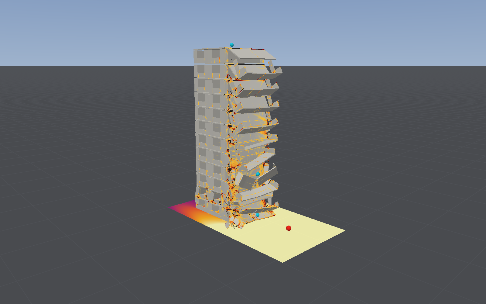
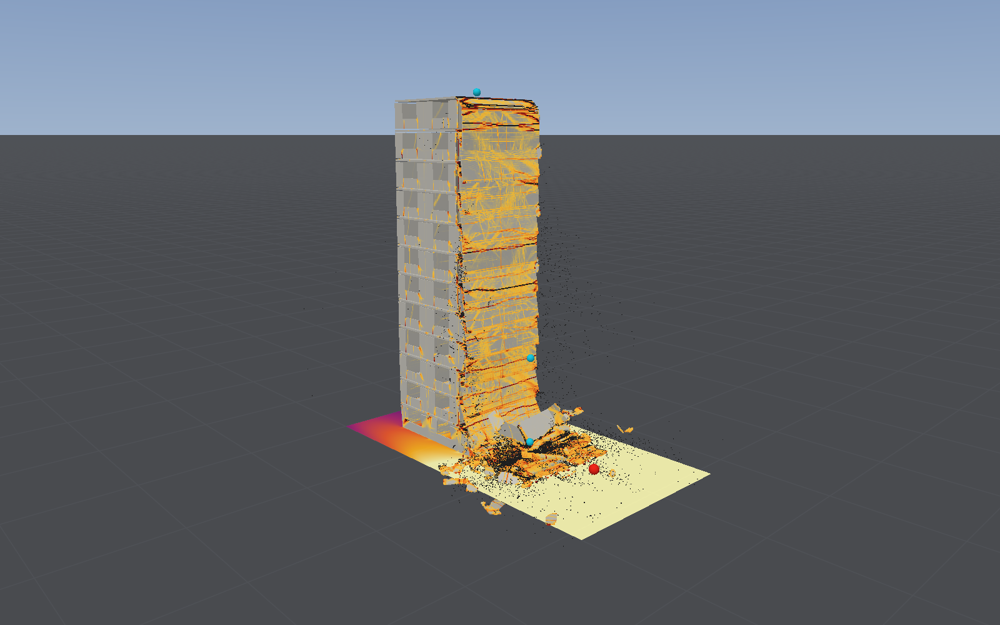

# Whole-event simulation

The aim ([emmettl/bombcad-work#36](https://github.com/emmettl/bombcad-work/issues/36)) is to carry
a building through the blast, its progressive collapse, the rubble pile and the dust cloud in one
coupled run, as at Ronan Point or Oklahoma City, and to give the collapse a standing of its own.
This page records the first step: the [large-panel block](large-panel-flats.md) under its street
charge, run past its collapse towards 10 s with failed concrete as rubble particles and the air
kept awake, measured as it goes, to find what gives out first: the contact, the time step, the
memory or the energy.

**Since (23 October 2026):** the energy no longer gives out. With the fixes of sections 3–5,
the twelve-storey run with rubble and the air awake reaches 3.5 s without blowing up, and its
budget closes: the work from outside holds at the blast's 1.4 MJ to 0.5 s, then only falls, as
contact, the joints and the ground take energy out (−4.9 MJ by 3.5 s). The 52 MJ below was the
work trace's own count and contact pumping energy in; with them gone half as many elements
fail by 3.36 s (18,000 against 39,000). Since 24 October bars that break take their steel with
their rubble, and bare elements pulled out of shape go (section 6): no node flies off; a few of a
gram or two among bare bars on the ground pass 50 m/s for a sample.
The collapse is still not earned: hourglass control does 60–76% of the elements' work.

**25 October (section 7):** that work is mostly elements warping in modes the one-point element
cannot see, at caps far below the concrete's strength, not the floors' hinges. Moving the cap
changes nothing; the element that sees those modes as strain (`--assumed-strain`) makes the work
the concrete's (hourglass control 22% of it, all in bare bars and rubble), at five times the cost,
and the twelve-storey bay comes down as far (gravity's work 20.3 against 19.0 MJ by 3.5 s), a
second sooner and in 2.6 times as many pieces; but that element's cracked concrete is too soft for
the struck beams. Stopped, with the user's decision on what to offer.

**28 October ([a range](#a-range-28-october-2026)):** the collapse is quoted as a range between the
two elements, assumed strain the more damaging end. Twelve storeys: 245–321 m² of floor down,
every storey, 21,000–54,000 elements failed, 31–80 t of rubble, nine tenths of the floor down within 1.0–2.0 s.
Three storeys: 15–79% of the floor down, 2,500–22,700 failed. Neither end is a bound: on the
member tests the measured value is outside the range four times in five, by 2–19%. The debris's
reach is not from this cause: on the hard ground it is still creeping when the runs end.

**In short (22 October 2026):** the energy gives out first. A joint between parts on a node whose
concrete had turned to rubble rang beyond the step and blew the run up at 0.62 s; that is fixed.
With it fixed, the run reaches 3.4 s, but from about 1.5 s the energy budget no longer closes: by
3.36 s the forces the work trace does not see (the air, contact, the joints and the ground) have
put 52 MJ into the body against the blast's 2, and at 3.40 s nodes holding only their bars' few
grams blow up. On the three-storey block failed elements opposite the charge blow up at 0.6 s,
with rubble or without. The contact table, the step and the memory are nowhere near their
limits. And the collapse is not earned: hourglass control does 54–61% of all the elements' work
through it.



## The run

```bash
blastbench wholeevent [--storeys 12] [--mass 500] [--dx 0.25] [--time 10] [--every 0.05]
                      [--budget 80] [--checkpoint-every 0.5] [--frames 1,2,4,6,8,10]
                      [--awake] [--no-rubble] [--dir …] [--continue] [--watch 20] [--inspect <checkpoint>]
                      [--erode-crushed-bare] [--release-bare-hourglass] [--assumed-strain]
                      [--breakdown <checkpoint>] [--outcome <checkpoint or run folder>]
```

The street preset (500 kg of TNT 8 m from the east flank wall, 670,560 solid elements of 87.5 mm,
air on 1.19 million cells of 0.25 m), with:
- **rubble particles** on (`StructureModel.rubbleParticles`, an option): failed concrete becomes
  a particle keeping its mass, pushed by the air and in contact with everything;
- **the air kept awake** (`--awake`: no sleep), as a dust cloud would need; by default the air
  sleeps as the recommended settings have it;
- **pieces of at most `--budget` minutes**: a checkpoint at the next 64-step boundary, and
  `--continue` carries on from it, the same to the bit (checked on the three-storey block, the
  resumed run's rows equal to the straight run's in every column);
- **a census at each sample** (`StructureSolver.census()`, read from the buffers between
  batches, so the run is the same with it or without it): nodes listed for contact, moved, and
  pushed; the contact table's entries holding more than its 8 slots and the nodes so left out,
  for nodes and for particles; the fastest node and particle; kinetic energy, the particles'
  internal energy and the work gravity has done; and the elements' work by mechanism from the
  work trace (`tracesWork`, started after the settle under self-weight). What those leave is the
  **net external work**, the work of everything the trace does not count: the air, the joints
  between parts, contact and the ground. While the blast loads the building it is the blast's
  work less what the joints and contact have taken; after, it should only fall.
- `--inspect <checkpoint>` lists the fastest nodes of a saved state with their mass and the
  elements round them; `--watch 20` does it at each sample with a node faster than 20 m/s, and a
  run that goes unstable does it as it stops.

Each sample's row goes to `phases.csv` in the run's folder (on StudioData,
`whole-event/run12-pairfix/`), with the frames.

## What gave out first

### 1. A joint on a node whose concrete had turned to rubble (fixed)

The first run went to NaN at **0.617 s**: a node of the east flank wall at the joint under the
second storey reached 18,363 m/s, the kinetic energy jumped from 0.09 to 0.70 MJ within 55 steps,
and the air's step went to zero. The node had 2.8 g of mass: its elements had all failed, their
concrete gone into particles, and it kept only its bars' share. Its joint pair
(`Anchorage.betweenParts`) was still as stiff as when set up for the whole node, whose mass was a
hundred times more, so its frequency was ten times what the step allows. The same had thrown
nodes at the joints' rows along the ground at 300–540 m/s from 0.2 s on.

The fix: with rubble, a pair bears in proportion to the reduced mass its two nodes have left
(`structurePairs`), which keeps its frequency where the step was set for it, and it lets go with
the concrete. Without rubble the kernel is built as before. Resumed from the checkpoint at
0.611 s, the run passed 0.75 s with its kinetic energy steady; run afresh, nothing went faster
than 12 m/s before 0.4 s, where 300–540 m/s had. The test
"A joint between parts eases as the concrete at it turns to rubble" (`RubbleParticleTests`)
fails without the fix (a node at 23 m/s from rest at 0.1) and passes with it.

### 2. The energy budget (its count fixed, 23 October 2026)

With the joint fixed, by phase (on the Studio, shared with other work; wall and GPU seconds per
second simulated; the structure's step 10.14 µs throughout):

| Phase | Wall s/s | GPU s/s | Air step | Failed (all rubble) | Nodes listed / pushed | Fastest node |
|---|---|---|---|---|---|---|
| 0–0.05 s, the blast | 606 | 598 | 103 µs | 679 | 773,700 / 512 | 12 m/s |
| 0.1–0.5 s | 655 | 648 | 114 µs | 1,416 | 774,000 / 1,413 | 119 m/s, once |
| 0.5–1 s, the east bay starts down | 984 | 942 | 119 µs | 2,510 | 774,400 / 2,498 | 33 m/s |
| 1–1.5 s | 1,164 | 1,147 | 126 µs | 3,781 | 775,300 / 2,996 | 21 m/s |
| 1.5–2 s | 847 | 833 | 138 µs | 5,405 | 776,700 / 3,421 | 31 m/s |
| 2–2.5 s | 792 | 781 | 147 µs | 9,992 | 779,100 / 7,209 | 249 m/s |
| 2.5–3 s | 1,167 | 1,152 | 147 µs | 16,092 | 782,100 / 10,852 | 249 m/s |
| 3–3.36 s | 1,443 | 1,408 | 147 µs | 39,359 | 793,900 / 27,120 | 903 m/s |
| 3.40 s | | | 0 | 42,823 | | 3 × 10⁸ m/s: blown up |

The energy, in MJ (gravity's is the work it has done since the settle):

| t (s) | Kinetic | Gravity's work | Elements' work | of which hourglass | fracture | bars | Net external work |
|---|---|---|---|---|---|---|---|
| 0.05 | 0.36 | −0.05 | 1.13 | 0.63 (56%) | 0.20 | 0.13 | 1.54 |
| 0.46 | 0.21 | 0.57 | 2.23 | 1.27 (57%) | 0.36 | 0.27 | 1.87 |
| 0.96 | 0.25 | 1.86 | 3.58 | 2.14 (60%) | 0.60 | 0.42 | 1.97 |
| 1.45 | 0.76 | 3.50 | 5.09 | 3.10 (61%) | 0.83 | 0.58 | 2.35 |
| 1.96 | 2.87 | 6.68 | 7.56 | 4.56 (60%) | 1.10 | 0.74 | 3.76 |
| 2.46 | 7.30 | 14.07 | 14.48 | 8.33 (58%) | 1.99 | 1.16 | 8.32 |
| 2.95 | 20.04 | 33.15 | 34.70 | 19.53 (56%) | 3.27 | 2.08 | 22.19 |
| 3.36 | 22.41 | 54.80 | 78.48 | 42.16 (54%) | 7.00 | 4.36 | 51.81 |

The net external work is the blast's 1.5 MJ by 50 ms, rises to 2.0 MJ by 1 s as the air keeps
loading the walls, and should then only fall, as contact, the joints' friction and the ground take
their share. It rises instead, slowly to 1.5 s, then doubling every half second: by 3.36 s
something the trace does not count has put about 50 MJ into the body, nearly as much as gravity
has. Either energy is being made, or the trace is counting work that was not done (the
elements' "elastic" channels, uncracked concrete's own stresses, read 24.5 MJ at 3.36 s, more
than ten times what the pile could store). Each accounts for the other: kinetic energy 22.4 MJ
equals gravity's 54.8 less the elements' 78.5 plus 46 from outside. The particles' internal
energy, the motion about their centres of the nodes they were made from, jumped from 0.6 to
5.7 MJ between 2.95 and 3.36 s: elements already ringing when they turned to rubble. At 3.40 s
the run went to NaN through nodes holding their bars' 0.5–7 g, some still on bare elements (bars
alone), the rest with every element round them gone.

**After the fixes of 23 October** (sections 3–5: the step limit, compaction from the confined
volume, rubble crushed and pairs capped alike, the trace at the mean of each step's stresses),
the same run (`--storeys 12 --awake --time 3.5`, 3,790 s on the Studio):

| t (s) | Kinetic | Gravity's work | Elements' work | of which hourglass | fracture | bars | Net external work | Fastest node |
|---|---|---|---|---|---|---|---|---|
| 0.05 | 0.38 | −0.05 | 1.01 | 0.58 (58%) | 0.19 | 0.14 | 1.43 | 12 m/s |
| 0.45 | 0.47 | 0.87 | 1.81 | 1.10 (60%) | 0.33 | 0.27 | 1.42 | 12 m/s |
| 0.96 | 0.53 | 2.87 | 3.29 | 2.08 (63%) | 0.62 | 0.47 | 0.96 | 52 m/s |
| 1.45 | 1.95 | 5.41 | 4.25 | 2.80 (66%) | 0.76 | 0.57 | 0.80 | 21 m/s |
| 1.96 | 4.46 | 9.31 | 5.37 | 3.60 (67%) | 0.93 | 0.68 | 0.53 | 120 m/s |
| 2.45 | 6.61 | 13.76 | 6.96 | 4.78 (69%) | 1.15 | 0.84 | −0.19 | 52 m/s |
| 2.96 | 4.09 | 17.60 | 10.73 | 7.86 (73%) | 1.52 | 1.23 | −2.77 | 41 m/s |
| 3.36 | 1.50 | 19.28 | 13.17 | 9.93 (75%) | 1.61 | 1.52 | −4.57 | 130 m/s |
| 3.51 | 1.09 | 20.03 | 13.99 | 10.59 (76%) | 1.66 | 1.63 | −4.91 | 128 m/s |

- **The budget closes.** The work from outside is the blast's 1.4 MJ and stays so to 0.5 s, then
  falls as the floors land and contact, the joints and the ground take energy out. The elements'
  elastic channels hold 0.1 MJ throughout (24.5 MJ under the old count by 3.36 s), ending a
  little below zero where the trace's correction is shared out among the mechanisms in
  proportion and where eroded elements give up what they held.
- **Less collapses.** 18,000 elements have failed by 3.36 s against 39,000: much of the old run's
  collapse after 2 s was driven by the energy contact had pumped in.
- **Still open:** bars-only nodes of 2–8 g, their elements all gone or bare, fly off at 50–130 m/s
  (one or two over 100 m/s at a time), thrown while their bare elements still held them. They
  carry tens of joules.

**On the three-storey block** (167,640 elements; `--storeys 3`), which is a quarter of the cost,
the same kind of event comes at 0.58 s, with the air asleep or awake: a cluster of the east flank
wall's bars-only nodes, a metre up, thrown at 1.9–3.7 km/s within one batch, 5 MJ into the
particles' internal energy. It is not the air's push on loose nodes (holding such a node to its
own mass as steel changed nothing, to the bit) nor the joint. Of the options for crushed bare
elements, `erodesCrushedBare` changed nothing and `releasesCrushedBareHourglass` put it off to
0.68 s and cut it to 1.6 MJ: bare elements' hourglass control is in it, but is not all of it.
**Without rubble it is worse, not better:** the same nodes, holding their whole concrete
(0.8–1.6 kg), go at 0.62 s, and the kinetic energy jumps from 0.12 to 307 MJ, two hundred times
the blast's 1.4, with nodes at 14 km/s. They are the flank wall's elements straight opposite the
charge, at its height, the first to fail. So this wall is the model's, after failure, and not the
rubble's: rubble's light nodes only add ways to reach it. The street preset's runs to 4 s without
rubble ([large-panel flats](large-panel-flats.md#a-street-charge)) had no energy budget; they may
have carried such events unseen.

**Where the extra work comes from**, sampled at 20 batch ends from 2.05 to 2.44 s on the twelve
storeys (resumed from the 2 s checkpoint with the census's power columns): the net external work
grew at 9.5 MW, while contact put in 1.3 MW on average and the joints between parts 0.85 MW,
both of which should take energy out, not put it in. Instantaneous samples of ringing forces are
noisy, but both lean positive throughout. The other 7 MW is in the air, the ground or the trace's
own count, which the census could not then tell apart (section 5 does).

### 3. Elements distorted past the step's reach (fixed, 23 October 2026)

What blew up the three-storey block's flank wall at 0.6 s was the fixed step. Without rubble, the
kinetic energy went from 0.06 to 317 MJ within one air step (0.415 ms, 41 structure substeps), and
nodes went from 5 m/s to 14 km/s (`blastbench wholeevent --step-by 1 --nodes …`, resumed from a
checkpoint at 0.604 s).

- **All six thrown nodes were corners of one element.** It was the only active one among their
  neighbours, the rest bare or eroded. The step before, it was squashed across to 3–4 cm of its
  87.5 mm and stretched along to 15 cm; its volume was barely changed, so the volume rule (a
  quarter) never removed it.
- **The cause.** The structure's step, 0.5 of an element's transit time, is set once from whole
  elements. A one-point hexahedron's highest frequency is at most c √(8 Σ|∇N_a|²) (Flanagan and
  Belytschko, 1981). A whole cube sits at 0.866 of the stable limit, 2 over it. Squeezed or
  sheared past about 13%, the substep is past its reach, and the element rings unstably:
  growth of about ×1.3 a substep took its corners from 0.15 m/s to 14 km/s in an air step.
- **The fix.** A concrete or masonry element past that limit is removed each substep, or left as
  its bars where it has any, as failed concrete is (`StructureSolver.stabilitySpeed`, the fastest
  wave the step is set from). Such an element has long since failed. A bare element past it keeps
  its bars and loses its hourglass control, whose mode shapes grow with the same gradients: that
  threw corners at about 100 m/s on the same wall a few hundredths of a second later. Metals are
  left alone, since they may strain that far before they fail and would need a shorter step, not
  removal. Elements that never get there are unchanged.
  - Test: `StepLimitTests`. At 0.55 of the transit time no whole element goes, at 0.6 all do.
    Without the check the second fails.

**After it**, on the three-storey block from the start to 1.5 s, the air asleep:

| | Fastest node, 0.3–1.5 s | Kinetic energy | Net external work, 0.3 → 1.5 s |
|---|---|---|---|
| Without rubble, before | 14,350 m/s from 0.63 s | 0.12 → 307 MJ | 1.36 → 274 MJ |
| Without rubble, after | 62–65 m/s, or 1,190 m/s (one corner node) | 0.01–0.34 MJ | 1.35 → 1.39 MJ (+3%), or → 1.76 MJ |
| With rubble, after | 11 m/s, or 1,317 m/s | up to 0.3 MJ | 1.41 → 2.14 MJ, or → 3.26 MJ |

Two builds of the same logic, whose arithmetic rounds differently (a shader edit's fast-math
codegen), give the two figures in each row: past failure the runs are chaotic.

- **The blow-up is gone.** The 14 km/s, 300 MJ event doesn't happen in either build.
- **A second mechanism remained, a corner node at the panel's free edge**, thrown at 62–65 m/s in
  one build and 1,190 m/s in the other. It is section 4.
- **With rubble the budget also drifts up without a fast node** (1.4 to 2.1 MJ to 1.5 s). That
  is the census's own question, below: the air's and the ground's work aren't yet counted apart.

### 4. Compaction counted from a distorted volume (fixed, 23 October 2026)

The corner node was traced substep by substep (`blastbench wholeevent --trace-node i,j,k` and
`--trace-element i,j,k`, which write each substep's force sources on the node and the stress,
state and force parts of one element; opt-in, compiled out when off).
- **One substep did it.** The node's one active element pushed it with 23.8 MN in a substep,
  after 100–260 N in those before; contact, ties, pairs and the air gave nothing. The
  element's stresses went from a few kilopascals to −12.6, −13.0 and −3.3 GPa, with shears in
  gigapascals, while its volume, strain rate and hourglass state didn't change.
- **The cause.** The element, cracked and distorted until its centre's volume read μ = V0/V − 1
  = 0.19, passed the test for confinement (all three normal stresses compressive, the largest
  under a fifth of the smallest) with stresses of a few kilopascals. The crushing law's
  compaction jumped from 0.003 to its μ, 0.19, and the Holmquist–Johnson–Cook curve past
  μ = 0.1 gives gigapascals.
- **The fix.** Compaction already counted from the volume an element had when last confined in
  the softer materials (block masonry, emmettl/bombcad-work#36's earlier runaway); now it does in
  structural concrete too. Concrete confined from the start, as a shock confines it, keeps its
  compaction from its undeformed volume, as before, so the default digests are unchanged.

**After it**, on the three-storey block from the start to 1.5 s, the air asleep:

| | Fastest node, 0.3–1.5 s | Kinetic energy, 0.3–1.5 s | Net external work, 0.3 → 1.5 s |
|---|---|---|---|
| Without rubble | 10 m/s | up to 0.18 MJ | 1.35 → 1.37 MJ (+1.5%) |
| With rubble | 15 m/s | up to 0.17 MJ | 1.35 → 1.58 MJ (+17%) |

- **The step-2 gate is met without rubble:** no node past 50 m/s, the budget flat to ±5%.
- **With rubble the budget still drifts**, with no fast node: section 5.

### 5. The census split, and the rubble's drift (23 October 2026)

`blastbench wholeevent --split-work` sums every node's and particle's work by each source, each
substep, over the way it actually moved (`StructureSolver.traceExternalWork`, kernels made again
with the sums compiled in, none of it when off), and writes `work-split.csv` at each sample:
- the air's work on the elements' faces, on loose nodes and on particles;
- contact on the nodes (and of it, the particles' share) and on the particles;
- the joints' pairs, the anchors and the shell links;
- the ground, damping and held axes;
- and two terms of the census's own:
  - the step's share: a node's kinetic energy at half steps changes by its force's work less ½ m |Δv|²;
  - the elements' force on their nodes less their work as the trace counts it.

The split closes to within a joule in 1.5 MJ: the conversion to rubble passes energy across
exactly. On the three-storey block, 0.3 to 1.5 s, it showed three things.

- **The blast's work is flat.** The air's work on faces is 1.31–1.33 MJ after 0.3 s, asleep or
  awake; the frozen air is not a reservoir.
- **The census counted work that was not there** (fixed the same day, below). The trace took
  each step's work with the stress after it, which counts half of each step's change in stress
  times its change in strain again, always positive. On a free elastic block set ringing with 0.19 J,
  the trace's elastic channels reached 25 J in 10 ms while the kinetic energy stayed near 0.05 J,
  and halving the step halved it. On the block it added 0.1–0.4 MJ by 1.5 s, more the more the
  body rang, without rubble too; it is why the budget without rubble read +1.5% in one build and
  +11% in another. It never moved the run, only its count.
- **With rubble, contact put energy in.** It took 254 kJ to 1.4 s, while without rubble contact
  took energy out. Two causes:
  - **A particle caged by its own element's corners.** Its reach was set from them as it was
    made, and as the body settled they closed in: 48–268 corners overlapped their particle by
    up to 2 cm. A contact's push reaches its cap (`contactKick`, 2 m/s a substep) at 0.2 mm of
    overlap, and a pair is pushed until it separates at 1 m/s, so each such corner was pushed out
    with all the cap allowed, every substep. **Fix:** a particle overlapped deeper than the cap's
    0.2 mm gives up its reach to it, as crushed debris would, and the spring's energy past it is
    lost (`rubbleForces`). Weight overlaps it by nanometres and a 5 m/s impact by a fraction of
    the depth. Test: `RubbleParticleTests.cagedParticleIsCrushed`, a particle grown into its cage
    by 14 mm; without the fix it fails.
  - **Nodes left with grams of steel.** With rubble, a node whose concrete has all gone keeps only
    its bars' share. Each node's push is capped by its own mass, so such a node pressed by a heavy
    one took less than the heavy one took back: 80 kJ as the bay landed, and in one run four 7 g
    nodes thrown at 340–770 m/s. **Fix:** with rubble, each pair of nodes' push is capped at the
    lighter's kick, the same on both (`contactForces`).
  Both are in rubble's code alone, so runs without it are unchanged, to the bit (the default
  digests, and the run above without rubble).

**After both**, on the three-storey block from the start to 1.5 s, with rubble:

| | Fastest node, 0.3–1.5 s | Net external work, 0.3 → 1.5 s | Contact's work |
|---|---|---|---|
| Before | 15 m/s | 1.35 → 1.58 MJ (+17%), old trace | +254 kJ (nodes), +17 kJ (particles) |
| After | 13 m/s | 1.21 → 1.11 MJ (−8.3%), midpoint trace | −97 kJ, −8 kJ (a split run) |

- **No fast node, and every source behaves.** The air's work is flat after the blast. Contact,
  the joints and the ground only take energy out. This is the step-2 gate's verdict, judged by the
  split: met.

**The trace at the mean of each step's stresses** (the same day). The work trace now takes each
step's work at the mean of the stresses before and after it, and the hourglass control's at the
mean of its modes' state; the excess is taken from the mechanisms in proportion to their size,
which keeps their sum exact, each mechanism's own share of it not being known apart. The block
set ringing keeps its 0.19 J within the offset of kinetic energy read at half steps (0.21–0.22 J,
flat; `ConcreteModelTests.workTraceWhileRinging`). The run is unchanged, to the bit; its count:

| Three-storey block, no rubble, by 1.5 s | Old trace | Midpoint trace |
|---|---|---|
| Elastic | 151 kJ, still rising | 59 kJ, flat from 0.3 s |
| Hourglass below its cap / at it | 137 / 760 kJ | 47 / 758 kJ |
| Fracture / bars | 277 / 237 kJ | 256 / 232 kJ |
| Hourglass's share of the elements' work | 58% | 60% |
| Net external work, 0.3 → 1.5 s | 1.35 → 1.37 MJ (+1.5%) | 1.22 → 1.17 MJ (−4.4%), flat from 0.9 s |

So the census now closes: what it leaves falls as contact and the joints' slip take energy out,
and stops when the body does. Hourglass control's share hardly moves, its work being nearly all
at its cap, where it is dissipated, not stored.

### 6. Steel that breaks goes with its rubble (24 October 2026)

After section 5, bars-only nodes of 2–8 g still flew off the twelve-storey block at 50–130 m/s.
- **Steel left on nodes.** With rubble, an element whose concrete goes but whose bars hold turns
  bare, its nodes keeping its steel's share. When those bars broke the steel stayed, so a node
  whose elements had all gone held a few grams. **Fix:** when a bare element's bars break, each
  corner no other element still holds gives its share to the particle the element's concrete
  became, with its momentum, at their centre of mass, the kinetic energy the merger cannot carry
  kept as the particle's internal energy (`rubbleConvert`, `rubbleNodes`). Moving the shares of
  corners still held as well left those nodes lighter on their bare bars, which rang: 400 m/s and
  5 MJ in the bars' channel, so they keep theirs. Test: `brokenBarsJoinTheirParticle` (without
  the fix the middle nodes keep 2–4 g).
- **Bare elements out of shape.** Traced substep by substep (`--trace-node 149,1,24
  --trace-element 149,1,24`, from the 2 s checkpoint), the node that flew fastest swung between
  43 and 76 m/s each substep, pushed by 67 kN from its one bare element. That element had been
  stretched to 0.73 m³, a thousand times its volume, and then turned inside out (−0.31 m³). Bars
  that run along one or two axes hold nothing across the third, so nothing ruptured, and a bare
  element of structural concrete went only when all its bars had; its hourglass control at its
  cap, through that shape, did the pushing. **Fix:** with rubble, a bare element squeezed below a
  quarter of its volume, turned inside out or stretched past twice it goes, its steel with it.
  Test: `barePulledApartGoes`, an element pulled apart across its bars (without the fix it stays
  bare and its nodes keep their steel).

Both are in rubble's code alone (default digests unchanged). After them:

| | Fastest node | Net external work, after the blast | Bars' work by 3.5 s |
|---|---|---|---|
| Three storeys, 0.3–1.5 s | 18 m/s | falls 1.20 → 1.12 MJ; contact, joints, ground only take energy out | |
| Twelve storeys, to 3.5 s | 21–32 m/s at most samples; 54, 66, 109 and 56 m/s at four of 70 | falls to −5.0 MJ | 1.63 MJ (no spike) |

- **The three-storey gate is met:** no node past 50 m/s, the air's work flat, and every
  dissipating source only taking energy out.
- **Still open, on twelve storeys:** single nodes of 1–2 g in bare bars lying in the debris near
  the ground reach 50–110 m/s for a sample and are slow again by the next: tens of joules at most,
  not thrown off.

### 7. Hinges two elements deep (25 October 2026)

Step 3 of emmettl/bombcad-work#36: find whether the hinges' dissipation can be made the
concrete's, at a cost a whole-event run can bear.

**Where the hourglass work goes.** `blastbench wholeevent --breakdown <checkpoint>` reads each
element's work from a saved state (the work trace's per-element sums, kept in the checkpoint) and
sorts it by part and by each element's state as saved. On the runs of section 6:

| Twelve storeys, rubble, air awake, at 3.5 s | Elements | Their work | Hourglass's share of it | Of all the hourglass work |
|---|---|---|---|---|
| Walls (2 through), cracked, concrete whole | 70,148 | 3.85 MJ | 93% | 35% |
| Floors (2 through), cracked | 106,069 | 2.58 MJ | 73% | 18% |
| Walls, bare bars | 10,833 | 2.54 MJ | 70% | 17% |
| Face walls (1 through), all states | 61,000 | 2.73 MJ | 64% | 17% |
| Walls and floors gone (rubble) | 5,342 | 1.43 MJ | 65% | 9% |
| Walls and floors uncracked | 412,019 | 0.18 MJ | 93% | 2% |
| All | 670,560 | 13.6 MJ | 76% (93% of it at the cap) | |

On three storeys at 1.5 s the shares are alike (cracked walls 44% of the hourglass work, cracked
floors 18%, face walls 14%, bare and gone 16%); at 0.5 s, in the blast, it is already 57%, half of
it in the flank and cross walls' cracked elements.

**Not hinges, mostly.** A hinge bends an element in one or two of its twelve hourglass
components (each of the four modes has three, along x, y and z, and of them six stretch the
element's fibres across its depth). The forces the elements hold at the end are spread evenly over
all twelve: in every part and state, 41–59% of their |q|² is in the six that bend, the other half
in those that warp the element (twist and shear across it), where the one-point element sees no
strain at all. And the caps they sit at are low: a cracked wall element holds its modes at a
median of 0.7 MPa (as a stress, |q| / (h²/8)), a floor's at 1.7 MPa, where the concrete's
tensile strength is 3.0. The shader caps an element's modes at the tension its centre can carry
plus its bars' yield spread through it, or at its squeeze, and for the tension it takes the
envelope at the centre's largest strain so far: E times that strain until the centre cracks. An
element squeezed or never stretched at its centre, as most of a wall under its weight is, holds
its modes at its bars (0.2 MPa in the walls), its squeeze or 0.02 f_t, and they yield there,
dissipating, far below the concrete's strength.

**What a hinge two elements deep carries** (`blastbench hinge-sections`: the block's sections bent
statically on the cracked-hex reference, emmettl/bombcad-work#20, its cap read as the shader's;
moment per metre width, kN m/m):

| Section | Through | Section analysis, at cracking / cracked | Today's element | Its hourglass control's part, cracked | Assumed strain |
|---|---|---|---|---|---|
| Wall, 142 mm²/m mesh at mid-depth | 2 | 24.0 / 3.3 | 30.6 / 2.4 | a third | 24.6 / 2.6 |
| | 4 | 25.5 / 3.6 | 27.6 / 3.3 | | 25.0 / 2.9 |
| | 8 | 26.1 / 4.4 | 26.4 / 4.4 | | 26.1 / 4.2 |
| Floor, sagging (524 mm²/m, 30 mm in) | 2 | 26.5 / 20.4 | 32.4 / 15.1 | a third | 27.0 / 18.1 |
| Floor, hogging (no top steel) | 2 | 24.2 / 3.6 | 30.0 / 2.5 | nearly all (the bars in the compressed element) | 24.3 / 1.3 |

(Cracked: at a curvature of 0.1 per metre, a rotation of 0.009 over an element. The reference as
built for #20 capped an uncracked element at the full tensile strength, unlike the shader; read
that way, today's two-through hinges would carry 2.4 times the section's moment.)

On the mesh of the whole-event runs a coherent hinge in today's element is 22–28% strong to
crack and 26–30% weak once cracked, a third of its moment in the hourglass control; the element
that bends in its cracked concrete gets the cracking right and is 11–65% weak once cracked.
Neither error is the 60–76%: the rest of the hourglass work is elements warping at their low caps.

**The routes weighed at the desk.**
1. **Refining through the thickness where elements crack or crush.** The structure is one
   lattice of one element size per body; refining an element on failure needs hanging nodes, its
   state and mass shared out, and a step half as long, for the whole body or subcycled. That is
   weeks, not a day and a half, and the table above shows what it would buy: on four through
   today's element is still 1–33% off a cracked section and the hourglass control still does a
   quarter of a hinge. Edgerton and ContinuumKit have no refinement of solids to reuse (Edgerton's
   are conforming meshes fixed before a run). Not built.
2. **A physically capped hourglass control.** Flanagan and Belytschko's viscous form would make
   the stabilisation's work rate-dependent and no more the material's; the stiffness form tied to
   the cracked modulus is `hourglassFollowsCracking`, which folds the struck beams
   ([validation](validation.md#hourglass-control)). What the breakdown points at is the cap, not
   the stiffness: an uncracked element's modes yield at its bars or 0.02 f_t. Tried as an option,
   below, and taken out: it changes nothing.
3. **Enhanced or assumed strain for cracked elements.** `assumedStrainCracking` (#20) is this
   element: Belytschko and Bindeman's assumed strain, switched on where a point would crack, with
   BombCAD's law at eight points and no hourglass control. An enhanced-strain element (Simo and
   Rifai's) bends a rectangular element the same way, so it would add nothing #20 lacked; what
   #20 lacked was a struck beam that agrees with it (20% further than its test). Its warping modes
   are strains it sees, so on the whole-event run all its work is the concrete's: run below.
4. **Shells for the slabs and walls.** `ShellSolver` has layered concrete with its bars at their
   depths, no hourglass in bending, but no rubble particles, no work trace, and joints between
   parts that act at the nodes without moments, too crude for these walls' bearings
   ([large-panel flats](large-panel-flats.md#the-building)); and on the slab test shells reach 124%
   of the measured peak where solids reach 104–115%. Making it carry a whole-event run is weeks.
   Not built.

Edgerton (read only, and its tracker emmettl/edgerton-work) has gone the other way, to 27-node
hexahedra fully integrated, for steel plates; it has no one-point element, hourglass control,
enhanced strain, refinement on failure, layered or reinforced shells, or anything on hinges, and
nothing planned on them. ContinuumKit has tetrahedra only. A change here duplicates neither.

**Route 2, tried: the cap at the face's strength until it cracks** (25 October; not kept). In
an option, the tension in an element's hourglass cap was what its most stretched face could still
carry, that face's strain being the centre's largest normal strain now plus the modes' reach
(2 |A| / h for a mode of amplitude A): the full tensile strength until it reached the onset, the
softened envelope beyond, the bars' yield and the squeeze as before. An element's modes were then
held elastically until its face would crack, and softened with that face's crack after. On the
three-storey block to 1.5 s (rubble, the air asleep, the same build):

| Three storeys, 1.5 s | Today's | The cap at the face's strength |
|---|---|---|
| Elements failed | 1,160 | 1,127 |
| Elements' work; hourglass's share | 1.37 MJ; 61% (93% of it at the cap) | 1.35 MJ; 60% (92%) |
| Cracked walls' own work in hourglass control | 60% | 59% |
| Uncracked walls' own work in hourglass control | 90% | 91% |

It changes nothing that matters: the elements that warp are warped well past their faces'
cracking strain (f_t / E is 1.1 × 10⁻⁴), so their caps soften back to their bars and their
squeeze at once, and they yield there as before. The hourglass work is not an artefact of where the cap sits; it is
the elements' deformation in modes the one-point element cannot see, and while the element cannot
see them, whatever resists them is the stabilisation's. The option was taken out again. What stays
is the record of the cap's reading: `HingeSectionTests` (CPU: the hinge two through on the
shader's reading, and an uncracked element warped in its fourth mode below cracking, held at
0.02 f_t) and `CrackedHexGPUTests.warpedElement` (the GPU's forces on that element as the
reference's, 56.7 N, the floor).


**Route 3, judged: the element that bends in its cracked concrete on the whole event.** The
existing option (`--assumed-strain`, now passed through `blastbench wholeevent`) sees the warping
as strain at its eight points, with BombCAD's law there, so whatever resists it is the concrete's.
On the large-panel block it switches nearly every element within the blast's first 50 ms (89% of
the three-storey block by 0.05 s, 93% by 1.5 s; 79% of the twelve-storey block by 0.6 s): its
cost is the whole of it, not a cracked minority.

| Three storeys, rubble, air asleep, to 3 s | Today's | Assumed strain |
|---|---|---|
| Elements' work at 3 s; hourglass's share | 1.83 MJ; 64% | 3.03 MJ; 13% (all in bare bars and rubble; cracked elements' own 0–2%) |
| Fracture and crushing; bars, at 3 s | 0.38; 0.27 MJ | 2.52; 1.46 MJ |
| Elements failed at 0.05 / 0.5 / 1.5 / 3 s | 438 / 758 / 1,160 / 1,692 | 1,561 / 2,964 / 7,928 / 15,211 |
| Gravity's work at 0.5 / 1.5 / 3 s (how far the block has come down) | 0.00 / 0.25 / 0.98 MJ | 0.05 / 1.55 / 5.45 MJ |
| Kinetic energy at 1.5 / 3 s | 0.01 / 0.40 MJ | 0.45 / 0.88 MJ |
| Fastest node after 0.3 s | 97 m/s, once | 331 m/s, once; 25–45 m/s late on |
| Wall time to 3 s | 504 s | 2,278 s (×4.5) |

On the slab tests the same element, run against today's on the same build:

| Case | Measured | Today's | Assumed strain |
|---|---|---|---|
| Contest slab, 8 through: peak; left at 70 ms | 109; 91 mm | 113 (104%); 76 mm (83%) | 122 (112%); 89 mm (98%) |
| Its hourglass share at the peak | | 6.8% | 0.03% |
| Wu's S8 / D8 (1.6 kg at 0.5 m): peak | 18.0 / 13.9 mm | 16.4 / 16.5 mm | 17.1 / 17.5 mm (S8 spalls 573 cm² underneath, 353 elements removed) |
| Run time | | 20 s; 446 / 499 s | 158 s (×7.9); 996 / 915 s (×2.0) |

and from emmettl/bombcad-work#20 (the same option): Saatci's heavy drop 47.6 mm against 39.5
measured and 39.3 today (+20%), SS0a-1 losing 621 elements against 193 (whole in the test), OA1 on
12 elements 127% against 132%, Janney 95–96% but breaking at 13–26 mm against 42.

On twelve storeys (rubble, the air awake, to 3.5 s; today's is section 6's run, which this build
reproduces to the bit in every column to 1.35 s):

| Twelve storeys | Today's | Assumed strain |
|---|---|---|
| Elements' work at 3.5 s; hourglass's share | 13.6 MJ; 76% | 8.1 MJ; 22% (bare bars 55% of it, rubble 43%; cracked elements' own 1%) |
| Fracture and crushing; bars, at 3.5 s | 1.59; 1.63 MJ | 6.12; 2.43 MJ |
| Elements failed at 0.5 / 1 / 2 / 3.5 s | 1,350 / 2,705 / 5,782 / 20,847 | 3,377 / 7,705 / 27,860 / 53,640 |
| Gravity's work at 1 / 2 / 2.5 / 3.5 s | 3.2 / 10.4 / 14.7 / 19.0 MJ | 6.2 / 16.0 / 19.5 / 20.3 MJ |
| Kinetic energy at 2.5 / 3 / 3.5 s | 6.1 / 4.3 / 0.4 MJ | 3.3 / 0.3 / 0.3 MJ |
| Net work from outside at 3.5 s | −5.0 MJ | −11.9 MJ |
| Fastest node after 0.3 s | 21.7 m/s median, 109 at most, 4 samples of 65 over 50 | 28.5 median, 127 at most, 7 over 50 |
| Wall time to 3.5 s | 2,481 s | 12,406 s (×5.0), in three pieces |



- **The hinges' work becomes the concrete's.** Fracture does three quarters of the elements' work,
  not an eighth; what hourglass control is left is in bars stripped of their concrete and in
  rubble, which the element does not switch.
- **The collapse comes down as far, a second sooner, in more pieces.** By the work gravity has
  done, how far the block's mass has come down, the east bay falls 7% further by 3.5 s (20.3
  against 19.0 MJ), but it is down by 2.5 s where today's is still falling at 3 s, and two and a
  half times as many elements fail: by 3.5 s the flank wall is cracked over its whole face and the
  bay lies as a pile of rubble at its foot. On three storeys it decides more: by 3 s today's
  block has come down a fifth as far (gravity's work 0.98 against 5.45 MJ), only starting to
  fall.
- **The count is less exact.** The trace's elastic channels end at −1.2 MJ on twelve storeys and
  −0.7 MJ on three, which stored energy cannot be: the split by mechanism is off by that much for
  switched elements (not traced further). The budget still only falls after the blast.
- **The cost is five times**, nearly every element switching in the blast's first 50 ms; 10 s of
  the twelve-storey block would be about ten hours on the Studio.

**The verdict: stopped.** No route makes the hinges' dissipation the concrete's at a cost a
whole-event run can bear while the members with tests still agree.
- Route 2 changes nothing: the work is in modes the one-point element cannot see, wherever its
  cap sits.
- Route 3 does make it the concrete's (hourglass control's part of the cracked elements' work from
  73–93% to 1%), at four and a half to five times the cost, but the same element sends Saatci's
  struck beam 20% further than its test (today's within 1%), breaks Janney's beam at 13–26 mm
  against the test's 42, and leaves Wu's two-layer slab 26% too far (today's 19%): its cracked
  concrete bends too softly under impact. A collapse it makes is the concrete's, on a concrete
  the member tests say is too soft once cracked: no more earned than today's.
- Routes 1 and 4 are weeks each, and the static sections show what the first would buy.

What the runs show for the product: how far the twelve-storey bay comes down is nearly the same
whichever mechanism takes the hinges' energy (gravity's work 19.0 against 20.3 MJ by 3.5 s), while
how it breaks up (2.6 times the elements failed, 3.9 times the fracture work) and when (a second
sooner) are not; on three storeys, nearer the margin, it decides whether the block comes down by
3 s at all.

**For the user's decision** (no default changed):
1. Record this step as stopped and keep the collapse illustrative (the record above).
2. Optionally, quote whole-event collapse as a bracket: today's element, its hinges held by the
   stabilisation, and `--assumed-strain`, held by the concrete, at five times the cost. On the
   twelve-storey block they agree within 7% on how far it comes down; on three storeys they
   differ by a factor of five and a half by 3 s.
3. The next attack on limitation 1 stays cracked concrete's stiffness and shear, now on the
   assumed-strain element, where the hourglass control no longer hides it: the cracked-stiffness
   study of 16 October was run on today's element. A bounded study would aim Saatci's heavy drops
   back within 15% with the assumed strain, the contest slab, Wu, OA1 and Janney as guards.

Runs and logs: `/Volumes/StudioData/bombcad/whole-event/hinge/` (`a0-default`, `a1-bending`,
`a2-assumed` on three storeys; `c2-assumed` on twelve, `c0-default` its baseline's first 1.35 s;
`cases/` the slab tests).

### Contact, the step and the memory: not near a limit

- **Contact.** Of the 1.07 million nodes, 774,000–795,000 are listed for contact (not buried in
  intact solid) and 512–27,000 pushed. The contact table never held more than its 8 slots in an
  entry, for nodes or for particles: no node was left out of contact at any sample. Its cost
  shows in the time per second simulated rising from 600–650 s to 1,400 s as failures went from
  700 to 39,000; at 3.4 s 6% of the elements were rubble.
- **The step.** The structure's step is fixed by its elements, 10.14 µs, from start to end; the
  air's, kept awake, grows from 103 to 147 µs (10 to 15 substeps a step). Asleep it would be
  41 substeps. Nothing in a collapse shortens it, and nothing checks it either: a flattened or
  bars-only element is held to a step set for whole concrete, which is the kind of thing that
  blew up above.
- **Memory.** 1.9–2.8 GB of process footprint and 1.20–1.22 GB on the GPU, flat: rubble keeps a
  slot for every element from the start, and the air is uniform. Checkpoints are 320–360 MB.
- **The time to 10 s.** At 800–1,450 s per second simulated, 10 s would take 2.5–4 hours on the
  Studio: two or three pieces of 80 minutes. Not a wall, once the energy holds.

## Is the collapse earned?

No. Limitation 1 is the gate the issue set ("collapse on a model that springs back is
unearned"), and the run shows why it holds here:
- **Hourglass control does most of the work.** Through the whole collapse, 58–76% of all the
  elements' work is hourglass control's (54–61% under the old count, which inflated the
  elastic channels), nearly all of it at its cap, where it dissipates; fracture does 12–19% and
  the bars 12–15%. Most of it is not the floors' hinges but elements warping in modes the
  one-point element cannot see, half in its bending components and half in its twisting and
  shearing ones, at caps of a few tenths of a megapascal (section 7). The cracked-element
  study (emmettl/bombcad-work#20, [concrete model](concrete-model.md)) found the struck beams'
  agreement leaning on the same stabilisation, and lowered their standing to low. So the energy
  the folding floors and walls take is the stabilisation's, not the concrete's.
- **The element that would make it the concrete's is too soft once cracked** (section 7): with
  it, hourglass control's share falls to 22% (none of it in cracked concrete), the bay comes down
  as far a second sooner, at five times the cost, and the struck beams go 20% further than their
  tests.
- **A finer mesh is out of reach.** Four elements through the 175 mm panels is 44 mm elements:
  eight times the elements and half the step, sixteen times the cost, some 4–6 hours per second
  simulated on the Studio.
- **The budget now closes** (section 2), so the collapse is no longer carried on energy the model
  made or miscounted; it is the hinges' that is unearned.

The collapse stays **illustrative** ([standing](standing.md#collapse)), and the whole-event
run is not ready to be offered: it would show a pile and a cloud on a collapse whose dissipation
is the mesh's.

## A range, 28 October 2026

The user's decision on section 7 (emmettl/bombcad-work#36): quote the whole-event collapse as a
range, today's element at one end and `--assumed-strain` at the other, so that a user sees how far
the collapse could be off from this one cause, the hinges' energy taken by hourglass control or by
the concrete. No default changed.

**What a user reads from a run**, measured at each saved state by `blastbench wholeevent --outcome
<checkpoint or run folder>` (`WholeEventOutcome.swift`; it reads the checkpoint and changes
nothing):
- **Extent:** the floor area down (a floor element whose concrete has gone, to rubble or bare
  bars, or whose centre has dropped more than half a storey) and sagged (dropped 0.3 m); the
  storeys losing more than 15% of their floor (Approved Document A's limit after a member is
  removed).
- **Failed elements**, by part, and the **rubble**, its mass against the block's.
- **When:** the floor area down and gravity's work at each checkpoint (every 0.5 s), the times
  gravity's work reaches half and nine tenths of its value at the end, and when the block is at
  rest (kinetic energy under 5% of its peak, staying there).
- **How far it came down:** gravity's work.
- **Debris:** the mass outside the block's plan (more than 0.5 m from it, so not walls bowing),
  beyond 2, 5 and 10 m, how far 90% and 99% of it reach and the furthest, and how much of it is
  still moving across the ground.
- **Dust:** not modelled (above).

**The cases.** The two runs of each from section 7, reused: twelve storeys (rubble, the air awake,
to 3.5 s; today's is section 6's `run12-barsc`, which section 7's build reproduced to the bit to
1.35 s; `hinge/c2-assumed`), and three storeys (rubble, the air asleep), carried on from their 3 s
checkpoints to 7 s on section 7's binary (`hinge/bin`, so the same to the bit as unbroken runs) to
see where each comes to rest. Both twelve-storey runs are at rest by 3.5 s (kinetic energy 0.4 and
0.3 MJ, from peaks of 6.3 and 7.6), both three-storey runs by 6 s.

| Twelve storeys, 500 kg at 8 m, 3.5 s | Today's element | Assumed strain | Ratio |
|---|---|---|---|
| Comes down | the east bay, all twelve storeys | the east bay, all twelve storeys | |
| Floor area down (of 1,378 m²) | 245 m² (18%) | 321 m² (23%) | 1.31 |
| Sagged 0.3 m or more | 356 m² | 425 m² | 1.19 |
| Storeys losing more than 15% of their floor | 12 (16–19% each) | 12 (17–25% each) | |
| Elements failed: floors / walls / face walls | 20,847: 1,640 / 15,169 / 4,038 | 53,640: 7,470 / 36,523 / 9,647 | 2.6 |
| Rubble (of the block's 938 t) | 31 t (3.3%) | 80 t (8.5%) | 2.5 |
| Gravity's work (how far its mass came down) | 19.0 MJ | 20.3 MJ | 1.07 |
| Nine tenths of the floor area down by | 1.5–2.0 s | 1.0–1.5 s | |
| Gravity's work at half / nine tenths | 1.96 / 2.91 s | 1.41 / 2.30 s | 0.55–0.6 s sooner |
| At rest | nearly, at 3.5 s (0.4 MJ left of a 6.3 MJ peak) | 3.0 s | |
| Debris outside the plan; beyond 2 / 5 / 10 m | 67 t; 39 / 5.9 / 0.1 t | 67 t; 40 / 2.9 / 0.3 t | 1.0 |
| Reach of 90% / 99% of it; the furthest | 4.9 / 6.0 m; 37 m | 4.2 / 7.9 m; 56 m | |
| Of it still moving faster than 0.5 m/s; mean speed | 64 t; 2.5 m/s | 61 t; 1.5 m/s | |
| Wall time | 2,481 s | 12,406 s | 5.0 |

| Three storeys, 500 kg at 8 m, 7 s | Today's element | Assumed strain | Ratio |
|---|---|---|---|
| Comes down | parts of all three floors, 10–18% of each | the second floor and the roof whole, 37% of the first floor | |
| Floor area down (of 345 m²), by floor from the first | 51 m² (15%): 10 / 16 / 18% | 273 m² (79%): 37 / 100 / 100% | 5.3 |
| Sagged 0.3 m or more | 85 m² | 325 m² | 3.8 |
| Storeys losing more than 15% of their floor | 2 | 3 | |
| Elements failed: floors / walls / face walls | 2,514: 274 / 1,869 / 371 | 22,650: 7,960 / 9,425 / 5,265 | 9.0 |
| Rubble (of the block's 235 t) | 3.8 t (1.6%) | 31.5 t (13%) | 8.3 |
| Gravity's work | 1.44 MJ | 7.15 MJ | 5.0 |
| Nine tenths of the floor area down by | 3.0–3.5 s | 2.5–3.0 s | |
| Gravity's work at half / nine tenths | 2.70 / 3.31 s | 2.52 / 3.61 s | about the same |
| At rest | 5.9 s | 4.8 s | |
| Debris outside the plan; beyond 2 / 5 / 10 m | 18 t; 15 / 14.5 / 2.0 t | 47 t; 28 / 16 / 9.2 t | 2.6 |
| Reach of 90% / 99% of it; the furthest | 10.1 / 11.8 m; 60 m | 15.1 / 16.9 m; 87 m | |
| Of it still moving faster than 0.5 m/s; mean speed | 16 t; 1.2 m/s | 13 t; 0.4 m/s | |
| Wall time to 3 s (alone on the GPU) | 504 s | 2,278 s | 4.5 |

(The three-storey runs from 3 to 7 s shared the GPU, 2,840 and 3,930 s; their times are not
compared.)

**Which way each end errs.** Not assumed; read from the runs and the member tests.
- **On these blocks, assumed strain is the more damaging end of every output but the debris's
  reach.** It brings down more floor (1.3 times on twelve storeys, 5.3 on three), fails more
  elements (2.6 and 9 times), makes more rubble and does more of gravity's work, and does it as
  soon or sooner. The debris outside the plan is the same on twelve storeys (67 t) and its reach
  goes both ways there (less beyond 5 m, further at 99%).
- **On the member tests, assumed strain errs towards too much damage, today's both ways.** With
  assumed strain Saatci's struck beam goes 20% further than its test and Wu's D8 26%, the contest
  slab peaks 12% high, Janney's beam breaks at 13–26 mm against the test's 42, and SS0a-1 loses
  621 elements where the test stayed whole; it is short only on Wu's S8 (5%) and the contest
  slab's residual (2%). Today's element is within 1% on Saatci but 19% high on D8, loses 193
  elements on SS0a-1 (still too many), and is short on the contest slab's residual (17%), S8 (9%)
  and, blind, on Mendonça's slabs, the two that collapsed left standing.
- **So assumed strain is the likely upper end for damage and the speed of collapse, and today's
  the lower; neither is a bound.** Of the five member comparisons the measured value lies between
  the two only for Saatci (at today's end); it is outside on the four others, by 2–19%, twice on
  each side. The range is the spread from one cause, the hinges' mechanism. It leaves out the
  others: cracked concrete's stiffness and shear (too soft in assumed strain, masked by hourglass
  control in today's), a mesh of two elements through that has not converged, and the chaos of
  collapse (one draw among roundings of each).
- **Where the block is near the margin the range is wide.** Twelve storeys come down either way,
  within 7% on how far and 31% on the floor area lost, but in 2.6 times as many pieces and half a
  second sooner (section 7's "a second sooner" read the kinetic energy; by gravity's work it is
  0.55–0.6 s). Three storeys lose 15% of their floor with today's element and 79% with assumed
  strain, at about the same time.
- **The debris's reach is not from this cause.** At the end of every run most of the debris
  outside the plan is still moving across the ground, at 0.4–2.5 m/s on average, a few seconds
  after the block has come to rest (the three-storey runs' 99% reach grows from 2.4 m at 3 s to
  12 m at 7 s with today's element). On the hard ground the sliding speed of a node pressed into it
  decays at 8/s, which a node chattering on and off the ground mostly escapes, so debris creeps on
  for seconds ([on the ground](structural-model.md#on-the-ground); `groundFrictionCoefficient`, the
  Coulomb friction Keys's walls are run with, is an option, off by default). How far debris reaches is the ground friction's question, not the element's,
  and is not quoted as a range.

**What it costs.** About 2.4 GPU hours: the three-storey runs from 3 to 7 s (2,790 and 3,930 s),
and reading the checkpoints (about half an hour). Everything else is section 7's runs.

**Where a user sees it.** The collapse's standing carries the range as evidence (`collapse()` in
`EvidentialStanding+Structures.swift`): "Large-panel flats, today's element against assumed
strain", with the twelve- and three-storey figures and which end errs which way. Its level stays
illustrative, with no band. The whole-event run is still not offered in the app.

Runs and tables: `/Volumes/StudioData/bombcad/whole-event/range/` (`a0-default`, `a2-assumed`
carried on to 7 s, `outcome-*.csv` and `motion-*.csv` the checkpoints read; the runs are on section
7's binary, the outcome reader on emmettl/bombcad@940ba3b2).

## Dust: what it would take

Nothing is built for dust. What it would need, from what the model has:
- **Where it comes from.** Crushing and fracture make fines in proportion to the new surface,
  so in proportion to the fracture and crushing work the trace already separates by element; and
  rubble landing makes more, in proportion to the impact energy contact takes out. A source per
  element per substep: fines mass = (fracture + crushing work) / an energy per kilogram of fines,
  and a share of each particle's impact loss. Both coefficients need data: dust sampled from a
  collapse or a demolition (to find, for data-wanted).
- **Carried by the air.** The air already carries two species alongside its state for
  afterburning, the detonation products and the oxygen, advected by the same fluxes. Dust is one
  or two more, a mass density per size class, with a settling velocity (Stokes: about 7 mm/s
  for 10 µm concrete, 0.6 m/s for 100 µm) added to its flux, and deposited on the ground and on
  the rubble where it reaches them.
- **Coupling.** Up to a few per cent by mass the dust rides the air passively. A collapse's
  cloud is denser: the falling floors push the air out at the base as a dusty gravity current,
  so its density enters the air's momentum and its weight the air's gravity (the well-balanced
  gravity option). The particles already push the air and take its push (`debrisAirForce`, the
  debris exchange); the dust adds the source and its inertia.
- **The air must stay awake** through the collapse, as here: asleep, the air is frozen and no
  cloud forms. That cost little: the awake air's step is 10–15 substeps.
- **Beyond the domain.** The cloud leaves a 31 m domain within seconds; the fireball's
  [cloud spread](fireball-rise.md) (a gravity current, then a Pasquill puff) is the hand-over
  once it does.
- **What it hides.** Optical depth from the dust's mass concentration and a mass extinction
  coefficient, marched as the fireball's volume is ([thermal radiation](thermal-radiation.md)).

```
 elements' fracture + crushing work ──┐
 particles' impact loss (contact) ────┴─► fines source ─► air cell's dust species ─► advected,
                                                                 │                     settling
                                    dust density in momentum ◄───┘                       │
                                    and gravity (dense cloud)              deposited ◄───┘
                                                                           on ground/rubble
                                    leaves the domain ─► cloud spread (gravity current, puff)
```

## Next

1. **Close the energy budget, on the three-storey block first** (a quarter of the cost, and its
   event at 0.6 s repeats: the same fastest node, to 0.1 m/s, on two builds). Find what blows up the failed
   elements opposite the charge without rubble (`--no-rubble --watch`, from its 0.5 s
   checkpoint, sampling every batch); then why contact and the joints lean positive, and what is
   left of the 7 MW (the air's work on the faces and the ground's would need counting too). With
   rubble, a candidate for the bars-only nodes: when a bare element's bars break, their mass goes
   with its particle, so that no node is left with a few grams.
2. **Then the 10 s run**, in pieces, with the residual held to a few per cent of gravity's work.
3. **Collapse earned** only after limitation 1's next attack, cracked concrete's stiffness and
   shear, not taken up; since 25 October the case for running it on the assumed-strain element,
   where the stabilisation no longer hides it (section 7).
4. **Dust** after that, as sketched.
5. **The debris's reach** needs the ground to stop it before it can be quoted: the runs of the
   range end with most of the debris outside the plan still creeping at 0.4–2.5 m/s. A pair with
   Coulomb friction on the ground (`groundFrictionCoefficient` 0.6, as Keys's walls) would say how
   much of the reach is creep; whether that becomes the default is the user's decision.
